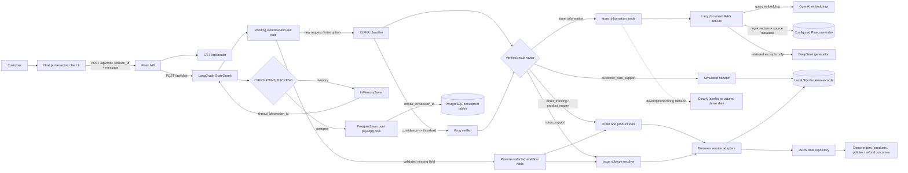
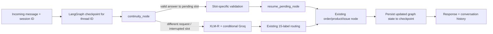

# Multilingual Ecommerce Support Agent (LangGraph)

A new, independent multilingual support application built around the existing fine-tuned XLM-R classifier and LangGraph. `Ecommerce-Support-Agentic-RAG/` is a source reference, not an assumed runnable app. Original classifier/reference projects and weights remain untouched.

## Problem and objectives

Customers need a conversational way to ask about orders, stock, payments, shipping, returns/refunds, and store policies in English or Hindi. The target combines intent verification, dialogue state, controlled service tools, retrieval, an HTTP API, and a chat UI.

- Keep existing XLM-R as primary classifier and preserve its 15 trained labels.
- Use Groq only at confidence <= 95%; fail closed if verification fails.
- Use LangGraph for routing, conversation state, and controlled tool execution.
- Selectively migrate read-only reference business logic.
- Use Pinecone/OpenAI embeddings/DeepSeek for document-based knowledge answers.
- Keep the new app independent from Rasa and reference-project imports.

## Features and intended capabilities

**Implemented:** Flask `GET /api/health` and `POST /api/chat`; optional lazy PostgreSQL/SQLAlchemy connection foundation and Alembic baseline; lazy local XLM-R and confidence-gated Groq verification; classifier-first LangGraph routing over the unchanged 15 labels; checkpointed pending workflows with same-session clarification/resumption; selectable in-memory or PostgreSQL checkpoints; sample-data order tracking and product lookup; optional read-only FakeStore product catalog; ETA-based delay explanation; issue resolver for refund status, return request drafts, damage reports, and missing-delivery investigations; simulated customer-care handoff; lazy document RAG for the existing store-information route; explicitly labeled development-only store samples when provider configuration is missing; local SQLite demo records; offline fake-provider tests.

**Not implemented:** live ecommerce integrations, API authentication/authorization and retention controls, approved RAG documents/index, RAG routing for shipping or operational issue workflows, frontend conversation persistence, or real human contact. The frontend calls the Flask chat API but does not authenticate users or store chat history. All current business data and support records are demonstrations; return and issue records do not submit anything to a retailer or courier.

## Technology stack

| Area | Technology/status |
| --- | --- |
| Runtime | Python 3.11 (environment recorded as 3.11.9) |
| API / orchestration | Flask 3.x / LangGraph 1.x StateGraph |
| Intent | Existing local XLM-R via PyTorch + Transformers |
| Verification | Groq, conditional on <=95% confidence |
| Graph memory | LangGraph `InMemorySaver` by default; optional PostgreSQL checkpointer |
| Relational database | SQLAlchemy 2.x, Alembic, psycopg 3; optional/lazy; explicit PostgreSQL business-data backend |
| Reference business services | Python functions over mock dictionaries |
| Document knowledge | OpenAI `text-embedding-3-large` + Pinecone dense index + DeepSeek `deepseek-flash`; lazy provider clients |
| Frontend | Next.js App Router, React, TypeScript and Tailwind CSS; interactive chat connected to Flask, browser-memory state only |
| Tests | `unittest`; mocks by default |

## High-level architecture



The Flask API invokes the graph for `POST /api/chat`; Python callers can also use `invoke_graph` directly. The Next.js frontend sends each turn to Flask using a conversation UUID held in browser memory. Its message list and session ID are not persisted by the frontend and are lost on refresh. The session ID is a conversation key, not authentication. Continuity, history, and pending slots are checkpointed by LangGraph thread ID. Store-information questions use RAG when configured; no approved knowledge documents or Pinecone index are included in the repository. The dashed development fallback is fictional sample data.

## Query processing flow

The implemented graph is invoked by the Next.js frontend through Flask `POST /api/chat`, or directly from Python with `invoke_graph(query, session_id)`.

```mermaid
sequenceDiagram
    participant C as Caller
    participant G as LangGraph
    participant X as XLM-R adapter
    participant Q as Groq
    participant R as Router
    participant O as OpenAI
    participant P as Pinecone
    participant D as DeepSeek
    C->>G: query + session_id
    G->>G: inspect checkpoint and pending slot
    alt valid slot answer
        G->>G: validate and resume stored workflow
    else new or interrupted request
        G->>X: classify_and_verify(query)
    X->>X: local model predicts label + confidence
    alt confidence > threshold
        X-->>R: accepted result
    else confidence <= threshold
        X->>Q: verify using actual labels/descriptions
        Q-->>R: verified, corrected, unknown, out-of-scope, or failure
    end
    R->>G: mapped branch or safe fallback
    Note over G: Order/product/issue nodes use deterministic services; only store_information enters document RAG
    opt verified store_information route
        G->>O: embed query
        G->>P: top-k vector query + metadata
        P-->>G: source-tagged retrieved excerpts
        G->>D: answer using excerpts only
        D-->>G: grounded answer
    end
    G-->>C: state + response + messages
```

Future flow: UI submits message and stable conversation ID; graph first checks pending required fields, then classifies/resumes workflow, asks clarification where needed, calls an approved read-only tool, and responds with sources where applicable. That loop is proposed only.

## Actual intent labels and graph routes

Labels come from `app/classifier/intent_mapping.json`; routing in `app/graph/routing.py` selects branches. Order/product/issue/customer-care nodes use deterministic demo fixtures/records. The existing `store_information` label invokes RAG; payment/shipping remain pending and no classifier label was added.

| Trained label | Current route | Planned scope / boundary |
| --- | --- | --- |
| `account_management` | unsupported | No account service. |
| `add_to_cart` | unsupported | Cart mutation excluded from read-only phase. |
| `billing_and_payment` | payment | Payment method/policy reads; pending now. |
| `customer_care_support` | customer_care | Records simulated handoff locally; no agent is contacted. |
| `delivery_options` | shipping | Shipping info read; pending now. |
| `issue_support` | issue_support | Resolves refund status, return draft, damage report, or missing delivery; may ask clarification. |
| `order_management` | unsupported | No update/cancel service. |
| `order_tracking` | order_tracking | Sample lookup; a missing ID is stored and resumed from the same session checkpoint. |
| `out_of_scope` | out_of_scope | Safe response; no tool. |
| `place_order` | unsupported | Order creation absent. |
| `product_inquiry` | product_inquiry | Functional sample stock lookup; ambiguous/unmatched names prompt clarification. |
| `remove_from_cart` | unsupported | Mutation absent. |
| `shipping_cost` | shipping | Shipping cost fields read later. |
| `store_information` | store_information | Grounded answer from indexed documents with source names; no-evidence response if unmatched. Missing-provider fallback is limited to explicitly labeled fictional development samples. |
| `submit_feedback` | unsupported | No feedback store. |

`UNKNOWN_ECOMMERCE_INTENT`, `UNVERIFIED`, `CLASSIFICATION_ERROR` also have safe routes. Only trusted outcomes with known final labels reach a mapped branch.

## Project layout

```text
ecom_langraph/
├── app/{api,classifier,graph,memory,rag,services,tools}/
│   └── classifier/intent_descriptions.json
├── models/xlmr_intent_classifier/  # local inference artifacts (withheld from publication)
├── data/mock/{orders.json,products.json}
├── knowledge_base/     # approved Markdown/text documents only; currently instructions only
├── docs/{system_design.md,PROJECT_PROGRESS.md}
├── frontend/          # independent Next.js App Router frontend
├── tests/              # Flask, classifier, graph tests
├── .env.example
├── .gitignore
├── requirements.txt
├── run.py
└── README.md
```

## Setup and installation

### Windows prerequisites

Install the following on a fresh Windows computer:

1. **Python 3.11.9 (64-bit):** use the [official Python 3.11.9 Windows release](https://www.python.org/downloads/release/python-3119/). In the installer, enable **Add python.exe to PATH**. Open a new PowerShell window and verify `python --version` prints `Python 3.11.9`. This project uses the `python` command; the `py` launcher is not required.
2. **Git for Windows:** install Git for Windows. Git LFS is not currently used to distribute the classifier artifacts because redistribution rights have not been established.
3. **Node.js:** install the current LTS Windows installer from [nodejs.org](https://nodejs.org/en/download). The frontend requires Node.js 20.9 or newer. Open a new PowerShell window and verify `node --version` and `npm.cmd --version` work.
4. **PostgreSQL (optional):** install a supported Windows PostgreSQL distribution from the [official PostgreSQL Windows download page](https://www.postgresql.org/download/windows/) only if using PostgreSQL business storage or persistent graph checkpoints. The default JSON business backend and in-memory checkpoint do not require PostgreSQL.

The model artifacts are excluded from publication pending rights verification. A fresh clone therefore will not have the classifier weights/configuration needed for inference. Obtain the complete model bundle through an authorized distribution method, then place it in `models/xlmr_intent_classifier/`. The application does not download model artifacts automatically. The local developer copy may contain files that are intentionally excluded from publication.

```powershell
git clone <repository-url> ecom_langraph
Set-Location ecom_langraph
```

The local fine-tuned weight is about 1.04 GiB, but neither it nor other model-derived inference artifacts are included in the publication set while redistribution rights remain unverified. Git LFS configuration is retained for possible future authorized distribution; it does not authorize or currently include the file.

From the cloned project folder in PowerShell:

```powershell
python --version
python -m venv .venv
.\.venv\Scripts\Activate.ps1
if (-not (Test-Path .env)) { Copy-Item .env.example .env }
python -m pip install -r requirements.txt
```

The application expects the model and tokenizer bundle inside `models/xlmr_intent_classifier/`; the Groq intent descriptions are in `app/classifier/intent_descriptions.json`. Loading uses `local_files_only=True`; no model is downloaded automatically. A fresh source clone cannot classify until the required artifacts are obtained through an authorized distribution method. The loader reports missing model files clearly.

## Classifier dataset provenance and redistribution status

The fine-tuned intent classifier was trained using the Hugging Face dataset identified by its owner as `monish-sd-7/E-Commerce-Customer-Intent-Detection-Dataset` ([source page](https://huggingface.co/datasets/monish-sd-7/E-Commerce-Customer-Intent-Detection-Dataset)). The dataset owner/namespace is `monish-sd-7`. The dataset page currently says “No dataset card yet” and does not display a license. The original classifier source files inspected do not independently record the training dataset ID or its terms. The dataset identity and training use are documented from the project owner's provenance information; the page was checked for its current public metadata.

No dataset license is inferred or assigned here. Permission to redistribute the dataset, the fine-tuned weights, or derived artifacts has not been established. Consequently, the original dataset, fine-tuned weights, and artifacts whose redistribution depends on those rights are withheld from publication pending permission/rights clarification. Tokenizer and intent-description files are identified as project-authored artifacts, but any applicable third-party rights should still be reviewed before distribution.

## Environment variables

| Variable | Use | Required now? |
| --- | --- | --- |
| `APP_ENV`, `APP_HOST`, `APP_PORT`, `APP_DEBUG` | Flask settings in `app/config.py` and `run.py` | No, defaults exist. |
| `SECRET_KEY` | Flask configuration for future session/security features | Not for health endpoint; set before adding sessions. |
| `CORS_ALLOWED_ORIGINS` | Comma-separated exact browser origins allowed to call the API; wildcard is rejected | Optional for non-browser/local clients; set the deployed frontend origin explicitly. |
| `NEXT_PUBLIC_CHAT_API_BASE_URL` | Public Flask API base URL read by the Next.js browser client from `frontend/.env.local` | Required for frontend chat, e.g. `http://127.0.0.1:5000`; contains no secret. |
| `MAX_CHAT_MESSAGE_LENGTH`, `MAX_SESSION_ID_LENGTH`, `MAX_CONTENT_LENGTH` | Chat text, conversation identifier, and raw HTTP body limits | No, defaults are 10,000 characters, 128 characters, and 64 KiB. |
| `XLMR_MODEL_PATH` | Local model/tokenizer directory; defaults to `models/xlmr_intent_classifier` | No, bundled default works. |
| `XLMR_LABEL_MAPPING_PATH` | Label mapping JSON; defaults to the bundled model mapping | No. |
| `XLMR_INTENT_DESCRIPTIONS_PATH` | Descriptions sent for low-confidence verification; defaults to the bundled classifier descriptions | No, bundled default works. |
| `INTENT_CONFIDENCE_THRESHOLD` | Cutoff (default 95.0); <= cutoff invokes verifier | No. |
| `GROQ_API_KEY` | Groq authentication | Only on uncertain predictions; absent key fails closed. |
| `GROQ_MODEL` | Groq verifier model | No, default configured. |
| `DATABASE_URL` | PostgreSQL SQLAlchemy URL; blank means no database access is configured | No for app startup/current business workflows; required for DB access and migrations. |
| `BUSINESS_DATA_BACKEND` | Selects `json` (default) or explicitly `postgres` for orders/products/refunds and simulated support records | No; PostgreSQL mode requires `DATABASE_URL` and migrations. |
| `CHECKPOINT_BACKEND` | Selects `memory` (default) or `postgres` for LangGraph thread checkpoints | No; PostgreSQL mode requires a valid `DATABASE_URL` and checkpoint schema setup. |
| `DB_POOL_SIZE`, `DB_MAX_OVERFLOW`, `DB_POOL_TIMEOUT_SECONDS`, `DB_POOL_RECYCLE_SECONDS`, `DB_CONNECT_TIMEOUT_SECONDS` | Bounded SQLAlchemy pool and PostgreSQL connection timeouts | No, safe defaults exist. |
| `OPENAI_API_KEY` | OpenAI embeddings during indexing and retrieval | Required only for RAG/indexing. |
| `PINECONE_API_KEY`, `PINECONE_INDEX_NAME` | Pinecone vector upsert and query | Required only for RAG/indexing; index must already exist. |
| `DEEPSEEK_API_KEY`, `DEEPSEEK_BASE_URL` | Grounded answer generation; default base URL is DeepSeek's OpenAI-compatible API | Required only when retrieved evidence is available to answer. |
| `OPENAI_EMBEDDING_MODEL`, `DEEPSEEK_MODEL` | Provider model names; defaults are `text-embedding-3-large` and `deepseek-flash` | Defaults exist. Index dimension must match embedding output (default 3072). |
| `RAG_TOP_K`, `RAG_MIN_SCORE`, `RAG_CHUNK_SIZE`, `RAG_CHUNK_OVERLAP`, `RAG_KNOWLEDGE_DIR` | Retrieval threshold/count, chunking, and local source directory | No, defaults exist; score threshold needs corpus validation. |

Keep secrets in local `.env` or a production secret manager; never commit `.env` or real credentials in `.env.example`. The sample leaves `DATABASE_URL` blank by default so copied development settings do not imply that a database is configured.

## PostgreSQL business data (Phase 4E.1 and 4E.2)

PostgreSQL access is optional and lazy. `create_app()`, importing `app.db`, and all current JSON-backed workflows work when `DATABASE_URL` is unset. A database connection is created only when `get_engine()`/`session_scope()` or Alembic is explicitly used. The connection layer rejects SQLite so local SQLite is not mistaken for PostgreSQL behavior.

### Local development

Install/start PostgreSQL locally (or use your preferred local container setup) and create a development database, for example with `createdb ecom_support_dev` or pgAdmin. Then set `DATABASE_URL` only in the ignored project `.env`:

```text
DATABASE_URL=postgresql+psycopg://<url-encoded-user>:<url-encoded-password>@localhost:5432/ecom_support_dev
```

Do not paste a real URL into this tracked README or `.env.example`. URL-encode reserved characters in usernames/passwords. Pool and connection timeout values can stay at their documented defaults for local work.

### Hosted production PostgreSQL

Provision a separate managed PostgreSQL database and provide its SQLAlchemy-compatible connection URL through the hosting platform's secret/environment configuration. Use the provider's TLS requirement (often an `sslmode=require` URL parameter) and keep credentials out of source control and logs. Tune pool limits for the provider's connection cap and the number of application workers. Never reuse the local development database or credentials in production.

`app/db/models.py` defines `products`, `orders`, `support_cases`, `return_request_drafts`, and `refund_records`. There are no customer or order-item tables because current fixtures contain no customer fields or line-item quantities. Product/order/support records retain `is_demo=true`; all supplied records remain fictional. Policies and store information remain JSON configuration. LangGraph checkpoint selection is described in Phase 4E.3 below.

JSON remains the default. To opt into PostgreSQL, set both `DATABASE_URL` and `BUSINESS_DATA_BACKEND=postgres` in the ignored `.env`; application services then read order/product/refund repositories from PostgreSQL and write simulated support/return records there. No implicit fallback occurs if PostgreSQL mode is selected and the database is unavailable. Apply migrations before selecting this mode.

### Alembic workflow

From the project root, with `DATABASE_URL` configured for the intended database:

```powershell
python -m alembic current
python -m alembic upgrade head
```

The first revision is a preserved no-op baseline. Revision `0002_business_data` adds the five business tables and can be applied to an empty PostgreSQL database:

```powershell
python -m alembic upgrade head
python -m alembic current
```

`python -m alembic upgrade head --sql` emits offline PostgreSQL SQL without connecting, but requires a PostgreSQL `DATABASE_URL` for dialect selection. Review future schema revisions before applying them.

### Import fictional JSON fixture records

After migration and explicit PostgreSQL configuration, import the existing products, orders, and refunds fixture collections:

```powershell
python -m app.db.import_demo_data --dry-run
python -m app.db.import_demo_data
```

The import is repeatable: existing primary identifiers are skipped and the source JSON is never changed. Product records are imported before their dependent orders, and demo refunds are attached only to existing demo orders; an absent or non-demo parent order is skipped. The command prints imported, skipped, and failed counts. Current fixtures contain 3 products, 4 fictional orders and 3 fictional refund records. `ORD-1004` intentionally has no refund record. The dry run reports these input counts and does not connect to PostgreSQL.

### Database tests

The normal unit tests create a PostgreSQL SQLAlchemy engine without opening a network connection and exercise URL validation, session factories, rollback/close behavior, and import safety. To test a real configured PostgreSQL connection, set `DATABASE_URL` in the environment or ignored `.env` and run:

```powershell
python -m unittest tests.test_database_connectivity -v
```

That connectivity test is skipped when `DATABASE_URL` is blank. No live PostgreSQL server was available for this phase's validation.

**Phase 4E.2 status:** Relational models, repositories, an explicit fixture importer, and opt-in service backend are implemented. JSON remains default. PostgreSQL persistence covers products, orders, refunds, demo support cases, and return drafts. Policies/store data remain JSON; LangGraph checkpoints remain in memory. PostgreSQL-specific live migration and repository behavior require a configured server and were not verified in the current environment.

## Run and test

Start Flask: `python run.py`. In a second PowerShell window:

```powershell
Invoke-RestMethod http://127.0.0.1:5000/api/health | ConvertTo-Json
```

Expected JSON: `{"status":"healthy","service":"ecom-langgraph"}`. Health does not load the model or call external services. The chat endpoint is `POST /api/chat`; see the Phase 7.3 frontend instructions below for its request contract.

Default mocked test suite:

```powershell
python -m unittest discover -s tests -v
```

Optional local-classifier smoke test (may call Groq if confidence is <= threshold):

```powershell
$env:RUN_REAL_CLASSIFIER_TESTS = "1"
python -m unittest tests.test_graph.OptionalRealClassifierSmokeTests -v
Remove-Item Env:RUN_REAL_CLASSIFIER_TESTS
```

Requires local model/descriptions and Groq credentials only if verifier is triggered.

## Phase status

| Phase | Status | Notes |
| --- | --- | --- |
| 0. Environment/workspace | Complete | Separate destination and environment. |
| 1. Flask/LangGraph base | Complete | Factory, health endpoint, simple test graph. |
| 2. XLM-R + Groq | Complete | Lazy local model, original labels, fail-closed verifier. |
| 3. Intent orchestration | Complete | Conditional routes and process-memory checkpoints. |
| 4A. Business analysis/docs | Complete | Analysis/documentation phase only; migration began in Phase 4B. |
| 4B. Order/product sample workflows | Complete | Order tracking and product availability use local demonstration JSON; no live backend. |
| 4C. Core customer support workflows | Complete (simulation) | Issue resolution, simulated handoff, store info, ETA delay detection; no real mutations or contacts. |
| 4D. Conversational continuity | Complete (process-local) | Explicit pending workflows, validated slots, interruptions, session isolation, confirmation gate. |
| 4E.1. PostgreSQL foundation | Complete (optional/lazy) | SQLAlchemy engine/session layer, psycopg driver, Alembic baseline. |
| 4E.2. PostgreSQL business data | Complete (opt-in) | Five ORM tables, repository layer, explicit demo-fixture import, JSON-default backend. Live PostgreSQL validation remains environment-dependent. |
| 4E.3. LangGraph persistence | Complete (opt-in) | Memory default or pooled PostgreSQL saver; process-restart integration test is opt-in. |
| 5.1 RAG integration plan | Complete (planning only) | Reference implementation inspected; no RAG code, providers, or dependencies added. |
| 5.2 Document RAG foundation | Complete (basic) | Lazy OpenAI/Pinecone/DeepSeek service, offline indexer and fake-client tests; now reused by the Phase 5.4 LangGraph subgraph. |
| 5.3 Agentic RAG architecture analysis | Complete (documentation) | Reference behavior and integration gaps analyzed; target design documented. |
| 5.4 Agentic RAG orchestration | Complete (bounded) | LangGraph analyze/retrieve/evaluate/rewrite/generate/fallback subgraph on the existing `store_information` route; one retry maximum and offline tests. |
| 5.5 Knowledge base and RAG quality validation | Complete (offline) | Metadata schema, separate approved/demo roots and namespaces, safe stale-vector synchronization, offline scenario report; no live retrieval-quality claim. |
| 6.1 Flask chat API | Complete | `POST /api/chat` validates inputs and invokes the existing graph; exact-origin CORS allowlist. Authentication is not included. |
| 6.2 Optional FakeStore and conversational testing | Complete (demo catalog) | Optional read-only product search/details through FakeStore; no inventory quantity. Sequential PowerShell chat scenarios. |
| 6.3 Conversational routing and refund scenarios | Complete (offline validated) | Pending slots skip XLM-R when valid; invalid slot text is classified for interruption; verified interruptions preserve and restore pending workflows; fictional refund outcomes added. |
| 7.1 Next.js frontend foundation | Complete | Responsive App Router shell and persistent system-aware themes. |
| 7.2 Interactive chat UI | Complete | Initial greeting, message bubbles, typing indicator, Enter/Shift+Enter behavior, and auto-scroll. |
| 7.3 Flask frontend integration | Complete (local API) | Configurable API base URL, one UUID per conversation, backend answers, and safe error display; no frontend persistence or authentication. |
| 8 Deployment | Planned | Production security, monitoring, evaluation and deployment hardening. |

See [system design](docs/system_design.md) and [progress tracker](docs/PROJECT_PROGRESS.md); keep them synchronized with implementation evidence.

## Known limitations

- The Next.js UI is connected to Flask, but does not persist its session ID or message history across refreshes. Session IDs do not authenticate or identify customers.
- Order/product, issue-support, and simulated handoff routes use local demonstration data. Store-information uses the bounded RAG subgraph when configured; no approved documents or Pinecone index are included. Payment/shipping and general issue-policy RAG routing remain pending.
- LangGraph checkpoints are process-local in `memory` mode. `postgres` mode persists them across process restarts; a session ID remains a checkpoint key, not authentication or authorization.
- Valid pending-slot answers, including suitable free-text details, resume without general reclassification. Invalid answers are classified once to detect a verified interruption; the current request is suspended and restored after the interruption completes. The checkpoint stores one active workflow plus suspended workflows per session. Session IDs are checkpoint keys, not authenticated identities.
- Order/product results are illustrative mock data with fixed/historical dates, not live commerce data.
- Refund fixtures contain fictional `not_initiated`, `processing`, and `completed` outcomes plus one order with no record. They are read-only demo status values; return eligibility needs manual review and return requests are local drafts only. No refund, return, email, courier, or restock integration is called.
- Reference route imports initialize Pinecone/OpenAI/RAG at module import; do not import the whole reference app.

## Phase 5.2: Basic document RAG

The Phase 5.2 foundation provides `app.rag.service.RAGService`: lazy OpenAI embeddings, Pinecone retrieval and DeepSeek grounded generation. Phase 5.4 now places a LangGraph subgraph between the unchanged `store_information` route and those reusable service methods. It evaluates evidence before generation, permits one rewritten retrieval, and otherwise returns a safe unavailable answer. Provider clients remain lazy; configuration or provider failures do not affect app imports, health checks, or unrelated deterministic workflows.

The indexer reads only UTF-8 `.md` and `.txt` files from `knowledge_base/approved/` (or `RAG_KNOWLEDGE_DIR`), chunks them, and upserts source/document metadata. It does not create an index or insert documents at application startup. Approved knowledge is empty; fictional samples are isolated in `knowledge_base/demo/` and never indexed as policy truth by the default command.

Before indexing, create a Pinecone dense index with cosine metric and dimension 3072 for the default `text-embedding-3-large` model. If you change the model, provision a matching index dimension. Then put approved documents under the knowledge directory and run:

```powershell
python -m app.rag.ingest
```

Configure `OPENAI_API_KEY`, `PINECONE_API_KEY`, `PINECONE_INDEX_NAME`, `DEEPSEEK_API_KEY`, and optionally `DEEPSEEK_BASE_URL`, `OPENAI_EMBEDDING_MODEL`, `DEEPSEEK_MODEL`, and the `RAG_*` tuning values in ignored `.env`. Defaults and placeholders are in `.env.example`. Install the two new packages through the existing setup command `python -m pip install -r requirements.txt`; this phase used `openai 3.51.0` and `pinecone 10.3.0`.

When provider configuration is missing in development only, recognized legacy store-sales/details questions may display the existing fictional sample fixture with a prominent notice. This fallback is disabled outside `APP_ENV=development`. Retrieval misses and provider failures never fall back to mock data. The RAG route does not make order/refund/return decisions. Explicit general return/refund policy questions receive a narrow route refinement to the existing store-information RAG node even when XLM-R returns `issue_support`; transactional return/refund requests remain on the support workflow. No new labels were added. See the Phase 6.3.1 notes and implementation details in [system design](docs/system_design.md#phase-631-policy-routing-and-fakestore-source-isolation).

Offline validation: `python -m unittest discover -s tests -q` ran **127 tests successfully; 2 were skipped** (the optional real-classifier/Groq smoke test and opt-in PostgreSQL checkpoint restart test). `pip check` found no broken requirements. No paid RAG provider calls were made.

## Phase 5.3: Agentic RAG analysis

Phase 5.2 is conventional retrieve-then-generate: `store_information_node` calls `RAGService.answer()` once; it embeds, queries Pinecone, filters a fixed score floor, and generates with DeepSeek or returns unavailable. It has no query analysis, rewrite/retry loop, evidence grader, or retrieval/tool decision node. Its provider clients remain lazy and tests use fakes.

The reference `rag/agents/agentic_controller.py:AgenticRAGController.query()` does implement a bounded outer loop (up to 3 hops) and a retrieval retry loop (up to 2 retries), invokes its retriever each time, asks the generator for optional tool calls, and rewrites a low-score query using the first retrieved text. But it always retrieves before generation; retrieval is not selected as an LLM tool. The only registered generator tools in `rag/agents/tools/tool_registry.py` are order-status and product-stock functions. Its “confidence” is the mean vector score from `RAGAugmenter`, not an answer or evidence-quality evaluation. No previous-turn conversation context is passed from `rasa/actions/actions.py`; the action sends only the latest message text.

Important gaps: an empty result can crash the controller at `docs[0]`; Pinecone text is nested under `metadata` while the augmenter reads top-level `text`; the “MMR” branch uses BM25 with a `search_type` label, and the optional Cohere reranker is not called by the controller; HyDE constructs an OpenAI chat model and the controller enables it on every retrieval. The generator catches failures as a generic answer, while the API may return raw errors. The reference endpoint eagerly constructs provider clients. Reference tests also contain incompatible endpoint imports/expectations, test inputs and constructor arguments, and can call real embedding APIs. Its labels in README/evaluation fixtures are not our classifier contract.

That analysis proposed a small LangGraph subgraph behind the existing `store_information` classifier route. Phase 5.4 implements it; see the section below. Transactional intents continue through the classifier-selected business workflows. RAG never infers order status, refund status, return eligibility/actions, or support-case outcomes.

Reference-project behavior and incompatibilities are documented in [system design](docs/system_design.md#24-phase-53-agentic-rag-architecture-analysis). The project does not import the reference repository at runtime.

## Phase 5.4: Agentic RAG with LangGraph

`app/rag/workflow.py` builds a small state graph used only by `store_information_node`. It analyzes the current question and may resolve a short follow-up from a safe prior user turn in the same conversation state; retrieves through the existing `RAGService`; asks DeepSeek for a strictly validated `{sufficient, reason, missing_information}` JSON assessment; then either generates from accepted excerpts, rewrites the retrieval query once and retries, or returns the fixed unavailable answer. Retrieval/provider/evaluator/rewrite/generation errors fail closed. Source filenames are attached by application code.

The evaluator considers whether excerpts directly answer the question, rather than relying on the Pinecone score average. Pinecone's existing `RAG_MIN_SCORE` filter still removes weak candidates before evidence assessment. Empty evidence is assessed as insufficient. Malformed evaluator JSON and incorrect fields are rejected; they do not trigger a retry or answer generation.

The subgraph has no business tools. The existing 15-label classifier continues to choose order tracking, products, payments, returns, refunds, damaged/missing deliveries, and customer care workflows. RAG cannot determine transactional status or execute operations. Relevant prior context is read from the current LangGraph thread only; transaction-looking prior turns are excluded from query expansion. RAG state does not write or replace pending workflow fields.

Offline tests use fake services/provider clients. Run the complete suite with `python -m unittest discover -s tests -q`; the Phase 5.4 validation ran 138 tests successfully with 2 opt-in tests skipped. No paid provider calls were made. Evidence quality still needs evaluation against approved documents and real retrieval data; there is no cross-encoder or independent answer-faithfulness verifier. The service fails closed if its single evaluator assessment is malformed or unavailable.

## Phase 5.5: Knowledge base and RAG quality validation

The knowledge tree separates approved information from fictional test content. The default approved directory is knowledge_base/approved/; it currently contains no policy documents. Demo samples are under knowledge_base/demo/: seven clearly marked fictional content documents for English/Hindi FAQ and store, promotion, shipping, return and refund examples, plus an instructions README. Demo vectors use a separate Pinecone namespace.

Markdown may start with document_id, category, language, last_updated (ISO YYYY-MM-DD), and status (approved or demo) metadata. Source path, filename, content hash and chunk index are recorded too. The format and allowed categories are described in knowledge_base/README.md.

Index approved documents with:

    python -m app.rag.ingest

For local fictional data only, set APP_ENV=development and run:

    python -m app.rag.ingest --demo

Normal app retrieval never reads the demo namespace. Local demo retrieval additionally requires RAG_USE_DEMO_KNOWLEDGE=true with APP_ENV=development. Reindexing skips unchanged content/metadata versions, writes replacements before deleting stale vectors, and deletes only IDs with this indexer's prefix in the selected namespace. If every source file was removed, the safe default is a no-op; explicitly reconcile the empty directory with:

    python -m app.rag.ingest --prune-empty

The offline scenario results are in [RAG quality report](docs/rag_quality_report.md). Fake-client tests exercise English/Hindi routes, unsupported and irrelevant questions, empty evidence, conflicting/superseded excerpts, prompt injection, retry/fallback behavior, metadata, updates, deletions and namespace isolation. The full suite ran 153 tests successfully with 2 skipped. They do not measure embedding recall, ranking quality or semantic answer faithfulness. No credentials/index or approved corpus were configured, so no live provider evaluation was performed and no demo content was uploaded. The Phase 5.2 default-namespace vectors are left untouched; the application now reads the dedicated approved namespace.

## Phase 6.1: Flask chat API

The existing Flask app now exposes `POST /api/chat`; `GET /api/health` is unchanged. Chat accepts only JSON with `session_id` and `message`, rejects extra fields (including caller-supplied `thread_id`), and enforces configured length/body limits. It calls the existing `invoke_graph(message, session_id)` helper and returns only graph `response`, `final_intent`, and `workflow_status` as the public `answer`, `intent`, and `workflow_status` fields.

Request:

    POST /api/chat
    Content-Type: application/json

    {"session_id":"conversation-123","message":"Where is my order?"}

Example response for a graph turn that needs an order ID:

    {
      "session_id": "conversation-123",
      "answer": "Please provide your order ID (for example, ORD-1001).",
      "intent": "order_tracking",
      "workflow_status": "awaiting_input"
    }

Send the next turn with the same `session_id` to resume that conversation. A different ID gets a different LangGraph thread/checkpoint. IDs are conversation identifiers only; this phase adds no authentication or owner binding, so callers must not be allowed to choose another user's ID in a public deployment.

Set `CORS_ALLOWED_ORIGINS` to an exact comma-separated allowlist, for example `https://your-frontend.vercel.app`. Wildcard origins are rejected. CORS permits JSON `Content-Type`, does not enable credentials, and does not provide authentication. Graph/provider/database failures return a generic 503 body; details are not returned to the client. Health remains independent of graph or provider readiness.

## Future scope

Connect the Next.js frontend to Flask; provide approved RAG documents and evaluate multilingual retrieval/answer quality; then add authenticated session ownership, rate limits, privacy-conscious logging, and deployment. State-changing operations remain out of scope until real APIs and confirmation/authorization safeguards exist.


## Phase 4B: working sample-data workflows

Order tracking and product lookup run through the existing `order_tracking` and `product_inquiry` labels. The graph node calls tool wrappers; the service reads the configured business repository (`BUSINESS_DATA_BACKEND=postgres` uses PostgreSQL repositories; JSON remains the local default). No reference-project package is imported at runtime.

## Phase 6.2: optional FakeStore catalog and API conversations

FakeStore is an optional read-only demo catalog. It is disabled by default. Set these values in the ignored local `.env` to enable it:

```text
FAKESTORE_ENABLED=true
FAKESTORE_API_BASE_URL=https://fakestoreapi.com
FAKESTORE_TIMEOUT_SECONDS=4
```

The lazy stdlib client calls `GET /products?limit=20` for a bounded listing/search and `GET /products/{id}` for an explicitly supplied numeric product ID. Product search filters title, description and category in process. The response is validated before it reaches graph tools. No API key or new dependency is required. FakeStore provides catalog fields (`id`, `title`, `price`, `description`, `category`, `image`) but no stock quantity, so the enabled catalog path reports inventory as unavailable instead of claiming stock. When FakeStore is enabled, a miss or provider failure is returned from that source and never falls through to local product records. When it is disabled, the configured local demonstration product source is selected directly and stock is labeled as fictional sample data.

Order tracking, refund status, return drafts, support cases and handoff do not use FakeStore. They remain routed through the existing business repository/tool services; when `BUSINESS_DATA_BACKEND=postgres`, order and support reads use PostgreSQL repositories. FakeStore does not provide the project's order IDs and we do not invent a FakeStore order endpoint. Although its API exposes demo cart routes, this project does not call them: the current graph has no supported customer-cart identity/state workflow, and its cart-related classifier intents remain unchanged.

Start the Flask app, then run the sequential user-style requests below. Each scenario gets a distinct session ID, and follow-up turns within a scenario reuse that ID:

```powershell
.\.venv\Scripts\Activate.ps1
python run.py
# In another PowerShell terminal:
.\scripts\run_chat_scenarios.ps1
```

The script covers order follow-up, product availability/search, return policy, damaged order, refund status, simulated agent handoff, unrelated input and a Hindi order conversation. These are actual HTTP requests to the Flask development server and may use whatever provider configuration is active. Routine unit tests instead use fake FakeStore HTTP responses and do not call paid LLM providers; the API integration test uses Flask's test client plus a fake catalog response. Neither is a live external-provider quality test.

Phase 6.2 validation: `.\.venv\Scripts\python.exe -m unittest discover -s tests -q` ran **174 tests successfully; 2 skipped**. The six FakeStore tests include a Flask test-client call through LangGraph with a fake HTTP response. No live FakeStore request or paid provider call was made during validation.

## Phase 6.3: pending-workflow routing and refund demonstrations

Every new message with no active pending workflow goes through XLM-R and the existing Groq verifier rules. When a workflow is pending, LangGraph first validates the expected slot: a valid order ID, unambiguous local product name, issue subtype, confirmation, or suitable free-text detail resumes directly without calling the general classifier. Slot validation checks shape/content only and does not replace intent classification. If the value is invalid, the message is classified once. A verified different request runs as an interruption while the prior pending workflow is held in the checkpointer; after the interruption completes, LangGraph restores the prior workflow and repeats its original prompt. An unverified or ambiguous response asks for clarification and keeps the pending workflow. The existing XLM-R labels and 95% confidence threshold are unchanged.

For a damaged order, the expected turns are:

```text
Customer: My order arrived damaged
Assistant: Please provide your order ID.
Customer: ORD-1001
Assistant: Please describe what is damaged.
Customer: The box was crushed and the screen is cracked.
Assistant: Records a demonstration support case; no retailer/courier claim is submitted.
```

The stored refund fixture now includes fictional statuses: `ORD-1001` is `not_initiated`, `ORD-1002` is `processing`, and `ORD-1003` is `completed`. `ORD-1004` has no refund record. These records are only read by the existing refund service; asking about a refund never initiates or changes one. The database importer skips existing identifiers, does not overwrite records, and skips a demo refund if the parent order is absent or not marked demo.

Before a database import, validate fixtures without touching PostgreSQL:

```powershell
python -m app.db.import_demo_data --dry-run
```

After confirming `DATABASE_URL` points to the intended database and migrations have been applied, import idempotently:

```powershell
$env:BUSINESS_DATA_BACKEND = "postgres"
python -m app.db.import_demo_data
Remove-Item Env:BUSINESS_DATA_BACKEND
```

For real Flask API conversations, start the app in one PowerShell window, then run `.\scripts\run_chat_scenarios.ps1` in another. The runner has separate session IDs for independent scenarios and reuses each ID for follow-up turns. The script is provided for local live testing; its scenarios are not reported as executed in this validation.

Validation: `.\.venv\Scripts\python.exe -m unittest discover -s tests -v` ran **182 tests; 2 skipped**. The database/model/import/repository tests passed, including duplicate-import and non-demo-parent protection. The skipped tests are optional integrations. No paid provider calls, live Flask-server scenario runs, or live PostgreSQL imports were performed.

The live runner is not an automated test and this phase does not claim it was run. To use it manually, start `python run.py` in one terminal, then run `.\scripts\run_chat_scenarios.ps1` from the project root in a second PowerShell terminal. Configure a working classifier/verifier and backend first if you expect real graph responses.

```mermaid
flowchart LR
    Query[Customer query] --> Classifier[XLM-R + Groq verification as needed]
    Classifier -->|order_tracking| OrderNode[Order tracking node]
    OrderNode --> OrderTool[lookup_order_status(order_id)]
    OrderTool --> OrderService[get_order_status]
    OrderService --> Repository[load_orders]
    Repository --> Orders[(data/mock/orders.json)]
    Classifier -->|product_inquiry| ProductNode[Product inquiry node]
    ProductNode --> ProductTool[check_product_stock(query)]
    ProductTool --> Search[search_products]
    Search -->|one match| Stock[get_product_stock(product_id)]
    Search -->|zero or multiple| Clarify[Ask for name / clarify candidates]
    Stock --> ProductRepo[load_products]
    ProductRepo --> Products[(data/mock/products.json)]
```

`orders.json` contains only order ID, sample status, ETA, and product ID; customer emails from the reference fixture were intentionally omitted. `products.json` normalizes records to canonical product IDs and includes display name, integer stock, and optional sample restock date. Both files identify themselves as demonstration data. All dates/quantities are examples, not current operational values.

The service interfaces are `get_order_by_id(order_id: str | None) -> dict`, `get_order_status(order_id: str | None) -> dict`, `get_product_by_id(product_id: str | None) -> dict`, `search_products(query: str | None) -> dict`, and `get_product_stock(product_id: str | None) -> dict`. Tool interfaces are `lookup_order_status(order_id: str | None) -> dict` and `check_product_stock(product_query: str | None) -> dict`. Outcomes distinguish missing/invalid IDs, not-found, ambiguous matches, unavailable data, and success. Ambiguous product candidates reveal names/IDs only; stock is returned after one product resolves. A recorded stock value of zero is valid; absent/invalid stock is never converted to zero.

Example order query: “Where is order ORD-1001?” returns a response marked **Demonstration data**, with sample status `Shipped` and the recorded historical ETA. “Where is my order?” asks for an ID and performs no repository lookup. Unknown ID `ORD-9999` reports not found without claiming success.

Example product query: “Do you have Laptop Pro in stock?” returns the sample count (8) and explicitly says it is not live inventory. “Laptop Pro or Galaxy S21” returns both candidates and asks which one; it does not expose either candidate's stock before clarification.

The services validate ID formats and return only needed order fields; customer email is not included. Product search matches candidate names/IDs without guessing on multiple matches. Repository errors become clear unavailable outcomes. The graph's unrelated payment, cart, out-of-scope, unknown, and unsupported branches do not call order/product tools.

Tests added: `tests/test_order_service.py`, `tests/test_product_service.py`, and `tests/test_business_graph.py`; prior classifier, Flask, and routing suites remain. Full suite command remains `python -m unittest discover -s tests -v`. The real-model smoke test is skipped unless explicitly enabled.

**At the end of Phase 4B:** all data were local demonstrations; pending-slot resumption, chat API, RAG, Streamlit, and production persistence had not yet been implemented. Phase 4D continuity is described below.


## Phase 4C: core customer support workflows

Phase 4C adds explicit local demo workflows without changing the classifier or its trained labels. `issue_support` resolves to one of four supported subtypes: refund status, return request, damaged order, or missing delivery. If the query is ambiguous or required fields are missing, the graph asks for clarification and does not create a record.

- **Refund status:** `data/mock/refunds.json` is deliberately empty because the reference source has no refund-status records. Known order with no record returns ?cannot confirm?; no status is inferred.
- **Return:** policy data are sample values in `data/mock/policies.json`. Missing purchase date/item condition prevents eligibility determination. A supplied reason creates only a local demo draft pending manual review; no return, pickup, or refund is submitted.
- **Damaged/missing delivery:** validated order details may create a local demo support case. The app does not claim a retailer/courier was notified or that a parcel is lost. Delay is derived only from the stored status and ETA; the fixtures contain no carrier scans.
- **Customer care:** `customer_care_support` creates a local simulated handoff record with session, reason, summary, and status. It explicitly tells the user that no live agent was contacted.
- **Store information:** answers use structured, fictional sample data in `data/mock/store_information.json`; promotional values are not live or redeemable.
- **Local case storage:** `app/services/case_repository.py` writes demonstration records to ignored `data/runtime/support_cases.sqlite3`. This is not a production ticketing system.

Current graph uses `app/graph/routing.py`, `app/graph/nodes.py`, and `app/graph/workflow.py`. Related service/tool boundaries are in `app/services/` and `app/tools/`. At the end of Phase 4B, missing-slot continuation was deferred to Phase 4D; see the implemented continuity section below. The test suite covers these branches and verifies unsupported/out-of-scope turns do not call business tools.


## Phase 4D: conversational continuity

The graph now begins with `continuity_node`, which reads the current `pending_workflow` from LangGraph state before choosing between a validated slot resumption and ordinary classifier routing. The active graph still uses the existing XLM-R/Groq classifier and the same 15 labels; no label was added or changed.

Pending state records workflow name, status, slot being requested, required slots, collected values, parent classifier intent, issue subtype, candidates, and the clarification prompt. Supported slots include order ID, product identifier/name, issue subtype, return reason, damage description, and missing-delivery details. Strict ID formats and the product repository validate structured answers. Free-text support details are collected only when the existing classifier confirms the expected `issue_support` parent intent. Ambiguous product or issue answers ask again without running the business tool.

A different request can run while an incomplete workflow is suspended. The pending workflow stays in that thread's checkpoint and can resume later. LangGraph message history is preserved per `session_id`/`thread_id`; tests verify distinct thread IDs do not share pending work. Do not treat a caller-provided session ID as authentication.



Examples now supported:

1. `Where is my order?` -> asks for an order ID -> `ORD-1001` -> resumes sample order lookup.
2. `I want to return my order.` -> asks for order ID -> `ORD-1001` -> asks for reason -> `It does not fit me.` -> creates only a local demo draft pending manual review.
3. `My order arrived damaged.` -> asks for order ID and damage details in sequence -> creates only a local demo case.
4. A pending order lookup can be interrupted by a store-information query and resumed later in the same thread.
5. An invalid order ID or ambiguous product answer asks for a correction; it does not guess or execute the workflow.

Sensitive or irreversible production actions remain unavailable. The graph state has a confirmation gate that accepts an explicit `confirm` or `cancel` response for a confirmation-pending action; no such live action/tool exists in this phase. Return, damage, missing-delivery, and handoff effects remain local simulations.

### Persistence boundary and PostgreSQL plan

At Phase 4D, `build_graph(checkpointer=None)` accepted an injectable saver and defaulted to `InMemorySaver`, so state lasted only for the current process. Phase 4E.3 now adds the opt-in PostgreSQL saver described below; session ownership/authentication and retention controls are still required before production use.

Tests: `tests/test_conversation_continuity.py` covers order/product/return/damage/missing-detail resumption, issue clarification, malformed identifiers, interrupted workflows, thread isolation, prior message context, and explicit confirmation gating. Full suite: `python -m unittest discover -s tests -v`.


## Phase 4E.1–4E.2: PostgreSQL persistence

The new `app/db/` module provides `Base`, lazy PostgreSQL `get_engine()`, `get_session_factory()`, `session_scope()`, and explicit `dispose_engines()`. `DATABASE_URL` is optional until database access is requested. Engine creation configures `pool_pre_ping`, bounded pool/timeouts, and psycopg 3; it does not connect immediately. `session_scope()` always closes sessions, rolls back on exceptions, and does not commit implicitly. SQLAlchemy sessions can be reused by future repository classes.

Alembic preserves `0001_postgresql_foundation` and applies `0002_business_data` to create the ORM tables. `app/db/repositories.py` provides safe parameterized lookups and explicit session commit/close behavior. `app/db/import_demo_data.py` imports the JSON demo fixtures idempotently.

Set `BUSINESS_DATA_BACKEND=postgres` to explicitly switch service reads and simulated support-record writes to PostgreSQL after `alembic upgrade head` and the fixture import. The default remains JSON plus the existing local SQLite simulated-record store. There is no fallback between backends. Policies and store data remain JSON. Live PostgreSQL business repository validation runs only when `DATABASE_URL` points to a migrated server.


## Phase 4E.3: PostgreSQL LangGraph checkpoints

`CHECKPOINT_BACKEND=memory` is the default and keeps `InMemorySaver` available for local work and unit tests. `CHECKPOINT_BACKEND=postgres` opts into `PostgresSaver`; it requires the existing PostgreSQL `DATABASE_URL`. This setting is independent from `BUSINESS_DATA_BACKEND`, so checkpoints can use PostgreSQL while business reads still use JSON, and vice versa.

The runtime keeps one `psycopg_pool.ConnectionPool` and one saver per process, then shares them with the cached compiled graph. Connections are checked out from the pool and reused across graph calls; the application does not open a new database connection for each message. Pool connections use psycopg 3 with autocommit and dictionary rows, as required by the checkpointer. The serializer restricts MessagePack deserialization to its safe built-in types. `close_graph_resources()` clears the cached graph and closes the checkpoint and SQLAlchemy pools; the Flask process registers this cleanup at exit.

The checkpointer package owns its checkpoint tables and its `checkpoint_migrations` version record. Alembic continues to manage only the five business-data tables; there is no duplicate checkpoint schema migration in Alembic. To explicitly initialize or update checkpoint tables, set `CHECKPOINT_BACKEND=postgres` and run:

```powershell
python -m app.graph.checkpointer_cli setup
```

The application also calls the package's repeatable `setup()` when it first constructs a PostgreSQL-backed graph, so the runtime fails clearly if the database is unavailable or lacks schema-creation privileges. It never falls back to memory.

Example local `.env` settings (use the same PostgreSQL database or a separately provisioned database; keep credentials out of source control):

```text
CHECKPOINT_BACKEND=postgres
DATABASE_URL=postgresql+psycopg://<url-encoded-user>:<url-encoded-password>@localhost:5432/ecom_support_dev
```

The process-restart integration test uses unique thread IDs and removes only those test threads. Run it only against a PostgreSQL database where checkpoint-table setup is permitted:

```powershell
$env:RUN_POSTGRES_CHECKPOINT_TESTS = "1"
python -m unittest tests.test_postgres_checkpointer_integration -v
Remove-Item Env:RUN_POSTGRES_CHECKPOINT_TESTS
```

The test invokes the graph in separate Python processes: the first leaves an order-tracking workflow awaiting an ID, and the second resumes that thread while confirming a different thread does not inherit its state. A skipped or mocked test does not establish persistence across process restarts.

Validation on the configured development PostgreSQL database: the full suite ran 110 tests (108 passed, 2 skipped); the opt-in two-process checkpoint restart/isolation test also passed separately. PostgreSQL setup was run successfully. The two full-suite skips were the optional real-classifier smoke test and the opt-in checkpoint integration test (run separately).

**Security boundary:** a `thread_id`/session ID separates checkpoint namespaces but is not authentication. Anyone allowed to submit another user's ID may be able to access that thread. The chat endpoint has no identity binding or authorization, and there is no checkpoint retention/deletion policy or encryption-at-rest configuration. Secure those before exposing persistent conversations to untrusted users.

## Phase 6.3.1: policy routing and FakeStore source isolation

The classifier and 15-label mapping are unchanged. After a verified `issue_support` result, the graph recognizes explicit general return/refund policy questions (for example, “What is your return policy?” and “How many days do I have to return an item?”) and sends those queries to the existing store-information RAG node. Transactional return requests and refund-status questions remain on the existing support route. The original prediction and final classifier intent remain in graph state. If RAG has no approved evidence or provider configuration, it returns the existing unavailable response. The approved knowledge directory currently contains no approved policy documents; fictional demo policy material is not official evidence and is not selected by default.

`FAKESTORE_ENABLED=false` explicitly selects the configured local demonstration product source. Its stock figures are fictional sample data and the response labels them as such. When enabled, FakeStore is the only product-catalogue source for that inquiry: matches may provide catalogue details, but stock quantity remains unknown; misses and API/validation failures return a catalogue-specific result without falling back to PostgreSQL or JSON product records. Order, refund, return, support-case and handoff workflows are unaffected.

With FakeStore enabled, a product name supplied after the assistant asks for one is also validated against FakeStore; pending-slot handling does not consult the local product repository. General return/refund policy queries use the existing RAG route, but approved documents must be added and indexed before the system can provide official policy content. Local fictional demo policies remain excluded from the approved namespace.

Phase 6.3.1 validation: `.\.venv\Scripts\python.exe -m unittest discover -s tests -v` passed **192 tests; 2 skipped**. Tests use mocked RAG/FakeStore behavior; no paid provider calls or live FakeStore requests were made.

## Phase 7.1: Next.js frontend foundation

The independent frontend in `frontend/` uses Next.js 16 App Router, React 19, TypeScript and Tailwind CSS 4. It has a responsive chat shell and a theme toggle that honors the system preference initially and persists the selected theme in the browser. Phase 7.2 added the interactive chat UI; Phase 7.3 connects it to the existing Flask API.

Node.js 20.9 or newer is required. To run it in PowerShell:

```powershell
Set-Location frontend
if (-not (Test-Path .env.local)) { Copy-Item .env.example .env.local }
# Edit .env.local only if Flask is not at the local default URL.
npm.cmd install
npm.cmd run dev
```

Before starting Flask, allow the exact frontend origin in the backend environment, for example `CORS_ALLOWED_ORIGINS=http://localhost:3000`. The Flask app rejects wildcard origins. If you open the frontend at another origin such as `http://127.0.0.1:3000`, add that exact origin instead.

Copy `frontend/.env.example` to `frontend/.env.local` and set `NEXT_PUBLIC_CHAT_API_BASE_URL` to the Flask base URL (local default: `http://127.0.0.1:5000`). This URL is public browser configuration; do not put credentials or API keys in frontend environment variables. Restart Next.js after changing it.

Open `http://localhost:3000`. To validate or run a production build, use another frontend terminal:

```powershell
Set-Location frontend
npm.cmd run lint
npm.cmd run build
npm.cmd run start
```

See [frontend/README.md](frontend/README.md) for the standalone frontend instructions. The frontend remains separate from Python dependencies, secrets, database configuration and business logic.

## Phase 7.2: Interactive chat UI

The page heading remains **E-commerce Customer Support** and each new page load starts with the assistant message **“Hi! How can we help you today?”**. Customers can send multiple messages with Enter or the Send button; Shift+Enter adds a line. Customer bubbles align right, assistant bubbles align left, a short typing indicator appears before each local mock reply, and the conversation scrolls to the newest message. Empty/whitespace messages are ignored, and the composer remains available while a mock reply is pending.

At the end of Phase 7.2, this phase used React component state and local mock replies. Phase 7.3 replaces those replies with the Flask response while retaining browser-only message state.

## Phase 7.3: Flask chat API integration

The frontend sends `POST ${NEXT_PUBLIC_CHAT_API_BASE_URL}/api/chat` with `{ "session_id": "<UUID>", "message": "..." }`. It uses the returned `answer` and verifies that the response `session_id` matches the current conversation. The API also returns `intent` and `workflow_status`; the current UI does not display them. Error responses use the backend's `message` field; network, malformed-response, and configuration failures appear as error messages instead of invented assistant answers.

The frontend creates a UUID on the conversation's first send, reuses it for each turn, and creates a new one after selecting **New chat**. It remains in React memory only. This ID only groups LangGraph turns and provides no authentication or customer identity. The Flask server must allow the exact browser origin through `CORS_ALLOWED_ORIGINS`.

### Manual frontend/API check

1. In a backend terminal at the project root, set the exact origin and start Flask:
   ```powershell
   $env:CORS_ALLOWED_ORIGINS = "http://localhost:3000"
   python run.py
   ```
2. In a second terminal, copy `frontend/.env.example` to `frontend/.env.local` if needed and confirm it contains `NEXT_PUBLIC_CHAT_API_BASE_URL=http://127.0.0.1:5000`.
3. Start Next.js from `frontend/` with `npm.cmd run dev` and open `http://localhost:3000`.
4. Send two distinct messages in the same chat. In browser developer tools, verify both `POST /api/chat` bodies carry the same `session_id` and their respective `message` values. The response should contain `session_id`, `answer`, `intent`, and `workflow_status`.
5. Select **New chat** and send another message; it should carry a different UUID. Confirm no credentials are sent by the frontend.
