# Multilingual E-commerce Support Assistant: Enhancement Report

**Project:** E-commerce Customer Support Assistant (LangGraph, XLM-R, Groq, Flask, Next.js)
**Branch:** `feature/accuracy-enhancements`
**Reporting period:** 20–21 November 2026
**Status:** Working end to end locally. The 20-intent classifier is training; its results are added in Section 10 when training completes.

---

## Contents

1. [Executive summary](#1-executive-summary)
2. [Project background and goals](#2-project-background-and-goals)
3. [System architecture](#3-system-architecture)
4. [Starting point and environment setup](#4-starting-point-and-environment-setup)
5. [Work timeline and commits](#5-work-timeline-and-commits)
6. [Evaluation methodology](#6-evaluation-methodology)
7. [Accuracy results](#7-accuracy-results)
8. [Features delivered](#8-features-delivered)
9. [The 10k+ multilingual dataset](#9-the-10k-multilingual-dataset)
10. [Classifier retraining (5 new intents)](#10-classifier-retraining-5-new-intents)
11. [Engineering quality and testing](#11-engineering-quality-and-testing)
12. [Parallel workstream: intent confirmation and tickets](#12-parallel-workstream-intent-confirmation-and-tickets)
13. [Research: where the field is going](#13-research-where-the-field-is-going)
14. [Known limitations and risks](#14-known-limitations-and-risks)
15. [Plan for Saturday and Sunday](#15-plan-for-saturday-and-sunday)
16. [Appendix](#16-appendix)

---

## 1. Executive summary

The assistant answers e-commerce customer questions in **English, Hindi (Devanagari), and Hinglish (Hindi in Latin letters)**. A fine-tuned XLM-R model classifies each message, an LLM (Groq) double-checks uncertain predictions, and a LangGraph state machine runs the right workflow: order tracking, refunds, returns, cancellations, and so on.

In this period the project went from "not runnable on this machine" to a measured, tested, multilingual system with new capabilities.

| Metric | Before | Now | Change |
|---|---|---|---|
| End-to-end pass rate (133-case benchmark) | 84.2% | **92.5%** | **+8.3 pts** |
| `issue_support` pass rate | 69.0% | **100%** | +31.0 pts |
| `product_inquiry` pass rate | 81.8% | **100%** | +18.2 pts |
| Hindi pass rate | 66.7% | **81.0%** | +14.3 pts |
| Hinglish pass rate | 79.2% | **91.7%** | +12.5 pts |
| Route accuracy | 85.7% | **92.5%** | +6.8 pts |
| Response-content checks | 85.2% | **96.3%** | +11.1 pts |
| Intents the assistant understands | 15 | **20** (model training) | +5 |
| Intents with a real handler (not "unsupported") | 9 | **16** | +7 |
| Labelled evaluation cases | 0 | **371** | — |
| Generated training examples | 0 | **11,898** (+6,000 original) | — |
| Automated unit tests | 197 | **227** | +30 |
| Code changed | — | 45 files, +8,369 / −104 lines | 3 commits |

Three findings drive the next steps:

1. **Most remaining errors come from the classifier being confidently wrong.** In the benchmark, every intent mistake had confidence of 95% or more, so the Groq check never ran. Retraining and calibration (Section 10) target this directly.
2. **The rules after classification were the cheapest big win.** One structured LLM call fixed every Hindi/Hinglish issue-type failure, which accounts for most of the +8.3 points.
3. **The Groq free tier is an operational risk.** Its 200,000 tokens/day allowance ran out during the 326-case evaluation run. We added a confidence-based fallback and cut the tokens per call by about two-thirds (Section 8.8).

---

## 2. Project background and goals

Customers ask support questions in mixed languages and informal phrasing. The assistant must:

- **understand intent** across English, Hindi, and Hinglish;
- **run the correct workflow safely**: deterministic code for orders and refunds, never an LLM improvising account actions;
- **remember the conversation**, so "ORD-1002" after "track my order" completes the earlier request;
- **fail safely**: when unsure, ask rather than guess.

**Design principles carried through this work:**

| Principle | How it shows up |
|---|---|
| Classifier first, LLM second | XLM-R runs locally on every message; Groq is consulted only when confidence ≤ 95% |
| Deterministic business actions | Order, refund, cancellation, and exchange logic is plain Python over demo data |
| Fail closed, but not uselessly | Unknown or unverified requests get a safe reply, now with alternatives the bot *can* do |
| Measure before claiming | Every change is checked against the evaluation suite and compared with the saved baseline |

---

## 3. System architecture

### 3.1 Component overview

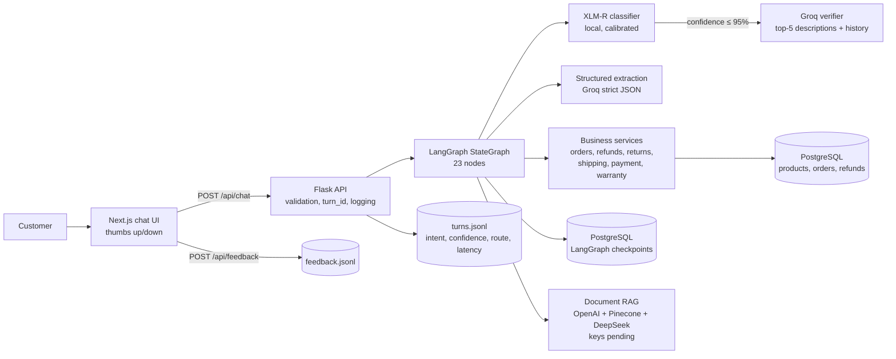

### 3.2 LangGraph state machine

The graph below is a simplified view of `docs/langgraph_architecture.mmd`, which is generated directly from the compiled graph so it always matches the code.

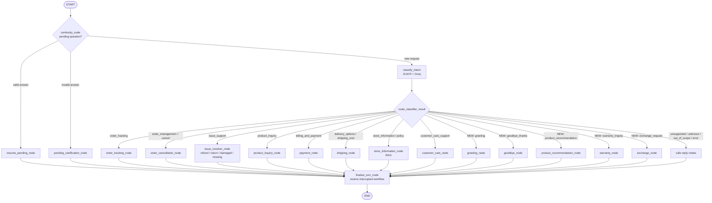

### 3.3 One message, end to end

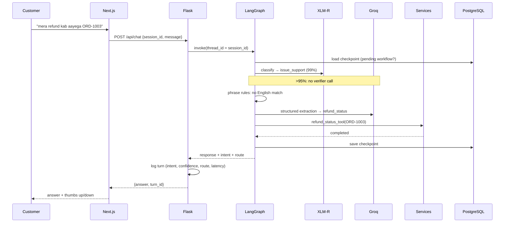

### 3.4 Classification decision flow (after this work)

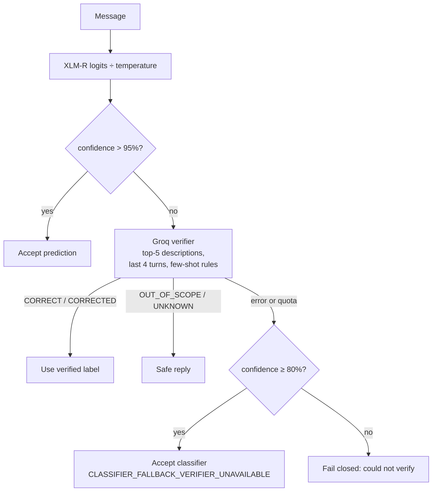

---

## 4. Starting point and environment setup

The repository was cloned onto a Mac (Apple M4, 16 GB) with no prior setup. We found and fixed these problems:

| # | Problem found | Resolution |
|---|---|---|
| 1 | Only system Python 3.9; project needs 3.11 | Homebrew Python 3.11 plus a project `.venv`, all requirements installed |
| 2 | No PostgreSQL server | Homebrew PostgreSQL 16 as a service; `postgres` role and `ecom_support_dev` database; Alembic migrations to `0002`; 10 demo records imported |
| 3 | XLM-R weights missing (withheld from Git) | User supplied the files; moved into `models/xlmr_intent_classifier/` (gitignored) |
| 4 | Browser blocked by CORS (`CORS_ALLOWED_ORIGINS` empty) | Allowed `http://localhost:3000` and `http://127.0.0.1:3000` |
| 5 | Stale Flask process holding port 5000 | Found by PID and stopped |
| 6 | Conversations lost on restart | `CHECKPOINT_BACKEND=postgres`; verified a conversation resumes after a server restart |

**Verified state:** all tests pass; the API health check responds; English, Hindi, and Hinglish chats work through the UI.

---

## 5. Work timeline and commits

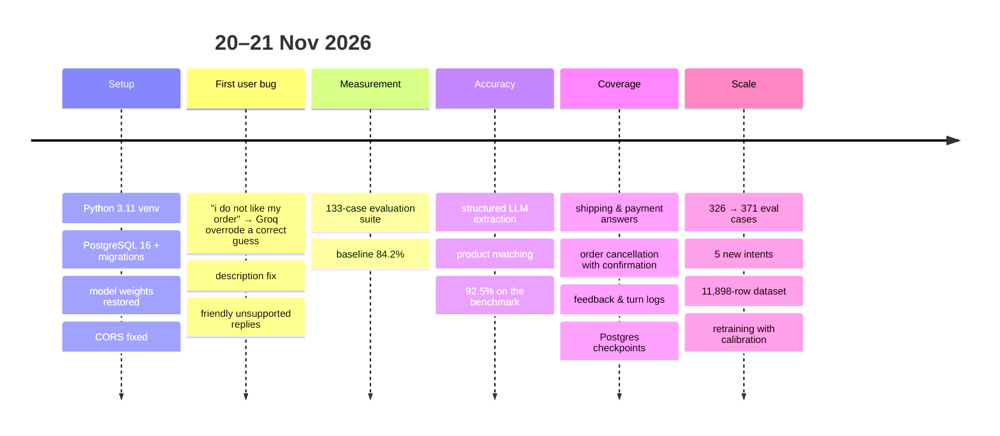

| Commit | Summary | Files |
|---|---|---|
| `fb07a4d` | Evaluation suite (133 cases), runner, baseline; issue_support description fix; friendly unsupported replies | 10 |
| `4a686a4` | Structured extraction, product matching, context-aware verifier, shipping/payment, cancellation, turn log, feedback API and UI, 326 cases, offline test isolation | 28 |
| `4ec6e93` | 5 new intents and handlers, dataset builder, ~1.9k templates, trainer with calibration, offline comparison, verifier fallback, top-5 descriptions, LangGraph diagram | 25 |

---

## 6. Evaluation methodology

### 6.1 Why an evaluation suite first

Before this work, nobody could say how accurate the bot was; failures were found one message at a time. We built a labelled suite and a runner so that **every change is measured against a saved baseline**.

### 6.2 Case format

Each line of `evals/cases.jsonl` is one scenario:

```json
{"id": "is-hg-01", "lang": "hinglish", "turns": ["mera refund kab aayega"],
 "intent": "issue_support", "route": "issue_support:refund_status",
 "contains": [], "entities": {"issue_type": "refund_status"}, "tags": ["refund"]}
```

- `intent`: the correct label for the first turn, or a list when two are genuinely acceptable
- `route`: the correct graph route after the last turn (`*` = prefix match)
- `contains`: facts the reply must mention (e.g. "Shipped" for ORD-1001)
- Expected values describe **what a correct bot should do**, never what the bot currently does

### 6.3 What the runner reports

| Metric | Meaning |
|---|---|
| Overall pass rate | Intent, route, and response checks all correct |
| Intent accuracy (final) | After the Groq check |
| Intent accuracy (XLM-R only) | Before Groq, to show whether Groq helps or hurts |
| Route accuracy | The right workflow ran |
| Response checks | The reply contains the required facts |
| Groq rate, fixed, broke | How often Groq is consulted and its net effect |
| Latency p50 / p95 | Typical and slow-case response time |
| Breakdowns | Per intent, per language, per tag; top confusions; every failure listed |

### 6.4 Evaluation set composition (371 cases)

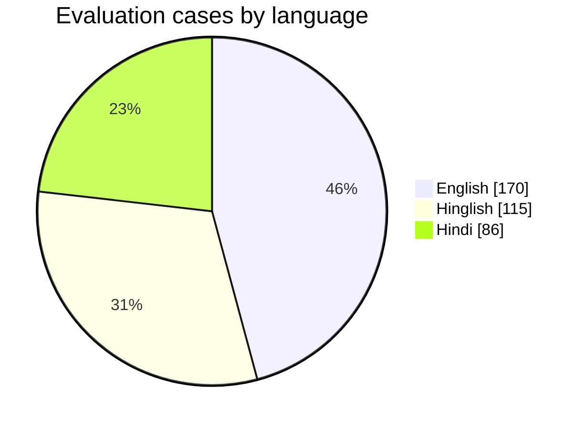

The set includes 27+ multi-turn conversations, typos, very short messages ("refund?"), long rambling ones, and angry or polite tones, across all 20 intents.

---

## 7. Accuracy results

### 7.1 Benchmark: before and after (133 cases)

| Intent | Cases | Before | After |
|---|---|---|---|
| account_management | 7 | 100.0 | 100.0 |
| add_to_cart | 5 | 100.0 | 100.0 |
| billing_and_payment | 8 | 100.0 | 100.0 |
| customer_care_support | 8 | 87.5 | 87.5 |
| delivery_options | 7 | 100.0 | 100.0 |
| **issue_support** | 29 | **69.0** | **100.0** |
| order_management | 7 | 85.7 | 85.7 |
| order_tracking | 13 | 92.3 | 92.3 |
| out_of_scope | 8 | 100.0 | 100.0 |
| place_order | 6 | 83.3 | 83.3 |
| **product_inquiry** | 11 | **81.8** | **100.0** |
| remove_from_cart | 5 | 80.0 | 80.0 |
| shipping_cost | 7 | 100.0 | 100.0 |
| store_information | 6 | 50.0 | 50.0 |
| submit_feedback | 6 | 66.7 | 66.7 |
| **Overall** | **133** | **84.2** | **92.5** |

```mermaid
xychart-beta
    title "Pass rate by language (%)"
    x-axis ["English", "Hindi", "Hinglish", "Overall"]
    y-axis "Pass rate" 0 --> 100
    bar [89.8, 66.7, 79.2, 84.2]
    bar [95.5, 81.0, 91.7, 92.5]
```

*(First bar per group = before, second = after.)*

### 7.2 Where the remaining 10 failures come from

All 10 remaining benchmark failures are **confident classifier mistakes** (95.3%–99.6% confidence), so Groq never saw them:

| Message | Expected | Model said (confidence) |
|---|---|---|
| "when is your next sale?" | store_information | order_tracking (97.0%) |
| "अगली सेल कब है?" | store_information | order_tracking (99.4%) |
| "this bot is useless, get me a human" | customer_care_support | account_management (97.9%) |
| "मैं अपना फीडबैक देना चाहता हूँ" | submit_feedback | billing_and_payment (98.7%) |
| "cart se laptop hata do" | remove_from_cart | issue_support (99.1%) |

This is why the next lever is **retraining plus calibration**, not more rules.

### 7.3 Groq's contribution

| Measure | Value |
|---|---|
| Messages sent to Groq | 11.3% |
| Labels Groq changed | 3 |
| Changes that fixed an error | 3 |
| Changes that broke a correct answer | 0 |

Groq helps whenever it is consulted. The problem is that the classifier does not ask it often enough.

### 7.4 The 326-case run and the Groq quota

A full run of the expanded 326-case set was **invalidated** by the Groq free tier's daily limit (200,000 tokens/day for `openai/gpt-oss-20b`):

| Segment | Cases | Groq status | Pass rate |
|---|---|---|---|
| Cases 1–132 | 132 | working | **91.7%** (consistent with 92.5%) |
| Cases 133–326 | 194 | quota exhausted, 60 `UNVERIFIED` | not a valid measurement |

The response was engineering, not hiding the number:

- a confidence fallback, so a quota outage no longer blocks confident answers;
- top-5 label descriptions instead of all 15, about two-thirds fewer tokens per call;
- a `--delay` option for evaluation runs.

The full 371-case run is scheduled once the quota resets (Section 15).

### 7.5 Latency

| Path | p50 | p95 |
|---|---|---|
| Classifier only (most messages) | ~18–20 ms | — |
| With a Groq call | ~1–3 s normally | 10–15 s under burst rate-limiting |

---

## 8. Features delivered

### 8.1 Friendlier "not supported" replies

**Before:** *"The 'order_management' request was recognized, but this application does not yet support that operation. No business operation was performed."*
**After:** *"I can cancel an order that hasn't shipped yet, but I can't change the items in an order from this chat. I can check an order's status, help with a return, refund, damaged or missing item, look up product availability, or connect you with a support agent."*

The reply never shows internal labels and always offers something the bot can do. A test enforces both.

### 8.2 Structured LLM extraction

The issue resolver's phrase rules were English-only, so every Hindi or Hinglish refund, damage, or missing-parcel message ended in "which issue is this?".

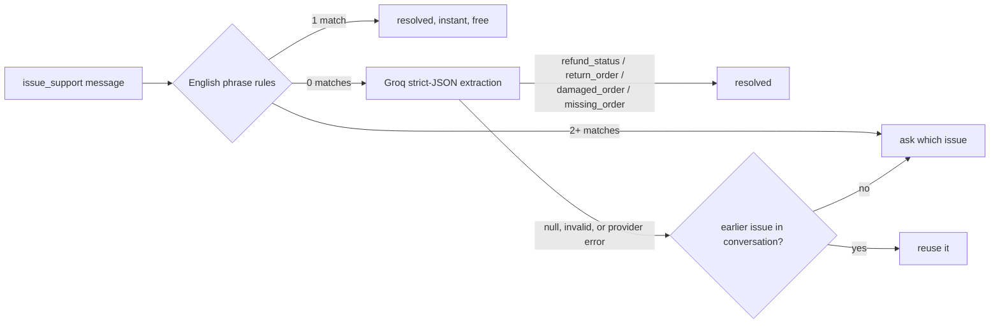

Safety properties:

- the JSON schema restricts the answer to the 4 issue types or null;
- an order ID is kept only if it literally appears in the message, so the model cannot invent one;
- any failure falls back to the old behaviour;
- clear English messages never trigger a network call.

### 8.3 Product matching

- Plurals and typos match without any LLM call: "laptops" → Laptop Pro, "headphnes" → Noise-Cancelling Headphones.
- Category words ("phone", "earphones", "laptop wala") go to a constrained LLM call that can only return an exact catalogue name.
- Result: `product_inquiry` went from 81.8% to 100%.

### 8.4 Context-aware, cheaper Groq verification

- **Few-shot boundary rules** for the confusions we measured: sale questions are store_information, angry requests for a human are customer_care, and complaints about a received item are issue_support.
- The **last 4 turns** of the conversation, so follow-ups like "and that one?" are understood.
- **Only the top-5 candidate labels are described** (all labels stay selectable), about a third of the tokens.

### 8.5 Shipping and payment answers

These replaced "integration pending" placeholders with answers from `data/mock/shipping_payment.json`:

| Question | Answer includes |
|---|---|
| "do you deliver to Pune?" / "क्या आप बैंगलोर में डिलीवरी करते हैं?" | city coverage (English and Devanagari spellings), methods, same-day where available |
| "how much is shipping?" | ₹49 standard (free above ₹499), ₹149 express, ₹199 same-day |
| "can you deliver internationally?" | India only |
| "can I pay with UPI?" / "invoice chahiye" | UPI, cards, net banking, PayPal, COD up to ₹10,000; invoice by email and in order details |

### 8.6 Order cancellation with confirmation (human-in-the-loop)

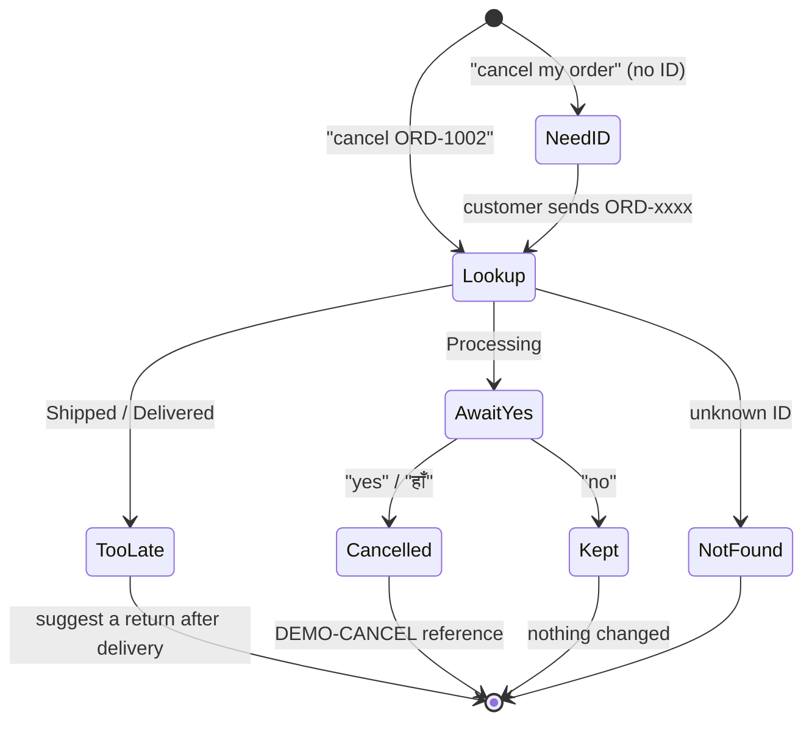

Cancellation-fee questions and item changes deliberately stay on the polite "not supported" reply. Five tests cover the flow, including the Hindi path.

### 8.7 Monitoring and feedback loop

- Each chat reply carries a `turn_id`. The API logs intent, confidence, verifier status, route, and latency, and appends the record to `data/runtime/turns.jsonl`.
- `POST /api/feedback` stores thumbs up/down with the message and answer in `data/runtime/feedback.jsonl`.
- The UI shows 👍/👎 under every answer.

**Why it matters:** every 👎 is a labelled example of a failure, which is exactly the data the next retraining round needs.

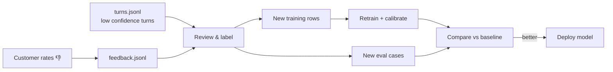

### 8.8 Resilience to Groq outages and quota

| Situation | Before | After |
|---|---|---|
| Groq down, model 85% confident | "I could not verify the intent" | Answer served, flagged `CLASSIFIER_FALLBACK_VERIFIER_UNAVAILABLE` |
| Groq down, model 60% confident | refuse | still refuse (safe) |
| Tokens per verification call | all 15 descriptions | top-5 only (≈ −66%) |

The threshold is configurable with `VERIFIER_FALLBACK_MIN_CONFIDENCE`; setting it above 100 restores strict fail-closed behaviour.

### 8.9 Persistent conversations

LangGraph checkpoints moved to PostgreSQL. We verified it: start a conversation, restart the server, send "ORD-1001", and the original order lookup completes.

### 8.10 Five new intents and their handlers

| Intent | Example | Handler behaviour |
|---|---|---|
| `greeting` | "namaste" | Welcome plus what the bot can do |
| `goodbye_thanks` | "thanks, that's all" | Polite close |
| `product_recommendation` | "gaming ke liye konsa laptop lena chahiye" | Suggests in-stock items, focused on the mentioned category |
| `warranty_inquiry` | "Laptop Pro warranty kitni hai?" | 24-month coverage details and the claim process |
| `exchange_request` | "size chhota aa gaya, exchange karwana hai" | Asks for the order; exchange only if delivered, otherwise suggests cancel or wait |

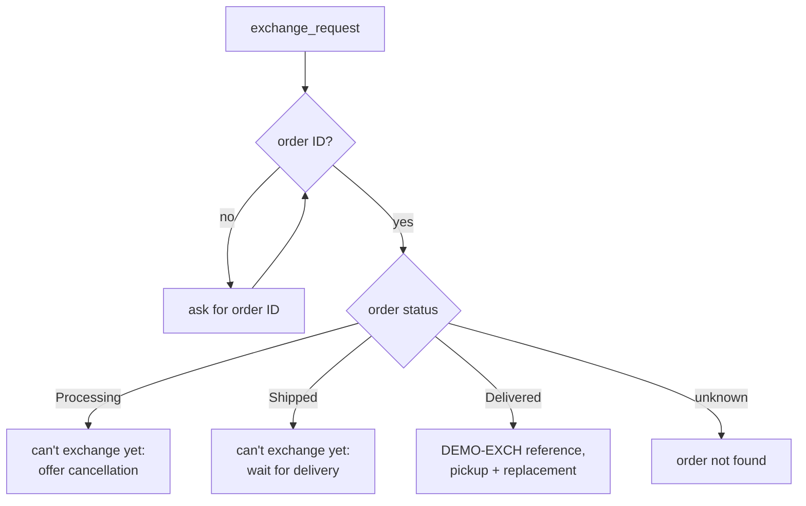

---

## 9. The 10k+ multilingual dataset

### 9.1 Pipeline

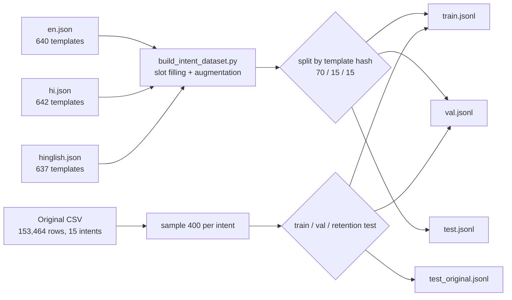

### 9.2 Design choices

- **Balanced ("distributed") across 20 intents × 3 languages:** about 600 examples per intent and about 4,000 per language.
- **Template-level split:** every template belongs to exactly one split, so **test sentences never share a template with training sentences.** The build verifies this: `test_rows_sharing_a_train_template = 0`.
- **Slot filling:** values like `{product}`, `{city}`, `{order_id}`, `{payment_method}`, `{size}`, and `{color}` are filled per language, with Devanagari cities for Hindi and romanised spellings for Hinglish.
- **Augmentation:** lowercase without punctuation (25%), a realistic adjacent-letter typo (15%, Latin scripts), and fillers like "pls / yaar / जी" (10%).
- **Original data mixed in:** 400 rows per original intent keep what the model already knew (no forgetting), plus a separate retention test.
- **Held-out integrity:** template writers were given the evaluation set and told not to copy or lightly reword it; overlap was checked by string similarity.

### 9.3 Numbers

| Split | Rows |
|---|---|
| train | 12,900 |
| val | 2,326 |
| test (generated, unseen templates) | 1,772 |
| test_original (retention) | 900 |
| **Total** | **17,898** (11,898 generated + 6,000 original) |

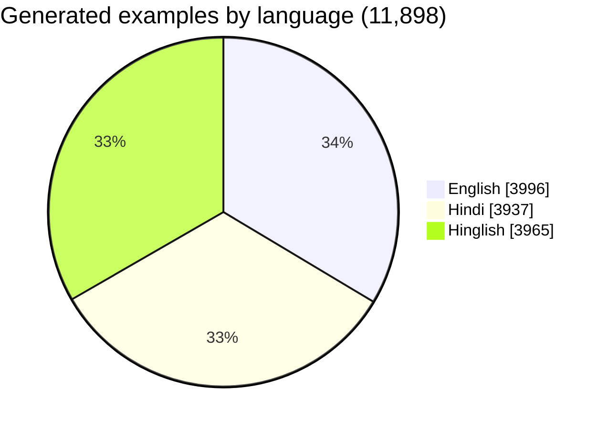

Every intent has 570–600 generated examples. The minimum is `delivery_options` (570), limited by how many unique variants its templates allow.

---

## 10. Classifier retraining (5 new intents)

### 10.1 Approach

| Choice | Reason |
|---|---|
| Warm start from the current model | Keeps everything the encoder learned; copies the 15 trained output rows and learns only 5 new rows from scratch |
| Class-weighted loss | New intents have fewer examples than old ones (no original data exists for them) |
| AdamW, lr 2e-5, linear warmup 6%, 3 epochs, batch 32, max length 64 | Standard, stable fine-tuning settings for XLM-R base |
| Best epoch by validation macro-F1 | Guards against overfitting to the template style |
| **Temperature scaling** on validation logits | Fixes overconfidence, so the 95% Groq threshold means something |
| Apple M4 GPU (MPS) | No cloud cost; about 4 s per step |

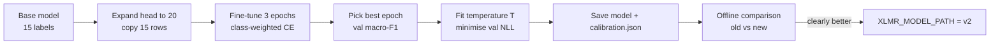

### 10.2 Results

> **Pending — training in progress at the time of writing.** This section will be updated with:
> - validation accuracy and macro-F1 per epoch;
> - calibration error (ECE) before and after temperature scaling;
> - old vs new model on: unseen-template test (1,772), original-data retention test (900), and the 371 hand-written cases;
> - the **confidently-wrong rate** (wrong with confidence > 95%), the key number from Section 7.2.

Deployment rule: switch the app to the new model only if it beats the old one on the hand-written cases for the 15 shared intents, without losing more than 1 point on the retention test.

---

## 11. Engineering quality and testing

### 11.1 Test suite

| | Count |
|---|---|
| Unit tests at start | 197 |
| Unit tests now | **227** (2 opt-in integration tests skipped by default) |
| New test modules | `test_llm_extraction`, `test_order_cancellation`, `test_new_intents` |
| Suite runtime | ~1.2 s, fully offline |

### 11.2 Problems found and fixed in our own changes

| Issue | Symptom | Fix |
|---|---|---|
| Unit tests silently calling Groq | Suite went from 1 s to 8 s | Module-level pins disable the LLM fallback in graph tests; extraction has its own mocked tests |
| Tests sharing the developer's PostgreSQL checkpoints | Failures grew with each run (state leaking across runs) | Tests pin `CHECKPOINT_BACKEND=memory`; leaked test threads truncated; verified 0 rows written by tests |
| Tests writing `turns.jsonl` into the project | Stray runtime files | `TURN_LOG_ENABLED=False` in test configs |
| Flask auto-reload during multi-file edits | Server crashed mid-edit | Restart after consistent state; documented |

### 11.3 Safety properties preserved

- LLM outputs are always validated against closed sets (labels, issue types, catalogue names).
- No order ID or product is ever invented by an LLM.
- Money-moving or state-changing demo actions (cancellation) require an explicit yes.
- Exceptions are never echoed to the customer.

---

## 12. Parallel workstream: intent confirmation and tickets

A second Claude session works in a separate git worktree (`feature/intent-confirmation-tickets`, rebased onto `4ec6e93`, 243 tests passing). Its changes:

- **Intent confirmation:** "You'd like to exchange an item for order X, is that right?" in English or Hindi, with quick-reply buttons.
- **Support tickets:** a `tickets` table (new Alembic migration), raised for returns, damage, missing parcels, exchanges, and human handoff, plus a "My Tickets" tab in the UI.

The two sessions coordinated file regions and commit hashes so that neither overwrote the other's work. The merge is planned for Saturday (Section 15).

---

## 13. Research: where the field is going

We surveyed open-source projects and 2025–2026 standards to position the project.

| Project / standard | Licence | Relevance |
|---|---|---|
| openai/openai-cs-agents-demo | MIT | Triage → specialist agents, guardrails; design reference |
| upsidelab/enthusiast | MIT | E-commerce agent framework, catalogue-grounded product search |
| RasaHQ/rasa | Apache 2.0 | Classic intent classifier + dialogue manager (now in maintenance) |
| LangGraph customer-support tutorial | MIT | Sub-assistants, human approval, saved state |
| **MCP** (Model Context Protocol) | open | Standard tool interface for AI clients |
| **UCP** (Universal Commerce Protocol; Google, Shopify) | Apache 2.0 | Catalogue, cart, checkout, order management for agents |
| **ACP** (Agentic Commerce Protocol; OpenAI, Stripe) | Apache 2.0 | Agent-completed purchases |
| **AP2** (Agent Payments Protocol) | open | Signed payment mandates |
| **A2A** (Agent-to-Agent) | open | Agents delegating to other agents |

**Positioning:** none of the surveyed projects combines a fine-tuned multilingual (Hindi/Hinglish) classifier, a LangGraph state machine with persistent workflows, and a measured evaluation suite. Building on our own codebase, rather than cloning a sample, keeps those differentiators.

---

## 14. Known limitations and risks

| Area | Limitation | Mitigation / plan |
|---|---|---|
| Groq free tier | 200k tokens/day; burst rate limits (10–15 s) | Fallback and smaller calls done; consider the paid Dev tier; avoid full evals before demos |
| Data | All orders, products, policies, and warranty terms are fictional | Clearly labelled in every reply; real integrations via UCP later |
| Document RAG | OpenAI, Pinecone, and DeepSeek keys not yet configured | Keys to be provided; policy questions route to RAG |
| Classifier | Confidently wrong on some boundary cases | Retraining + calibration (Section 10) |
| Authentication | Session ID is not identity; no login | Planned (Section 15) |
| Replies | Hindi questions answered in English | Language-matched replies planned |
| Generated data | Template style may differ from real traffic | Feedback loop (Section 8.7) supplies real examples |
| Hand-written approval | Cancellation uses custom yes/no state | Move to LangGraph `interrupt()` after the branch merge |

---

## 15. Plan for Saturday and Sunday

### 15.1 Schedule

```mermaid
gantt
    title Saturday 21 and Sunday 22 November 2026
    dateFormat  YYYY-MM-DD HH:mm
    axisFormat  %a %H:%M
    section Saturday: finish and demo
    Finish training and offline comparison        :s1, 2026-11-21 09:00, 1h
    Switch to v2 model if better and re-evaluate  :s2, after s1, 1h
    Merge confirmation/tickets branch             :s3, after s2, 1h
    Full 371-case run (quota reset, --delay)      :s4, after s3, 1h
    RAG keys, index demo policies                 :s5, after s4, 2h
    Hindi replies for Hindi questions             :s6, after s5, 1h
    Demo script and dry run                       :s7, after s6, 1h
    section Sunday: agentic upgrade
    LangGraph interrupt() for approvals           :u1, 2026-11-22 09:00, 2h
    Streaming replies (graph.stream + SSE)        :u2, after u1, 2h
    LangSmith or Langfuse tracing                 :u3, after u2, 1h
    MCP server for order/product/refund tools     :u4, after u3, 2h
    Subgraphs: orders, issues, shopping           :u5, after u4, 2h
    CI: tests + eval gate on every PR             :u6, after u5, 1h
```

### 15.2 Saturday: finish, measure, demo

| # | Task | Success measure |
|---|---|---|
| 1 | Finish v2 training; run `evaluate_classifier.py` old vs new | Report filled into Section 10 |
| 2 | Switch `XLMR_MODEL_PATH` to v2 only if it wins | Confidently-wrong rate lower; retention within 1 pt |
| 3 | Merge the tickets/confirmation branch | Combined suite green |
| 4 | Full 371-case evaluation with `--delay` after the quota reset | New committed `evals/baseline.json`; target **≥ 93%** |
| 5 | Configure RAG keys; index the demo policy documents | Policy questions answered with sources |
| 6 | Reply in the customer's language (Hindi/Hinglish) | Spot-checked replies; new eval checks |
| 7 | Demo script: 8–10 tested messages across all three languages | No `UNVERIFIED` during the dry run |

### 15.3 Sunday: agentic upgrade

| # | Task | Why |
|---|---|---|
| 1 | **LangGraph `interrupt()` / `Command(resume=...)`** for cancellation and exchange approval | Standard human-in-the-loop pattern; replaces custom state |
| 2 | **Streaming** replies (`graph.stream` + server-sent events) | Text appears as it is generated; better perceived latency |
| 3 | **Tracing** with LangSmith or Langfuse | A visual trace of every node per message, for debugging and demos |
| 4 | **MCP server** exposing order, product, refund, and handoff tools | Any MCP client (Claude, ChatGPT, others) can use our tools; the first step towards agentic commerce |
| 5 | **Subgraphs** for orders, issues, and shopping | Specialist sub-agents; clearer architecture |
| 6 | **CI pipeline**: unit tests + evaluation gate | A change that lowers accuracy cannot be merged |
| 7 | **Retraining loop** from 👎 feedback and low-confidence turns | Continuous accuracy improvement from real traffic |

### 15.4 Later (next week onwards)

- **UCP** cart and checkout (turns `add_to_cart`, `remove_from_cart`, and `place_order` into working flows)
- **AP2-style signed mandates** for refunds and cancellations
- Customer login with order ownership checks
- Real ticketing or email handoff; **A2A** delegation to courier or seller agents
- Docker Compose deployment; an admin dashboard for tickets, accuracy, latency, and cost
- Voice input (Hindi/English speech-to-text)

---

## 16. Appendix

### 16.1 How to run

```bash
# Backend (from the project root)
.venv/bin/python run.py                      # Flask API on :5000
# Frontend
cd frontend && npm run dev                    # UI on :3000

# Tests and evaluation
.venv/bin/python -m unittest discover -s tests
.venv/bin/python -m evals.run_eval --compare evals/baseline.json --delay 2

# Dataset, training, comparison
.venv/bin/python scripts/build_intent_dataset.py --original data/training/source/original_153k.csv --per-cell 200
.venv/bin/python scripts/train_intent_classifier.py --epochs 3
.venv/bin/python scripts/evaluate_classifier.py --model models/xlmr_intent_classifier --model models/xlmr_intent_classifier_v2
```

### 16.2 New configuration

| Variable | Default | Purpose |
|---|---|---|
| `LLM_EXTRACTION_ENABLED` | `true` | Structured Groq fallback for issue types and products |
| `LLM_EXTRACTION_TIMEOUT_SECONDS` | `8` | Per-call timeout (1 retry) |
| `VERIFIER_FALLBACK_MIN_CONFIDENCE` | `80.0` | Accept the classifier when Groq is unavailable |
| `TURN_LOG_ENABLED` / `TURN_LOG_DIR` | `true` / `data/runtime` | Per-turn monitoring and feedback files |
| `CHECKPOINT_BACKEND` | `postgres` (local `.env`) | Persistent conversations |
| `XLMR_MODEL_PATH` | `models/xlmr_intent_classifier` | Switch to `_v2` after evaluation |

### 16.3 Main files added or changed

| Path | Role |
|---|---|
| `evals/run_eval.py`, `evals/cases.jsonl`, `evals/baseline.json` | Evaluation suite (371 cases) |
| `app/services/llm_extraction.py` | Structured extraction (issue type, product) |
| `app/services/shipping_payment_service.py`, `data/mock/shipping_payment.json` | Shipping and payment answers |
| `app/services/catalog_help_service.py`, `data/mock/warranty.json` | Recommendations and warranty |
| `app/services/turn_log.py`, `app/api/routes.py` | Turn log and feedback API |
| `app/graph/nodes.py`, `routing.py`, `workflow.py` | Cancellation, exchange, and 5 new intent nodes |
| `app/classifier/classifier_service.py`, `model_loader.py` | Context, top-5 descriptions, fallback, calibration |
| `scripts/build_intent_dataset.py`, `scripts/intent_templates/` | 10k+ dataset generation |
| `scripts/train_intent_classifier.py`, `scripts/evaluate_classifier.py` | Retraining and comparison |
| `frontend/app/page.tsx`, `globals.css` | 👍/👎 feedback buttons |
| `docs/langgraph_architecture.mmd` | Generated graph diagram |

### 16.4 Glossary

| Term | Meaning |
|---|---|
| Intent | The customer's goal, e.g. `order_tracking` |
| XLM-R | Multilingual transformer model used as the classifier |
| Calibration / temperature scaling | Adjusting confidence scores so 90% confident means right about 90% of the time |
| ECE | Expected Calibration Error: the average gap between confidence and accuracy |
| Macro-F1 | F1 averaged equally over intents, so small intents count as much as big ones |
| Checkpoint | Saved LangGraph conversation state |
| Human-in-the-loop | The workflow pauses for an explicit customer or agent decision |
| MCP / UCP / ACP / AP2 / A2A | Emerging open standards for agent tools, commerce, payments, and agent-to-agent delegation |
