# Multilingual E-commerce Support Assistant: Project and Enhancement Report

**Project:** E-commerce Customer Support Assistant (LangGraph, XLM-R, Groq, RAG, Flask, Next.js)
**Branch:** `feature/accuracy-enhancements` (plus worktree `feature/intent-confirmation-tickets`)
**Reporting period:** 20–22 November 2026 (Friday to Sunday)
**Status at writing (Saturday 21 Nov, early morning):** working end to end locally; production classifier measured in full; 20-intent retraining interrupted after epoch 1 and scheduled to re-run; weekend feature plan agreed.

---

## Contents

1. [Executive summary](#1-executive-summary)
2. [Problem statement](#2-problem-statement)
3. [Our approach](#3-our-approach)
4. [System architecture](#4-system-architecture)
5. [Models used](#5-models-used)
6. [Datasets used](#6-datasets-used)
7. [Starting point and environment setup](#7-starting-point-and-environment-setup)
8. [Work timeline and commits](#8-work-timeline-and-commits)
9. [Evaluation methodology](#9-evaluation-methodology)
10. [Classifier metrics: accuracy, precision, recall, F1, AUC, calibration](#10-classifier-metrics)
11. [End-to-end accuracy: where it was and where it is now](#11-end-to-end-accuracy)
12. [What we tried: what worked, what did not, and why](#12-what-we-tried)
13. [Features delivered: how each one works](#13-features-delivered)
14. [Intent confirmation and support tickets](#14-intent-confirmation-and-support-tickets)
15. [The 10k+ multilingual dataset](#15-the-10k-multilingual-dataset)
16. [Classifier retraining (20 intents)](#16-classifier-retraining)
17. [Retrieval-augmented generation (RAG)](#17-retrieval-augmented-generation-rag)
18. [Research: method and analytics](#18-research-method-and-analytics)
19. [Weekend build plan: features to ship by Sunday night](#19-weekend-build-plan)
20. [Backlog after the weekend](#20-backlog-after-the-weekend)
21. [Engineering quality and testing](#21-engineering-quality-and-testing)
22. [Known limitations and risks](#22-known-limitations-and-risks)
23. [Appendix: commands, configuration, files, glossary, references](#23-appendix)

---

## 1. Executive summary

The assistant answers e-commerce customer questions in **English, Hindi (Devanagari) and Hinglish (Hindi written in Latin letters)**. A fine-tuned XLM-RoBERTa model classifies each message into an intent, an LLM on Groq double-checks uncertain predictions, and a LangGraph state machine runs the matching workflow: order tracking, refunds, returns, cancellations, exchanges, product questions, shipping, payment, store policy questions through RAG, and handoff to a human.

**Headline results**

| Metric | Where it started | Where it is now | Change |
|---|---|---|---|
| End-to-end pass rate (133-case benchmark) | 84.2% | **92.5%** | **+8.3 pts** |
| Hindi pass rate (benchmark) | 66.7% | **81.0%** | +14.3 pts |
| Hinglish pass rate (benchmark) | 79.2% | **91.7%** | +12.5 pts |
| `issue_support` pass rate | 69.0% | **100%** | +31.0 pts |
| `product_inquiry` pass rate | 81.8% | **100%** | +18.2 pts |
| Route accuracy | 85.7% | **92.5%** | +6.8 pts |
| Reply-content checks | 85.2% | **96.3%** | +11.1 pts |
| Intents with a working handler | 9 | **16** | +7 |
| Intents in the label set | 15 | **20** (v2 model) | +5 |
| Labelled evaluation cases | 0 | **371** | new |
| Multilingual training examples | 0 | **11,898** generated (+6,000 original) | new |
| Classifier validation accuracy (same 2,326 rows) | 63.46% (v1) | **88.65%** (v2, after 1 of 3 epochs) | **+25.2 pts** (run interrupted; re-run Saturday) |
| Unit tests | 197 | **227** (243 on the tickets branch) | +30 |

**The key measured finding.** The production classifier scores **95.0% accuracy, macro-F1 95.0 and macro AUC 0.998** on held-out rows from the dataset it was trained on, which is English only. On new Hindi, Hinglish and English phrasings it falls to **72.6% accuracy, macro-F1 72.6 and ECE 18.7%**, and to **65.2% on Hindi**. About a third of its errors are made with more than 95% confidence, so the Groq check never sees them. The weekend's main model work is the retraining that fixes this (Section 16). The feature work adds the things other open-source projects show off and this project lacks (Sections 18–19).

**Weekend plan in one line:** finish retraining, merge tickets, turn on RAG with citations, reply in the customer's language, mask personal data, escalate angry customers with a handoff summary, show order and product cards with quick replies, accept damage photos, handle two requests in one message, and gate risky actions behind confirmation. MCP, subgraphs and CI move to next week.

---

## 2. Problem statement

Indian e-commerce customers write to support the way they speak: in English, in Hindi, and very often in Hinglish, mixing scripts, spelling freely and making typos ("mera refund kab aayega", "cart se laptop hata do", "अगली सेल कब है?"). A support assistant for this market has to:

1. **Understand intent across three language forms**, including code-mixed text the original training data never contained.
2. **Act safely.** Orders, refunds, cancellations and exchanges must be decided by deterministic code over business data, never improvised by an LLM.
3. **Remember the conversation**, so "ORD-1002" sent after "track my order" completes the earlier request, even after a server restart.
4. **Know when it is unsure** and ask, verify or hand off rather than guess.
5. **Answer policy questions from approved documents** (returns, shipping, promotions) with sources, not from the model's memory.
6. **Be measurable**, so every change can be shown to help or hurt.

**What was wrong at the start (20 Nov):**

| Gap | Evidence |
|---|---|
| The project did not run on this machine | Wrong Python, no PostgreSQL, model weights missing, CORS blocked |
| Accuracy was unknown | No evaluation set existed |
| Hindi and Hinglish requests failed after classification | Issue-type rules were English-only, so every Hindi refund or damage message ended in "which issue is this?" |
| The classifier was trained on English only | 153,464 training rows, **0** containing Devanagari |
| The classifier was over-confident | Errors at 97–99% confidence; Groq verifies only at ≤ 95% |
| Many intents had no handler | Shipping, payment and several others replied "integration pending" |
| Policy answers (RAG) not active | Provider keys and an approved corpus missing |

---

## 3. Our approach

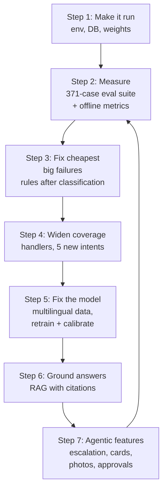

**Principles we kept throughout**

| Principle | How it shows up |
|---|---|
| Classifier first, LLM second | XLM-R runs locally on every message in about 20 ms; Groq is consulted only when confidence is at or below 95% |
| Deterministic business actions | Order, refund, cancellation and exchange logic is plain Python over the business database |
| LLM output is always constrained | Closed label sets, strict JSON schemas, exact catalogue names; an order ID is kept only if it literally appears in the message |
| Fail closed, but helpfully | Unknown or unverifiable requests get a safe reply that lists what the bot *can* do |
| Measure before claiming | Every change is run against the saved baseline; numbers in this report come from saved reports or scripts |
| Build on our own code | Ideas from other projects are re-implemented to fit our classifier-first design, not cloned |

---

## 4. System architecture

### 4.1 Component overview

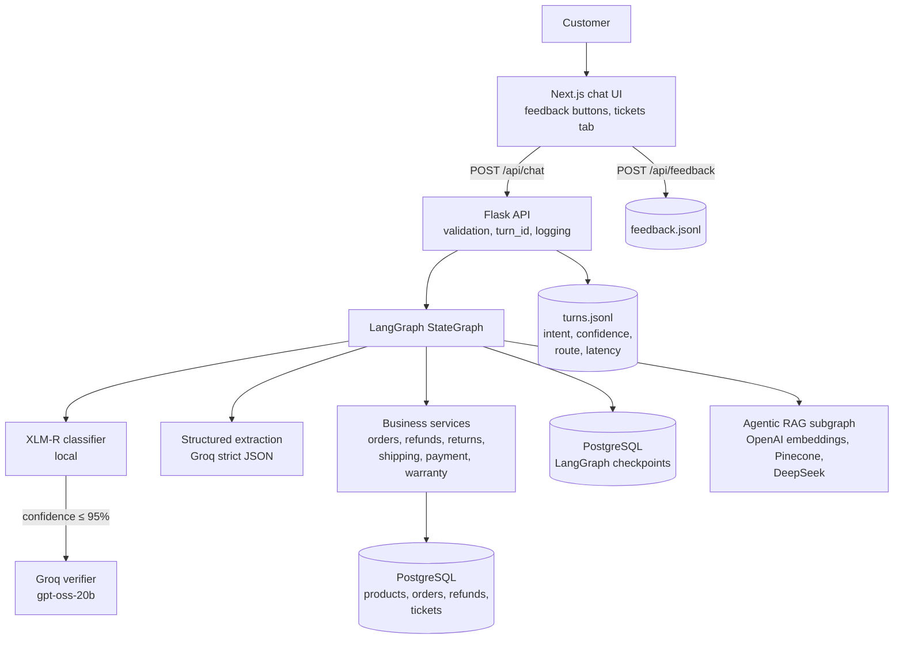

### 4.2 LangGraph state machine

The full graph is generated from the compiled code into `docs/langgraph_architecture.mmd`; this is a simplified view.

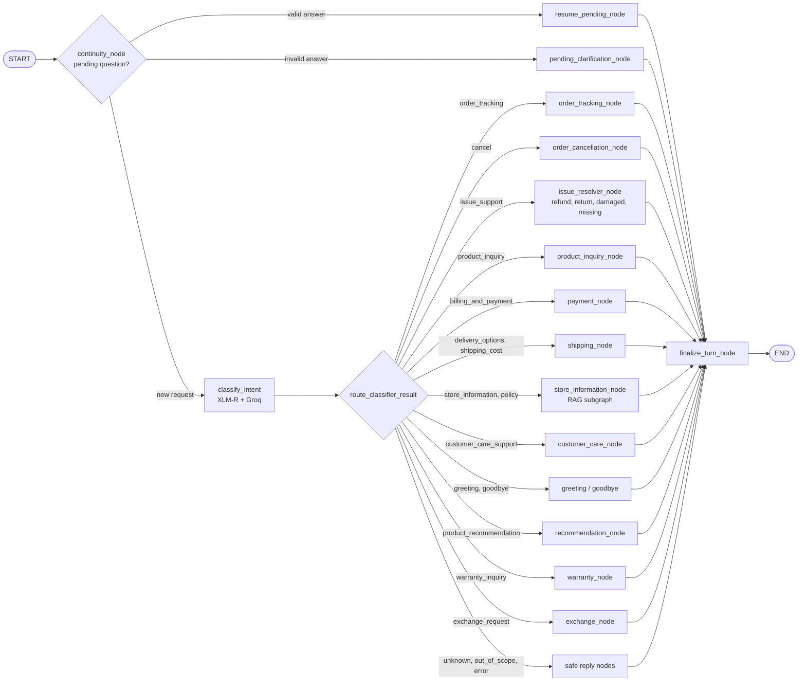

### 4.3 One message, end to end


### 4.4 Classification decision flow

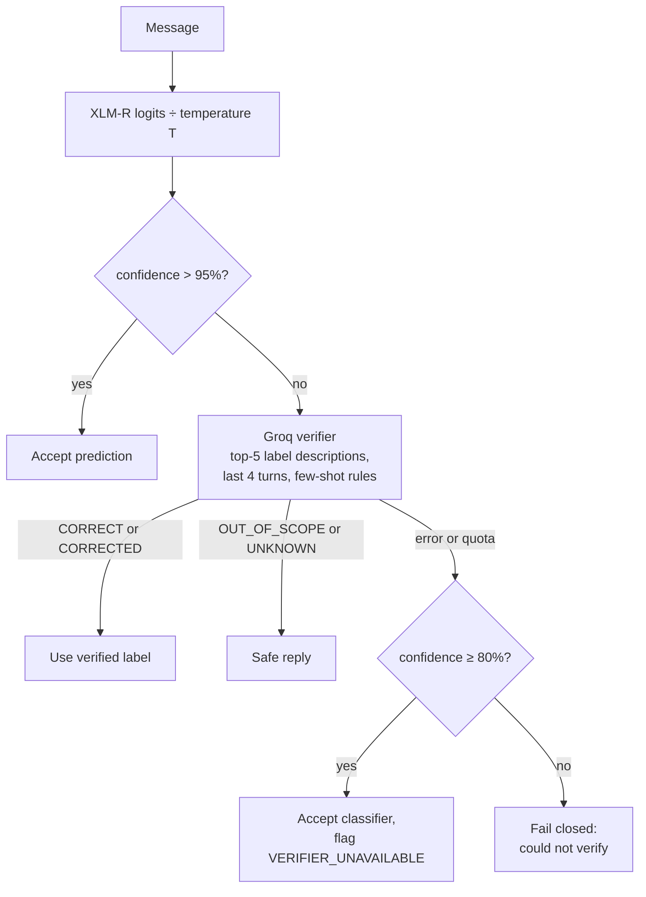

### 4.5 Technology stack

| Layer | Technology |
|---|---|
| Orchestration | LangGraph 1.x (`StateGraph`, checkpointer), `langgraph-checkpoint-postgres` |
| Classifier runtime | PyTorch 2.x, Hugging Face Transformers 4.57, Apple MPS / CPU / CUDA |
| LLM providers | Groq (verifier, extraction), DeepSeek (RAG), OpenAI (embeddings) |
| Vector store | Pinecone (cosine, 3,072 dimensions, separate approved and demo namespaces) |
| API | Flask (`/api/health`, `/api/chat`, `/api/feedback`, `/api/tickets` on the tickets branch) |
| Database | PostgreSQL 16, SQLAlchemy, Alembic migrations 0001–0003 |
| Frontend | Next.js 16, React 19 |
| Tests | `unittest`, fully offline with fake providers |

---

## 5. Models used

Every model the project uses, has tried, or plans to use this weekend.

### 5.1 In production

| # | Model | Provider / where it runs | Role | Size / settings | Status |
|---|---|---|---|---|---|
| 1 | **`FacebookAI/xlm-roberta-base`** | Hugging Face (upstream base) | Multilingual encoder our classifier is built on; pretrained on 100 languages including Hindi | 12 layers, 768 hidden, 12 heads, 250,002-token vocabulary, ~278M parameters | Base only, not used directly |
| 2 | **`xlmr_intent_classifier` (v1)** | Local (`models/xlmr_intent_classifier/`), MPS/CPU | Intent classifier, 15 labels | `model.safetensors` 1.11 GB, max length 64 | **In production** |
| 3 | **`openai/gpt-oss-20b`** | Groq API | (a) Intent verifier when confidence ≤ 95%; (b) structured extraction of issue type and product; (c) category-to-catalogue product matching | Strict JSON, closed label sets, 8 s timeout, 1 retry | **In production** (free tier: 200k tokens/day) |
| 4 | **`text-embedding-3-large`** | OpenAI API | RAG document and query embeddings | 3,072 dimensions | Wired, **keys pending** |
| 5 | **`deepseek-flash`** | DeepSeek API (`api.deepseek.com`) | RAG evidence grader, query rewriter and grounded answer generator | Strict JSON for the grader | Wired, **keys pending** |
| 6 | **Pinecone dense index** | Pinecone (vector database, not a model) | Stores chunk vectors | cosine, top-k 4, min score 0.35 | Wired, **keys pending** |

### 5.2 Trained this weekend

| # | Model | Role | Status |
|---|---|---|---|
| 7 | **`xlmr_intent_classifier_v2`** | 20-label classifier, warm-started from v1, class-weighted loss, temperature-calibrated | Epoch 1 done (val acc 88.65%, macro-F1 0.883); run interrupted in epoch 2; **re-run scheduled Saturday** (Section 16) |

### 5.3 Proposed for the weekend features

| # | Model | Role | Why this one |
|---|---|---|---|
| 8 | **`cardiffnlp/twitter-xlm-roberta-base-sentiment`** | Customer sentiment for escalation (Section 19.6) | Same XLM-R family as our classifier; fine-tuned for sentiment on 8 languages **including Hindi**; runs locally with no API cost; outputs Positive / Neutral / Negative |
| 9 | **`meta-llama/llama-4-scout-17b-16e-instruct`** | Damage-photo understanding (Section 19.8) | Image-capable model on Groq, so no new provider account is needed |
| 10 | Rule-based recognisers (regex + Luhn check) | Personal-data masking (Section 19.5) | Deterministic and testable; Microsoft Presidio is the reference design |

### 5.4 How the models work together

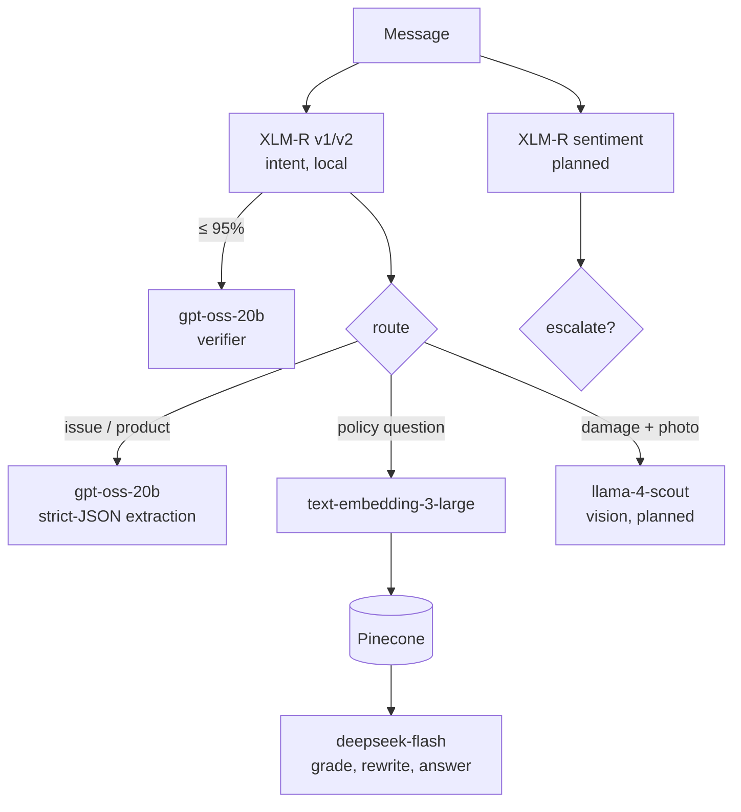

---

## 6. Datasets used

### 6.1 Inventory

| # | Dataset | Location | Size | Languages | Used for |
|---|---|---|---|---|---|
| 1 | **E-Commerce Customer Intent Detection** (`monish-sd-7/E-Commerce-Customer-Intent-Detection-Dataset`, Hugging Face) | `data/training/source/original_153k.csv` | **153,464 rows, 15 intents** | English only (0 rows contain Devanagari) | Training v1; 6,000 sampled rows mixed into v2 |
| 2 | **Intent templates** (written for this project) | `scripts/intent_templates/{en,hi,hinglish}.json` | 1,919 templates (640 en, 642 hi, 637 hinglish), 20 intents | en, hi, hinglish | Source of the generated dataset |
| 3 | **Generated multilingual dataset** | `data/training/{train,val,test}.jsonl` | 11,898 generated + 6,000 original = 17,898 rows | en 3,996, hi 3,937, hinglish 3,965 | v2 training, validation and unseen-template test |
| 4 | **Retention test** | `data/training/test_original.jsonl` | 900 rows (60 per original intent) | en | Checks that v2 does not forget the original data |
| 5 | **Hand-written evaluation suite** | `evals/cases.jsonl` | 371 cases, 29 multi-turn, 20 intents | en 170, hinglish 115, hi 86 | End-to-end accuracy: intent, route, reply content |
| 6 | **Mock business data** | `data/mock/*.json` | orders, products, refunds, policies, shipping/payment, store info, warranty (+ customers on the tickets branch) | en | Deterministic workflows; imported into PostgreSQL |
| 7 | **Knowledge base (demo)** | `knowledge_base/demo/` | 7 fictional documents: FAQ (en, hi), store, promotions, shipping, returns, refunds | en, hi | RAG development only, separate namespace |
| 8 | **Knowledge base (approved)** | `knowledge_base/approved/` | empty | — | Production RAG once real policies are supplied |
| 9 | **Runtime logs** | `data/runtime/turns.jsonl`, `feedback.jsonl` | grows with use | all | Monitoring, 👎 review, future retraining rows |

### 6.2 Original dataset: intent distribution (153,464 rows)

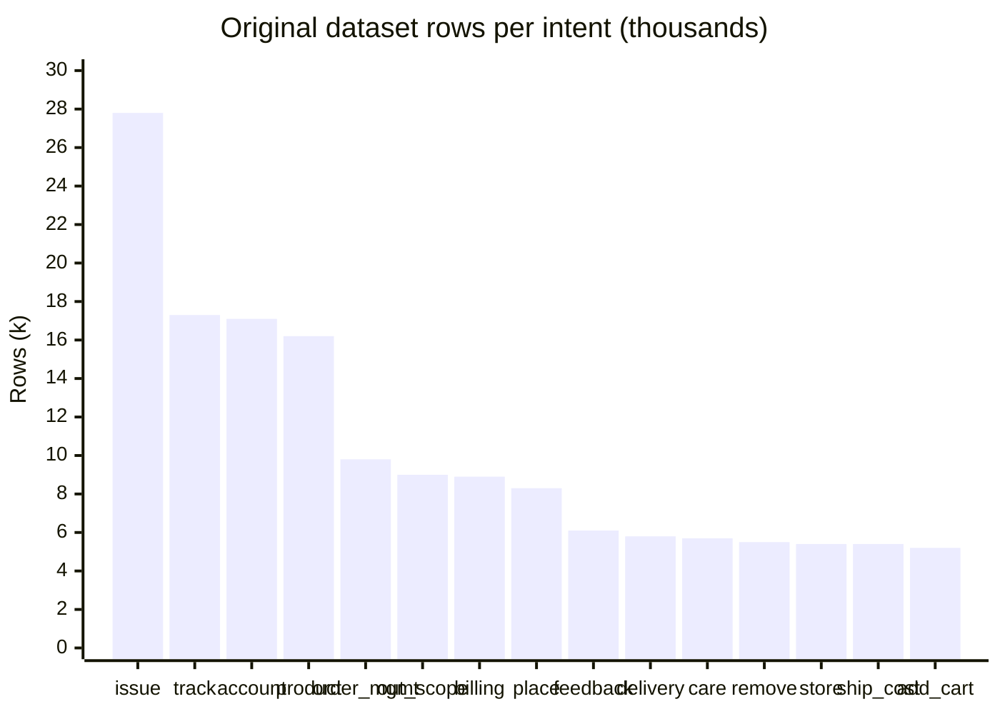

The source is imbalanced (5.3× between the largest and smallest intent) and English-only. Those two facts explain most of what Section 10 measures.

### 6.3 Evaluation suite by intent (371 cases)

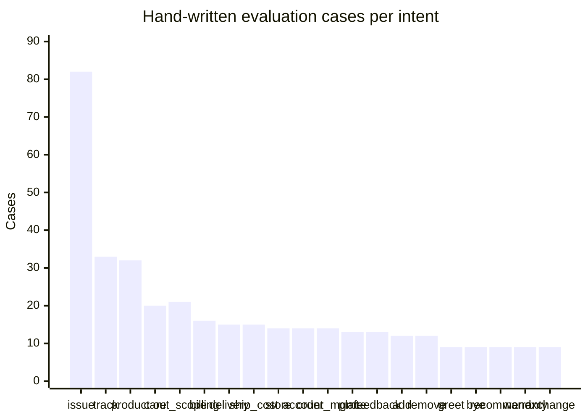

---

## 7. Starting point and environment setup

The repository was cloned onto a Mac (Apple M4, 16 GB) with no prior setup.

| # | Problem found | Resolution |
|---|---|---|
| 1 | Only system Python 3.9; the project needs 3.11 | Homebrew Python 3.11 plus a project `.venv` |
| 2 | No PostgreSQL server | PostgreSQL 16 via Homebrew; `ecom_support_dev` database; Alembic to `0002`; demo records imported |
| 3 | XLM-R weights missing (withheld from Git) | User supplied them; placed in `models/xlmr_intent_classifier/` (gitignored) |
| 4 | Browser blocked by CORS | Allowed `localhost:3000` and `127.0.0.1:3000` |
| 5 | Stale Flask process holding port 5000 | Found by PID and stopped |
| 6 | Conversations lost on restart | `CHECKPOINT_BACKEND=postgres`; verified a conversation resumes after restart |

---

## 8. Work timeline and commits

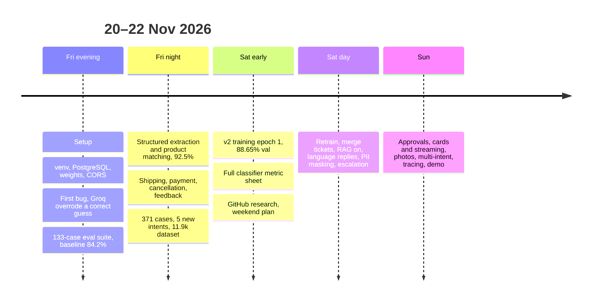

| Commit | Summary | Files |
|---|---|---|
| `fb07a4d` | Evaluation suite (133 cases), runner, baseline; `issue_support` description fix; friendly unsupported replies | 10 |
| `4a686a4` | Structured extraction, product matching, context-aware verifier, shipping/payment, cancellation, turn log, feedback API and UI, 326 cases | 28 |
| `4ec6e93` | 5 new intents and handlers, dataset builder, ~1.9k templates, trainer with calibration, offline comparison, verifier fallback, top-5 descriptions, LangGraph diagram | 25 |
| `cab8a0e` | First version of this report | 1 |

---

## 9. Evaluation methodology

Two kinds of measurement are used, because they answer different questions.

| | Offline classifier metrics (Section 10) | End-to-end evaluation suite (Section 11) |
|---|---|---|
| Question answered | How good is the model alone? | Does the whole bot do the right thing? |
| Data | 900 retention rows, 1,772 unseen-template rows, 371 hand-written first turns | 371 hand-written conversations |
| Includes Groq | No | Yes |
| Metrics | Accuracy, top-3, precision, recall, F1, ROC-AUC, ECE, confidently-wrong rate | Pass rate, intent, route, reply-content checks, Groq effect, latency |
| Tool | Measurement script (this report), `scripts/evaluate_classifier.py` | `evals/run_eval.py` |

### 9.1 Case format (end-to-end)

```json
{"id": "is-hg-01", "lang": "hinglish", "turns": ["mera refund kab aayega"],
 "intent": "issue_support", "route": "issue_support:refund_status",
 "contains": [], "entities": {"issue_type": "refund_status"}, "tags": ["refund"]}
```

Expected values describe **what a correct bot should do**, never what the bot currently does.

### 9.2 Metric definitions

| Metric | Meaning |
|---|---|
| Accuracy | Share of messages whose top label is correct |
| Top-3 accuracy | Correct label is among the three highest scores; shows how close the model is |
| Precision (per intent) | Of the messages the model labelled X, how many really were X |
| Recall (per intent) | Of the real X messages, how many the model found |
| F1 / macro-F1 | Harmonic mean of precision and recall; macro averages intents equally |
| ROC-AUC (one-vs-rest, macro) | How well scores rank the right intent above the others, independent of threshold; 1.0 is perfect, 0.5 is chance |
| ECE | Expected calibration error: average gap between confidence and actual accuracy (15 bins) |
| Confidently wrong | Wrong **and** above 95% confidence, so Groq never checks it |
| Sent to Groq | Share at or below 95% confidence |

---

## 10. Classifier metrics

All numbers in this section were measured on Saturday 21 November with the production v1 model, offline, without Groq. The v1 model knows 15 labels; rows whose gold label is one of the 5 new intents are excluded and reported separately.

### 10.1 Summary

| Metric | Retention test (original data, en) | Unseen templates (en/hi/hinglish) | Hand-written cases |
|---|---|---|---|
| Rows scored | 900 | 1,322 (of 1,772) | 326 (of 371) |
| **Accuracy** | **95.00%** | **72.62%** | **83.44%** |
| Top-3 accuracy | 98.78% | 89.94% | 94.17% |
| **Macro precision** | **95.15%** | **76.31%** | **83.83%** |
| **Macro recall** | **95.01%** | **72.72%** | **81.23%** |
| **Macro-F1** | **95.00** | **72.61** | **81.33** |
| Weighted F1 | 95.00 | 72.39 | 82.84 |
| **Macro ROC-AUC (one-vs-rest)** | **0.9979** | **0.9606** | **0.9729** |
| ECE (lower is better) | 2.58% | 18.66% | 11.30% |
| Mean confidence | 97.45% | 91.28% | 94.24% |
| Confidently wrong (> 95%) | 2.11% | 9.00% | 7.06% |
| Errors made above 95% | 42.2% | 32.9% | 42.6% |
| Sent to Groq (≤ 95%) | 6.56% | 32.68% | 22.70% |
| Accuracy if new-intent rows count as wrong | 95.00% | 54.18% | 73.32% |

```mermaid
xychart-beta
    title "v1 classifier: accuracy and macro-F1 by test set (%)"
    x-axis ["Retention (en)", "Hand-written", "Unseen templates"]
    y-axis "Score (%)" 50 --> 100
    bar [95.0, 83.4, 72.6]
    bar [95.0, 81.3, 72.6]
```

*(First bar = accuracy, second = macro-F1.)*

### 10.2 Accuracy by language

| Test set | English | Hinglish | Hindi |
|---|---|---|---|
| Unseen templates | 80.4% (450) | 71.8% (450) | **65.2%** (422) |
| Hand-written | 90.3% (155) | 79.0% (100) | **74.6%** (71) |

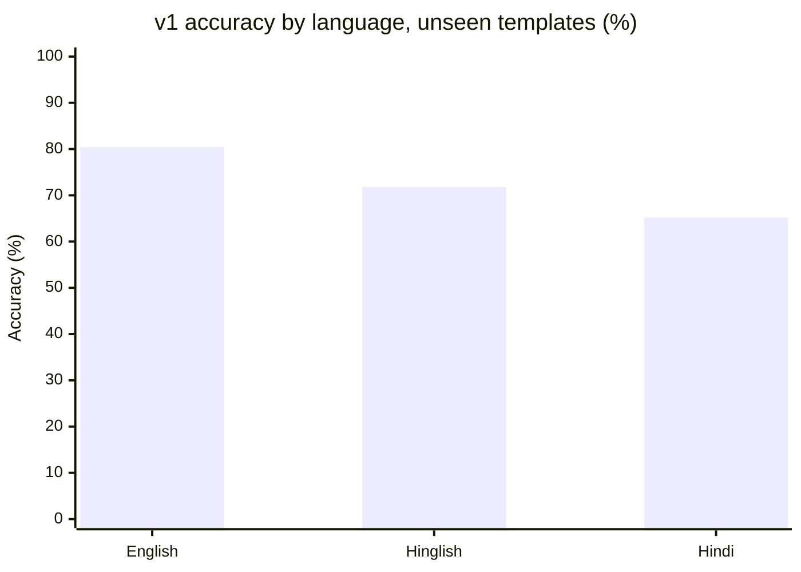

### 10.3 Per-intent precision, recall, F1 and AUC (unseen templates)

| Intent | n | Precision | Recall | F1 | AUC |
|---|---|---|---|---|---|
| account_management | 90 | 77.4 | 91.1 | 83.7 | 0.995 |
| add_to_cart | 90 | 82.7 | 95.6 | 88.7 | 0.981 |
| billing_and_payment | 90 | 69.7 | 76.7 | 73.0 | 0.976 |
| customer_care_support | 89 | 89.1 | **46.1** | 60.7 | 0.928 |
| delivery_options | 90 | 76.2 | 71.1 | 73.6 | 0.976 |
| issue_support | 90 | 77.6 | 73.3 | 75.4 | 0.965 |
| order_management | 69 | 100.0 | 76.8 | 86.9 | 0.986 |
| order_tracking | 87 | **45.0** | 88.5 | 59.7 | 0.976 |
| out_of_scope | 90 | 78.0 | 78.9 | 78.5 | 0.948 |
| place_order | 90 | 94.3 | **55.6** | 69.9 | 0.901 |
| product_inquiry | 90 | 55.9 | 90.0 | 68.9 | 0.983 |
| remove_from_cart | 87 | 98.6 | 79.3 | 87.9 | 0.995 |
| shipping_cost | 90 | 90.9 | 77.8 | 83.8 | 0.993 |
| **store_information** | 90 | **19.7** | **13.3** | **15.9** | 0.844 |
| submit_feedback | 90 | 89.6 | 76.7 | 82.6 | 0.962 |

**How to read this:**

- `order_tracking` has high recall but 45% precision: it is the model's **default guess**. Sale and store questions ("अगली सेल कब है?") land there.
- `store_information` is almost never recognised (F1 15.9). In the original data it is a narrow intent; our templates include sales, opening hours and policies that the model has never seen.
- `customer_care_support` recall is 46%: angry "get me a human" messages are classified as something else.
- AUC stays high (0.84–0.995) even where F1 is low. **The right label is usually near the top, but the scores are badly calibrated**, which matches the 89.9% top-3 accuracy and the 18.7% ECE. Retraining plus temperature scaling is the right fix.

### 10.4 Top confusions (unseen templates)

| True intent → predicted | Count |
|---|---|
| customer_care_support → store_information | 38 |
| store_information → order_tracking | 32 |
| place_order → product_inquiry | 21 |
| remove_from_cart → add_to_cart | 18 |
| shipping_cost → delivery_options | 18 |
| store_information → product_inquiry | 17 |
| billing_and_payment → order_tracking | 11 |
| place_order → account_management | 11 |

### 10.5 Per-intent F1 on the retention test

All 15 intents score 91.9–98.3 F1 with AUC ≥ 0.99. The v1 model has **learned its source dataset very well**. Its problem is generalisation to new phrasing and languages, not capacity.

---

## 11. End-to-end accuracy

### 11.1 Benchmark: before and after (133 cases, with Groq)

| Intent | Cases | Before (pass %) | After (pass %) |
|---|---|---|---|
| account_management | 7 | 100.0 | 100.0 |
| add_to_cart | 5 | 100.0 | 100.0 |
| billing_and_payment | 8 | 100.0 | 100.0 |
| customer_care_support | 8 | 87.5 | 87.5 |
| delivery_options | 7 | 100.0 | 100.0 |
| **issue_support** | 29 | **69.0** | **100.0** |
| order_management | 7 | 85.7 | 85.7 |
| order_tracking | 13 | 92.3 | 92.3 |
| out_of_scope | 8 | 100.0 | 100.0 |
| place_order | 6 | 83.3 | 83.3 |
| **product_inquiry** | 11 | **81.8** | **100.0** |
| remove_from_cart | 5 | 80.0 | 80.0 |
| shipping_cost | 7 | 100.0 | 100.0 |
| store_information | 6 | 50.0 | 50.0 |
| submit_feedback | 6 | 66.7 | 66.7 |
| **Overall** | **133** | **84.2** | **92.5** |

```mermaid
xychart-beta
    title "End-to-end pass rate by language, before vs after (%)"
    x-axis ["English", "Hindi", "Hinglish", "Overall"]
    y-axis "Pass rate (%)" 0 --> 100
    bar [89.8, 66.7, 79.2, 84.2]
    bar [95.5, 81.0, 91.7, 92.5]
```

*(First bar = before, second = after.)*

```mermaid
xychart-beta
    title "Benchmark metrics, before vs after (%)"
    x-axis ["Pass rate", "Intent", "Route", "Reply checks"]
    y-axis "Score (%)" 70 --> 100
    bar [84.2, 92.5, 85.7, 85.2]
    bar [92.5, 92.5, 92.5, 96.3]
```

Intent accuracy did not change (92.5%), and that is expected: the gains came from what happens **after** classification. The remaining 10 failures are all confident classifier mistakes (95.3–99.6%), which only retraining can fix.

### 11.2 The remaining failures

| Message | Expected | Model said (confidence) |
|---|---|---|
| "when is your next sale?" | store_information | order_tracking (97.0%) |
| "अगली सेल कब है?" | store_information | order_tracking (99.4%) |
| "this bot is useless, get me a human" | customer_care_support | account_management (97.9%) |
| "मैं अपना फीडबैक देना चाहता हूँ" | submit_feedback | billing_and_payment (98.7%) |
| "cart se laptop hata do" | remove_from_cart | issue_support (99.1%) |

Each of these matches a weakness measured offline in Section 10.3, so the two measurement methods agree.

### 11.3 Groq's contribution (valid run)

| Measure | Value |
|---|---|
| Messages sent to Groq | 11.3% |
| Labels Groq changed | 3 |
| Changes that fixed an error | 3 |
| Changes that broke a correct answer | 0 |

### 11.4 The 326-case run and the Groq quota

| Segment | Cases | Groq status | Pass rate |
|---|---|---|---|
| Cases 1–132 | 132 | working | **91.7%** (consistent with 92.5%) |
| Cases 133–326 | 194 | quota exhausted, 60 `UNVERIFIED` | not a valid measurement |

The whole-run figures (63.2% pass, 32 "broken" Groq changes) are dominated by the 60 quota failures and **must not be quoted as accuracy**. The fixes are described in Section 13.8. The full 371-case run is scheduled for Saturday.

### 11.5 Latency

| Path | p50 | p95 |
|---|---|---|
| Classifier only (most messages) | ~18–20 ms | — |
| With a Groq call | ~1–3 s | 10–15 s under burst rate-limiting |

---

## 12. What we tried

### 12.1 What worked

| # | What we tried | Result | Why it worked |
|---|---|---|---|
| 1 | Build the evaluation suite **before** changing anything | Baseline 84.2%; every later change measured | Turned "it feels better" into numbers; found the real failure clusters |
| 2 | Rewrite the `issue_support` description for the verifier | Fixed "i do not like my order" being overridden | Groq was following a misleading description, not making a random error |
| 3 | Groq **strict-JSON extraction** for issue type when English rules find nothing | `issue_support` 69% → **100%**; Hindi +14 pts | One constrained call understands any language; the schema allows only 4 answers or null |
| 4 | Fuzzy product matching, then constrained LLM category matching | `product_inquiry` 81.8% → **100%** | Plurals and typos solved locally; LLM may return only exact catalogue names |
| 5 | Few-shot boundary rules + last 4 turns in the verifier | Groq: 3 fixes, 0 breaks | Rules target measured confusions; history resolves "and that one?" |
| 6 | Top-5 label descriptions instead of all 15 | ≈ 66% fewer verifier tokens | Quota pressure was the main operational risk |
| 7 | Confidence fallback when Groq is down (≥ 80%) | Confident answers survive outages | Previously a quota outage refused even 99%-confident answers |
| 8 | PostgreSQL checkpoints | Conversations survive restarts | LangGraph's official Postgres saver; verified manually |
| 9 | Template-level train/test split | 0 test rows share a template with training | Makes the unseen-template score honest |
| 10 | Warm-start v2 from v1 with class-weighted loss | 88.65% validation accuracy after **one** epoch on 20 labels | Keeps everything v1 learned; the 5 new rows learn fast |
| 11 | Friendlier "not supported" replies listing what the bot can do | Tested; no internal labels shown | Fails safely without a dead end |

### 12.2 What did not work, and why

| # | What we tried or found | What happened | Why | What we did instead |
|---|---|---|---|---|
| 1 | English phrase rules for issue types | Every Hindi/Hinglish issue message asked "which issue?" | Rules cannot cover three scripts and free spelling | LLM extraction fallback (12.1 #3) |
| 2 | Relying on the 95% threshold to catch errors | 33–43% of errors happen **above** 95% | The model is over-confident (ECE up to 18.7%) | Temperature calibration in v2 (Section 16) |
| 3 | Lowering the threshold to send more to Groq | Not adopted | More calls exhaust the free quota; latency up to 15 s | Fix the model, not the gate |
| 4 | Full 326-case evaluation in one run | 60 cases `UNVERIFIED`; run invalid | Groq free tier: 200k tokens/day | Smaller prompts, fallback, `--delay` option |
| 5 | Unit tests that touched real services | Suite slowed from 1 s to 8 s; state leaked into the dev database | Graph tests called Groq; tests shared Postgres checkpoints | Tests pin `LLM_EXTRACTION_ENABLED=False`, `CHECKPOINT_BACKEND=memory` |
| 6 | Training v2 in a foreground session | Killed mid-epoch 2 after ~33 min; **nothing saved** | Process tied to the session; the script saves only at the end | Re-run detached (`nohup`) with a checkpoint every epoch |
| 7 | Flask auto-reload during multi-file edits | Server crashed mid-edit | Reloader picked up half-edited files | Restart after edits are consistent |
| 8 | Exact-phrase GitHub searches | 6 queries returned 0 results | `gh search` treats a quoted string as a phrase | Re-ran as keyword queries (Section 18) |
| 9 | Training only on the original dataset (v1, before this project) | 95% on its own data, **72.6%** on new phrasing, **65.2%** on Hindi | Source data is English-only and narrow | 11,898-row multilingual dataset |

### 12.3 What we decided not to do, and why

| Option | Reason |
|---|---|
| Replace XLM-R with an LLM classifier | 20 ms and free locally vs 1–3 s and quota-bound; XLM-R AUC is already 0.96–0.998 |
| Let an LLM call business tools freely (ReAct) | Money-moving actions must stay deterministic and testable |
| Clone a sample project | None combines a Hindi/Hinglish classifier, persistent workflows and an evaluation suite (Section 18) |

---

## 13. Features delivered

### 13.1 Friendlier "not supported" replies

**Before:** *"The 'order_management' request was recognized, but this application does not yet support that operation."*
**After:** *"I can cancel an order that hasn't shipped yet, but I can't change the items in an order from this chat. I can check an order's status, help with a return, refund, damaged or missing item, look up product availability, or connect you with a support agent."*

### 13.2 Structured LLM extraction

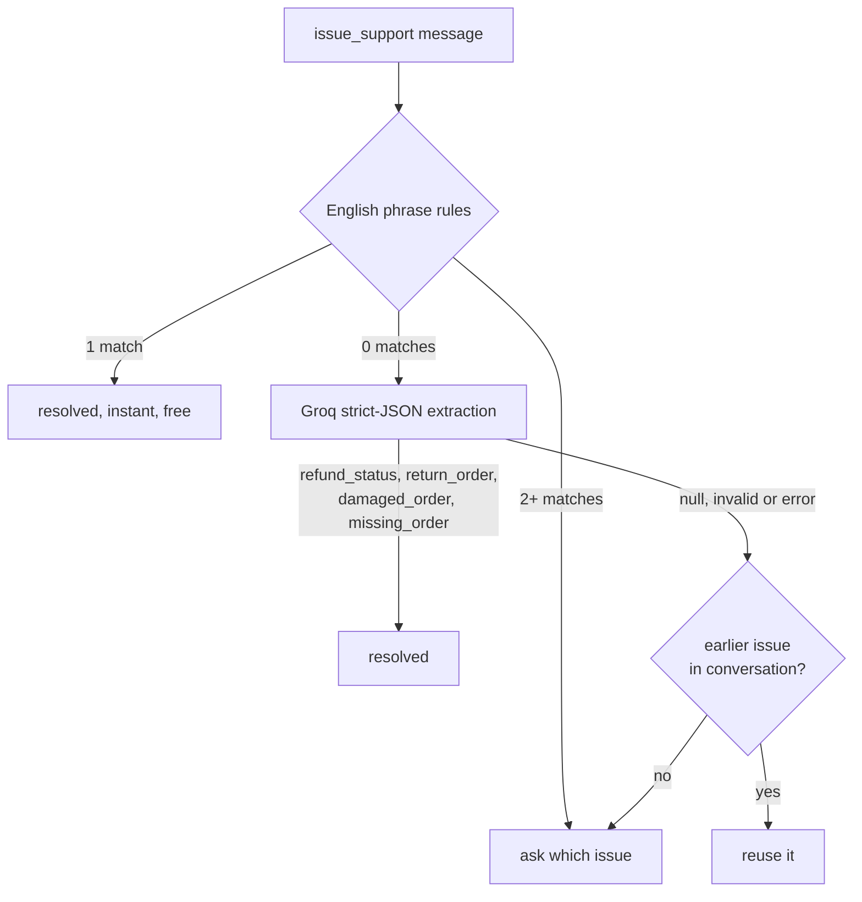

Safety: the schema allows only 4 issue types or null; an order ID is kept only if it literally appears in the message; any failure falls back to the old behaviour; clear English messages never cause a network call.

### 13.3 Product matching

Plurals and typos match locally ("laptops" → Laptop Pro, "headphnes" → Noise-Cancelling Headphones). Category words ("phone", "laptop wala") go to a constrained LLM call that can only return an exact catalogue name.

### 13.4 Context-aware, cheaper verification

Few-shot boundary rules for measured confusions; the last 4 turns of history; only the top-5 candidate labels described (all labels remain selectable).

### 13.5 Shipping and payment answers

| Question | Answer includes |
|---|---|
| "do you deliver to Pune?" / "क्या आप बैंगलोर में डिलीवरी करते हैं?" | City coverage (English and Devanagari spellings), methods, same-day where available |
| "how much is shipping?" | ₹49 standard (free above ₹499), ₹149 express, ₹199 same-day |
| "can I pay with UPI?" / "invoice chahiye" | UPI, cards, net banking, PayPal, COD up to ₹10,000; invoice by email |

### 13.6 Order cancellation with confirmation

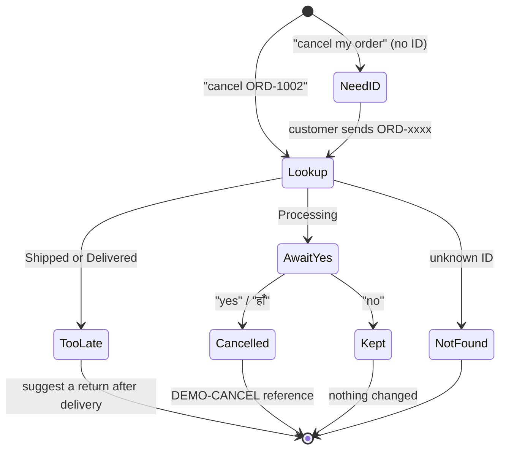

### 13.7 Monitoring and feedback loop

Every reply carries a `turn_id`; the API logs intent, confidence, verifier status, route and latency to `data/runtime/turns.jsonl`. `POST /api/feedback` stores 👍/👎 with the message and answer.

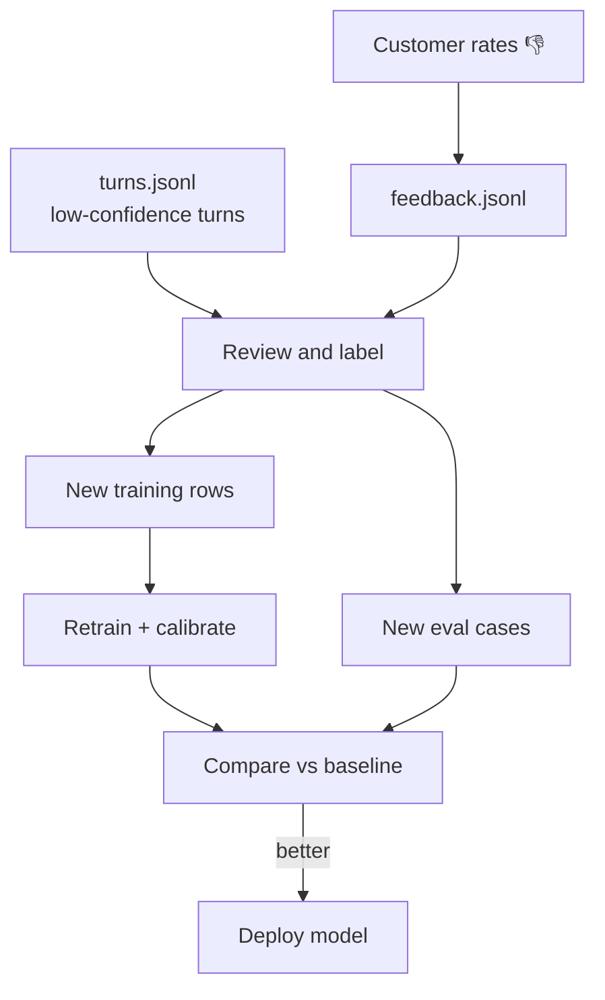

### 13.8 Resilience to Groq outages and quota

| Situation | Before | After |
|---|---|---|
| Groq down, model 85% confident | "I could not verify the intent" | Answer served, flagged `CLASSIFIER_FALLBACK_VERIFIER_UNAVAILABLE` |
| Groq down, model 60% confident | refuse | still refuse (safe) |
| Tokens per verification | all 15 descriptions | top-5 only (≈ −66%) |

### 13.9 Persistent conversations

LangGraph checkpoints in PostgreSQL: start a conversation, restart the server, send "ORD-1001", and the original lookup completes.

### 13.10 Five new intents

| Intent | Example | Handler |
|---|---|---|
| `greeting` | "namaste" | Welcome plus what the bot can do |
| `goodbye_thanks` | "thanks, that's all" | Polite close |
| `product_recommendation` | "gaming ke liye konsa laptop lena chahiye" | In-stock suggestions in the mentioned category |
| `warranty_inquiry` | "Laptop Pro warranty kitni hai?" | Coverage and claim process |
| `exchange_request` | "size chhota aa gaya, exchange karwana hai" | Exchange only if delivered; otherwise cancel or wait |

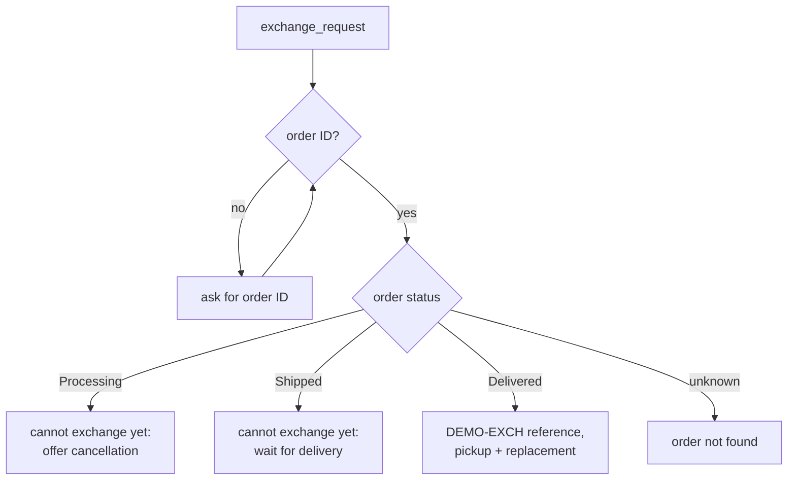

---

## 14. Intent confirmation and support tickets

Built in a parallel git worktree (`feature/intent-confirmation-tickets`): 15 files changed, +795 lines, 16 new tests, 243 tests passing. It merges on Saturday.

### 14.1 What it adds

| Part | Detail |
|---|---|
| Intent confirmation | Before a ticket-raising workflow runs, the bot restates the request ("You'd like to exchange an item for order ORD-1004, is that right?") in English or Hindi with Yes/No quick-reply buttons. Controlled by `INTENT_CONFIRMATION_ENABLED` |
| Tickets | `support_tickets` table (Alembic `0003`) or local SQLite: id, customer, session, category, subject, description, order, case reference, status, priority, timestamps |
| Categories and priority | Damaged item and missing delivery = **high**; return, exchange and "speak to an agent" = normal |
| Customers | `data/mock/customers.json`; tickets can be listed per customer or per session |
| UI | "My Tickets" tab in the Next.js app |

### 14.2 How it works

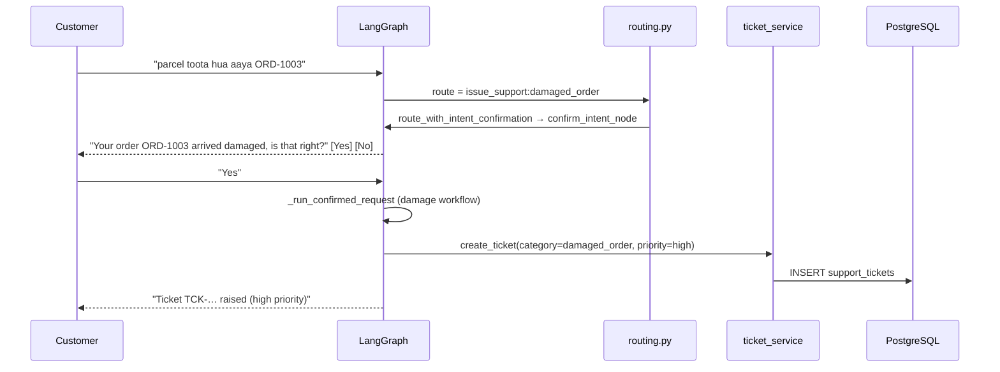

---

## 15. The 10k+ multilingual dataset

### 15.1 Pipeline

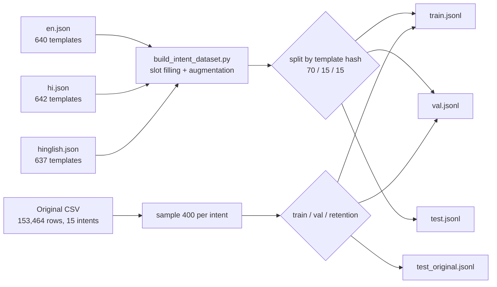

### 15.2 Design choices

- **Balanced across 20 intents × 3 languages:** about 600 examples per intent and about 4,000 per language.
- **Template-level split:** test sentences never share a template with training sentences (`test_rows_sharing_a_train_template = 0`).
- **Slot filling:** `{product}`, `{city}`, `{order_id}`, `{payment_method}`, `{size}`, `{color}` filled per language, with Devanagari city names for Hindi.
- **Augmentation:** lower-case without punctuation (25%), adjacent-key typo (15%, Latin scripts), fillers like "pls / yaar / जी" (10%).
- **Original data mixed in:** 400 rows per original intent prevent forgetting, plus a separate retention test.
- **Held-out integrity:** templates were checked by string similarity against the evaluation suite so the suite is not leaked into training.

### 15.3 Numbers

| Split | Rows | Of which original |
|---|---|---|
| train | 12,900 | 4,500 |
| val | 2,326 | 600 |
| test (unseen templates) | 1,772 | 0 |
| test_original (retention) | 900 | 900 |
| **Total** | **17,898** | 6,000 |

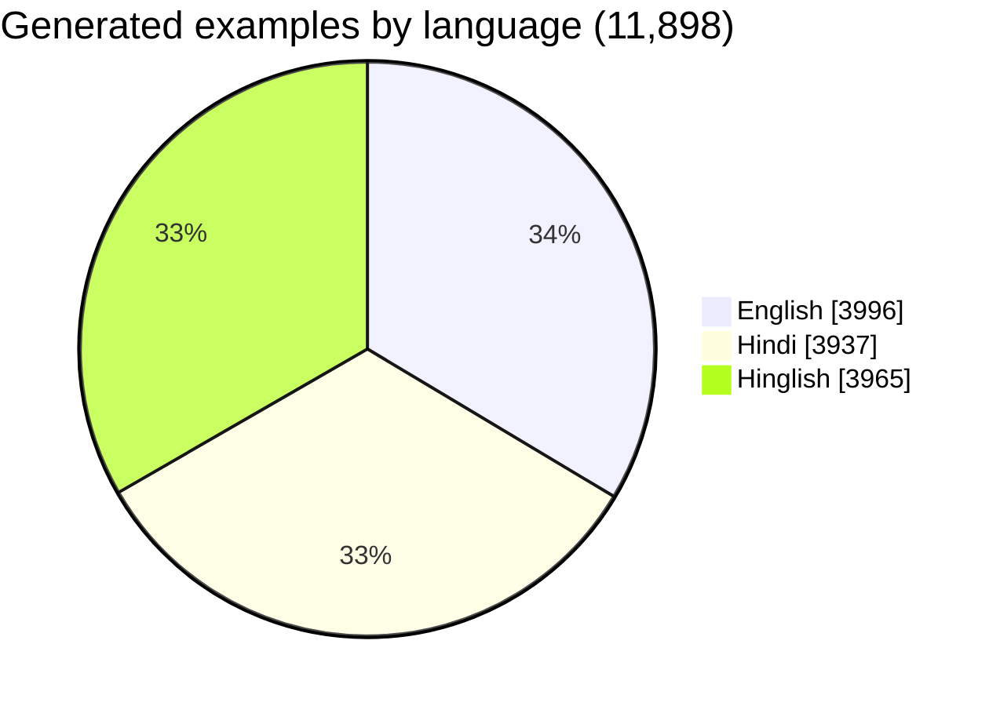

---

## 16. Classifier retraining

### 16.1 Approach

| Choice | Reason |
|---|---|
| Warm start from v1 | Keeps everything the encoder learned; copies the 15 trained output rows; only 5 new rows start from scratch |
| Class-weighted cross-entropy | New intents have no original data, so fewer examples |
| AdamW, lr 2e-5, weight decay 0.01, warmup 6%, 3 epochs, batch 32, max length 64 | Standard stable settings for XLM-R base |
| Best epoch by validation macro-F1 | Guards against over-fitting to template style |
| **Temperature scaling** on validation logits | Fixes over-confidence (ECE 18.7%) so the 95% Groq threshold means something |
| Apple M4 GPU (MPS) | No cloud cost; ~3.4 s per step, ~404 steps per epoch |

```mermaid
flowchart TD
    A[v1 model<br/>15 labels] --> B[Expand head to 20<br/>copy 15 rows]
    B --> C[Fine-tune 3 epochs<br/>class-weighted CE]
    C --> D[Pick best epoch<br/>val macro-F1]
    D --> E[Fit temperature T<br/>minimise val NLL]
    E --> F[Save model + calibration.json]
    F --> G[Offline comparison<br/>v1 vs v2]
    G -->|passes deployment rule| H[XLMR_MODEL_PATH = v2]
```

### 16.2 First run (Saturday 00:52–01:25): what happened

| Stage | Result |
|---|---|
| Setup | `device=mps`, train 12,900, val 2,326, 20 labels |
| Epoch 1 (404 steps, ~23 min) | Training loss 1.70 → 0.31 |
| **Epoch 1 validation** | **accuracy 88.65%, macro-F1 0.883** |
| Epoch 2 | Loss 0.25 → 0.19 at step 100, then the process stopped |
| Saved output | None: the script writes the model only after all epochs |

```mermaid
xychart-beta
    title "v2 training loss (first run)"
    x-axis ["e1-50", "e1-100", "e1-150", "e1-200", "e1-250", "e1-300", "e1-350", "e1-400", "e2-50", "e2-100"]
    y-axis "Loss" 0 --> 2
    line [1.70, 1.19, 0.84, 0.61, 0.52, 0.39, 0.39, 0.31, 0.25, 0.19]
```

**Why it stopped:** no error was logged; the process was tied to an interactive session that ended. **Fix for the re-run:** start it detached (`nohup … &`) and save a checkpoint after every epoch so an interruption loses at most one epoch.

### 16.3 What the epoch-1 number means

The validation set mixes unseen-template rows (1,726) and original rows (600) over 20 labels. We measured v1 on **the same 2,326 rows**:

| Model | Validation accuracy (all 20 labels) | On the 15 shared labels only | Macro-F1 | ECE |
|---|---|---|---|---|
| v1 (production) | **63.46%** | 76.96% | 77.25 (15 labels) | 15.73% |
| v2 after epoch 1 | **88.65%** | — | 88.28 (20 labels) | not yet fitted |

```mermaid
xychart-beta
    title "Same validation set (2,326 rows): v1 vs v2 after 1 epoch (%)"
    x-axis ["v1, all labels", "v1, 15 shared", "v2 epoch 1, all 20"]
    y-axis "Accuracy (%)" 0 --> 100
    bar [63.46, 76.96, 88.65]
```

So v2 is already **+25.2 points** over v1 on the same rows, and **+11.7 points** even against v1's score on only the labels it knows. Loss was still falling when the run stopped. Final numbers come from the held-out test sets after the re-run.

### 16.4 Results to fill in after the re-run

| Metric | v1 (measured) | v2 target | v2 result |
|---|---|---|---|
| Unseen-template accuracy (15 shared intents) | 72.62% | ≥ 88% | pending |
| Unseen-template macro-F1 (20 intents) | — (cannot predict 5) | ≥ 0.88 | pending |
| Hindi accuracy | 65.2% | ≥ 85% | pending |
| `store_information` F1 | 15.9 | ≥ 70 | pending |
| Retention accuracy | 95.00% | ≥ 94.0% (max −1 pt) | pending |
| ECE (unseen templates) | 18.66% | ≤ 5% | pending |
| Confidently wrong | 9.00% | ≤ 3% | pending |
| Macro AUC | 0.9606 | ≥ 0.98 | pending |

**Deployment rule:** switch to v2 only if it beats v1 on the hand-written cases for the 15 shared intents without losing more than 1 point on the retention test.

---

## 17. Retrieval-augmented generation (RAG)

RAG answers **policy and store questions** (returns, refunds policy, shipping policy, promotions, store details) from approved documents. It **never** decides order status, refund status or eligibility; those stay with deterministic workflows.

### 17.1 Current implementation (Phases 5.2–5.5, already in the code)

| Piece | File | What it does |
|---|---|---|
| `RAGService` | `app/rag/service.py` | Lazy OpenAI embeddings, Pinecone query, score filter (`RAG_MIN_SCORE=0.35`), DeepSeek generation |
| Agentic subgraph | `app/rag/workflow.py` | Analyse question → retrieve → **grade evidence** (strict JSON `{sufficient, reason, missing_information}`) → generate, or rewrite once and retry, or fail closed |
| Ingest | `app/rag/ingest.py` | Reads `.md`/`.txt`, chunks (1,200 chars, 150 overlap), records metadata (document id, category, language, last updated, status, hash, chunk index), upserts; skips unchanged; deletes stale vectors safely |
| Documents | `app/rag/documents.py` | Front-matter parsing and validation |
| Knowledge base | `knowledge_base/approved/` (empty), `knowledge_base/demo/` (7 fictional docs) | Approved and demo content kept apart |
| Namespaces | `ecom-support-kb-approved-v1`, `ecom-support-kb-demo-v1` | Demo vectors never answer production questions |
| Routing | `store_information` route, plus general policy questions refined from `issue_support` | Transactional requests stay on business workflows |

### 17.2 Agentic RAG flow

```mermaid
flowchart TD
    Q[Policy or store question] --> AN[Analyse question<br/>resolve short follow-up<br/>from safe prior turn]
    AN --> RET[Retrieve: embed with<br/>text-embedding-3-large,<br/>Pinecone top-4, score ≥ 0.35]
    RET --> GR{DeepSeek grades evidence<br/>sufficient?}
    GR -->|yes| GEN[Generate grounded answer<br/>from accepted excerpts]
    GR -->|no, first time| RW[Rewrite query once] --> RET
    GR -->|no, after retry| UN[Fixed 'not available' reply]
    GR -->|malformed JSON or error| UN
    GEN --> SRC[Attach source filenames<br/>in application code]
```

### 17.3 One RAG question, end to end

```mermaid
sequenceDiagram
    participant C as Customer
    participant G as LangGraph
    participant S as store_information_node
    participant O as OpenAI embeddings
    participant P as Pinecone
    participant D as DeepSeek
    C->>G: "return policy kya hai?"
    G->>S: route = store_information (policy)
    S->>O: embed(question)
    O-->>S: 3,072-d vector
    S->>P: query(namespace=approved, top_k=4)
    P-->>S: chunks + scores + metadata
    S->>D: grade evidence (strict JSON)
    D-->>S: {sufficient: true}
    S->>D: answer only from these excerpts
    D-->>S: grounded answer
    S-->>C: answer + "Source: return_policy_en.md"
```

### 17.4 Safety already built in

- Provider clients are lazy: missing keys never break app start-up, health checks or other workflows.
- The evaluator judges whether excerpts answer the question, not just the vector score.
- Prompt-injection, conflicting/superseded excerpts, empty evidence and namespace isolation are covered by offline tests (153 tests at Phase 5.5).
- Source attribution is added by code, so the model cannot invent a source.

### 17.5 What is missing and the weekend plan

| Gap | Weekend action |
|---|---|
| No API keys | Add `OPENAI_API_KEY`, `PINECONE_API_KEY`, `PINECONE_INDEX_NAME`, `DEEPSEEK_API_KEY` |
| No index | Create a Pinecone serverless index: cosine, dimension 3,072 |
| No approved documents | Promote the 7 demo documents for the demo (clearly labelled as demo), or index with `--demo` in development |
| Sources shown only as filenames | **Citations in the UI**: a "Sources" chip under the answer with document title and last-updated date (pattern from SakikoMind) |
| Hindi answers | Answer in the question's language (Section 19.4); Hindi FAQ already exists |
| No live quality numbers | **RAG evaluation set**: 30 questions (en/hi/hinglish) with the expected source document; measure retrieval hit@4, "not available" rate on unanswerable questions, and grounded-answer spot checks |

### 17.6 RAG metrics we will report

| Metric | Definition | Target |
|---|---|---|
| Hit@4 | Expected document among the top-4 retrieved chunks | ≥ 90% |
| Correct refusal | Unanswerable questions get the "not available" reply | 100% |
| Grounded answers | Answer content supported by a cited excerpt (manual check) | ≥ 95% |
| Latency p50 | Embed + retrieve + grade + generate | ≤ 4 s |

---

## 18. Research: method and analytics

### 18.1 How we researched

```mermaid
flowchart TD
    Q[16 GitHub searches<br/>gh search repos] --> R[~95 unique repositories]
    W[Web search: 2026 vendor<br/>guides on handoff and sentiment] --> F
    R --> S[Shortlist by relevance<br/>and stars: 8 repositories]
    S --> RD[Read READMEs in full]
    RD --> F[Feature matrix<br/>14 features × 7 repos]
    F --> G[Gap analysis vs our code<br/>grep for each feature]
    G --> SC[Score: impact, demo value,<br/>effort, risk]
    SC --> P[Weekend plan + backlog]
```

| Step | Detail |
|---|---|
| Search queries | `langgraph customer support`, `ecommerce customer support chatbot`, `ecommerce support agent llm`, `customer support ai agent open source`, `hinglish chatbot`, `multilingual support chatbot indic`, `customer service agents handoff`, `support ticket triage llm`, `shopping assistant agent llm`, `chatwoot ai agent`, and others; sorted by stars, top 10 each |
| A lesson learned | The first 6 searches used quoted phrases and returned nothing; re-run as keywords |
| Deep reads | SakikoMind, ai-service-agent-root, NVIDIA Retail Shopping Assistant, tgo, cossistant, Aakash109 eCommerce-Customer-Support-Agent, ShoppingGPT, ecom-service-agent |
| Gap check | Searched our code for sentiment, redaction/PII, streaming, image upload, WhatsApp, tracing, CSAT and citations |
| Earlier survey (Friday) | openai-cs-agents-demo, upsidelab/enthusiast, Rasa, LangGraph customer-support tutorial; MCP, UCP, ACP, AP2 and A2A standards |
| Limits | READMEs describe intent, not verified behaviour; stars are a popularity signal, not quality; snapshot taken 21 Nov 2026 |

### 18.2 Most-starred related repositories (21 Nov 2026)

```mermaid
xychart-beta
    title "GitHub stars of the most relevant repositories"
    x-axis ["cossistant", "tgo", "langgraph-mars", "agent-desk", "email-automation", "feedlog", "nexusdesk", "ShoppingGPT", "multi-agent-rag", "SakikoMind", "NVIDIA retail"]
    y-axis "Stars" 0 --> 800
    bar [742, 666, 356, 309, 281, 211, 198, 166, 152, 112, 109]
```

### 18.3 Feature matrix (from READMEs)

| Feature | SakikoMind | ai-service-agent-root | NVIDIA retail | tgo | Aakash109 | ShoppingGPT | ecom-service-agent | **Count** | **Ours today** |
|---|---|---|---|---|---|---|---|---|---|
| Conversation memory | ✓ | | ✓ | ✓ | ✓ | ✓ | ✓ | **6** | session only |
| Human handoff | ✓ | ✓ | | ✓ | ✓ | | ✓ | **5** | simulated |
| Streaming (SSE) | | ✓ | ✓ | ✓ | | | ✓ | **4** | no |
| Tracing / observability | ✓ | ✓ | ✓ | | ✓ | | | **4** | turn log only |
| Evaluation suite | ✓ | ✓ | ✓ | | | | ✓ | **4** | **yes (371)** |
| Guardrails / PII masking | ✓ | ✓ | ✓ | | | | | **3** | closed sets, no PII |
| Risk tiers / approvals | ✓ | ✓ | ✓ | | | | | **3** | cancellation only |
| Markdown "skills" / policies | ✓ | | ✓ | | | | ✓ | **3** | no |
| MCP tools | ✓ | | | ✓ | | | ✓ | **3** | no |
| Rich UI cards | | | ✓ | ✓ | | | | **2** | no |
| Multi-channel | | ✓ | | ✓ | | | | **2** | web only |
| Semantic / fast router | | ✓ | | | | ✓ | | **2** | **yes (XLM-R)** |
| RAG citations | ✓ | | | | | | | **1** | filenames only |
| Image understanding | | | ✓ | | | | | **1** | no |
| Sentiment-based escalation | | | | | | | | **0** | no |
| Two requests in one message | | | | | | | | **0** | no |
| Hindi / Hinglish | | | | | | | | **0** | **yes** |

```mermaid
xychart-beta
    title "How many of 7 projects have each feature"
    x-axis ["Memory", "Handoff", "SSE", "Tracing", "Eval", "Guardrails", "Risk tiers", "Skills", "MCP", "Cards", "Channels", "Router", "Citations", "Vision", "Sentiment", "Multi-intent"]
    y-axis "Projects" 0 --> 7
    bar [6, 5, 4, 4, 4, 3, 3, 3, 3, 2, 2, 2, 1, 1, 0, 0]
```

**What the analytics say**

1. **Table stakes we lack:** human handoff (5/7), streaming (4/7), tracing (4/7). Reviewers will expect these.
2. **Differentiators we already have:** a measured evaluation suite and a fast local router (both rare), and **Hindi/Hinglish (0/7)**.
3. **Open space:** sentiment-based escalation and two-requests-in-one-message appear in no project. Vendor guides (2026) name sentiment-triggered handoff as best practice, yet no open-source project implements it.

### 18.4 Where each feature idea came from

| Feature | Found in | How we found it |
|---|---|---|
| Sentiment escalation + handoff summary | SakikoMind (redacted handoff summaries), 2026 vendor handoff guides | Web search on handoff and sentiment; README read |
| Risk-tiered actions + policy gate | ai-service-agent-root, NVIDIA (tool risk classes, per-skill tool grants) | Search "customer service agents handoff"; README read |
| Human takeover lane | ai-service-agent-root (seat-gated handoff), tgo, chatwoot-ai-agent | Same searches |
| Cards and quick replies | tgo (order, logistics and product cards), NVIDIA (SSE product events) | Search "customer support ai agent open source" |
| Damage photos | NVIDIA Retail Shopping Assistant (photo/video understanding) | Search "shopping assistant agent llm" |
| Markdown policy files | SakikoMind (governed Skills), NVIDIA (skills), ecom-service-agent | README reads |
| Guardrails / PII masking | NVIDIA (content safety), SakikoMind (redaction) | README reads; Microsoft Presidio as the reference |
| LLM-as-judge evaluation | SakikoMind, NVIDIA (Challenger and Judge) | README reads |
| WhatsApp | tgo, x1Aoshy WhatsApp assistant, Neo Support AI | Search results |
| Voice | Local voice support agent (sanikasalunke) | Search "customer support ai agent open source" |
| Long-term memory | SakikoMind (Redis + ChromaDB), ecom-service-agent | README reads |
| Tool resilience + metrics | SakikoMind (timeouts, circuit breaker, Prometheus) | README read |
| Semantic router | ShoppingGPT (aurelio-labs semantic-router) | Search "shopping assistant agent llm" |
| Two requests in one message | Our own gap: single-label classifier | Code review |
| Script-matched replies | Our own gap: Hindi pass rate lowest | Evaluation data |
| Refund-abuse signals, agent reply suggestions, order ownership check, dashboard | Our own design | Product reasoning |

### 18.5 Selection scoring

Each candidate was scored 1–5 for customer impact, demo value and fit with our existing code, with effort in hours.

| Candidate | Impact | Demo | Fit | Effort (h) | Decision |
|---|---|---|---|---|---|
| Sentiment escalation + handoff summary | 5 | 5 | 5 | 2.5 | **Weekend** |
| Cards + quick replies + streaming status | 4 | 5 | 4 | 3 | **Weekend** |
| Damage photo check | 4 | 5 | 5 | 2 | **Weekend** |
| Two requests in one message | 4 | 4 | 4 | 2 | **Weekend** |
| Risk tiers with `interrupt()` | 5 | 3 | 5 | 2 | **Weekend** |
| Script-matched replies | 5 | 4 | 5 | 1 | **Weekend** |
| PII masking | 4 | 3 | 5 | 1 | **Weekend** |
| RAG citations + evaluation | 4 | 4 | 5 | 2.5 | **Weekend** |
| Tracing (Langfuse) | 3 | 4 | 4 | 1 | **Weekend (stretch)** |
| Human takeover (agent inbox) | 5 | 4 | 3 | 6+ | Next week |
| WhatsApp channel | 5 | 4 | 3 | 6+ | Next week |
| MCP server | 3 | 3 | 4 | 2 | Next week |
| Subgraphs | 2 | 2 | 3 | 2 | Next week |
| CI eval gate | 4 | 1 | 5 | 1 | Next week |
| Voice (Hindi) | 4 | 5 | 2 | 8+ | Later |
| Long-term memory | 3 | 2 | 3 | 4 | Later |

```mermaid
quadrantChart
    title Impact vs effort of candidate features
    x-axis Low effort --> High effort
    y-axis Lower impact --> Higher impact
    quadrant-1 Plan carefully
    quadrant-2 Do this weekend
    quadrant-3 Quick extras
    quadrant-4 Later
    Script replies: [0.10, 0.92]
    PII masking: [0.10, 0.72]
    Risk tiers: [0.22, 0.90]
    Photo check: [0.22, 0.78]
    Multi-intent: [0.24, 0.74]
    Escalation: [0.30, 0.95]
    RAG citations: [0.30, 0.76]
    Cards and SSE: [0.36, 0.82]
    Tracing: [0.12, 0.50]
    MCP server: [0.22, 0.48]
    Subgraphs: [0.22, 0.30]
    Human takeover: [0.72, 0.92]
    WhatsApp: [0.72, 0.85]
    Voice: [0.92, 0.75]
    Memory: [0.48, 0.45]
```

---

## 19. Weekend build plan

### 19.1 Schedule

```mermaid
gantt
    title Saturday 21 and Sunday 22 November 2026
    dateFormat  YYYY-MM-DD HH:mm
    axisFormat  %a %H:%M
    section Saturday
    Re-run v2 training, detached (background)  :t1, 2026-11-21 09:00, 90m
    Merge tickets branch, combined tests      :s1, 2026-11-21 09:00, 1h
    Script-matched replies                    :s2, after s1, 1h
    PII masking                               :s3, after s2, 1h
    Evaluate v2, switch if it wins            :s4, after s3, 1h
    RAG keys, index, citations, RAG eval      :s5, after s4, 150m
    Sentiment escalation + handoff summary    :s6, after s5, 150m
    Full 371-case run                         :s7, after s6, 1h
    section Sunday
    Risk tiers + interrupt approvals          :u1, 2026-11-22 09:00, 2h
    Cards, quick replies, streaming status    :u2, after u1, 3h
    Damage photo check                        :u3, after u2, 2h
    Two requests in one message               :u4, after u3, 2h
    Tracing (stretch)                         :u5, after u4, 1h
    Final eval, report numbers, demo dry run  :u6, after u5, 90m
```

### 19.2 Overview

| # | Feature | Day | Hours | Shows in demo |
|---|---|---|---|---|
| 1 | v2 classifier (re-run, evaluate, switch) | Sat | 2.5 | Hindi questions now classified correctly |
| 2 | Merge intent confirmation and tickets | Sat | 1 | Yes/No confirmation, ticket ID, My Tickets tab |
| 3 | RAG with citations | Sat | 2.5 | Policy answer with a Sources chip |
| 4 | Script-matched replies | Sat | 1 | Devanagari question → Devanagari answer |
| 5 | PII masking | Sat | 1 | Logs and tickets show `98******10` |
| 6 | Sentiment escalation + handoff summary | Sat | 2.5 | Angry Hinglish message → ticket with summary |
| 7 | Risk tiers + `interrupt()` approvals | Sun | 2 | Cancellation pauses for confirmation; re-checks before acting |
| 8 | Cards, quick replies, streaming status | Sun | 3 | Order card with timeline; "Checking your order…" |
| 9 | Damage photo check | Sun | 2 | Upload a broken-item photo → evidence on the ticket |
| 10 | Two requests in one message | Sun | 2 | "track ORD-1001 aur ORD-1002 cancel karo" → both handled |
| 11 | Tracing (stretch) | Sun | 1 | Langfuse trace of a turn |

### 19.3 Feature 1–2: v2 classifier and tickets merge

Covered in Sections 16 and 14. Success measure: the combined suite is green, the v2 deployment rule is met, and a new `evals/baseline.json` is committed.

### 19.4 Script-matched replies

**What:** answer in the form the customer used: Devanagari for Hindi, Latin-script Hinglish for Hinglish, English for English.

**Why:** Hindi is our weakest language (65.2% classifier accuracy, 81% end to end), and today Hindi questions get English answers.

**How it works:**

```mermaid
flowchart TD
    M[Message] --> D{Share of Devanagari<br/>characters > 30%?}
    D -->|yes| HI[reply_lang = hi]
    D -->|no| H{Hinglish marker words<br/>kya, hai, mera, chahiye,<br/>kab, nahi ≥ 2?}
    H -->|yes| HG[reply_lang = hinglish]
    H -->|no| EN[reply_lang = en]
    HI & HG & EN --> ST[stored in graph state]
    ST --> T[Template replies:<br/>per-language strings]
    ST --> L[LLM replies, RAG:<br/>answer in Hindi, Devanagari]
```

**Files:** `app/graph/state.py` (field), new `app/services/language.py`, reply templates in the nodes. **Tests:** 3 languages × key workflows. **Reference:** our own evaluation data; NeoGPT (Hinglish chatbot) shows the same pattern.

### 19.5 PII masking

**What:** mask phone numbers (+91 and 10-digit), e-mail addresses, card numbers (Luhn check), UPI IDs, Aadhaar (12 digits) and PAN in `turns.jsonl`, `feedback.jsonl`, ticket descriptions and **text sent to external LLMs**.

**How it works:** one `redact(text)` function with compiled patterns, applied at the logging boundary and before every Groq/DeepSeek call. Order IDs (`ORD-1234`) are kept, because workflows need them.

```mermaid
flowchart TD
    IN[Customer text] --> R[redact: phone, email,<br/>card+Luhn, UPI, Aadhaar, PAN]
    R --> LOG[(turns / feedback logs)]
    R --> TK[(ticket description)]
    R --> LLM[Groq / DeepSeek prompts]
    IN --> WF[Deterministic workflows<br/>see original text]
```

**Reference:** SakikoMind (redacted handoff summaries); Microsoft Presidio (recogniser design).

### 19.6 Sentiment-aware escalation with a handoff summary

**What:** detect frustration and hand off to a human **before** the customer asks twice, with a summary so the agent doesn't have to re-ask.

**How it works:**

```mermaid
flowchart TD
    M[Each message] --> S[Sentiment model<br/>twitter-xlm-roberta-base-sentiment]
    M --> K[Escalation phrases<br/>'human chahiye', 'useless',<br/>'बात करनी है', all caps, !!!]
    S --> SC[Frustration score<br/>over last 3 turns]
    K --> SC
    C[Repeated failure signals<br/>same intent 3×, 2 clarifications,<br/>👎 on last answer] --> SC
    SC --> T{score ≥ threshold?}
    T -->|no| NORMAL[continue workflow]
    T -->|yes| E[Empathetic reply in the<br/>customer's language]
    E --> H[Create high-priority ticket<br/>category customer_care]
    H --> SUM[Handoff summary:<br/>mood, intents so far, order IDs,<br/>what was tried, PII masked]
```

```mermaid
sequenceDiagram
    participant C as Customer
    participant G as LangGraph
    participant SE as Sentiment
    participant T as Tickets
    C->>G: "ORD-1003 ka refund abhi tak nahi aaya"
    G-->>C: refund status: processing
    C->>G: "3 baar puch chuka hoon, bekaar service!!"
    G->>SE: score message + history
    SE-->>G: negative 0.94, repeated intent
    G->>T: create_ticket(customer_care, high, summary)
    G-->>C: "Sorry for the trouble. I've passed this to a support agent (TCK-…)."
```

**Files:** new `app/services/sentiment.py` (lazy-loaded model like the classifier), escalation check in `finalize_turn_node` or a new `escalation_node`, ticket summary in `ticket_service`. **Tests:** angry en/hi/hinglish messages escalate; a single mildly negative message does not. **References:** SakikoMind; 2026 handoff guides (Fini, Gleap, eesel); cardiffnlp XLM-T sentiment model.

### 19.7 Risk-tiered actions with `interrupt()` approvals

**What:** every tool belongs to a tier. Reads run immediately; changes need the customer's confirmation; high-risk actions need confirmation **and** a re-check just before running.

| Tier | Examples | Rule |
|---|---|---|
| READ | track order, product stock, policy | Run |
| CHANGE | raise ticket, return request | Confirm once |
| HIGH_RISK | cancel order, exchange, refund request | Confirm with `interrupt()`; re-validate order status; idempotency key; log |

```mermaid
sequenceDiagram
    participant C as Customer
    participant G as LangGraph
    participant P as Policy gate
    participant O as Order service
    C->>G: "cancel ORD-1002"
    G->>P: tier(cancel_order) = HIGH_RISK
    P->>O: precheck status = Processing
    G-->>C: interrupt: "Cancel ORD-1002 (₹2,499)? [Yes] [No]"
    Note over G: state saved in Postgres checkpoint
    C->>G: Command(resume="yes")
    G->>O: re-check status (still Processing?)
    O-->>G: Processing
    G->>O: cancel(ORD-1002, idempotency_key)
    G-->>C: "Cancelled. Reference DEMO-CANCEL-…"
```

**Why:** replaces hand-written yes/no state with LangGraph's official human-in-the-loop API, and makes the safety rule visible. **References:** ai-service-agent-root (deterministic policy gate, risk-layered subgraphs); NVIDIA retail (tool risk classes); LangGraph `interrupt` documentation.

### 19.8 Cards, quick replies and streaming status

**What:** the API returns structured UI blocks alongside the text; the frontend renders them. A streaming endpoint sends progress events while a turn runs.

| Block | Shown for |
|---|---|
| `order_card` | Order ID, items, total, status badge, **tracking timeline** (Ordered → Packed → Shipped → Delivered) |
| `product_card` | Name, price, stock, rating, "Add to cart" (demo) |
| `ticket_card` | Ticket ID, category, priority, status |
| `quick_replies` | Yes/No, "Track another order", "Talk to an agent" (in the customer's language) |
| `sources` | RAG citations |

```mermaid
sequenceDiagram
    participant UI as Next.js
    participant API as Flask /api/chat/stream
    participant G as LangGraph
    UI->>API: POST message (SSE)
    API->>G: graph.stream(stream_mode="updates")
    G-->>API: classify_intent done
    API-->>UI: event: status "Understanding your request…"
    G-->>API: order_tracking_node done
    API-->>UI: event: status "Checking your order…"
    API-->>UI: event: blocks [order_card, quick_replies]
    API-->>UI: event: message "Your order is out for delivery"
    API-->>UI: event: done
```

**Files:** `app/api/routes.py` (stream endpoint), a `ui_blocks` field in graph state, `frontend/app/page.tsx` card components. The existing `/api/chat` keeps working. **References:** tgo (order, logistics and product cards; action protocol), NVIDIA retail (SSE events for products, text and metrics), ai-service-agent-root (SSE event contract ending with `done`).

### 19.9 Damage photo check

**What:** in the damaged-item flow the customer can attach a photo. A vision model returns **evidence**, never a decision.

```mermaid
flowchart TD
    U[Photo upload<br/>JPEG/PNG ≤ 5 MB] --> V[llama-4-scout on Groq<br/>strict JSON]
    V --> J["{product_visible, damage_visible,<br/>damage_type, matches_order_item,<br/>confidence}"]
    J --> T[Attach to damage ticket]
    J --> R{damage_visible<br/>and matches item?}
    R -->|yes| P[Priority high,<br/>'photo confirms damage']
    R -->|no or unsure| N[Ask for another photo<br/>or hand to agent]
```

**Safety:** the model can only fill the schema; refunds are never approved automatically; the image is not stored beyond the ticket in the demo. **Reference:** NVIDIA Retail Shopping Assistant (photo and video understanding); Groq vision documentation.

### 19.10 Two requests in one message

**What:** "track ORD-1001 aur ORD-1002 cancel karo" contains two requests; today the second is silently lost because the classifier returns one label.

```mermaid
flowchart TD
    M[Message] --> SP{Split on connectors<br/>and, aur, और, also, then, ;}
    SP -->|1 part| ONE[normal flow]
    SP -->|2+ parts| CL[Classify each part]
    CL --> CHK{different intents,<br/>each ≥ 90% confident,<br/>each part meaningful?}
    CHK -->|no| ONE
    CHK -->|yes| Q[Run first request now;<br/>queue the rest in state]
    Q --> R[Reply 1 + 'Next, your<br/>second request…']
    R --> NXT[Run queued request<br/>in the same turn or next]
```

**Rules:** at most 2 requests per message; HIGH_RISK requests still go through confirmation; if splitting is uncertain, fall back to the single-intent path. **Reference:** our own gap analysis; none of the surveyed projects do this.

### 19.11 Tracing (stretch)

Langfuse (open source, self-hostable) or LangSmith: one trace per turn showing each node, the classifier score, Groq calls, tokens and latency. **References:** NVIDIA retail (per-turn observability), Aakash109 (LangSmith traces), SakikoMind (trace IDs).

### 19.12 Demo script (Sunday)

| # | Message | Shows |
|---|---|---|
| 1 | "namaste" | Greeting in Hindi, quick replies |
| 2 | "mera order ORD-1001 kahan hai" | Order card with tracking timeline |
| 3 | "अगली सेल कब है?" | v2 classifier fix; RAG answer in Devanagari with source |
| 4 | "track ORD-1001 aur ORD-1002 cancel karo" | Two requests; cancellation approval |
| 5 | "parcel toota hua aaya ORD-1003" + photo | Confirmation, photo evidence, high-priority ticket |
| 6 | "3 baar puch chuka hoon, bekaar service!!" | Sentiment escalation with handoff summary |
| 7 | "my number is 9876543210" | PII masked in logs and ticket |
| 8 | "return policy kya hai?" | RAG with citation |

---

## 20. Backlog after the weekend

| Feature | Why later | Reference |
|---|---|---|
| Human takeover lane and agent inbox (Chatwoot) | Needs a second UI and agent accounts | ai-service-agent-root, tgo, chatwoot-ai-agent |
| WhatsApp channel | Business API approval and webhooks | tgo, x1Aoshy WhatsApp assistant |
| MCP server for order/product/refund tools | Useful for interoperability, low demo value | tgo, SakikoMind |
| Subgraphs (orders, issues, shopping) | Refactor without visible change | LangGraph customer-support tutorial |
| CI with an evaluation gate | Important, invisible in a demo | SakikoMind (regression suites) |
| LLM-as-judge reply scoring | Needs a paid LLM quota | SakikoMind, NVIDIA (Challenger and Judge) |
| Markdown policy files ("skills") | Needs a policy owner | SakikoMind, NVIDIA |
| Long-term customer memory | Needs authentication first | SakikoMind, ecom-service-agent |
| Hindi voice in and out | Large new surface | sanikasalunke local voice agent |
| Refund-abuse signals | Needs real order history | Our design |
| Agent reply suggestions | Needs the takeover lane | Our design |
| Order ownership check (order ID + last 4 phone digits) | Needs customer phone data | Our design |
| Support dashboard (intent mix, deflection, 👎 by intent) | Data exists; UI work | Our design |
| Retraining loop from 👎 and low-confidence turns | Needs real traffic | Section 13.7 |
| UCP cart and checkout; AP2 signed mandates; A2A delegation | Emerging standards | Friday survey |

---

## 21. Engineering quality and testing

| | Count |
|---|---|
| Unit tests at start | 197 |
| Unit tests now | **227** (+16 on the tickets branch = 243) |
| Suite runtime | ~1.2 s, fully offline |
| Opt-in integration tests | 2 (real classifier/Groq; PostgreSQL restart) |

| Issue | Symptom | Fix |
|---|---|---|
| Tests silently calling Groq | Suite 1 s → 8 s | Module-level pins disable LLM fallbacks |
| Tests sharing dev PostgreSQL checkpoints | Failures growing with each run | `CHECKPOINT_BACKEND=memory`; leaked threads removed |
| Tests writing runtime logs | Stray files | `TURN_LOG_ENABLED=False` in tests |

**Safety properties preserved:** LLM outputs validated against closed sets; no order ID or product ever invented; state-changing actions require explicit confirmation; exceptions never shown to the customer.

---

## 22. Known limitations and risks

| Area | Limitation | Mitigation / plan |
|---|---|---|
| Classifier | Over-confident on new phrasing (ECE 18.7%) | v2 with temperature scaling (Section 16) |
| Training | First v2 run lost; ~80 min per run | Detached re-run with per-epoch checkpoints |
| Groq free tier | 200k tokens/day; 10–15 s bursts | Fallback and smaller prompts done; paid tier or spread evaluations |
| Data | All orders, products, policies are fictional | Labelled in replies; real integrations later |
| Generated data | Template style may differ from real traffic | Feedback loop supplies real examples |
| RAG | Keys and approved corpus missing; no live quality numbers | Weekend RAG evaluation set |
| Authentication | Session ID is not identity | Ownership check and login in the backlog |
| Sentiment model | Tweet-trained; Hinglish is not a training language | Combine with escalation phrases and repeat signals; tune on our cases |
| Vision | Model may misjudge photos | Evidence only, never an automatic refund |
| Weekend scope | 11 items in 2 days | Tracing and multi-intent are stretch; MCP, subgraphs, CI moved to next week |

---

## 23. Appendix

### 23.1 How to run

```bash
# Backend and frontend
.venv/bin/python run.py                      # Flask API on :5000
cd frontend && npm run dev                   # UI on :3000

# Tests and evaluation
.venv/bin/python -m unittest discover -s tests
.venv/bin/python -m evals.run_eval --compare evals/baseline.json --delay 2

# Dataset, training (detached), comparison
.venv/bin/python scripts/build_intent_dataset.py --original data/training/source/original_153k.csv --per-cell 200
nohup .venv/bin/python scripts/train_intent_classifier.py --epochs 3 > train.log 2>&1 &
.venv/bin/python scripts/evaluate_classifier.py --model models/xlmr_intent_classifier --model models/xlmr_intent_classifier_v2

# RAG
python -m app.rag.ingest            # approved documents
python -m app.rag.ingest --demo     # demo documents, development only
```

### 23.2 Configuration

| Variable | Default | Purpose |
|---|---|---|
| `XLMR_MODEL_PATH` | `models/xlmr_intent_classifier` | Switch to `_v2` after evaluation |
| `INTENT_CONFIDENCE_THRESHOLD` | `95.0` | Groq verifies at or below this |
| `GROQ_MODEL` | `openai/gpt-oss-20b` | Verifier and extraction |
| `VERIFIER_FALLBACK_MIN_CONFIDENCE` | `80.0` | Accept classifier when Groq is unavailable |
| `LLM_EXTRACTION_ENABLED` / `_TIMEOUT_SECONDS` | `true` / `8` | Structured extraction |
| `INTENT_CONFIRMATION_ENABLED` | `true` | Confirmation before ticket workflows (tickets branch) |
| `CHECKPOINT_BACKEND` | `postgres` locally | Persistent conversations |
| `TURN_LOG_ENABLED` / `TURN_LOG_DIR` | `true` / `data/runtime` | Monitoring and feedback |
| `OPENAI_EMBEDDING_MODEL` | `text-embedding-3-large` | RAG embeddings (3,072-d) |
| `DEEPSEEK_MODEL` | `deepseek-flash` | RAG grader and generator |
| `PINECONE_NAMESPACE` / `PINECONE_DEMO_NAMESPACE` | `ecom-support-kb-approved-v1` / `ecom-support-kb-demo-v1` | Namespace isolation |
| `RAG_TOP_K` / `RAG_MIN_SCORE` | `4` / `0.35` | Retrieval |
| `RAG_CHUNK_SIZE` / `RAG_CHUNK_OVERLAP` | `1200` / `150` | Chunking |

### 23.3 Main files

| Path | Role |
|---|---|
| `app/graph/nodes.py`, `routing.py`, `workflow.py`, `state.py` | LangGraph workflows |
| `app/classifier/classifier_service.py`, `model_loader.py` | XLM-R, verifier, fallback, calibration |
| `app/services/llm_extraction.py` | Structured extraction |
| `app/services/*_service.py` | Orders, refunds, returns, shipping/payment, catalogue help, tickets |
| `app/rag/service.py`, `workflow.py`, `ingest.py`, `documents.py` | RAG |
| `app/api/routes.py` | Chat, feedback, tickets API |
| `evals/run_eval.py`, `evals/cases.jsonl`, `evals/baseline.json` | Evaluation suite |
| `scripts/build_intent_dataset.py`, `scripts/intent_templates/` | Dataset generation |
| `scripts/train_intent_classifier.py`, `scripts/evaluate_classifier.py` | Training and comparison |
| `frontend/app/page.tsx` | Chat UI |

### 23.4 Glossary

| Term | Meaning |
|---|---|
| Intent | The customer's goal, e.g. `order_tracking` |
| XLM-R | XLM-RoBERTa, a multilingual transformer encoder |
| Precision / recall / F1 | See Section 9.2 |
| ROC-AUC | Probability that the model scores a true example of an intent above a non-example |
| Calibration, ECE | Whether "90% confident" means right 90% of the time; ECE is the average gap |
| Temperature scaling | Dividing logits by one fitted number T to fix calibration |
| RAG | Retrieval-augmented generation: answer from retrieved documents |
| Checkpoint | Saved LangGraph conversation state |
| `interrupt()` | LangGraph pause for a human decision, resumed with `Command(resume=…)` |
| SSE | Server-sent events, a one-way stream from server to browser |
| PII | Personally identifiable information |
| MCP / UCP / ACP / AP2 / A2A | Open standards for agent tools, commerce, payments and agent-to-agent delegation |

### 23.5 References

**Models and datasets**

- XLM-RoBERTa base — https://huggingface.co/FacebookAI/xlm-roberta-base
- Intent dataset — https://huggingface.co/datasets/monish-sd-7/E-Commerce-Customer-Intent-Detection-Dataset
- Groq `openai/gpt-oss-20b` and Groq vision (Llama 4 Scout) — https://console.groq.com/docs/vision, https://console.groq.com/docs/model/meta-llama/llama-4-scout-17b-16e-instruct
- XLM-T sentiment model — https://huggingface.co/cardiffnlp/twitter-xlm-roberta-base-sentiment; paper https://arxiv.org/abs/2104.12250
- OpenAI embeddings `text-embedding-3-large`; DeepSeek API https://api.deepseek.com; Pinecone

**Open-source projects (GitHub, stars on 21 Nov 2026)**

- ConstantineChenn/SakikoMind (112★) — https://github.com/ConstantineChenn/SakikoMind
- wlyqiqi/ai-service-agent-root — https://github.com/wlyqiqi/ai-service-agent-root
- NVIDIA-AI-Blueprints/retail-shopping-assistant (109★) — https://github.com/NVIDIA-AI-Blueprints/retail-shopping-assistant
- tgoai/tgo (666★) — https://github.com/tgoai/tgo
- cossistantcom/cossistant (742★) — https://github.com/cossistantcom/cossistant
- Aakash109-hub/eCommerce-Customer-Support-Agent — https://github.com/Aakash109-hub/eCommerce-Customer-Support-Agent
- Hoanganhvu123/ShoppingGPT (166★) — https://github.com/Hoanganhvu123/ShoppingGPT
- Auroral666/ecom-service-agent — https://github.com/Auroral666/ecom-service-agent
- hanmolabiqiu/chatwoot-ai-agent — https://github.com/hanmolabiqiu/chatwoot-ai-agent
- liangdabiao/langgraph_multi-agent-rag-customer-support (356★) — https://github.com/liangdabiao/langgraph_multi-agent-rag-customer-support
- RasaHQ/calm-langgraph-customer-service-comparison — https://github.com/RasaHQ/calm-langgraph-customer-service-comparison
- sanikasalunke local voice support agent — https://github.com/sanikasalunke/AI-Customer-Support-Agent-with-RAG---Voice--Local-LLM---Local-TTS---Local-STT-
- Rahul-2314/neogpt (Hinglish) — https://github.com/Rahul-2314/neogpt
- openai/openai-cs-agents-demo; upsidelab/enthusiast; RasaHQ/rasa (Friday survey)

**Documentation and guides**

- LangGraph human-in-the-loop (`interrupt`, `Command`) and Postgres checkpointer — https://langchain-ai.github.io/langgraph/
- Microsoft Presidio (PII recognisers) — https://github.com/microsoft/presidio
- Langfuse — https://github.com/langfuse/langfuse
- Chatwoot — https://github.com/chatwoot/chatwoot
- AI handoff guides, 2026: https://www.usefini.com/guides/ai-customer-support-platforms-handoff-quality-context-preservation, https://www.gleap.io/blog/ai-customer-support-handoff-saas, https://www.eesel.ai/blog/ai-vs-human-customer-support
