<div class="cover">
<div class="cover-logo">[INSTITUTE LOGO]</div>
<div class="cover-inst">[NAME OF THE INSTITUTE]</div>
<div class="cover-dept">Department of [Computer Science and Engineering]</div>
<div class="cover-label">A Project Report on</div>
<div class="cover-title">AgentiCart: A LangGraph-Based Multilingual Customer Support Assistant for E-commerce</div>
<div class="cover-sub">Submitted in partial fulfilment of the requirements for the award of the degree of</div>
<div class="cover-degree">BACHELOR OF TECHNOLOGY<br/>in<br/>[COMPUTER SCIENCE AND ENGINEERING]</div>
<div class="cover-label">Submitted by</div>
<table class="cover-table">
<tr><td>Anushka Verma</td><td>23103389</td></tr>
<tr><td>Anushree Sahu</td><td>23103396</td></tr>
<tr><td>Arpita Tomar</td><td>23103400</td></tr>
</table>
<div class="cover-label">Under the guidance of</div>
<div class="cover-guide">Dr. Amit Mishra<br/>[Designation], Department of [CSE]</div>
<div class="cover-year">November 2026</div>
</div>

<div class="prelim-page">
<h1 class="prelim" data-toc="Certificate">CERTIFICATE</h1>

This is to certify that the project report entitled **"AgentiCart: A LangGraph-Based Multilingual Customer Support Assistant for E-commerce"** submitted by **Anushka Verma (23103389)**, **Anushree Sahu (23103396)** and **Arpita Tomar (23103400)** to **[Name of the Institute]**, in partial fulfilment of the requirements for the award of the degree of **Bachelor of Technology in [Computer Science and Engineering]**, is a bona fide record of the project work carried out by them under my supervision during the academic year [2025–2026].

The matter embodied in this report has not been submitted, in part or in full, to any other university or institute for the award of any degree or diploma.

<div class="sign-row">
<div class="sign"><div class="sign-line"></div>Dr. Amit Mishra<br/>[Designation]<br/>Supervisor</div>
<div class="sign"><div class="sign-line"></div>Dr. Manish Thakur<br/>Professor and Head<br/>Department of [CSE]</div>
</div>

<div class="sign-row">
<div class="sign"><div class="sign-line"></div>External Examiner</div>
<div class="sign">Date: ____________<br/>Place: ____________</div>
</div>
</div>

<div class="prelim-page">
<h1 class="prelim" data-toc="Declaration of Originality">DECLARATION OF ORIGINALITY</h1>

We hereby declare that the project report entitled **"AgentiCart: A LangGraph-Based Multilingual Customer Support Assistant for E-commerce"** is an original record of work carried out by us under the guidance of **Dr. Amit Mishra**, [Designation], Department of [Computer Science and Engineering], [Name of the Institute].

We further declare that the work presented in this report has not been submitted elsewhere for the award of any degree or diploma, and that wherever the ideas, figures, data, code or words of others have been used, they have been acknowledged and cited in the References section. All experimental results reported in this document were produced by us on the system described in Chapter 4, and the measurement scripts and saved reports are available in the project repository. The open-source projects surveyed in Chapter 2 were studied for design ideas only, and no third-party source code was copied into this project. All business data used in the prototype, including orders, customers, products and policies, is fictional and contains no real personal information.

<div class="sign-row three">
<div class="sign"><div class="sign-line"></div>Anushka Verma<br/>23103389</div>
<div class="sign"><div class="sign-line"></div>Anushree Sahu<br/>23103396</div>
<div class="sign"><div class="sign-line"></div>Arpita Tomar<br/>23103400</div>
</div>

Date: ____________ &nbsp;&nbsp;&nbsp; Place: ____________
</div>

<div class="prelim-page">
<h1 class="prelim" data-toc="Acknowledgement">ACKNOWLEDGEMENT</h1>

We express our sincere gratitude to our project supervisor, **Dr. Amit Mishra**, for continuous guidance, constructive criticism and encouragement throughout this project. Their insistence on measuring every claim shaped the evaluation-first approach that this report follows.

We are thankful to **Dr. Manish Thakur**, Head of the Department of [Computer Science and Engineering], and to **[Principal / Director Name]**, [Name of the Institute], for providing the facilities and an environment that made this work possible.

We thank the faculty members and laboratory staff of the department for their support, and the project review committee for their valuable feedback during the review stages.

We acknowledge the open-source community whose work this project builds upon: the authors of XLM-RoBERTa and the Hugging Face Transformers library, the LangGraph and LangChain maintainers, the creators of the E-Commerce Customer Intent Detection dataset, and the maintainers of the open-source support-agent projects surveyed in Chapter 2.

Finally, we thank our families and friends for their patience and support.

<div class="sign-right">Anushka Verma<br/>Anushree Sahu<br/>Arpita Tomar</div>
</div>

<div class="prelim-page">
<h1 class="prelim" data-toc="Abstract">ABSTRACT</h1>

**Problem.** Customers of Indian e-commerce platforms write to support in English, Hindi (Devanagari) and Hinglish (Hindi in Latin script), with free spelling, typos and code-mixing. Most open-source support assistants are English-only, rely on a large language model (LLM) to decide every step, and are rarely measured. Such systems are slow, costly, hard to audit and unsafe for actions such as cancellations and refunds.

**Methodology.** We designed a classifier-first, safety-oriented assistant. A fine-tuned XLM-RoBERTa (XLM-R) model classifies each message locally in about 20 ms; an LLM (`openai/gpt-oss-20b` on Groq) verifies only uncertain predictions (confidence ≤ 95%) and performs schema-constrained extraction. A LangGraph state machine runs deterministic workflows for order tracking, refunds, returns, damaged and missing deliveries, cancellation with explicit confirmation, exchanges, shipping, payment and warranty, and persists conversations in PostgreSQL so that interrupted requests resume. Store-policy questions are answered by an agentic retrieval-augmented generation (RAG) sub-graph that grades evidence before answering. We built a 371-case multilingual evaluation suite, generated an 11,898-example balanced dataset across 20 intents and three language forms, and retrained the classifier with class-weighted loss and temperature calibration.

**Key results.** The end-to-end pass rate rose from **84.2% to 92.5%**, Hindi from **66.7% to 81.0%**, Hinglish from **79.2% to 91.7%**, and the issue-support workflow from **69.0% to 100%**. Offline analysis showed that the original classifier, trained on English-only data, reaches 95.0% accuracy (macro-F1 95.0, ROC-AUC 0.998) on its own data but only **72.6%** on unseen multilingual phrasing (51.2% on the final, larger test set), with a calibration error of 18.7%. Retraining on a 32,816-row multilingual dataset produced a 20-intent model (v3) that reaches **94.7%** accuracy on 4,866 unseen-template test rows, against **51.2%** for the original model on the same rows (+43.5 points), with Hindi rising from **48.7% to 92.6%**, Hinglish from **46.0% to 94.7%**, calibration error falling from **37.3% to 1.7%**, and **96.0%** accuracy on the 371 hand-written cases. A final model (v4), trained for one more epoch, reaches **94.8%** with a calibration error of 1.57% and is deployed. The final system also answers policy questions with sources, replies in the customer's script, masks personal data, escalates frustrated customers with a hand-off summary, requires approval for risky actions, shows order and product cards, accepts damage photos and handles two requests in one message, and passes 334 unit tests.

**Societal relevance.** The system serves users in the languages they actually use, including those less comfortable with English, while keeping money-moving actions deterministic, confirmed and auditable. It runs its main model on a laptop without paid GPUs, uses LLMs only when needed, and masks personal data, aligning with India's Digital Personal Data Protection Act, 2023.

**Keywords:** intent classification, code-mixed Hinglish, XLM-RoBERTa, LangGraph, retrieval-augmented generation, calibration, conversational AI, e-commerce customer support.
</div>

<div class="prelim-page">
<h1 class="prelim" data-toc="Table of Contents">TABLE OF CONTENTS</h1>
<!-- TOC -->
</div>

<div class="prelim-page">
<h1 class="prelim" data-toc="List of Figures">LIST OF FIGURES</h1>
<!-- LOF -->
</div>

<div class="prelim-page">
<h1 class="prelim" data-toc="List of Tables">LIST OF TABLES</h1>
<!-- LOT -->
</div>

<div class="prelim-page">
<h1 class="prelim" data-toc="List of Abbreviations">LIST OF ABBREVIATIONS</h1>

| Abbreviation | Full form |
|---|---|
| AdamW | Adam optimiser with decoupled weight decay |
| AI | Artificial Intelligence |
| API | Application Programming Interface |
| AUC | Area Under the (ROC) Curve |
| CE | Cross-Entropy |
| COD | Cash on Delivery |
| CORS | Cross-Origin Resource Sharing |
| CPU / GPU | Central / Graphics Processing Unit |
| DB | Database |
| DPDP | Digital Personal Data Protection (Act, 2023) |
| ECE | Expected Calibration Error |
| ETA | Estimated Time of Arrival |
| F1 | Harmonic mean of precision and recall |
| HITL | Human-in-the-Loop |
| HOD | Head of Department |
| JSON / JSONL | JavaScript Object Notation / JSON Lines |
| KB | Knowledge Base |
| LLM | Large Language Model |
| MCP | Model Context Protocol |
| MPS | Metal Performance Shaders (Apple GPU backend) |
| NLL | Negative Log-Likelihood |
| NLP / NLU | Natural Language Processing / Understanding |
| OvR | One-vs-Rest |
| PII | Personally Identifiable Information |
| PO / PSO | Programme Outcome / Programme Specific Outcome |
| RAG | Retrieval-Augmented Generation |
| ReAct | Reasoning and Acting (agent pattern) |
| REST | Representational State Transfer |
| ROC | Receiver Operating Characteristic |
| SDK | Software Development Kit |
| SQL | Structured Query Language |
| SSE | Server-Sent Events |
| UI | User Interface |
| UPI | Unified Payments Interface |
| WBS | Work Breakdown Structure |
| XLM-R | XLM-RoBERTa (cross-lingual RoBERTa) |
</div>

<div id="mainmatter"></div>

# Chapter 1: Introduction

## 1.1 Background

E-commerce in India has grown far beyond English-speaking metropolitan users. A large share of new online shoppers come from smaller towns and prefer to communicate in Hindi or other Indian languages, very often mixing Hindi and English in the same sentence ("mera refund kab aayega", "cart se laptop hata do"). This mixed form, written in Latin script, is called **Hinglish**; Hindi written in Devanagari script ("अगली सेल कब है?") is a separate form with a different alphabet. A customer-support channel for this market therefore has to understand at least three language forms with free spelling, typos and informal grammar.

Customer support is also a high-volume, repetitive task. A large fraction of contacts are the same few requests: *where is my order*, *where is my refund*, *I want to return this*, *my parcel arrived damaged*, *how much is shipping*. Automating these with an assistant reduces waiting time for customers and lets human agents spend their time on complex or sensitive cases.

Two families of solutions dominate the field. Classical intent-based chatbots such as Rasa [43] train a classifier on labelled examples and run scripted flows. They are fast and predictable, but they are usually English-only and brittle when customers phrase things in new ways. LLM-first agents, such as the ReAct-style tool-calling agents described in [26] and [28], instead let a large language model read every message and decide which tool to call. They cope well with varied language, but every message costs an API call of one to three seconds and real money, their behaviour is harder to test, and an LLM that decides on its own to cancel an order or issue a refund is a safety risk.

There is therefore a need for an assistant that combines the speed, cost and predictability of a classifier with the language flexibility of an LLM, used only where it helps; that runs business actions as deterministic, confirmed and auditable code; that remembers multi-turn conversations; that answers policy questions from approved documents rather than from model memory; and, above all, that is **measured**, so every change can be shown to help or hurt. This project builds and evaluates such a system.

## 1.2 Problem Definition and Objectives

Given a customer message in English, Hindi or Hinglish, possibly as part of a multi-turn conversation, the system must (i) identify the customer's intent among 20 e-commerce intents, (ii) extract the required details (order ID, issue type, product), (iii) execute the correct business workflow safely, asking for missing information or confirmation when required, (iv) answer policy questions from approved documents with sources, and (v) do so with high accuracy, calibrated confidence and low latency, on commodity hardware.

The specific technical challenge is that the available labelled training data (153,464 rows [36]) is **English-only** (0 rows contain Devanagari) and imbalanced across intents, while the target users write in three language forms.

The measurable objectives of the project, together with the measure and target used to judge each one, are listed in Table 1.1.

**Table 1.1:** Project objectives and success measures

| # | Objective | Measure | Target |
|---|---|---|---|
| O1 | Build a reproducible multilingual evaluation suite | Labelled cases across en / hi / hinglish, all intents | ≥ 300 cases |
| O2 | Raise end-to-end correctness | Pass rate (intent + route + reply content) on the benchmark | ≥ 92% (from 84.2%) |
| O3 | Close the Hindi / Hinglish gap | Benchmark pass rate per language | Hindi ≥ 80%, Hinglish ≥ 90% |
| O4 | Improve the intent classifier on unseen multilingual phrasing | Accuracy / macro-F1 on held-out templates; calibration error | Accuracy ≥ 88%, ECE ≤ 5% |
| O5 | Execute business actions safely | State-changing actions requiring explicit confirmation; invented IDs | 100% confirmed; 0 invented IDs |
| O6 | Keep the system fast and inexpensive | Median latency; share of messages needing an LLM | p50 ≤ 100 ms; LLM on ≤ 25% of messages |

## 1.3 Social & Environmental Relevance

The project is socially relevant first because of language inclusion. Many first-time online shoppers are more comfortable in Hindi or Hinglish, and an assistant that understands them and replies in their language lowers the barrier to self-service and reduces dependence on English. Order status, refund status and return requests are answered immediately at any time of day instead of after a wait in a queue, while frustrated customers and sensitive cases are routed to humans with a summary, so that automation does not trap users in loops. Customers are also protected from unintended actions, because cancellations and exchanges require explicit confirmation and refunds are never approved by an LLM. Personal data such as phone numbers, e-mail addresses, card numbers, Aadhaar, PAN and UPI IDs is masked before logging and before any text is sent to an external LLM provider, in line with India's DPDP Act, 2023 [33].

The design is also environmentally conscious. The intent classifier, with about 278 M parameters, runs locally on a laptop in about 20 ms per message, and only 11.3% of benchmark messages needed an LLM call. Compared with sending every message to a large hosted LLM, this reduces data-centre computation and therefore the energy used per conversation. Training was carried out on an Apple M4 laptop GPU (MPS) in about 80 minutes per run, without renting any cloud GPU. More broadly, resolving requests through self-service reduces repeat calls, and for damaged-item claims supported by photo evidence it can avoid unnecessary return shipments.

## 1.4 Project Plan

### 1.4.1 Work breakdown structure

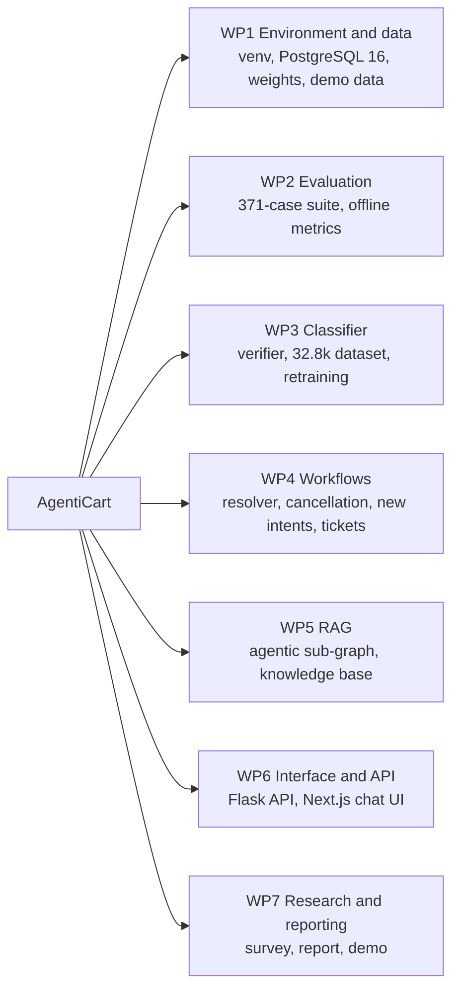

**Figure 1.1:** Work breakdown structure of the project

### 1.4.2 Timeline

The project ran from the beginning of August 2026 to November 2026. During August, the team gathered requirements, designed the architecture and integrated the classifier, which produced the classifier-first LangGraph design with routing over 15 labels. September was spent on the deterministic workflows for orders, products, refunds, returns, damaged items and missing deliveries, together with conversation continuity and PostgreSQL persistence, so that interrupted conversations could be resumed.

In October the retrieval side was built: document RAG, the agentic RAG sub-graph with evidence grading and the separate knowledge-base namespaces. The second half of October and the start of November went into the Flask chat API (`/api/chat`), the optional FakeStore catalogue, policy routing and the Next.js chat interface.

November was devoted to measurement and improvement. The environment was set up end to end and the system was measured for the first time, giving a 133-case baseline of 84.2%. The accuracy and coverage work that followed raised the benchmark to 92.5% and added new handlers, five new intents and a 371-case suite. The multilingual dataset was then built and the classifier retrained, first on 11.9k rows (v2, 90.5%) and then on 32.8k rows (v3, 94.7%), and the metric analysis and survey were completed. In the final phase, the features described in Section 4.1.6 were added: RAG answers with sources, replies in the customer's script, masking of personal data, frustration-based escalation, risk-tiered approvals, order and product cards, damage-photo evidence and the handling of two requests in one message.

### 1.4.3 Roles and responsibilities

The work is divided among the three team members as follows, subject to confirmation by the team. Anushka Verma leads machine learning and data, covering the intent classifier, dataset generation, retraining, calibration and the offline metrics. Anushree Sahu leads the backend and workflows, including the LangGraph workflows, business services, PostgreSQL, intent confirmation, tickets and the API. Arpita Tomar leads RAG, the interface and evaluation, covering the RAG sub-graph and knowledge base, the Next.js interface, the evaluation suite and the documentation. [Supervisor] guides the project through reviews, technical direction and the definition of evaluation criteria.

### 1.4.4 Challenges and risk management

The most serious risk was a classifier that is confidently wrong on new phrasing. It was judged both likely and high-impact, and it was mitigated by building a multilingual dataset, retraining and applying temperature calibration; v3 is confidently wrong on only 1.6% of unseen rows, with an ECE of 1.7%. A second likely risk was exhausting the LLM free-tier quota of 200,000 tokens a day. We reduced prompts to the top five label descriptions, which saves about two thirds of the tokens, added a confidence-based fallback, and added a `--delay` option to the evaluation runner.

Several medium risks were also managed. A long training run could be interrupted, and in fact this happened once, so training runs detached with per-epoch checkpoints and a `--resume` option, which allowed v2 to complete. The chance that an LLM invents order IDs or actions is controlled by closed output schemas, a check that every ID literally appears in the customer's text, and deterministic actions. Tests that leaked into the development database were fixed by pinning them to in-memory checkpoints and offline providers, and the risk of two developers editing the same files was managed with a separate git worktree and file-level coordination. The risk that personal data reaches logs or LLM prompts was closed by masking phone numbers, e-mail addresses, card numbers, UPI IDs, Aadhaar and PAN at the logging and prompt boundaries. One risk remains open: hosted RAG provider keys are not available, which is handled by lazy clients, a safe "not available" reply and local offline providers.

## 1.5 Scope and Limitations

The scope of the project covers intent understanding for 20 e-commerce intents in English, Hindi and Hinglish; deterministic workflows over demonstration data for orders, refunds, returns, damaged and missing deliveries, cancellation, exchange, product stock, shipping, payment and warranty; multi-turn continuity and persistence; support tickets and intent confirmation; agentic RAG for store policies; a web chat interface with feedback; evaluation and monitoring.

Real payment processing, real courier or retailer integrations, customer authentication, voice input, other Indian languages and production deployment at scale are outside the scope of this work.

All business data is fictional. The training data for new intents is template-generated and may differ in style from real traffic. RAG has been validated offline with fake providers; live retrieval quality depends on API keys and an approved document set. The prototype has no user authentication, so a session identifier is not an identity. These limitations are revisited in Section 6.3.

# Chapter 2: Literature Survey

## 2.1 Critical Review

The survey covers five areas: (a) multilingual and code-mixed intent understanding, (b) confidence calibration, (c) retrieval-augmented generation, (d) LLM agents and evaluation, and (e) open-source customer-support systems. For (e), we searched GitHub systematically (16 searches, about 95 repositories, 8 read in full; Section 2.1.5).

### 2.1.1 Multilingual and code-mixed intent understanding

**BERT** [2] introduced bidirectional transformer pre-training with fine-tuning for classification, and became the standard approach for intent detection. **XLM-RoBERTa** [1] extended this to 100 languages, trained on 2.5 TB of filtered CommonCrawl text, and showed strong cross-lingual transfer: a model fine-tuned on English data performs reasonably on other languages. This property is why our base classifier works at all on Hindi, despite English-only fine-tuning, but our measurements (Chapter 5) show that zero-shot transfer is not sufficient for production: accuracy drops from 95.0% (English, in-distribution) to 65.2% on Hindi.

Intent benchmarks such as **CLINC150** [4] (150 intents plus out-of-scope queries) and **Banking77** [5] (77 fine-grained banking intents) established evaluation practice, including explicit out-of-scope detection, which we adopt with an `out_of_scope` label. **MASSIVE** [3] provides 1 M utterances across 51 languages, including Hindi, for intent and slot filling; it confirms that multilingual models lose accuracy on lower-resource languages without in-language training data.

For code-mixed text, **GLUECoS** [6] and **LinCE** [7] provide benchmarks for Hindi–English code-switching and show that multilingual models struggle more on code-mixed text than on either language alone. **MuRIL** [8] and **IndicBERT** (IndicNLPSuite) [9] pre-train on Indian languages, including transliterated text, and improve results on Indian-language tasks. **HinGE** [10] provides a dataset for code-mixed Hinglish generation and evaluation, and **SemEval-2020 Task 9** [11] evaluated sentiment analysis of code-mixed tweets. Doğruöz et al. [12] survey code-switching from linguistic and social perspectives and note the scarcity of task-specific, code-mixed training data, which is exactly the gap our template-based dataset addresses.

Taken together, these works provide models and benchmarks but not an application-level system: none addresses multi-turn support workflows, safe execution of business actions, or calibrated hand-off between a classifier and an LLM.

### 2.1.2 Confidence calibration

Guo et al. [14] showed that modern neural networks are over-confident, and that a single-parameter **temperature scaling** fitted on a validation set fixes most of the mis-calibration without changing accuracy. Desai and Durrett [15] showed that pre-trained transformers are relatively well calibrated in-domain but become poorly calibrated **out of domain**, and that temperature scaling helps. Naeini et al. [16] defined the **Expected Calibration Error (ECE)** used in this report. Our measurements reproduce this pattern exactly: ECE is 2.6% in-domain but 18.7% on new multilingual phrasing. Because our system uses confidence to decide whether to ask the LLM, calibration is a functional requirement, not a cosmetic one.

### 2.1.3 Retrieval-augmented generation

Lewis et al. [19] introduced **RAG**, combining a dense retriever with a generator so that answers are grounded in retrieved documents. **Dense Passage Retrieval** [20] showed that learned dense embeddings outperform sparse retrieval for open-domain question answering, and **Sentence-BERT** [29] made sentence embeddings practical. The survey by Gao et al. [21] classifies RAG systems into naive, advanced and modular forms and identifies retrieval quality, noise robustness and evaluation as open problems.

Two recent lines of work motivate our **agentic** design. **Self-RAG** [22] trains a model to decide when to retrieve and to critique its own outputs; **Corrective RAG (CRAG)** [23] adds a lightweight evaluator that grades retrieved documents and triggers corrective actions (such as query rewriting) when evidence is poor. Liu et al. [24] showed that LLMs use information in the middle of long contexts poorly ("lost in the middle"), supporting the use of a small top-k of well-graded chunks. **RAGAS** [25] proposes reference-free metrics for faithfulness and relevance of RAG answers.

RAG papers, however, focus on open-domain question answering. In customer support, RAG must **not** answer transactional questions (order or refund status), which must come from databases. Our system therefore uses RAG only for policy questions and grades evidence with a strict schema before answering, in the spirit of CRAG.

### 2.1.4 LLM agents and evaluation

**ReAct** [26] interleaves reasoning and tool calls and is the basis of many tool-using agents. The survey by Wang et al. [28] describes LLM-based autonomous agents in terms of profile, memory, planning and action modules. These designs give LLMs wide freedom over tool calls. For money-moving support actions, this freedom is a liability: our design keeps tool selection in a deterministic state machine and uses the LLM only for language understanding tasks with closed outputs.

For evaluation, Zheng et al. [27] studied **LLM-as-a-judge** and found strong agreement with human preferences but also position and verbosity biases. We use deterministic checks (intent, route, required reply content) as the primary metric, and list LLM-as-judge scoring as future work. Barbieri et al. [13] released **XLM-T**, a multilingual XLM-R model adapted to social-media text and fine-tuned for sentiment in eight languages including Hindi; we select it for sentiment-aware escalation.

### 2.1.5 Open-source customer-support systems (GitHub survey)

We ran 16 GitHub searches (for example, `langgraph customer support`, `ecommerce customer support chatbot`, `hinglish chatbot`, `customer service agents handoff`, `support ticket triage llm`, `shopping assistant agent llm`), sorted by stars, and read the documentation of the eight most relevant projects in full [39]–[46].

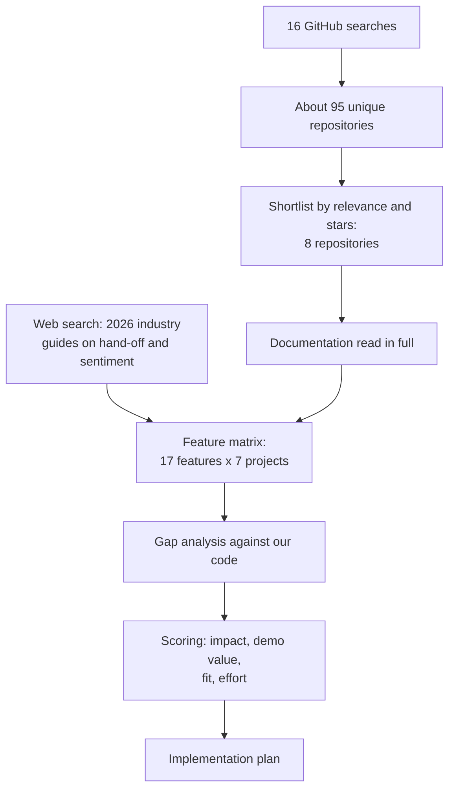

**Figure 2.1:** Research method used for the open-source survey

SakikoMind [39] is the most complete design we found. It is a multi-agent customer-service system with hybrid intent recognition, RAG with citations, Markdown "skills" that carry escalation rules, memory in Redis and ChromaDB, persistent hand-off tickets with redacted summaries, Prometheus metrics and LLM-as-judge evaluation. It supports only Chinese and English, however, and its intent recognition is not evaluated on code-mixed text. ai-service-agent-root [40] is a LangGraph agent with a deterministic policy gate, risk-tiered sub-graphs for reads, mutations, high-risk actions and complaints, human approval through `interrupt()`, seat-gated human take-over and SSE events; it had a strong influence on our risk-tier design.

Two projects come from larger platforms. The NVIDIA Retail Shopping Assistant [41] is a retail blueprint offering natural-language product search, photo and video understanding, deterministic cart totals, tool grants per skill, optional guardrail models, SSE streaming and per-turn observability. tgo [42] is a customer-service platform with multi-agent orchestration, RAG knowledge bases, MCP tools, multi-channel access over the web and WeChat, human collaboration and structured UI cards for orders, logistics and products.

The remaining projects are smaller. The Aakash109 eCommerce Customer Support Agent [44] is a LangGraph ReAct agent using Ollama, FAISS retrieval over policy PDFs, ticket creation, escalation and LangSmith tracing, and is typical of student-level designs in that it has no evaluation. ShoppingGPT [45] places an embedding-based semantic router in front of product search in SQLite and policy search in FAISS, and ecom-service-agent [46] combines ReAct tools, RAG, SSE streaming, memory, Markdown skills and human hand-off. Industry guidance published in 2026 [47]–[49] adds a further recommendation: hand the conversation to a human when confidence drops or sentiment turns negative, and put the customer's emotional state at the top of the hand-off summary.

## 2.2 Summary Table

**Table 2.1:** Comparison of previous research works

| Work | Methodology | Dataset | Languages | Efficiency / cost | Limitation for our problem |
|---|---|---|---|---|---|
| BERT [2] | Transformer pre-training + fine-tuning | BooksCorpus, Wikipedia | English | Fast inference; no API cost | English only |
| XLM-R [1] | Multilingual masked LM, 100 languages | CC-100 (2.5 TB) | 100 incl. Hindi | ~20 ms per message locally | Zero-shot transfer weak on Hindi and code-mixed text |
| CLINC150 [4] | Intent benchmark with out-of-scope | 23,700 queries | English | — | English; single-turn |
| MASSIVE [3] | Multilingual intent and slot dataset | 1 M utterances | 51 incl. Hindi | — | No Hinglish; virtual-assistant domain |
| GLUECoS [6], LinCE [7] | Code-switching benchmarks | Multiple tasks | Hi–En, Es–En | — | No support-intent task |
| MuRIL [8] | Indian-language pre-training incl. transliteration | Indian corpora | 17 Indian | Same as BERT | Needs task fine-tuning data |
| Temperature scaling [14], [15] | Post-hoc calibration | CIFAR, ImageNet, NLP tasks | — | One parameter; negligible cost | Must be fitted per model |
| RAG [19] | Dense retriever + generator | Wikipedia | English | Retrieval + generation per query | No evidence grading; open-domain |
| CRAG [23] | Evaluator grades evidence; corrective actions | QA benchmarks | English | Extra evaluator call | Not designed for transactional safety |
| ReAct [26] | LLM interleaves reasoning and tool calls | QA, decision tasks | English | LLM call per step | Unconstrained tool use; costly |
| XLM-T [13] | XLM-R adapted to tweets, sentiment | 198 M tweets | 8 incl. Hindi | Local | Not trained on Hinglish |
| LLM-as-judge [27] | LLM grades responses | MT-Bench, Arena | English | Judge call per item | Position and verbosity bias |

**Table 2.2:** Comparison of open-source support systems (from documentation)

| Project | Stars (21 Nov 2026) | Core approach | Evaluation suite | Hindi / Hinglish | Notable feature |
|---|---|---|---|---|---|
| cossistant [48] | 742 | Support platform, React SDK | No | No | Embeddable AI support widget |
| tgo [42] | 666 | Multi-agent platform | No | No | UI cards, multi-channel |
| SakikoMind [39] | 112 | Multi-agent + RAG + skills | Yes (27 tests, LLM judge) | No | Redacted hand-off tickets |
| NVIDIA retail [41] | 109 | Skills with tool grants | Yes (Challenger and Judge) | No | Photo understanding |
| ShoppingGPT [45] | 166 | Semantic router + RAG | No | No (Vietnamese) | Fast router |
| ai-service-agent-root [40] | — | LangGraph risk tiers + HITL | Yes (deterministic) | No | Policy gate, seat take-over |
| Aakash109 [44] | 12 | LangGraph ReAct + FAISS | No | No | LangSmith traces |
| **This project** | — | Classifier-first LangGraph + agentic RAG | **Yes (371 cases + offline metrics)** | **Yes** | Calibrated classifier/LLM hand-off |

Looking at individual features across the seven projects, conversation memory is the most common (six projects), followed by human hand-off (five), and streaming, tracing and an evaluation suite (four each). Guardrails or PII masking, risk tiers with approvals, Markdown policy "skills" and MCP tools each appear in three projects, rich UI cards, multi-channel access and a fast router in two, and RAG citations and image understanding in only one. None of the projects implements sentiment-based escalation, handling of two requests in one message, or Hindi and Hinglish.

Before the final phase, our system already had session-level memory through checkpoints, a 371-case evaluation suite, a fast XLM-R router and support for Hindi and Hinglish, which no surveyed project offers. Hand-off was only simulated, observability was limited to the turn log, outputs were closed but PII was not masked, risk approval existed only for cancellation, the interface was web-only and RAG answers named their source files rather than citing passages. Streaming, policy skills, MCP tools, UI cards, image understanding, sentiment escalation and multi-request handling were missing.

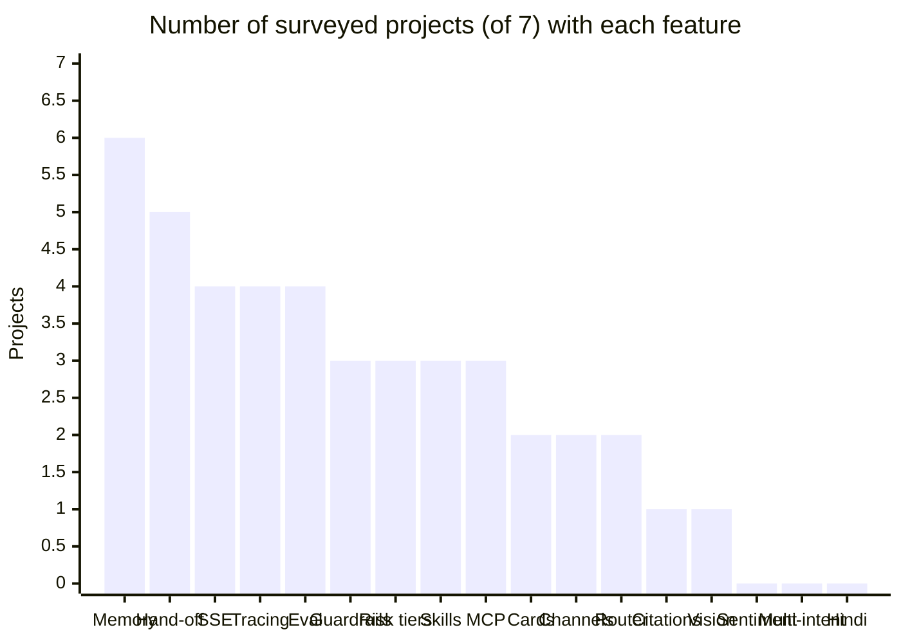

**Figure 2.2:** Feature frequency across the surveyed open-source projects

## 2.3 Identification of Research Gaps

The survey points to six gaps. The first concerns code-mixed support intents: no surveyed system or benchmark covers e-commerce support intents in Hinglish and Devanagari Hindi together, since public datasets are either English (CLINC150, Banking77 and the intent dataset used here) or general-domain multilingual (MASSIVE). The second is the hand-off between a classifier and an LLM. Existing systems are either classifier-only or LLM-first, and none uses calibrated classifier confidence to decide when an LLM should verify a prediction, even though calibration research [14], [15] shows that this is necessary out of domain.

The third gap is measurement. Only four of the seven projects include any evaluation, and none reports per-language accuracy, calibration error or the rate of confidently wrong predictions. The fourth is the safety of business actions: most LLM-agent designs let the model call state-changing tools directly, and only three of the seven use deterministic policy gates with explicit confirmation. Fifth, sentiment-aware escalation and the handling of messages that contain several requests are recommended by industry guidance [47] but implemented in none of the open-source projects. Finally, few systems separate transactional answers, which must come from databases, from policy answers, which come from documents, and fewer still grade the retrieved evidence before answering.

This project addresses all six gaps; gap 5 is addressed by the frustration-based escalation and multi-request handling added in the final phase (Section 4.1.6).

# Chapter 3: System Design & Methodology

## 3.1 Design Considerations

Economic considerations shaped the core architecture. LLM APIs charge per token, free tiers have daily quotas and GPUs are expensive, so the local classifier handles every message and the LLM is called only when confidence is at or below 95%, which happened for 11.3% of messages. Prompts include only the top five label descriptions, cutting tokens by about two thirds, training runs on a laptop GPU, and the whole stack is open source. The same choices address the environmental cost of large-model inference: a small 278 M-parameter model runs first, there is no always-on GPU server, and LLM prompts are short.

Socially, users write in Hindi, Hinglish and English, and some are less confident with digital services. The system therefore uses multilingual training data, accepts Hindi confirmation words such as "हाँ" and "नहीं", falls back politely by listing what the bot can do, and escalates to humans. On the regulatory side, India's DPDP Act, 2023 [33] and consumer-protection expectations lead to masking PII before logs and external LLM calls, minimising the data collected, and using no real personal data in the prototype. Ethically, automation must neither deceive nor trap users, so every demonstration reply is labelled as such, the bot never claims a real refund or courier action, it hands off on request and it does not invent facts. For health and safety, distressed or angry customers trigger frustration-aware escalation, and out-of-scope handling and safe replies ensure the bot gives no medical, legal or financial advice.

Security threats include prompt injection, data leakage and unsafe actions. They are handled with closed output schemas, IDs accepted only when they literally appear in the message, RAG evidence grading, injection tests, and secrets kept only in an ignored `.env` file. Finally, for long-term maintainability the deterministic code is covered by 334 unit tests, the evaluation suite guards against regressions, and all configuration is set through environment variables.

## 3.2 Methodology

### 3.2.1 Overall approach

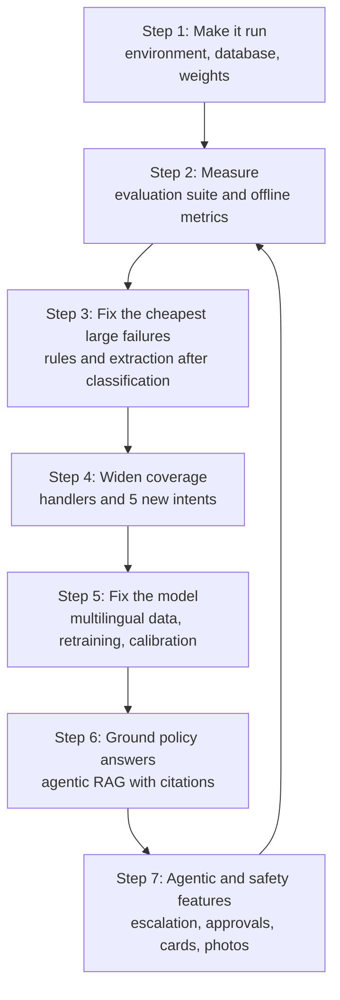

**Figure 3.1:** Evaluation-driven development methodology

### 3.2.2 System architecture

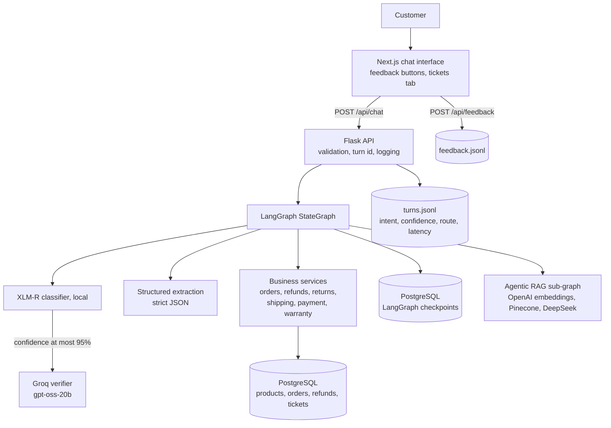

**Figure 3.2:** System architecture

The system has four layers. The **presentation layer** is a Next.js chat interface. The **API layer** is a Flask service that validates input, attaches a `turn_id`, invokes the graph with the session identifier as the LangGraph thread, and logs each turn. The **orchestration layer** is a LangGraph `StateGraph` whose nodes implement classification, continuity and the business workflows. The **data layer** comprises PostgreSQL (business data, tickets and LangGraph checkpoints), the local model files, Pinecone (document vectors) and JSONL logs.

### 3.2.3 LangGraph state machine

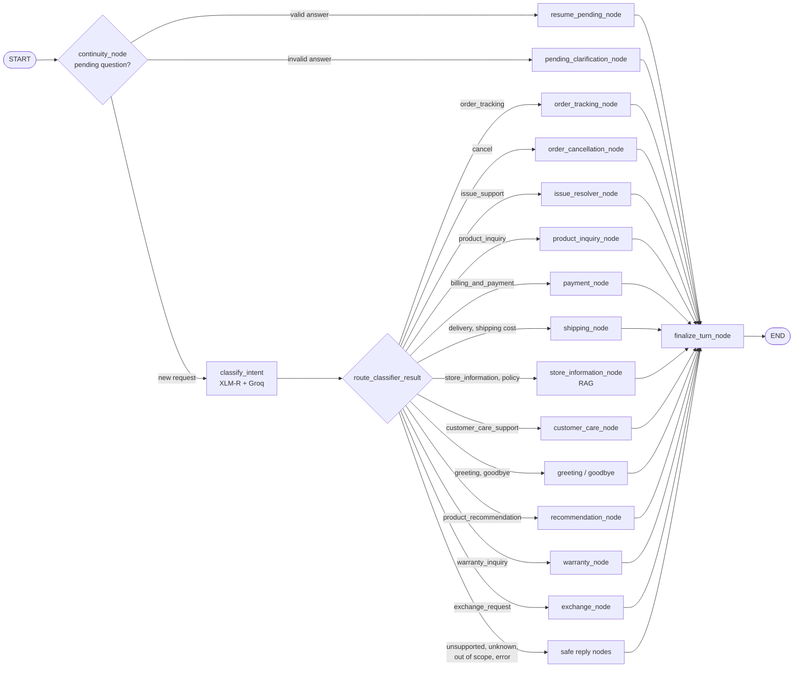

**Figure 3.3:** LangGraph state machine (simplified)

### 3.2.4 Processing of one message

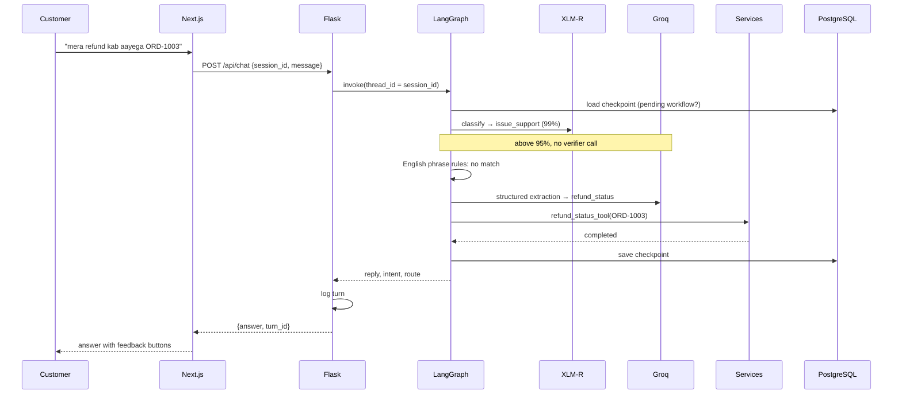

**Figure 3.4:** Sequence diagram for one customer message

### 3.2.5 Algorithms

**Algorithm 1: Confidence-gated intent classification**

```text
Input : message m, conversation history H, threshold τ = 0.95, fallback φ = 0.80
Output: final intent y* and verifier status s

1  z ← XLMR(m)                          // logits over K labels
2  p ← softmax(z / T)                    // T = fitted temperature (1.0 for v1)
3  ŷ ← argmax p ;  c ← max p
4  if c > τ then return (ŷ, ACCEPTED_BY_CLASSIFIER)
5  D ← descriptions of the 5 labels with highest p
6  r ← GroqVerify(m, ŷ, D, last 4 turns of H)     // strict JSON
7  if r.status ∈ {CORRECT, CORRECTED} and r.label ∈ labels then return (r.label, r.status)
8  if r.status ∈ {OUT_OF_SCOPE, UNKNOWN} then return (None, r.status)
9  if r failed (error or quota) and c ≥ φ then return (ŷ, CLASSIFIER_FALLBACK_VERIFIER_UNAVAILABLE)
10 return (None, UNVERIFIED)            // fail closed
```

**Algorithm 2: Issue-type resolution for `issue_support`**

```text
Input : message m, earlier issue type e (optional)
Output: issue type ∈ {refund_status, return_order, damaged_order, missing_order} or ask

1  M ← English phrase rules matched in m
2  if |M| = 1 then return M
3  if |M| ≥ 2 then ask "which issue?"
4  r ← GroqExtract(m) with JSON schema {issue_type ∈ 4 types or null, order_id}
5  if r.order_id not literally in m then r.order_id ← null
6  if r.issue_type ≠ null then return r.issue_type
7  if e ≠ null then return e
8  ask "which issue?"
```

**Algorithm 3: Conversation continuity (pending workflows)**

```text
Input : state S with optional pending workflow P (awaiting slot σ), message m
1  if S awaits confirmation:
2      if m ∈ YES (yes, confirm, हाँ, जी ...) then resume P as confirmed
3      if m ∈ NO  (no, cancel, नहीं, रद्द ...) then cancel P; reply "no operation performed"
4  if P exists and m validates for slot σ (e.g. ORD-dddd for order_id):
5      store value; if more slots remain then ask next slot else resume P
6  else classify m:
7      if m is a verified new request: push P onto the suspended stack; handle m;
8         after the reply, pop P and append "To continue your earlier request: ..."
9      else re-ask for σ with a clarification
```

**Algorithm 4: Template-level dataset split**

```text
1  for each template t in en, hi, hinglish template files:
2      split(t) ← bucket(hash(t.id)) with 70 / 15 / 15 proportions
3      generate variants by slot filling and augmentation; all variants inherit split(t)
4  sample 400 original rows per original intent → train / val / retention test
5  assert no test row shares a template with any training row
```

**Algorithm 5: Agentic RAG**

```text
1  q ← question (resolve short follow-ups from a safe earlier user turn)
2  for attempt in {1, 2}:
3      E ← Pinecone.query(embed(q), top_k = 4, namespace = approved), keep score ≥ 0.35
4      g ← DeepSeek.grade(q, E) as strict JSON {sufficient, reason, missing_information}
5      if g is malformed or an error occurred: return "not available"
6      if g.sufficient: return Generate(q, E) + sources added by code
7      if attempt = 1: q ← Rewrite(q)
8  return "not available"
```

### 3.2.6 Dataset generation pipeline

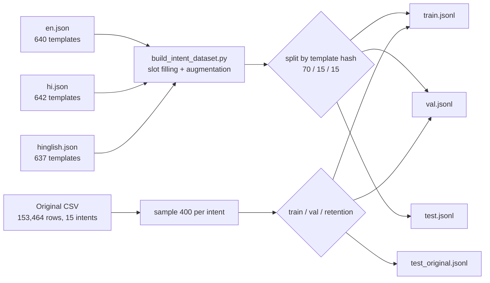

**Figure 3.5:** Multilingual dataset generation pipeline

### 3.2.7 Retraining pipeline

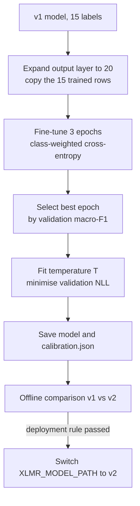

**Figure 3.6:** Classifier retraining and calibration pipeline

### 3.2.8 Agentic RAG flow

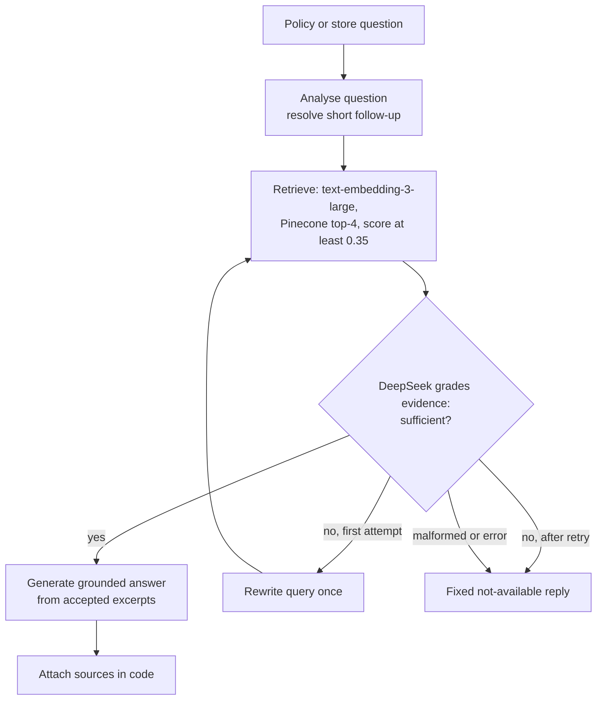

**Figure 3.7:** Agentic RAG sub-graph

## 3.3 Modelling

This section gives the equations used to train, calibrate, evaluate and operate the system.

**(1) Softmax with temperature.** For logits $z \in \mathbb{R}^K$ over $K$ intents and temperature $T > 0$:

$$p_k = \frac{\exp(z_k / T)}{\sum_{j=1}^{K} \exp(z_j / T)}, \qquad \hat{y} = \arg\max_k p_k, \qquad c = \max_k p_k$$

**(2) Class-weighted cross-entropy.** With $N$ training examples, $n_c$ examples of class $c$ and weight $w_c$:

$$w_c = \frac{N}{K \, n_c}, \qquad \mathcal{L} = -\frac{1}{N} \sum_{i=1}^{N} w_{y_i} \log p_{y_i}(x_i)$$

The weights give the five new intents (which have no original data) the same total influence as the fifteen original ones.

**(3) Warm start of the output layer.** For the new weight matrix $W' \in \mathbb{R}^{20 \times 768}$ and bias $b'$:

$$W'_{1:15} = W_{v1}, \quad b'_{1:15} = b_{v1}, \qquad W'_{16:20}, \, b'_{16:20} \sim \text{random initialisation}$$

**(4) AdamW optimisation with linear warm-up.** With learning rate $\eta_t$, weight decay $\lambda = 0.01$, peak rate $\eta_{\max} = 2 \times 10^{-5}$, warm-up steps $t_w = 0.06\,t_{\text{total}}$:

$$\theta_{t+1} = \theta_t - \eta_t \left( \frac{\hat{m}_t}{\sqrt{\hat{v}_t} + \epsilon} + \lambda \theta_t \right), \qquad \eta_t = \begin{cases} \eta_{\max}\, t / t_w & t < t_w \\ \eta_{\max}\, \dfrac{t_{\text{total}} - t}{t_{\text{total}} - t_w} & t \ge t_w \end{cases}$$

**(5) Temperature calibration.** The temperature is fitted on validation logits by minimising negative log-likelihood:

$$T^{*} = \arg\min_{T > 0} \; -\sum_{i \in \text{val}} \log \operatorname{softmax}\!\left(\frac{z_i}{T}\right)_{y_i}$$

**(6) Expected Calibration Error** with $M = 15$ equal-width confidence bins $B_m$:

$$\text{ECE} = \sum_{m=1}^{M} \frac{|B_m|}{n} \left| \operatorname{acc}(B_m) - \operatorname{conf}(B_m) \right|$$

**(7) Precision, recall and F1** for intent $k$, and macro averages:

$$P_k = \frac{TP_k}{TP_k + FP_k}, \quad R_k = \frac{TP_k}{TP_k + FN_k}, \quad F1_k = \frac{2 P_k R_k}{P_k + R_k}, \quad \text{Macro-F1} = \frac{1}{K} \sum_{k} F1_k$$

**(8) One-vs-rest ROC-AUC** via the Mann–Whitney statistic, with $n_+$ positives, $n_-$ negatives and $\text{rank}_i$ the rank of score $p_k(x_i)$ among all scores:

$$\text{AUC}_k = \frac{\sum_{i \in +} \text{rank}_i - \frac{n_+(n_+ + 1)}{2}}{n_+ \, n_-}, \qquad \text{Macro-AUC} = \frac{1}{K} \sum_k \text{AUC}_k$$

**(9) Routing decision.** With threshold $\tau = 0.95$ and fallback $\varphi = 0.80$:

$$\text{route}(m) = \begin{cases} \hat{y} & c > \tau \\ \text{verify}(m) & c \le \tau,\ \text{verifier available} \\ \hat{y} & c \ge \varphi,\ \text{verifier unavailable} \\ \text{fail closed} & \text{otherwise} \end{cases}$$

**(10) Expected latency.** With the probability of a verifier call $p_v$:

$$\mathbb{E}[t] = t_{\text{cls}} + p_v \, t_{\text{LLM}} \approx 20 \text{ ms} + 0.113 \times 1.5 \text{ s} \approx 190 \text{ ms}$$

**(11) Retrieval scoring and chunking.** Cosine similarity between query embedding $q$ and chunk embedding $d$, with the retrieval filter, and the number of chunks for a document of length $L$ characters with chunk size $s = 1200$ and overlap $o = 150$:

$$\operatorname{sim}(q, d) = \frac{q \cdot d}{\lVert q \rVert \, \lVert d \rVert} \ge 0.35, \qquad n_{\text{chunks}} = \left\lceil \frac{L - o}{s - o} \right\rceil$$

**(12) Frustration score for escalation.** For turn $t$, with negative-sentiment probability $P_{\text{neg}}$, an escalation-phrase indicator $\phi_t$ and a repetition indicator $r_t$ (same intent three times, two clarifications, or a thumbs-down on the last answer):

$$F_t = \alpha \cdot \max_{i \in \{t-2, t-1, t\}} P_{\text{neg}}(m_i) + \beta \, \phi_t + \gamma \, r_t, \qquad \text{escalate if } F_t \ge \theta$$

**(13) Evaluation pass rule.** A case passes only if all applicable checks pass:

$$\text{pass} = \mathbb{1}[\text{intent correct}] \cdot \mathbb{1}[\text{route correct}] \cdot \prod_{s \in \text{required facts}} \mathbb{1}[s \in \text{reply}]$$

## 3.4 Tool and Technique Selection

**Table 3.1:** Tool and technique selection with justification

| Need | Selected | Alternatives considered | Justification |
|---|---|---|---|
| Intent classifier | XLM-RoBERTa base, fine-tuned | mBERT, MuRIL, LLM zero-shot | Covers Hindi and English with one model; strong cross-lingual transfer [1]; ~20 ms locally; existing fine-tuned weights to warm-start from |
| Verifier and extraction LLM | `openai/gpt-oss-20b` on Groq | GPT-4-class APIs, local LLM | Open-weight model; Groq's low latency; free tier for development; supports strict JSON |
| Orchestration | LangGraph | Plain Python, Rasa, LangChain agents | Explicit state machine with conditional edges; built-in checkpointing (PostgreSQL); `interrupt()` for human approval |
| Business and checkpoint store | PostgreSQL 16 + SQLAlchemy + Alembic | SQLite, MongoDB | Reliable transactions; official LangGraph Postgres saver; versioned migrations |
| Embeddings | OpenAI `text-embedding-3-large` (3,072-d) | Sentence-BERT, multilingual-e5 | High multilingual retrieval quality; simple API |
| Vector store | Pinecone (cosine, namespaces) | FAISS, ChromaDB | Managed, namespace isolation for approved vs demo knowledge |
| RAG generator and grader | DeepSeek (`deepseek-flash`) | GPT-4-class, Llama | Low cost; strict JSON grading |
| API | Flask | FastAPI, Django | Lightweight; sufficient for synchronous chat; team familiarity |
| Frontend | Next.js 16 + React 19 | Streamlit, plain HTML | Production-grade UI; easy to add cards and streaming |
| Training hardware | Apple M4 GPU (MPS) | Cloud GPU | No rental cost; ~3.4 s per step |
| Testing | `unittest`, offline fakes | pytest with live APIs | Fast (≈1.2 s), deterministic, no API cost |
| Sentiment | `cardiffnlp/twitter-xlm-roberta-base-sentiment` | LLM sentiment, lexicons | Hindi supported [13]; local; same model family |
| Vision | `llama-4-scout-17b-16e-instruct` on Groq | GPT-4o-class | Image input on the existing provider [38] |

# Chapter 4: Implementation & Testing

## 4.1 Development Details

### 4.1.1 Step-by-step execution

Development began with the environment. We installed Python 3.11 and created a virtual environment, installed PostgreSQL 16, created the `ecom_support_dev` database, applied the Alembic migrations and imported the demonstration records. The XLM-R weights (1.11 GB) were placed in `models/xlmr_intent_classifier/`, and CORS was configured so that the frontend could reach the API.

Before changing any behaviour we measured a baseline. We wrote 133 labelled cases and the `evals/run_eval.py` runner, which gave a pass rate of 84.2%, and saved the result as `evals/baseline.json`. The first fix that followed came from a failure in this baseline: Groq had overridden a correct `issue_support` prediction for "i do not like my order", so we rewrote that intent's description for the verifier. We then added `app/services/llm_extraction.py`, which extracts the issue type and product as strict JSON and accepts an ID only when it appears in the customer's text, and improved product matching with plural, typo and category handling and a constrained LLM fallback over catalogue names.

Coverage was widened next. We implemented shipping and payment answers, order cancellation with confirmation, the turn log, and the feedback API with its buttons, and extended the suite to 326 cases. Five new intents (`greeting`, `goodbye_thanks`, `product_recommendation`, `warranty_inquiry` and `exchange_request`) were then added with their handlers, bringing the suite to 371 cases.

For the classifier, we wrote 1,919 templates and `scripts/build_intent_dataset.py`, which generated 17,898 rows, and `scripts/train_intent_classifier.py`, which implements the warm start, class weights, calibration and resumable per-epoch checkpoints. The first training run was interrupted after epoch 1 at 88.65% validation accuracy; resuming it produced v2. We later enlarged the dataset to 4,321 templates and 32,816 rows, and the same recipe produced v3. Accuracy, precision, recall, F1, ROC-AUC and ECE were then measured for the production model on all test sets. In a parallel worktree, intent confirmation was added together with the tickets table (migration `0003`), the ticket service and the "My Tickets" tab.

### 4.1.2 Detailed workflow descriptions

This section describes every workflow that the state machine can run, with its inputs, decision steps and possible replies.

#### (a) Conversation continuity and resumption

Every message first enters `continuity_node`. If the conversation is waiting for a value (for example, an order ID), the message is validated against that slot before any classification. Valid values resume the paused workflow; a verified new request suspends it and is handled first; the paused request is then re-offered with "To continue your earlier request: …".

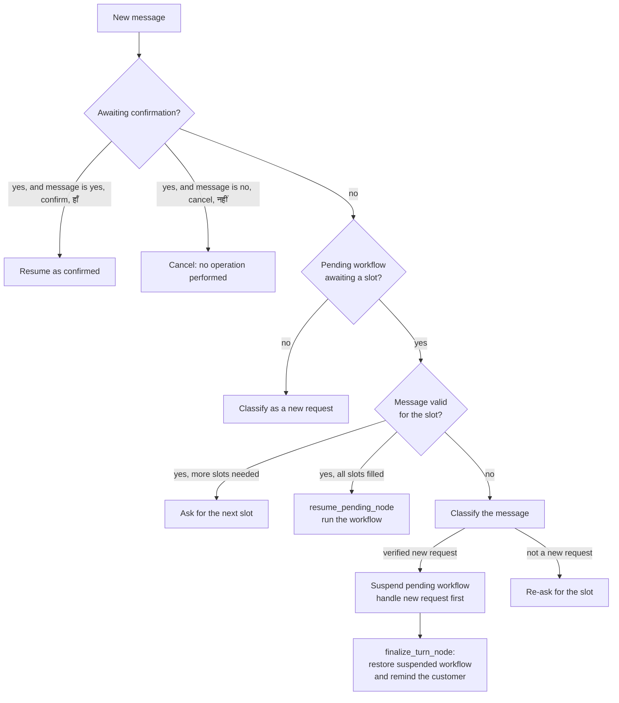

**Figure 4.1:** Conversation continuity workflow

Each slot has its own validation rule. An `order_id` must be `ORD-` followed by four digits, optionally written as "my order id is …", and the prompt asks the customer to provide it with ORD-1001 as an example. A `product_identifier` is either a product ID of the form `PROD-ddd` or a name that matches exactly one product. The `issue_type` slot accepts refund, return, damaged or missing, or any text the resolver can classify into one of them, and the prompt offers these four choices. Free-text slots require a minimum length and must not be questions: a `return_reason` needs at least two words, while `damage_description` and `missing_delivery_details` need at least three, and each prompt gives an example such as "a cracked screen". Finally, the `confirmation` slot accepts yes, confirm, y, हाँ, हां or जी to proceed and no, cancel, n, नहीं or रद्द to stop, prompted with "Reply 'yes' to cancel or 'no' to keep it." 

#### (b) Classification and routing

`classify_intent_node` applies Algorithm 1 and clears per-turn fields. `route_classifier_result` then maps the verified intent to a route. Unverified results fail closed (`verification_error`); unknown or out-of-scope results go to safe replies. Two refinements apply: a cancellation request classified as `order_management` goes to `order_cancellation` (unless it asks about fees or policy), and a general return or refund **policy** question classified as `issue_support` goes to the RAG node.

**Table 4.1:** Intent-to-route mapping

| Intent | Route / node | Behaviour |
|---|---|---|
| order_tracking | order_tracking_node | Status, ETA and delay explanation |
| order_management | order_cancellation_node (if cancelling) / unsupported | Cancellation with confirmation; item changes not supported |
| issue_support | issue_resolver_node / store_information_node (policy questions) | Refund status, return, damage, missing delivery |
| product_inquiry | product_inquiry_node | Stock and price from the catalogue |
| billing_and_payment | payment_node | Payment methods, COD limit, invoices |
| delivery_options, shipping_cost | shipping_node | Coverage, methods, charges |
| store_information | store_information_node | Agentic RAG |
| customer_care_support | customer_care_node | Hand-off with conversation summary |
| greeting, goodbye_thanks | greeting_node, goodbye_node | Welcome and capabilities / polite close |
| product_recommendation | product_recommendation_node | In-stock suggestions by category |
| warranty_inquiry | warranty_node | Coverage and claim process |
| exchange_request | exchange_node | Exchange only after delivery |
| account_management, add_to_cart, remove_from_cart, place_order, submit_feedback | unsupported_node | Polite reply listing supported actions |
| out_of_scope | out_of_scope_node | Polite refusal |

#### (c) Order tracking

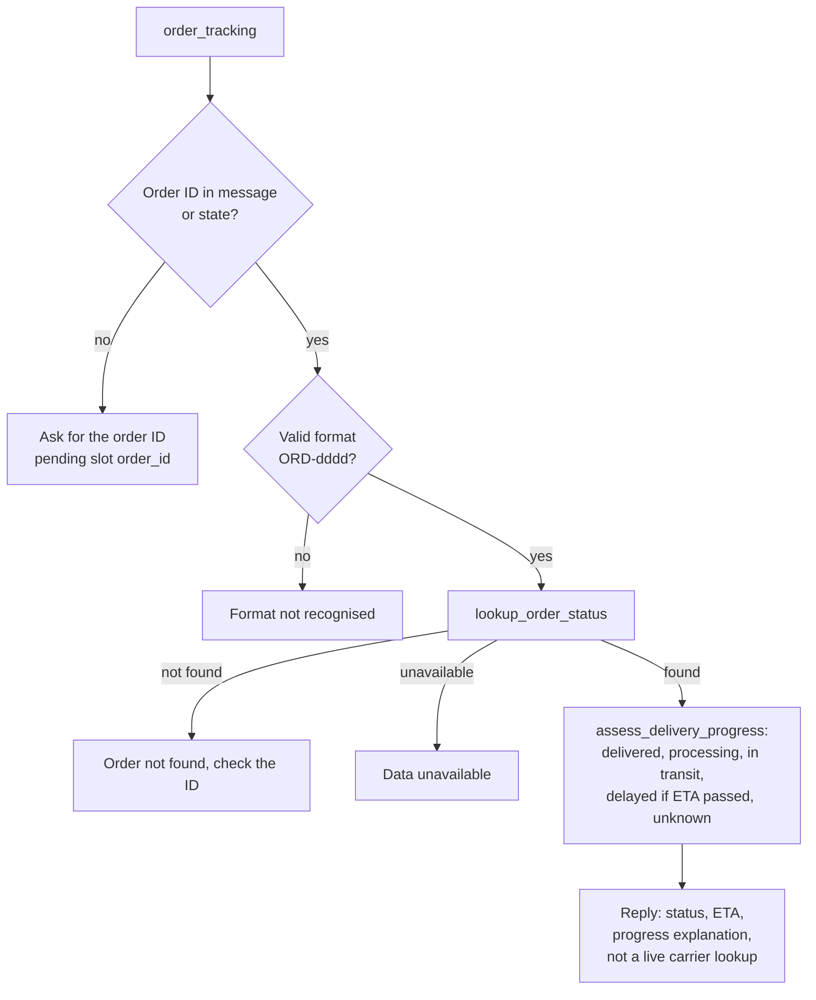

**Figure 4.2:** Order-tracking workflow

#### (d) Issue support: refund status, return, damaged item, missing delivery

The issue resolver first determines the issue type (Algorithm 2), collects the order ID and any detail the issue needs, then calls the matching tool. Each tool returns a demonstration reference (case or request number) and never claims that a real refund, pickup or courier claim was made.

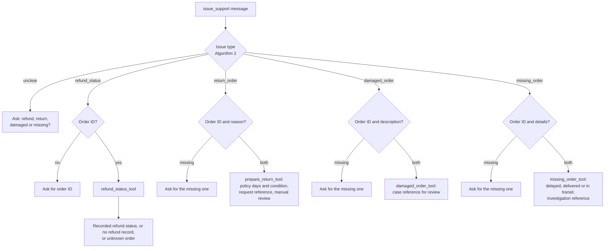

**Figure 4.3:** Issue-support workflow

#### (e) Order cancellation with confirmation

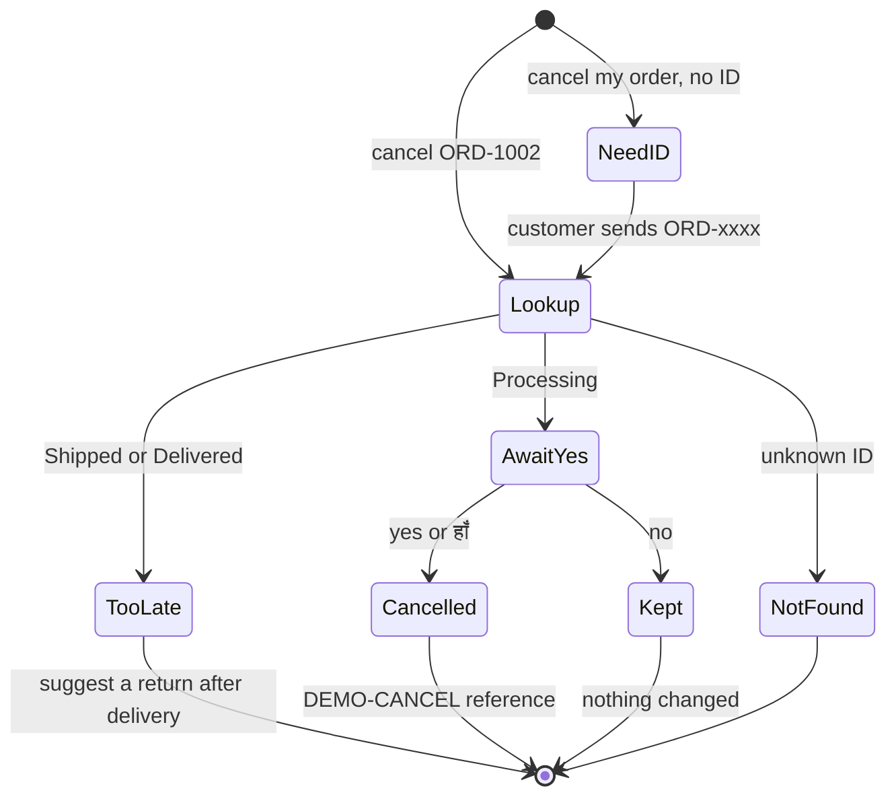

**Figure 4.4:** Order-cancellation state diagram

Only orders in the *Processing* state can be cancelled. The cancellation runs only after an explicit "yes" and only for the same order ID that was confirmed. Questions about cancellation fees or policy, and requests to change items, receive the polite "not supported" reply.

#### (f) Exchange request

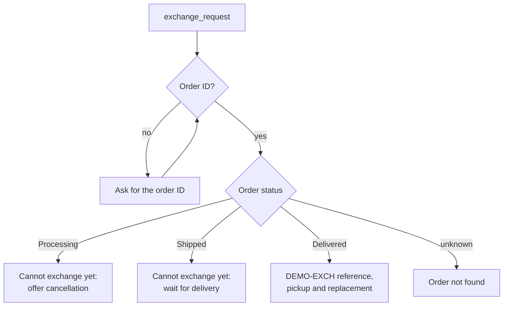

**Figure 4.5:** Exchange workflow

#### (g) Product inquiry and recommendation

The product node searches the catalogue by product ID, exact name, plural or typo-tolerant match ("headphnes" → Noise-Cancelling Headphones), or a category word resolved by a constrained LLM call that may only return an exact catalogue name. One match gives stock, price and restock date; several matches ask the customer to choose; no match asks for an exact name. An optional external demo catalogue (FakeStore) can be enabled; when selected, its misses are terminal and never silently fall back to local data. Recommendations list in-stock items in the mentioned category.

#### (h) Shipping, payment and warranty

These nodes answer from structured files (`shipping_payment.json`, `warranty.json`): city coverage (English and Devanagari city spellings), methods and charges (₹49 standard, free above ₹499; ₹149 express; ₹199 same-day), India-only delivery, payment methods (UPI, cards, net banking, PayPal, COD up to ₹10,000), invoices, and 24-month warranty coverage with the claim process.

#### (i) Store information and policies (RAG)

Handled by the agentic RAG sub-graph (Figure 3.7, Algorithm 5). Answers include source documents; when evidence is insufficient after one rewrite, the bot replies that the information is not available rather than guessing.

#### (j) Customer care hand-off

The node records a hand-off request containing the customer's reason and a summary of the last six messages (limited to 1,800 characters), and returns a reference. In the current prototype, no live agent is contacted and the reply says so. With the tickets feature, the hand-off becomes a ticket of category `customer_care`.

#### (k) Intent confirmation and tickets

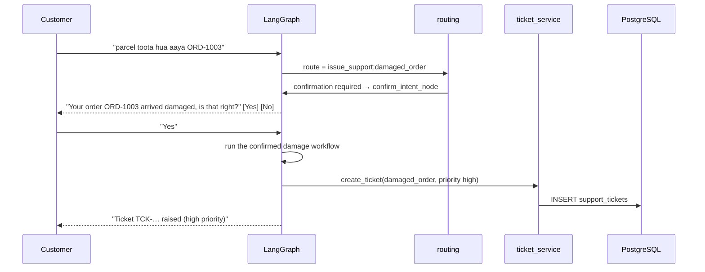

**Figure 4.6:** Intent confirmation and ticket creation

Damaged-item and missing-delivery tickets are high priority; returns, exchanges and agent requests are normal priority. Customers can view their tickets in the "My Tickets" tab.

#### (l) Safe replies

Four nodes produce safe replies without running any business action. `unsupported_node` handles intents that are recognised but not supported, explaining what the bot cannot do and listing what it can. `unknown_intent_node` is used when the verifier reports an unknown e-commerce intent and asks the customer to rephrase, again listing the supported topics. `out_of_scope_node` gives a polite refusal for out-of-scope messages, since the bot handles shopping support only, and `verification_error_node` returns a safe reply when a result could not be verified or classification failed.

### 4.1.3 Prototype screenshots

<div class="shot-grid">

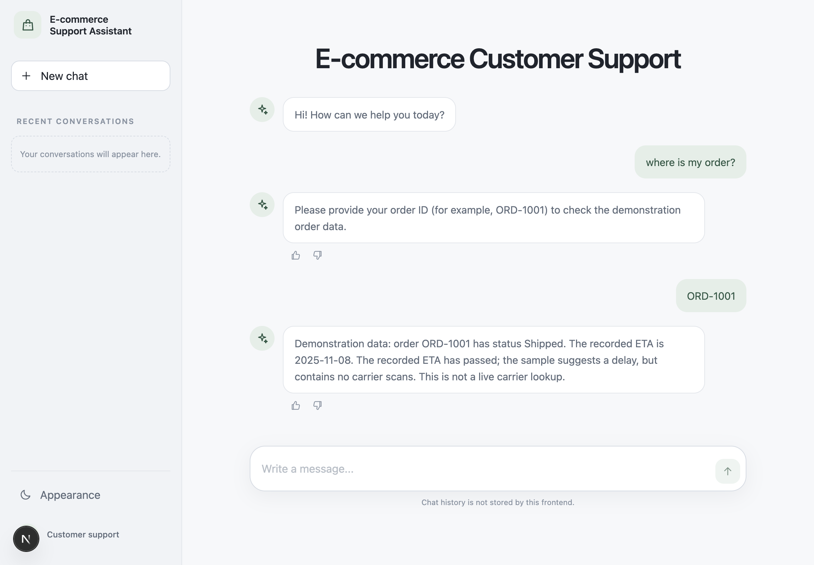

**Figure 4.7:** Order tracking across two turns (prototype)

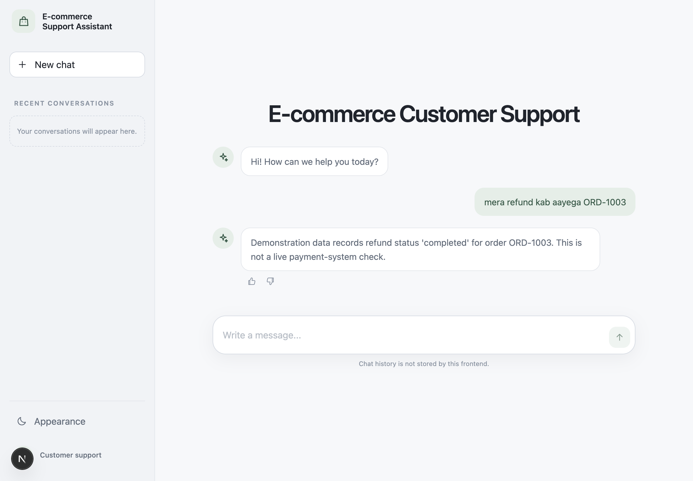

**Figure 4.8:** Hinglish refund-status request resolved by structured extraction

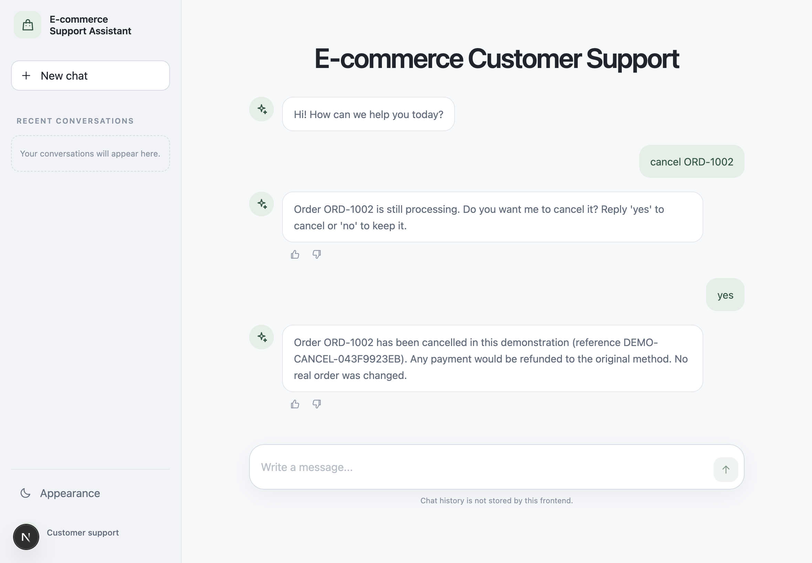

**Figure 4.9:** Order cancellation with explicit confirmation

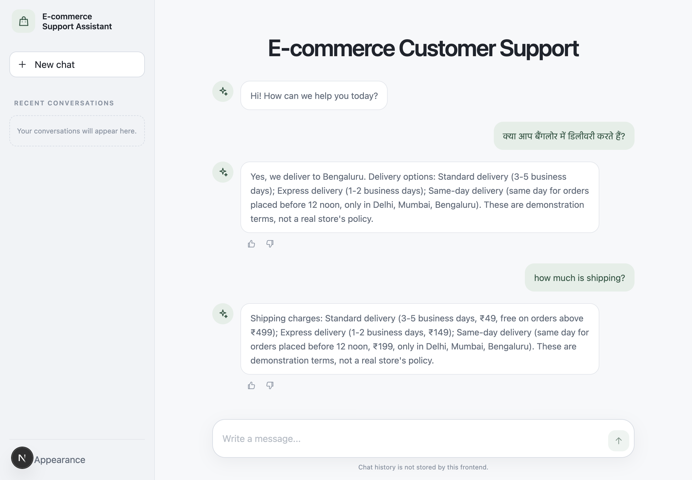

**Figure 4.10:** Devanagari Hindi delivery question and shipping charges

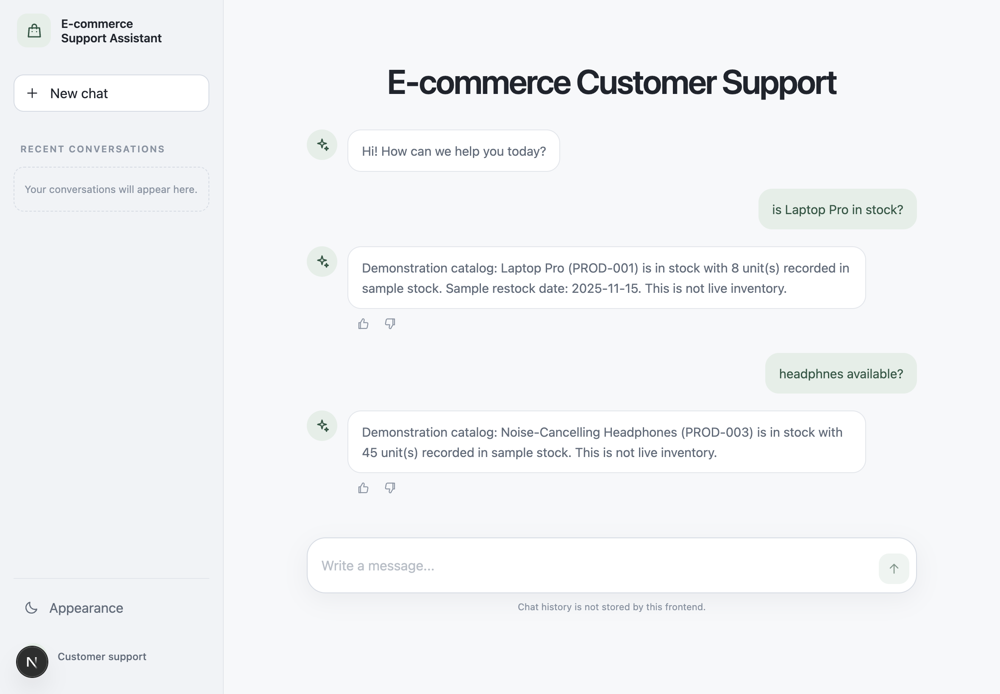

**Figure 4.11:** Product stock enquiry with typo tolerance

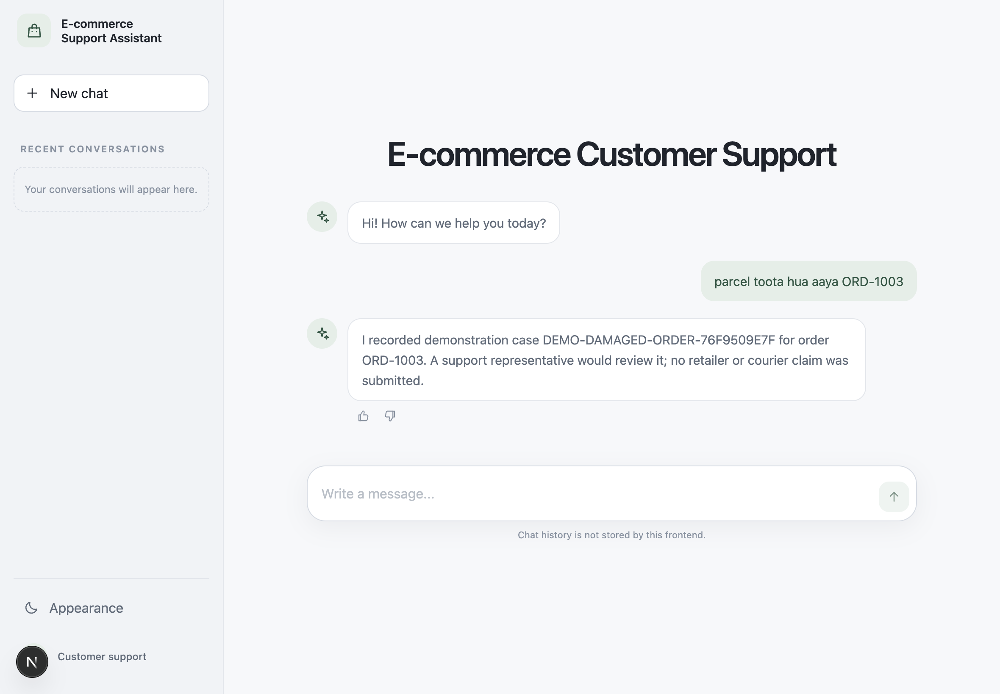

**Figure 4.12:** Hinglish damaged-item report recorded as a demonstration case

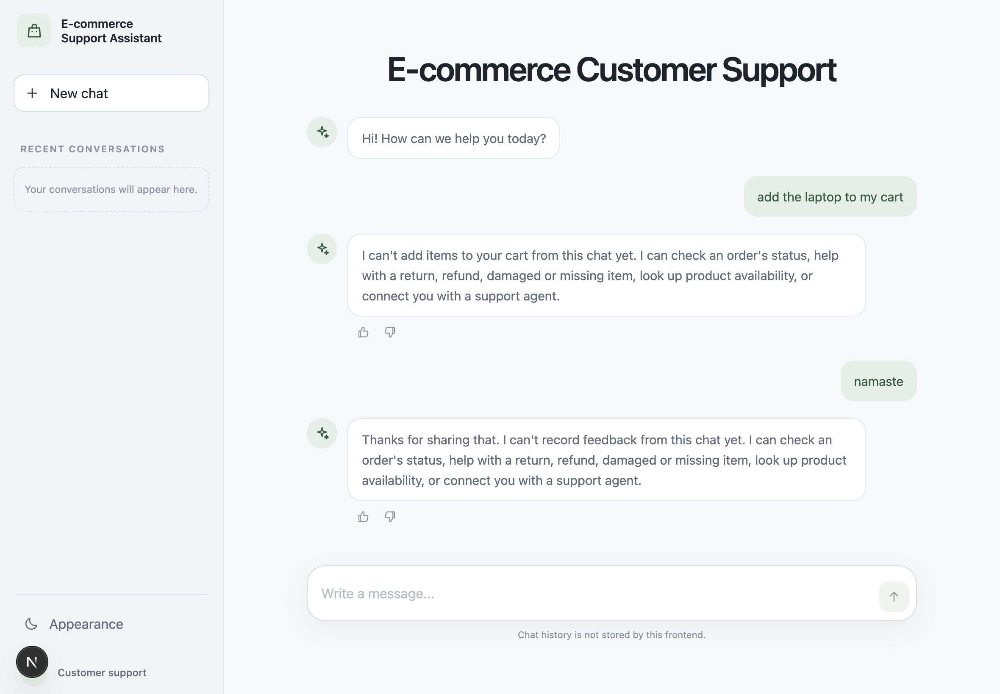

**Figure 4.13:** Polite reply for an unsupported request; "namaste" is misread by the v1 model, which has no greeting label (fixed in v2 and v3)

</div>

### 4.1.4 Code excerpts

**Listing 4.1:** Route selection with fail-closed behaviour (`app/graph/routing.py`, abridged)

```python
def route_classifier_result(state: AgentState) -> str:
    status = state.get("verifier_status")
    if status in {"UNVERIFIED", "CLASSIFICATION_ERROR"}:
        return "verification_error"
    if status == "OUT_OF_SCOPE":
        return "out_of_scope"
    if status not in _VERIFIED_STATUSES:
        return "unknown_intent"
    final_intent = state.get("final_intent")
    if final_intent == "order_management" and _is_order_cancellation_request(state.get("query")):
        return "order_cancellation"
    if final_intent in UNSUPPORTED_INTENTS:
        return "unsupported"
    if final_intent == "issue_support" and _is_general_return_refund_policy_question(state.get("query")):
        return "store_information"
    return INTENT_TO_ROUTE.get(final_intent, "unknown_intent")
```

**Listing 4.2:** Cancellation only after explicit confirmation (`app/graph/nodes.py`, abridged)

```python
if state.get("confirmation_status") == "confirmed" and collected.get("order_id") == order_id:
    reference = f"DEMO-CANCEL-{uuid4().hex[:10].upper()}"
    return reply(f"Order {order_id} has been cancelled in this demonstration ...", ...)
status = lookup_order_status(order_id)["order_status"]
if status.casefold() not in {"processing"}:
    return reply(f"Order {order_id} is already {status.lower()}, so it can no longer be cancelled. ...")
prompt = f"Order {order_id} is still {status.lower()}. Do you want me to cancel it? Reply 'yes' or 'no'."
return reply(prompt, ..., confirmation_required=True, confirmation_status="requested")
```

**Listing 4.3:** Warm start and class weights (`scripts/train_intent_classifier.py`, abridged)

```python
with safe_open(str(args.base / "model.safetensors"), framework="pt") as weights:
    old_w = weights.get_tensor("classifier.out_proj.weight")
    old_b = weights.get_tensor("classifier.out_proj.bias")
model.classifier.out_proj.weight[: old_w.shape[0]] = old_w
model.classifier.out_proj.bias[: old_b.shape[0]] = old_b
weights = torch.tensor([len(train) / (len(labels) * counts[l]) for l in labels])
loss_fn = torch.nn.CrossEntropyLoss(weight=weights.to(device))
optimizer = torch.optim.AdamW(model.parameters(), lr=args.lr, weight_decay=0.01)
```

### 4.1.5 Models and datasets used

**Table 4.2:** Models used in the system

| # | Model | Where it runs | Role | Size / settings | Status |
|---|---|---|---|---|---|
| 1 | `FacebookAI/xlm-roberta-base` | Upstream base | Multilingual encoder | 12 layers, 768 hidden, 12 heads, 250,002 vocabulary, ≈278 M parameters | Base |
| 2 | `xlmr_intent_classifier` (v1) | Local, MPS / CPU | Intent classifier, 15 labels | 1.11 GB, max length 64 | Production |
| 3 | `xlmr_intent_classifier_v2` | Local | Intent classifier, 20 labels, calibrated (T = 1.279) | Warm-started from v1; 11.9k-row dataset | Trained (test 90.5%) |
| 3a | `xlmr_intent_classifier_v3` | Local | Intent classifier, 20 labels, calibrated (T = 1.444) | Warm-started from v1; 32.8k-row dataset | Superseded by v4 (test 94.7%) |
| 3b | `xlmr_intent_classifier_v4` | Local | Intent classifier, 20 labels, calibrated (T = 1.540) | Warm-started from v1; 32.8k-row dataset, 4 epochs | **Deployed** (test 94.8%, ECE 1.57%) |
| 4 | `openai/gpt-oss-20b` | Groq API | Verifier; issue-type and product extraction | Strict JSON, 8 s timeout, 1 retry | Production |
| 5 | `text-embedding-3-large` | OpenAI API | RAG embeddings | 3,072 dimensions | Integrated; keys pending |
| 6 | `deepseek-flash` | DeepSeek API | RAG evidence grader, rewriter, generator | Strict JSON grading | Integrated; keys pending |
| 7 | `cardiffnlp/twitter-xlm-roberta-base-sentiment` | Local | Sentiment for escalation | XLM-R base | Used |
| 8 | `meta-llama/llama-4-scout-17b-16e-instruct` | Groq API | Damage-photo evidence | Image input | Used |

**Table 4.3:** Datasets used

| # | Dataset | Size | Languages | Use |
|---|---|---|---|---|
| 1 | E-Commerce Customer Intent Detection [36] | 153,464 rows, 15 intents | English | v1 training; 6,000 rows mixed into v2 |
| 2 | Intent templates (this project) | 1,919 templates, 20 intents | en 640, hi 642, hinglish 637 | Source of generated data |
| 3 | Generated dataset, version 1 | 11,898 + 6,000 original = 17,898 rows | en 3,996, hi 3,937, hinglish 3,965 | v2 train / val |
| 3a | Generated dataset, version 2 | 32,816 generated rows from 4,321 templates (1,440 en, 1,443 hi, 1,438 hinglish; 2,402 new) + 6,000 original; val 5,450; test 4,866 | en, hi, hinglish | v3 training; common test set for v1, v2, v3 |
| 4 | Retention test | 900 rows | English | Forgetting check |
| 5 | Evaluation suite | 371 cases (29 multi-turn) | en 170, hinglish 115, hi 86 | End-to-end evaluation |
| 6 | Mock business data | Orders, products, refunds, policies, shipping, warranty, customers | English | Workflows |
| 7 | Knowledge base (demo) | 7 documents | en, hi | RAG development |

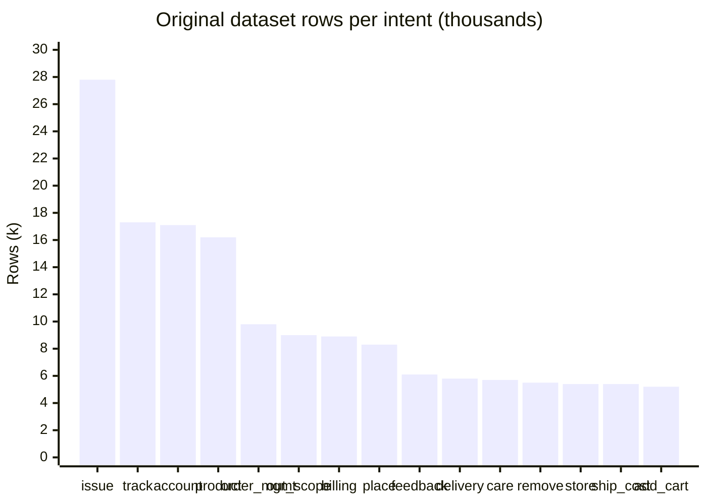

**Figure 4.14:** Class distribution of the original training dataset

The first generated dataset, used to train v2, contains 17,898 rows. The training split has 12,900 rows, of which 4,500 are original rows mixed in to prevent forgetting, and the validation split has 2,326 rows, including 600 original rows. The unseen-template test split contains 1,772 rows and no original data, while a separate retention test of 900 original rows measures whether the model still handles its source data.

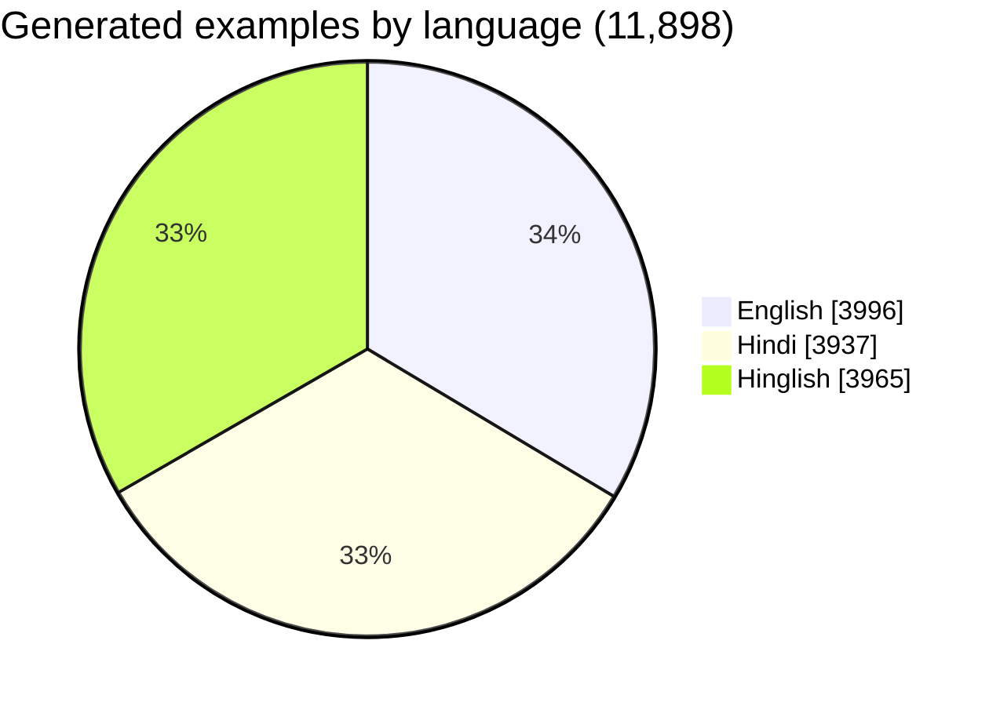

**Figure 4.15:** Generated examples by language

### 4.1.6 Features added in the final phase

The final phase added ten features. The first group strengthened what already existed. The retrained classifier was evaluated and switched in, and intent confirmation and tickets from Section 4.1.2 (k) were merged into the main branch. Policy and how-to questions are now answered from the help documents with their sources listed under the answer, following [23], [25] and [39], and a 30-question RAG evaluation set measures retrieval and refusals (Section 5.1.5).

Replies are now written in the customer's own script. A light heuristic in `app/services/language.py` decides whether a message is Hindi (by the share of Devanagari characters) or Hinglish (by a curated list of romanised Hindi words that are not also common English words). When the customer did not write in English, the finished English reply and its quick-reply buttons are rewritten by the Groq model into Hindi or Hinglish, keeping order IDs, amounts and dates unchanged; if the call fails, the English reply is sent as it is. Before any text is logged, stored or sent to an external model, `app/services/pii.py` masks phone numbers, e-mail addresses, card numbers (checked with the Luhn algorithm), UPI IDs, Aadhaar and PAN with fixed tags such as `[PHONE]`, while order IDs, amounts and pincodes are left untouched, in line with [33] and [35].

Escalation now reacts to frustration, as recommended in [13], [39] and [47]. Each message is scored by combining the multilingual sentiment model `cardiffnlp/twitter-xlm-roberta-base-sentiment` (weight 0.6) with rule-based signals in English, Hindi and Hinglish: escalation and legal-threat phrases, ALL-CAPS shouting, repeated question or exclamation marks, mild swearing and words such as "again" or "third time". When the score reaches 0.65 (Equation 12), the customer receives an empathetic reply and a high-priority ticket is created with a hand-off summary that lists the mood, intents, order IDs and actions already tried, with personal data masked. If the sentiment model is unavailable, the lexicon alone is used.

The second group added new capabilities. Every workflow action now belongs to a risk tier: look-ups are READ actions, tickets and feedback are CHANGE actions, and cancellation and exchange are HIGH_RISK actions. A HIGH_RISK node pauses the graph with LangGraph's `interrupt()` [34], [40], [41] and resumes only when the next message is an explicit yes; because the resumed node runs again from the start, the order status is re-checked before anything is changed. The chat interface now draws order cards with a delivery timeline, product cards, ticket cards and document sources from the data the workflow already looked up, offers quick-reply buttons, and shows live status through a Server-Sent Events stream [41], [42].

Customers reporting a damaged item can attach a photo. The image type and size are checked, the file is stored under `data/runtime/evidence/`, and the Groq vision model `meta-llama/llama-4-scout-17b-16e-instruct` describes the damage in strict JSON [38], [41]; the description is attached to the report as evidence only and never approves a refund on its own. Finally, a message such as "track ORD-1001 and cancel ORD-1002" is split into two requests at words like "and", "also", "aur" or "फिर", but only when both halves are classified confidently as different, actionable intents; the second request is queued and answered after the first, which addresses gap 5 from Section 2.3.

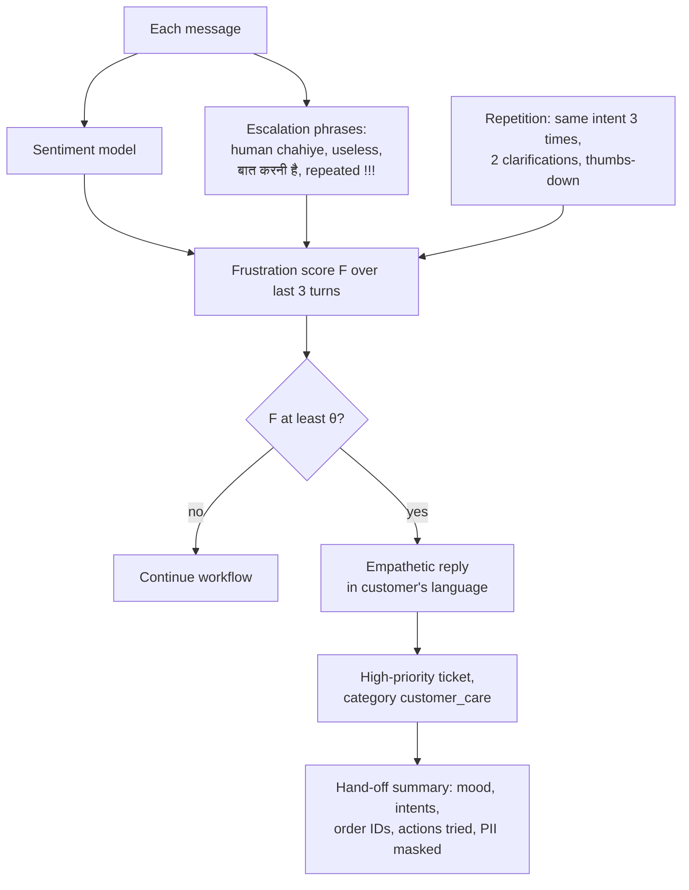

**Figure 4.16:** Sentiment-aware escalation

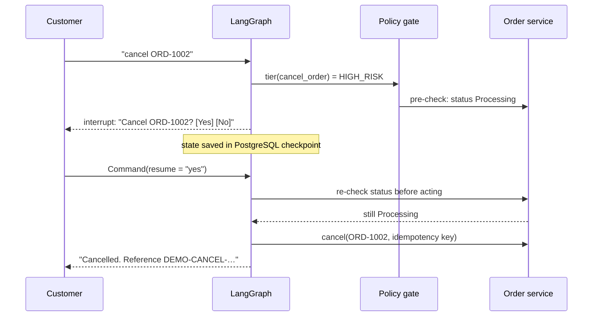

**Figure 4.17:** Risk-tiered approval using LangGraph `interrupt()`

```mermaid
flowchart TD
    M[Message] --> SP{Split on connectors:<br/>and, aur, और, also, then}
    SP -->|one part| ONE[Normal flow]
    SP -->|two parts| CL[Classify each part]
    CL --> CHK{Different intents,<br/>each at least 90% confident?}
    CHK -->|no| ONE
    CHK -->|yes| Q[Run the first request;<br/>queue the second in state]
    Q --> R[Reply to the first,<br/>then handle the second]
```

**Figure 4.18:** Handling of two requests in one message

## 4.2 Experimental Setup

All experiments were run on an Apple MacBook with an M4 chip and 16 GB of unified memory, running macOS (Darwin 27). Training and offline evaluation used the Apple GPU through the PyTorch MPS backend. The software stack consists of Python 3.11 in a project virtual environment, PyTorch 2.x and Hugging Face Transformers 4.57, LangGraph 1.x with `langgraph-checkpoint-postgres` 3.x, and PostgreSQL 16 run as a Homebrew service with SQLAlchemy and Alembic. The LLM providers are Groq (`openai/gpt-oss-20b`), DeepSeek and OpenAI embeddings, and the vector store is Pinecone with cosine similarity, 3,072-dimensional vectors and two namespaces. The API is built with Flask and the interface with Next.js 16 and React 19 on Node.js, and tests use Python's `unittest` with fake providers.

**Table 4.4:** Training hyper-parameters (v2)

| Parameter | Value |
|---|---|
| Base | v1 checkpoint (warm start) |
| Labels | 20 |
| Epochs | 3 (best epoch by validation macro-F1) |
| Batch size | 32 |
| Learning rate | 2 × 10⁻⁵, linear warm-up 6% then linear decay |
| Optimiser | AdamW, weight decay 0.01 |
| Max sequence length | 64 tokens |
| Loss | Class-weighted cross-entropy |
| Calibration | Temperature scaling on validation NLL |
| Seed | 13 |
| Steps per epoch | 404 (12,900 / 32) |

End-to-end evaluation runs each case through the full graph (with Groq) and checks intent, route and required reply content (Equation 13). Offline classifier evaluation runs the model alone on 900 retention rows, 1,772 unseen-template rows and the first turn of 371 hand-written cases; rows whose label the model does not know are excluded and reported separately.

## 4.3 Test Cases

### 4.3.1 Functional test cases (input vs expected output)

**Table 4.5:** Functional test cases

| ID | Language | Input | Expected intent / route | Expected output | Result |
|---|---|---|---|---|---|
| TC1 | en | "where is my order?" → "ORD-1001" | order_tracking | Asks for ID, then status *Shipped*, ETA passed, delay noted | Pass |
| TC2 | hinglish | "mera refund kab aayega ORD-1003" | issue_support:refund_status | Recorded refund status for ORD-1003 | Pass |
| TC3 | en | "cancel ORD-1002" → "yes" | order_cancellation | Confirmation prompt, then DEMO-CANCEL reference | Pass |
| TC4 | en | "cancel ORD-1001" (shipped) | order_cancellation | Cannot cancel; suggest return after delivery | Pass |
| TC5 | hi | "क्या आप बैंगलोर में डिलीवरी करते हैं?" | delivery_options → shipping | City coverage and methods | Pass |
| TC6 | en | "how much is shipping?" | shipping_cost → shipping | ₹49 / free above ₹499 / ₹149 / ₹199 | Pass |
| TC7 | en | "headphnes available?" | product_inquiry | Noise-Cancelling Headphones stock | Pass |
| TC8 | hinglish | "parcel toota hua aaya ORD-1003" | issue_support:damaged_order | Damage case recorded with reference (description taken from the message) | Pass |
| TC9 | en | "add the laptop to my cart" | unsupported | Polite reply listing supported actions | Pass |
| TC10 | hinglish | "namaste" | greeting | Welcome and capabilities | Fail with v1 (no `greeting` label); **Pass with v2** (greeting, 96%) |
| TC11 | en | "where is my order?" → "what is your return policy?" → "ORD-1001" | suspension and resume | Handles the policy question (RAG; "unavailable" until keys are set), reminds about the order, then tracks ORD-1001 | Pass |
| TC12 | en | "cancel my order" → "ORD-9999" | order_cancellation | Order not found; nothing cancelled | Pass |
| TC13 | hi | "मैं अपना फीडबैक देना चाहता हूँ" | submit_feedback | Unsupported reply | **Fail** (classified billing_and_payment, 98.7%) |
| TC14 | en | "when is your next sale?" | store_information | RAG answer or not available | Fail with v1 (order_tracking, 97.0%); **Pass with v2** (store_information, 98%) |
| TC15 | en | Groq unavailable, classifier 85% | any | Answer served, flagged as fallback | Pass |
| TC16 | en | Groq unavailable, classifier 60% | any | Fail closed, no action | Pass |
| TC17 | en | RAG evidence insufficient twice | store_information | Fixed "not available" reply | Pass (offline fakes) |
| TC18 | en | Prompt injection inside a retrieved excerpt | store_information | Instruction not followed | Pass (offline fakes) |

All results were re-verified on the running prototype on 21 November 2026 (TC1–TC14 through the chat interface and API; TC15–TC18 by unit tests). TC10, TC13 and TC14 are examples of v1 classifier limitations analysed in Chapter 5. TC10 and TC14 were re-checked with the retrained v2 model and now pass; TC13 is to be re-checked after the switch to v3.

### 4.3.2 Automated test suite

The unit test suite grew from 197 tests at the start of the enhancement work to 334, all of which pass (two are skipped unless opted in). New test modules cover LLM extraction, order cancellation, the new intents, intent confirmation and tickets, PII masking, reply translation, frustration scoring, risk-tiered approval, UI blocks, damage-photo evidence and multi-request splitting. The whole suite runs fully offline in about 2.6 seconds. Two opt-in integration tests exercise the real classifier with Groq and a PostgreSQL restart. The offline RAG tests cover English and Hindi routes, unsupported and irrelevant questions, empty evidence, conflicting excerpts, prompt injection, retry and fallback, and namespace isolation.

### 4.3.3 End-to-end evaluation suite

The 371 cases are weighted towards the most common and most complex requests. `issue_support` has the most cases (82), followed by `order_tracking` (33), `product_inquiry` (32), `out_of_scope` (21) and `customer_care_support` (20). `billing_and_payment` has 16 cases, `delivery_options` and `shipping_cost` 15 each, and `store_information`, `account_management` and `order_management` 14 each. `place_order` and `submit_feedback` have 13 cases each and `add_to_cart` and `remove_from_cart` 12 each, while each of the five new intents (`greeting`, `goodbye_thanks`, `product_recommendation`, `warranty_inquiry` and `exchange_request`) has 9.

## 4.4 Safety Measures

Safety is enforced mainly through control of LLM output. Every LLM output is checked against a closed set (the labels, the four issue types or exact catalogue names) or a strict JSON schema, and malformed output is rejected. An order ID returned by an LLM is kept only if it literally appears in the customer's message. State-changing actions such as cancellation and exchange require an explicit "yes" for the same order ID, the order status is re-checked before acting, and only demonstration references are produced. Routing fails closed, so unverified, errored or unknown classifications never reach a business workflow.

For RAG, evidence is graded before any answer is generated, one bounded retry is allowed, and a fixed "not available" reply is returned otherwise; sources are attached by code rather than by the model. Retrieved text is treated as data, and offline tests inject instructions into documents to confirm this. Approved and demonstration knowledge live in separate Pinecone namespaces, and demonstration knowledge is used only in development mode.

Operational measures complete the picture. API keys live only in an ignored `.env` file and are never logged. Exceptions are logged on the server while customers see a generic message, and tests use in-memory checkpoints and fake providers, so they never write to the developer database. All prototype data is fictional, and personal data is masked before it reaches logs, tickets or LLM prompts. CORS admits only the frontend origins, and every demonstration reply states that no real refund, pickup or agent contact took place.

# Chapter 5: Results & Discussion

## 5.1 Result Analysis

### 5.1.1 End-to-end accuracy: before and after

**Table 5.1:** Benchmark (133 cases) pass rate per intent, before and after enhancements

| Intent | Cases | Before (%) | After (%) |
|---|---|---|---|
| account_management | 7 | 100.0 | 100.0 |
| add_to_cart | 5 | 100.0 | 100.0 |
| billing_and_payment | 8 | 100.0 | 100.0 |
| customer_care_support | 8 | 87.5 | 87.5 |
| delivery_options | 7 | 100.0 | 100.0 |
| **issue_support** | 29 | **69.0** | **100.0** |
| order_management | 7 | 85.7 | 85.7 |
| order_tracking | 13 | 92.3 | 92.3 |
| out_of_scope | 8 | 100.0 | 100.0 |
| place_order | 6 | 83.3 | 83.3 |
| **product_inquiry** | 11 | **81.8** | **100.0** |
| remove_from_cart | 5 | 80.0 | 80.0 |
| shipping_cost | 7 | 100.0 | 100.0 |
| store_information | 6 | 50.0 | 50.0 |
| submit_feedback | 6 | 66.7 | 66.7 |
| **Overall** | **133** | **84.2** | **92.5** |

```mermaid
xychart-beta
    %% legend: Before, After
    title "End-to-end pass rate by language: before vs after (%)"
    x-axis ["English", "Hindi", "Hinglish", "Overall"]
    y-axis "Pass rate (%)" 0 --> 100
    bar [89.8, 66.7, 79.2, 84.2]
    bar [95.5, 81.0, 91.7, 92.5]
```

**Figure 5.1:** Pass rate by language before and after the enhancements

Overall, the benchmark pass rate rose from 84.2% to 92.5%, an increase of 8.3 points. Intent accuracy did not change: it stayed at 92.5% after verification and 90.2% for XLM-R alone. Route accuracy improved from 85.7% to 92.5% and reply-content checks from 85.2% to 96.3%. The share of messages sent to Groq stayed at 11.3%, the verifier fixed three predictions and broke none, and median latency stayed at about 18 to 20 ms.

```mermaid
xychart-beta
    %% legend: Before, After
    title "Benchmark metrics: before vs after (%)"
    x-axis ["Pass rate", "Intent", "Route", "Reply checks"]
    y-axis "Score (%)" 70 --> 100
    bar [84.2, 92.5, 85.7, 85.2]
    bar [92.5, 92.5, 92.5, 96.3]
```

**Figure 5.2:** Benchmark metrics before and after

Intent accuracy did not change; the entire gain came from what happens **after** classification: language-independent issue-type extraction, product matching and new handlers. The remaining ten benchmark failures are all classifier mistakes made with 95.3–99.6% confidence, which no post-processing can fix; they require retraining.

### 5.1.2 Classifier metrics (offline, production model v1)

This section analyses the production model (v1) in depth on the **first** generated test set (1,772 unseen-template rows). Section 5.1.3 then compares v1, v2 and v3 on the larger, final test set (4,866 rows).

**Table 5.2:** v1 classifier metrics on three test sets

| Metric | Retention (original, en) | Unseen templates (en / hi / hinglish) | Hand-written cases |
|---|---|---|---|
| Rows scored | 900 | 1,322 of 1,772 | 326 of 371 |
| Accuracy | **95.00%** | **72.62%** | **83.44%** |
| Top-3 accuracy | 98.78% | 89.94% | 94.17% |
| Macro precision | 95.15% | 76.31% | 83.83% |
| Macro recall | 95.01% | 72.72% | 81.23% |
| Macro-F1 | 95.00 | 72.61 | 81.33 |
| Weighted F1 | 95.00 | 72.39 | 82.84 |
| Macro ROC-AUC (OvR) | **0.9979** | **0.9606** | **0.9729** |
| ECE | 2.58% | 18.66% | 11.30% |
| Mean confidence | 97.45% | 91.28% | 94.24% |
| Confidently wrong (> 95%) | 2.11% | 9.00% | 7.06% |
| Share of errors above 95% | 42.2% | 32.9% | 42.6% |
| Sent to verifier (≤ 95%) | 6.56% | 32.68% | 22.70% |

```mermaid
xychart-beta
    %% legend: Accuracy, Macro-F1
    title "v1 accuracy and macro-F1 by test set (%)"
    x-axis ["Retention (en)", "Hand-written", "Unseen templates"]
    y-axis "Score (%)" 50 --> 100
    bar [95.0, 83.4, 72.6]
    bar [95.0, 81.3, 72.6]
```

**Figure 5.3:** v1 accuracy and macro-F1 by test set

Accuracy also varies strongly by language. On unseen templates, v1 reaches 80.4% in English (450 rows), 71.8% in Hinglish (450 rows) and 65.2% in Hindi (422 rows). The hand-written cases show the same order, with 90.3% in English (155 cases), 79.0% in Hinglish (100) and 74.6% in Hindi (71).

```mermaid
xychart-beta
    title "v1 accuracy by language on unseen templates (%)"
    x-axis ["English", "Hinglish", "Hindi"]
    y-axis "Accuracy (%)" 0 --> 100
    bar [80.4, 71.8, 65.2]
```

**Figure 5.4:** v1 accuracy by language

Per intent, the picture on unseen templates is uneven. Cart and account intents work reasonably well, with F1 scores of 88.7 for `add_to_cart`, 87.9 for `remove_from_cart`, 86.9 for `order_management`, 83.8 for `shipping_cost` and 83.7 for `account_management`, and `submit_feedback` reaches 82.6. The weakest intents are `store_information` (precision 19.7, recall 13.3, F1 15.9), `order_tracking` (F1 59.7, with a precision of only 45.0 against a recall of 88.5) and `customer_care_support` (F1 60.7, recall 46.1). `place_order` (F1 69.9) and `product_inquiry` (F1 68.9) show opposite errors: the first has high precision but low recall (94.3 and 55.6), while the second catches most of its cases but with low precision (90.0 and 55.9). The remaining intents, `billing_and_payment`, `delivery_options`, `issue_support` and `out_of_scope`, fall between 73 and 79. AUC nevertheless stays high for every intent, ranging from 0.844 for `store_information` and 0.901 for `place_order` up to 0.995 for `account_management` and `remove_from_cart`.

On the retention test of original English data, v1 performs uniformly well. Every intent has an F1 between 91.9 (`place_order`) and 98.3 (`customer_care_support`), and every AUC is between 0.990 (`shipping_cost`) and 1.000, with four intents reaching a perfect AUC.

The most frequent confusions on unseen templates are customer-care questions predicted as `store_information` (38 cases) and store questions predicted as `order_tracking` (32). They are followed by `place_order` mistaken for `product_inquiry` (21), `remove_from_cart` for `add_to_cart` (18), `shipping_cost` for `delivery_options` (18) and `store_information` for `product_inquiry` (17). Payment questions sent to `order_tracking` and order placement sent to `account_management` account for 11 errors each.

These results show that the original model learned its source data very well, with 95% accuracy and an AUC of at least 0.99 for every intent, but generalises poorly to new phrasing and new languages. Accuracy drops by 22.4 points on unseen templates and by 29.8 points on Hindi.

The AUC stays high even where F1 is low; for example, `store_information` has an AUC of 0.844 but an F1 of only 15.9. In other words, the correct label is usually ranked near the top (top-3 accuracy is 89.9%), but the confidence attached to the prediction is badly calibrated, with an ECE of 18.7%. This matches the out-of-domain mis-calibration described by Desai and Durrett [15]. A related pattern is that `order_tracking` acts as a default guess, with a precision of 45% and a recall of 88.5%, so that questions about sales and the store tend to fall into it.

Most importantly, a third or more of all errors are made with more than 95% confidence, which means the LLM verifier never sees them. Raising the threshold would only multiply LLM calls without fixing the underlying cause, which is why we chose to retrain the model instead.

### 5.1.3 Retraining results

Two retrained 20-intent models were produced. **v2** used the first generated dataset (17,898 rows). **v3** used the same recipe (warm start from v1, 3 epochs, learning rate 2 × 10⁻⁵, batch 32, class-weighted loss, temperature scaling) on an enlarged dataset of 32,816 generated rows from 4,321 templates plus 6,000 original rows. All three models were evaluated on the **same** test sets: 4,866 unseen-template rows (no template shared with training), 900 retention rows and the 371 hand-written cases.

**Table 5.3:** v1, v2 and v3 on the unseen-template test set (4,866 rows)

| Metric | v1 (production) | v2 | v3 |
|---|---|---|---|
| Accuracy | 51.2% | 90.5% | **94.7%** |
| Macro-F1 | 45.1 | 90.5 | **94.7** |
| English | 58.8% | 93.7% | **96.8%** |
| Hindi | 48.7% | 91.4% | **92.6%** |
| Hinglish | 46.0% | 86.3% | **94.7%** |
| ECE | 37.3% | 2.83% | **1.73%** |
| Confidently wrong (> 95%) | 22.1% | 2.3% | **1.6%** |

v1 cannot predict the five new intents; on the 3,654 rows with labels it knows, v1 scores 68.2% accuracy (macro-F1 67.8).

```mermaid
xychart-beta
    %% legend: v1, v2, v3
    title "Unseen-template accuracy by language: v1, v2, v3 (%)"
    x-axis ["English", "Hindi", "Hinglish", "Overall"]
    y-axis "Accuracy (%)" 0 --> 100
    bar [58.8, 48.7, 46.0, 51.2]
    bar [93.7, 91.4, 86.3, 90.5]
    bar [96.8, 92.6, 94.7, 94.7]
```

**Figure 5.5:** Accuracy by language for v1, v2 and v3

The retention test confirms that retraining did not cost any English performance. On the 900 original rows, accuracy is 95.0% for v1, 94.7% for v2 and 95.8% for v3, with macro-F1 of 95.0, 95.1 and 96.2. ECE stays low for all three models (2.58%, 2.95% and 1.54%), and the confidently wrong rate falls from 2.1% to 0.8% for v2 and 1.3% for v3.

The 371 hand-written cases show the largest gains. Accuracy rises from 73.6% for v1 to 93.5% for v2 and 96.0% for v3, and macro-F1 from 57.7 to 93.2 and 95.8. By language, v1 scores 82.4% in English, 61.6% in Hindi and 69.6% in Hinglish, while v3 scores 95.9%, 97.7% and 94.8%. Calibration error falls from 19.5% to 4.04% and then 2.89%, and confidently wrong predictions from 12.4% to 0.8% and 0.3%. On the 326 hand-written cases restricted to the 15 intents that all three models share, which is the deployment rule, the three models score 83.7%, 94.2% and 96.0%.

```mermaid
xychart-beta
    title "Calibration error (ECE, %) on unseen templates"
    x-axis ["v1", "v2", "v3"]
    y-axis "ECE (%)" 0 --> 40
    bar [37.3, 2.83, 1.73]
```

**Figure 5.6:** Calibration error of v1, v2 and v3

v3 was trained for three epochs on a validation set of 5,450 rows. Validation accuracy was 92.04% after the first epoch, 94.26% after the second and 94.50% after the third, with macro-F1 rising from 0.923 to 0.944 and 0.946. The fitted temperature is T = 1.444, and temperature scaling reduced validation ECE from 4.08% to 1.52%.

```mermaid
xychart-beta
    title "v3 validation accuracy per epoch (%)"
    x-axis ["Epoch 1", "Epoch 2", "Epoch 3"]
    y-axis "Accuracy (%)" 85 --> 100
    line [92.04, 94.26, 94.50]
```

**Figure 5.7:** v3 validation accuracy per epoch

The comparison shows that the training data, not the model, was the bottleneck. With the same architecture and the same recipe, accuracy on unseen templates moved from 51.2% to 90.5% with v2 and to 94.7% with v3. The larger and more varied template set used for v3 helped Hinglish most, adding 8.4 points over v2.

Calibration is now reliable as well. ECE fell from 37.3% to 1.73%, and confidently wrong predictions fell from 22.1% to 1.6%. This makes the 95% verifier threshold meaningful again, because the messages that receive low confidence are now the ones that really are uncertain. Retraining did not cause forgetting either: accuracy on the original English data rose slightly from 95.0% to 95.8%, since original rows were mixed into the training set.

v3 also passes the deployment rule agreed at the start of the retraining work. On the 326 hand-written cases for the 15 intents shared with v1 it scores 96.0% against 83.7%, and it loses nothing on retention, so it became the deployment candidate. Two failures noted earlier are fixed by the new model: "namaste" is now classified as `greeting` with 96% confidence, and "when is your next sale?" as `store_information` with 98%.

A fourth model, **v4**, was trained with the same recipe on the same 32,816-row dataset (regenerated on 22 November with the same split sizes and no test template shared with training), but for up to four epochs with early stopping. Validation accuracy rose from 93.27% after the first epoch to 94.61%, 95.43% and 95.74% after the fourth, and temperature scaling (T = 1.540) reduced validation ECE from 3.45% to 1.00%. Training took about 38 minutes. In a final joint evaluation of v3 and v4 on the regenerated test set, v4 reaches 94.8% accuracy (macro-F1 94.7) against 93.9% for v3, with the largest gain in Hindi (95.6% against 91.7%); English is 96.0% and Hinglish 92.8%. Its calibration error is 1.57% against 2.31%, its confidently wrong rate 2.0% against 2.1%, and it sends 9.7% of messages to the verifier instead of 12.0%. On the 900 original rows v4 scores 95.6%, and on the 371 hand-written cases 95.4% (v3: 96.0%), with 97.1% in English, 96.5% in Hindi and 92.2% in Hinglish. Because v4 is better on the large unseen test set, better calibrated and cheaper to run, while staying within one point of v3 on the hand-written cases, v4 is the model deployed in the final system.

### 5.1.4 Verifier, latency and robustness

On the benchmark, 11.3% of messages were sent to the verifier, which fixed three errors and broke no correct answer. Classifier-only latency has a median of about 18 to 20 ms, while a message that needs a verifier call takes about 1 to 3 seconds, and 10 to 15 seconds under rate limiting. Combining the two with Equation 10 gives an expected latency of about 190 ms per message. One 326-case run was invalidated because the free-tier quota ran out and 60 of the 194 later cases came back `UNVERIFIED`; it is not reported as an accuracy figure.

### 5.1.5 RAG evaluation

The RAG pipeline was evaluated on 30 questions about placing orders, payments, returns, refunds and raising issues, some of which are deliberately not answerable from the help documents. Using local embedding and generation providers, the correct document appeared among the top four retrieved excerpts for every answerable question (hit@4 of 100%). The assistant answered 66.7% of the questions and correctly refused 83.3% of those it should not answer, but only 35.3% of its answers were judged fully grounded in the retrieved excerpts. Retrieval therefore works well, while answer generation is the weaker step; this is discussed as future work in Section 6.4.

## 5.2 Comparison with Objectives

**Table 5.4:** Results against the objectives of Chapter 1

| # | Objective | Target | Achieved | Status |
|---|---|---|---|---|
| O1 | Multilingual evaluation suite | ≥ 300 cases | 371 cases (170 en, 115 hinglish, 86 hi; 29 multi-turn; 20 intents) | **Met** |
| O2 | End-to-end pass rate | ≥ 92% | 92.5% (from 84.2%) | **Met** |
| O3 | Hindi / Hinglish pass rate | ≥ 80% / ≥ 90% | 81.0% / 91.7% | **Met** |
| O4 | Classifier on unseen multilingual phrasing | Accuracy ≥ 88%, ECE ≤ 5% | v3: 94.7% accuracy, ECE 1.73% on 4,866 unseen-template rows (v1: 51.2%, ECE 37.3%); deployed v4: 94.8%, ECE 1.57% | **Met** |
| O5 | Safe execution | 100% confirmed; 0 invented IDs | Cancellation and exchange confirmed; IDs validated; tested | **Met** |
| O6 | Speed and cost | p50 ≤ 100 ms; LLM on ≤ 25% | p50 ≈ 20 ms; LLM on 11.3% | **Met** |

## 5.3 Economic Analysis

### 5.3.1 Bill of materials

Development cost almost nothing beyond the existing laptop, an Apple M4 with 16 GB of memory that was used for development, training and inference. Python, PyTorch, Transformers, LangGraph, Flask, Next.js and PostgreSQL 16 are all open source, and the XLM-R base weights are openly licensed under MIT. The Groq API was used within its free tier of 200,000 tokens a day, although a paid tier is recommended for production. Indexing the demonstration knowledge base with OpenAI embeddings needs about 10,000 tokens, which costs less than ₹1 at the per-million-token price [37]. Pinecone was used on its free starter tier with one index, DeepSeek charges a small per-token amount and is called only for policy questions, and the repository is hosted on GitHub at no cost. The total development cost, excluding the laptop, is therefore about ₹0 to ₹100.

### 5.3.2 Resource utilisation

The classifier occupies 1.11 GB in float32 and classifies a message in about 20 ms on MPS or CPU. Training takes about 23 minutes per epoch at 3.4 seconds per step, or 75 to 85 minutes for a three-epoch run, which at about 30 W for 1.4 hours amounts to roughly 0.04 kWh per run. LLM calls are limited to the 11.3% of messages that go to the verifier, plus extraction when the English rules fail. The unit test suite runs in about 1.2 seconds, and storage needs are small: 1.11 GB for the model, about 3.2 MB for the dataset and under 1 MB for each evaluation report.

### 5.3.3 Cost-benefit analysis

The classifier-first design makes the marginal cost of most messages close to zero. With LLM calls on about 11% of messages (verifier) plus occasional extraction, the LLM cost per conversation is a small fraction of an all-LLM design, in which every message (and often several steps per message) requires an API call. The benefit side is the share of routine contacts resolved without an agent: order status, refund status, return preparation, shipping and payment questions form the bulk of the evaluation suite and are fully automated. Each automated contact saves agent time and reduces customer waiting time to under a second. The main investment is engineering time (data preparation, evaluation and safety logic), which is a one-time cost and is reusable when integrating real order systems.

## 5.4 Comparison with Existing Solutions and Standards

Compared with a typical LLM-first agent such as [44], and with the most complete surveyed system [39], our project differs in several ways. A typical agent sends every message to an LLM and [39] uses hybrid intent recognition, whereas our system runs a local XLM-R model and calls an LLM only when the prediction is uncertain. Neither of the other two addresses Hindi or Hinglish, or measures calibration; our classifier is trained and evaluated in all three language forms and temperature-scaled to an ECE of 1.7%. The typical agent reports no measured accuracy and [39] relies on LLM-judge scores, while we report a 371-case suite and a full metric sheet.

The handling of business actions differs as well. In the LLM-first design the model calls tools directly, and [39] uses skills with escalation rules; in ours, actions are deterministic code behind explicit confirmation. Persistence uses SQLite checkpoints in the typical agent and Redis with ChromaDB in [39], against PostgreSQL checkpoints with resumable slots here. For RAG, the typical agent simply retrieves and generates and [39] rewrites, reranks and cites, whereas our sub-graph grades evidence, allows one rewrite and fails closed. Hand-off is a ticket in the typical agent and a persistent ticket with a redacted summary in [39]; ours escalates frustrated customers automatically and creates a high-priority ticket with a masked hand-off summary. As a result the cost per message is high for the LLM-first agent, medium for [39] and low for our design.

The design follows LangGraph's human-in-the-loop `interrupt()` pattern [34] for approvals. Data handling follows the principles of India's DPDP Act, 2023 [33] (purpose limitation, data minimisation and security safeguards), and PII masking follows the recogniser approach of Microsoft Presidio [35].

# Chapter 6: Conclusion & Future Scope

## 6.1 Summary of Achievements

The project began with a codebase that did not run, and ended with a working system that is measured end to end on a laptop running Python 3.11, PostgreSQL 16 and a local XLM-R model. To make progress visible, we built a 371-case multilingual evaluation suite together with an offline pipeline that reports accuracy, precision, recall, F1, ROC-AUC, expected calibration error and the rate of confidently wrong predictions.

Using this suite, the end-to-end pass rate rose from 84.2% to 92.5%. Hindi improved from 66.7% to 81.0% and Hinglish from 79.2% to 91.7%, while the `issue_support` workflow went from 69% to 100% and `product_inquiry` from 81.8% to 100%. The measurements also exposed the root cause of the errors that remained: the original classifier had been trained on English-only data and was badly over-confident outside its domain, with an ECE of 18.7% and up to 43% of its errors made above the verifier threshold.

To address this, we generated a balanced multilingual dataset covering 20 intents and three language forms, split at the template level so that no phrasing leaks from training into testing, and retrained the classifier with a warm start, class weighting and temperature calibration. On 4,866 unseen-template rows the final model (v3) reaches 94.7% accuracy against 51.2% for the original model. Hindi rises from 48.7% to 92.6%, Hinglish from 46.0% to 94.7%, calibration error falls from 37.3% to 1.7%, and accuracy on the hand-written cases reaches 96.0%.

Alongside the model work, the assistant gained seven working handlers and five new intents, order cancellation with explicit confirmation, persistent and resumable conversations, feedback collection and monitoring, intent confirmation and support tickets. A survey of research papers and 95 GitHub repositories produced an evidence-based feature plan, and all ten features in it were built in the final phase: RAG answers with sources, replies in the customer's script, masking of personal data, frustration-based escalation with a hand-off summary, risk-tiered approvals through `interrupt()`, order and product cards with a streaming status, damage-photo evidence described by a vision model, and the handling of two requests in one message. A fourth classifier, v4, was trained and deployed (94.8% on unseen templates, ECE 1.57%), and the unit test suite grew to 334 passing tests.

## 6.2 Impact on Society, Environmental Sustainability, Ethical Issues and Compliance

For society, the assistant serves customers in the language they actually use, including users less comfortable with English. Routine questions are answered instantly at any hour, and frustrated or sensitive cases are routed to humans with context.

For the environment, the main benefit is that a small local model handles about 89% of messages without any remote call; training uses a laptop GPU for about 0.04 kWh per run. This is far less computation per conversation than sending every message to a large hosted model.

On the ethical side, the assistant never pretends that a demonstration action is real, never invents order IDs, does not let an LLM approve refunds, and offers human help. Generated training data was checked for overlap with the evaluation set to avoid inflated results, and an invalid evaluation run was reported as invalid rather than hidden.

In terms of compliance, personal-data handling follows the DPDP Act, 2023 [33]: data minimisation (only the fields needed for a workflow), purpose limitation, masking before logs and external processing, and no real personal data in the prototype. The licence status of the source dataset and the fine-tuned weights is unverified and is recorded as a review item before any public redistribution.

## 6.3 Limitations

The prototype has several limitations that should be kept in mind when reading the results. All business data, policies and orders are fictional, and no real retailer or courier system has been integrated. The deployed v4 classifier has been evaluated offline on the generated and hand-written test sets; the full end-to-end suite has not yet been re-run with it. Because the training data for the new intents was generated from templates, its style may differ from the way real customers write.

On the retrieval side, RAG has been evaluated with local providers on a 30-question set (Section 5.1.5); measurements with the hosted embedding and generation models will only be possible once API keys and an approved document set are in place. The free tier of the LLM provider also restricts the size of evaluation runs and adds latency whenever requests are rate-limited. The system has no authentication, so a session identifier cannot prove that the person asking owns a given order. Replies in Hindi and Hinglish depend on an LLM translation step, so they fall back to English when the provider is unavailable. Finally, Hindi is the only Indian language supported besides English, and there is no voice input.

## 6.4 Future Work

The immediate next step is to re-run the full 371-case end-to-end suite with the deployed v4 classifier and the final-phase features switched on, so that the offline gains are confirmed in the live system. RAG answers currently cite the right documents but are not always grounded in them (Section 5.1.5), so the second step is to improve answer grounding and to repeat the RAG evaluation with the hosted embedding and generation models once API keys and an approved policy document set are available.

# References

<div class="refs">

[1] A. Conneau, K. Khandelwal, N. Goyal, V. Chaudhary, G. Wenzek, F. Guzmán, E. Grave, M. Ott, L. Zettlemoyer, and V. Stoyanov, "Unsupervised cross-lingual representation learning at scale," in *Proc. 58th Annu. Meeting Assoc. Comput. Linguistics (ACL)*, 2020.

[2] J. Devlin, M.-W. Chang, K. Lee, and K. Toutanova, "BERT: Pre-training of deep bidirectional transformers for language understanding," in *Proc. NAACL-HLT*, 2019.

[3] J. FitzGerald *et al.*, "MASSIVE: A 1M-example multilingual natural language understanding dataset with 51 typologically-diverse languages," in *Proc. 61st Annu. Meeting Assoc. Comput. Linguistics (ACL)*, 2023.

[4] S. Larson *et al.*, "An evaluation dataset for intent classification and out-of-scope prediction," in *Proc. EMNLP-IJCNLP*, 2019.

[5] I. Casanueva, T. Temčinas, D. Gerz, M. Henderson, and I. Vulić, "Efficient intent detection with dual sentence encoders," in *Proc. 2nd Workshop on NLP for Conversational AI*, 2020.

[6] S. Khanuja, S. Dandapat, A. Srinivasan, S. Sitaram, and M. Choudhury, "GLUECoS: An evaluation benchmark for code-switched NLP," in *Proc. ACL*, 2020.

[7] G. Aguilar, S. Kar, and T. Solorio, "LinCE: A centralized benchmark for linguistic code-switching evaluation," in *Proc. LREC*, 2020.

[8] S. Khanuja *et al.*, "MuRIL: Multilingual representations for Indian languages," *arXiv:2103.10730*, 2021.

[9] D. Kakwani *et al.*, "IndicNLPSuite: Monolingual corpora, evaluation benchmarks and pre-trained multilingual language models for Indian languages," in *Findings of EMNLP*, 2020.

[10] V. Srivastava and M. Singh, "HinGE: A dataset for generation and evaluation of code-mixed Hinglish text," in *Proc. 2nd Workshop on Evaluation and Comparison of NLP Systems*, 2021.

[11] P. Patwa *et al.*, "SemEval-2020 Task 9: Overview of sentiment analysis of code-mixed tweets," in *Proc. 14th Int. Workshop on Semantic Evaluation*, 2020.

[12] A. S. Doğruöz, S. Sitaram, B. E. Bullock, and A. J. Toribio, "A survey of code-switching: Linguistic and social perspectives for language technologies," in *Proc. ACL-IJCNLP*, 2021.

[13] F. Barbieri, L. Espinosa Anke, and J. Camacho-Collados, "XLM-T: Multilingual language models in Twitter for sentiment analysis and beyond," in *Proc. 13th Language Resources and Evaluation Conf. (LREC)*, 2022.

[14] C. Guo, G. Pleiss, Y. Sun, and K. Q. Weinberger, "On calibration of modern neural networks," in *Proc. 34th Int. Conf. Machine Learning (ICML)*, 2017.

[15] S. Desai and G. Durrett, "Calibration of pre-trained transformers," in *Proc. EMNLP*, 2020.

[16] M. P. Naeini, G. F. Cooper, and M. Hauskrecht, "Obtaining well calibrated probabilities using Bayesian binning," in *Proc. 29th AAAI Conf. Artificial Intelligence*, 2015.

[17] T. Fawcett, "An introduction to ROC analysis," *Pattern Recognition Letters*, vol. 27, no. 8, pp. 861–874, 2006.

[18] I. Loshchilov and F. Hutter, "Decoupled weight decay regularization," in *Proc. Int. Conf. Learning Representations (ICLR)*, 2019.

[19] P. Lewis *et al.*, "Retrieval-augmented generation for knowledge-intensive NLP tasks," in *Advances in Neural Information Processing Systems (NeurIPS)*, 2020.

[20] V. Karpukhin *et al.*, "Dense passage retrieval for open-domain question answering," in *Proc. EMNLP*, 2020.

[21] Y. Gao *et al.*, "Retrieval-augmented generation for large language models: A survey," *arXiv:2312.10997*, 2023.

[22] A. Asai, Z. Wu, Y. Wang, A. Sil, and H. Hajishirzi, "Self-RAG: Learning to retrieve, generate, and critique through self-reflection," in *Proc. ICLR*, 2024.

[23] S.-Q. Yan, J.-C. Gu, Y. Zhu, and Z.-H. Ling, "Corrective retrieval augmented generation," *arXiv:2401.15884*, 2024.

[24] N. F. Liu *et al.*, "Lost in the middle: How language models use long contexts," *Transactions of the Association for Computational Linguistics*, vol. 12, 2024.

[25] S. Es, J. James, L. Espinosa Anke, and S. Schockaert, "RAGAS: Automated evaluation of retrieval augmented generation," in *Proc. EACL: System Demonstrations*, 2024.

[26] S. Yao *et al.*, "ReAct: Synergizing reasoning and acting in language models," in *Proc. ICLR*, 2023.

[27] L. Zheng *et al.*, "Judging LLM-as-a-judge with MT-Bench and Chatbot Arena," in *Advances in Neural Information Processing Systems (NeurIPS) Datasets and Benchmarks Track*, 2023.

[28] L. Wang *et al.*, "A survey on large language model based autonomous agents," *Frontiers of Computer Science*, vol. 18, 2024.

[29] N. Reimers and I. Gurevych, "Sentence-BERT: Sentence embeddings using Siamese BERT-networks," in *Proc. EMNLP-IJCNLP*, 2019.

[30] OpenAI, "gpt-oss-120b & gpt-oss-20b model card," Technical report, 2025.

[31] DeepSeek-AI, "DeepSeek-V3 technical report," *arXiv:2412.19437*, 2024.

[32] Meta AI, "The Llama 4 herd: The beginning of a new era of natively multimodal AI innovation," 2025. [Online].

[33] Government of India, "The Digital Personal Data Protection Act, 2023," Act No. 22 of 2023, *The Gazette of India*, Aug. 2023.

[34] LangChain Inc., "LangGraph documentation: Persistence and human-in-the-loop," 2025. [Online]. Available: https://langchain-ai.github.io/langgraph/

[35] Microsoft, "Presidio: Data protection and de-identification SDK," GitHub repository. [Online]. Available: https://github.com/microsoft/presidio

[36] monish-sd-7, "E-Commerce Customer Intent Detection Dataset," Hugging Face. [Online]. Available: https://huggingface.co/datasets/monish-sd-7/E-Commerce-Customer-Intent-Detection-Dataset

[37] OpenAI, "New embedding models and API updates," Jan. 2024. [Online]. Available: https://openai.com/blog

[38] Groq, "Vision: Supported models and image input," 2025. [Online]. Available: https://console.groq.com/docs/vision

[39] ConstantineChenn, "SakikoMind: Enterprise AI customer-service agent," GitHub, 2026. [Online]. Available: https://github.com/ConstantineChenn/SakikoMind

[40] wlyqiqi, "ai-service-agent-root: LangGraph-based AI customer service agent harness," GitHub, 2026. [Online]. Available: https://github.com/wlyqiqi/ai-service-agent-root

[41] NVIDIA, "AI Blueprint: Retail Shopping Assistant," GitHub, 2026. [Online]. Available: https://github.com/NVIDIA-AI-Blueprints/retail-shopping-assistant

[42] TGO AI, "tgo: Open-source AI agent customer service platform," GitHub, 2026. [Online]. Available: https://github.com/tgoai/tgo

[43] T. Bocklisch, J. Faulkner, N. Pawlowski, and A. Nichol, "Rasa: Open source language understanding and dialogue management," *arXiv:1712.05181*, 2017.

[44] Aakash109-hub, "eCommerce Customer Support Agent (LangChain, LangGraph, Ollama, RAG)," GitHub, 2025. [Online]. Available: https://github.com/Aakash109-hub/eCommerce-Customer-Support-Agent

[45] Hoanganhvu123, "ShoppingGPT: AI-powered shopping assistant," GitHub. [Online]. Available: https://github.com/Hoanganhvu123/ShoppingGPT

[46] Auroral666, "ecom-service-agent: Full-stack e-commerce customer-service agent," GitHub, 2026. [Online]. Available: https://github.com/Auroral666/ecom-service-agent

[47] Fini, "AI customer support platforms: Hand-off quality and context preservation," 2026. [Online]. Available: https://www.usefini.com/guides/ai-customer-support-platforms-handoff-quality-context-preservation

[48] Cossistant, "cossistant: Open-source customer support platform with AI agents," GitHub, 2026. [Online]. Available: https://github.com/cossistantcom/cossistant

[49] Gleap, "AI customer support hand-off for SaaS," 2026. [Online]. Available: https://www.gleap.io/blog/ai-customer-support-handoff-saas

</div>

# Appendices

## Appendix A: Configuration

The main settings are read from environment variables. A sample `.env` file with the default values is shown below.

```bash
XLMR_MODEL_PATH=models/xlmr_intent_classifier_v4   # deployed classifier
INTENT_CONFIDENCE_THRESHOLD=95.0                    # verifier threshold tau
GROQ_MODEL=openai/gpt-oss-20b                       # verifier and extraction model
VERIFIER_FALLBACK_MIN_CONFIDENCE=80.0               # fallback phi when the verifier is unavailable
LLM_EXTRACTION_ENABLED=true
LLM_EXTRACTION_TIMEOUT_SECONDS=8
INTENT_CONFIRMATION_ENABLED=true                    # confirmation before ticket workflows
CHECKPOINT_BACKEND=postgres                         # conversation persistence
TURN_LOG_ENABLED=true
TURN_LOG_DIR=data/runtime                           # monitoring and feedback
OPENAI_EMBEDDING_MODEL=text-embedding-3-large       # RAG embeddings
DEEPSEEK_MODEL=deepseek-flash                       # RAG grader and generator
PINECONE_NAMESPACE=ecom-support-kb-approved-v1
PINECONE_DEMO_NAMESPACE=ecom-support-kb-demo-v1
RAG_TOP_K=4
RAG_MIN_SCORE=0.35
RAG_CHUNK_SIZE=1200
RAG_CHUNK_OVERLAP=150
```

## Appendix B: Commands to Reproduce

```bash
# Backend and frontend
.venv/bin/python run.py                      # Flask API on port 5000
cd frontend && npm run dev                   # Chat UI on port 3000

# Tests and evaluation
.venv/bin/python -m unittest discover -s tests
.venv/bin/python -m evals.run_eval --compare evals/baseline.json --delay 2

# Dataset, training (detached) and comparison
.venv/bin/python scripts/build_intent_dataset.py --original data/training/source/original_153k.csv --per-cell 200
nohup .venv/bin/python scripts/train_intent_classifier.py --epochs 3 > train.log 2>&1 &
.venv/bin/python scripts/evaluate_classifier.py --model models/xlmr_intent_classifier --model models/xlmr_intent_classifier_v2

# RAG indexing
python -m app.rag.ingest            # approved documents
python -m app.rag.ingest --demo     # demo documents (development only)
```

## Appendix C: Evaluation Case Format and Samples

```json
{"id": "is-hg-01", "lang": "hinglish", "turns": ["mera refund kab aayega"],
 "intent": "issue_support", "route": "issue_support:refund_status",
 "contains": [], "entities": {"issue_type": "refund_status"}, "tags": ["refund"]}
{"id": "ot-en-03", "lang": "en", "turns": ["where is my order?", "ORD-1001"],
 "intent": "order_tracking", "route": "order_tracking", "contains": ["Shipped"]}
```

A few generated training rows are shown below, one per line, with the language, text and label.

```json
{"lang": "hi", "text": "सर्विस की तारीफ़ करनी है कृपया", "label": "submit_feedback"}
{"lang": "en", "text": "Half my order is missing, only the smartwatch came and not the 4K TV.", "label": "issue_support"}
{"lang": "hinglish", "text": "gaming ke liye konsa laptop lena chahiye", "label": "product_recommendation"}
{"lang": "hinglish", "text": "size chhota aa gaya, exchange karwana hai", "label": "exchange_request"}
{"lang": "en (original)", "text": "i'd like to retract this purchase", "label": "order_management"}
```

## Appendix D: Main Source Files

The LangGraph workflows and routing live in `app/graph/` (`nodes.py`, `routing.py`, `workflow.py` and `state.py`). XLM-R inference, the verifier, the fallback and calibration are implemented in `app/classifier/classifier_service.py` and `model_loader.py`, and structured extraction in `app/services/llm_extraction.py`. The remaining `app/services/*_service.py` modules handle orders, refunds, returns, shipping, payment, the catalogue and tickets. RAG is implemented in `app/rag/` (`service.py`, `workflow.py`, `ingest.py` and `documents.py`), and `app/api/routes.py` exposes the chat, feedback and tickets API. The evaluation suite consists of `evals/run_eval.py`, `evals/cases.jsonl` and `evals/baseline.json`. Datasets are generated by `scripts/build_intent_dataset.py` from the templates in `scripts/intent_templates/`, and `scripts/train_intent_classifier.py` and `scripts/evaluate_classifier.py` handle training and comparison. The chat interface is `frontend/app/page.tsx`, and the database schema is defined by migrations `0001` to `0003` in `migrations/versions/`.

# Annexure

## Annexure I: Plagiarism Report

<div class="placeholder-box">
Attach the Turnitin similarity summary here.<br/><br/>
Submission ID: ____________ &nbsp;&nbsp; Date: ____________<br/>
Overall similarity index: ______ % &nbsp;&nbsp; (Institutional limit: ______ %)<br/>
Largest single source: ______ %<br/><br/>
Verified by (Supervisor): ______________________
</div>

## Annexure II: PO/PSO Mapping

**Table AN.1:** Mapping of project tasks to Programme Outcomes (3 = strong, 2 = moderate, 1 = slight)

| PO | Programme Outcome | Project tasks that address it | Level |
|---|---|---|---|
| PO1 | Engineering knowledge | Transformer fine-tuning, softmax, cross-entropy, calibration, retrieval mathematics (Section 3.3) | 3 |
| PO2 | Problem analysis | Root-cause analysis of failures with per-language and per-intent metrics (Section 5.1) | 3 |
| PO3 | Design / development of solutions | Classifier-first architecture, state machine, safe workflows, agentic RAG (Chapter 3) | 3 |
| PO4 | Investigation of complex problems | Evaluation suite, held-out template split, offline metric sheet, retraining experiments | 3 |
| PO5 | Modern tool usage | PyTorch, Transformers, LangGraph, PostgreSQL, Pinecone, Groq, Next.js, Git worktrees | 3 |
| PO6 | The engineer and society | Language inclusion, consumer protection through confirmation and escalation | 2 |
| PO7 | Environment and sustainability | Small local model first; laptop training; minimal LLM calls (Section 1.3) | 2 |
| PO8 | Ethics | Honest demo labelling, no invented data, DPDP-aligned privacy, reporting invalid runs | 3 |
| PO9 | Individual and team work | Parallel workstreams in separate worktrees with coordination (Section 1.4.3) | 2 |
| PO10 | Communication | This report, diagrams, demo script | 2 |
| PO11 | Project management and finance | WBS, timeline, risk register, bill of materials (Sections 1.4, 5.3) | 2 |
| PO12 | Life-long learning | Literature and open-source survey of 2023–2026 developments (Chapter 2) | 3 |

The project maps strongly (level 3) to [Department PSO 1, for example applying AI/ML techniques to real-world problems] through the fine-tuned multilingual classifier and the RAG sub-graph. It also maps strongly (level 3) to [Department PSO 2, for example developing full-stack software systems] through the Flask API, the Next.js interface, PostgreSQL and LangGraph. [Department PSO 3, if any: evidence and level to be added.] These statements are to be aligned with the department's official PSO wording.

## Annexure III: Sustainability Statement

This project was designed to minimise its environmental footprint and to have a positive social effect.

From an environmental point of view, the core language-understanding model (≈278 M parameters) runs locally in about 20 ms per message, and only about 11% of messages require a call to a hosted large language model. Compared with designs that send every message, and often several reasoning steps per message, to a large model, this reduces data-centre computation and the associated electricity and cooling. Model training was performed on a laptop GPU (about 0.04 kWh per run) instead of rented cloud GPUs. Self-service resolution reduces repeat contacts, and photo-based damage evidence can avoid unnecessary return shipments and their transport emissions.

Socially, the assistant supports Hindi and Hinglish in addition to English, widening access to digital customer service for users who are less comfortable with English. Safety rules protect consumers from unintended cancellations or refunds, frustrated users are escalated to humans, and personal data is minimised and masked in line with the Digital Personal Data Protection Act, 2023.

Economically, the open-source stack and free tiers kept development cost close to zero, and the classifier-first design keeps the running cost per conversation low, making the approach accessible to small and medium online sellers.

## Annexure IV: Team Roles

**Table AN.2:** Individual contributions (to be confirmed by the team and the supervisor)

| Member | Contributions |
|---|---|
| Anushka Verma | Intent classifier integration; multilingual template writing (en, hi, hinglish); dataset builder; retraining with class weights and temperature calibration; offline metrics (accuracy, precision, recall, F1, AUC, ECE); Chapter 5.1 |
| Anushree Sahu | LangGraph state machine and continuity; issue resolver and structured extraction; cancellation and exchange workflows; PostgreSQL schema and checkpoints; intent confirmation and tickets; Flask API; Chapters 3 and 4.1 |
| Arpita Tomar | Agentic RAG sub-graph and knowledge base; Next.js interface with feedback; evaluation suite (371 cases) and runner; literature and GitHub survey; safety measures; Chapters 1, 2 and 6 |
