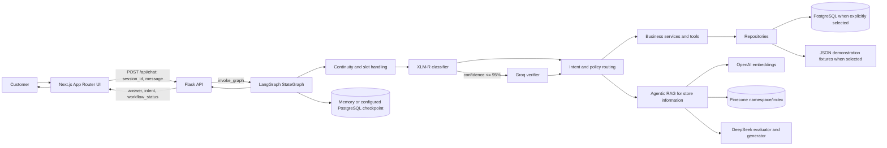
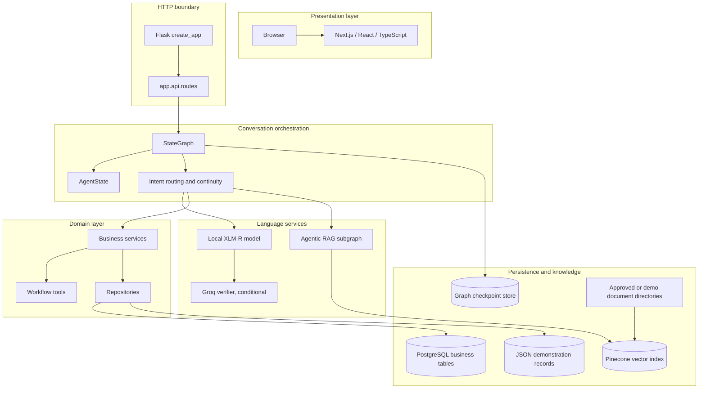
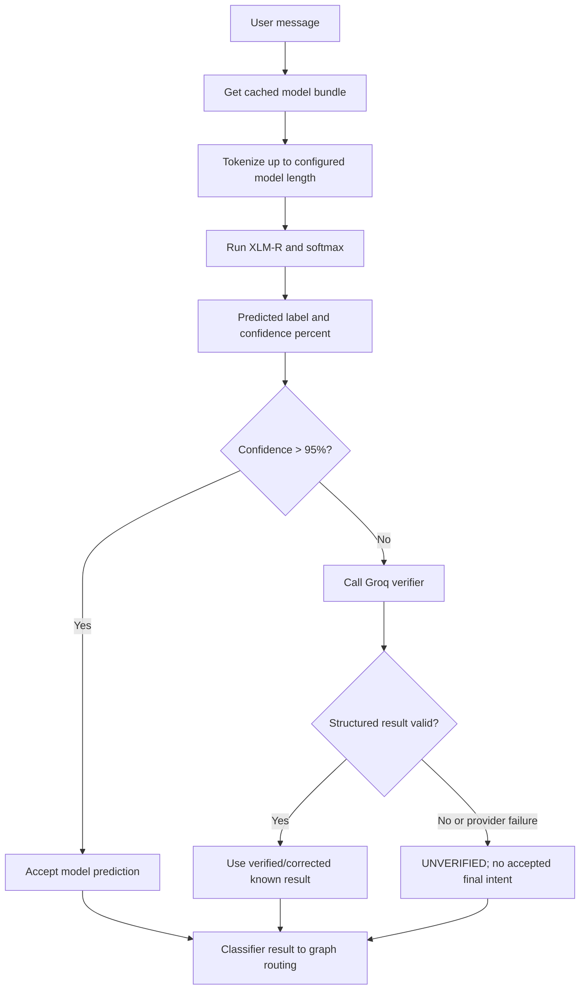
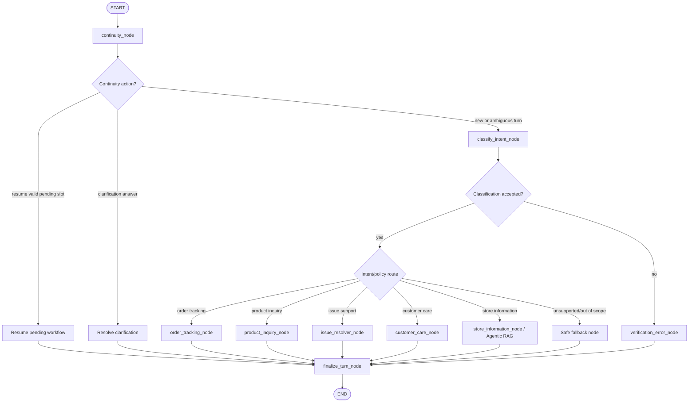
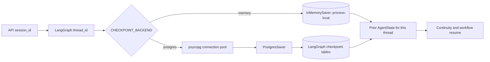
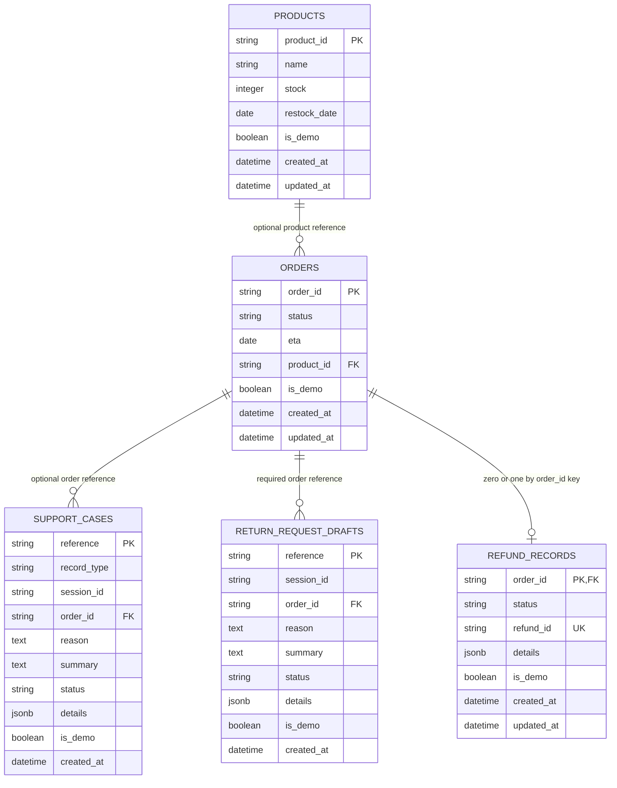
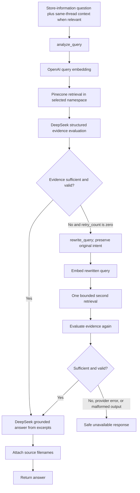
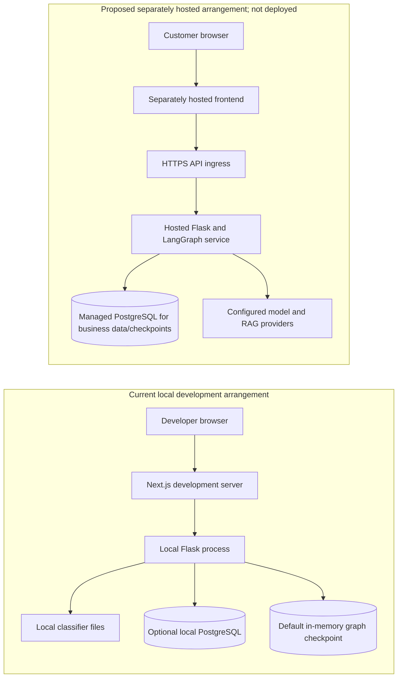

# E-commerce Customer Support Assistant

## Project Architecture and Implementation Report

**Prepared for:** Academic evaluation, technical review, and project handover  
**Project:** Multilingual E-commerce Customer Support Assistant  
**Implementation status:** Local development project; see Chapter 16 for verified limitations  
**Report date:** 15 November 2026

> This report describes the inspected implementation. Demonstration records, simulated workflows, optional integrations, and planned deployment are identified as such. No credentials or private local configuration values are included.

## Table of Contents

1. [Introduction](#chapter-1-introduction)
2. [Existing System and Proposed System](#chapter-2-existing-system-and-proposed-system)
3. [Technology Stack](#chapter-3-technology-stack)
4. [System Architecture](#chapter-4-system-architecture)
5. [High-Level Design](#chapter-5-high-level-design-hld)
6. [Low-Level Design](#chapter-6-low-level-design-lld)
7. [Intent Classification and Verification](#chapter-7-intent-classification-and-verification)
8. [LangGraph Conversation Orchestration](#chapter-8-langgraph-conversation-orchestration)
9. [Business Workflows](#chapter-9-business-workflows)
10. [Database Design](#chapter-10-database-design)
11. [Agentic RAG Architecture](#chapter-11-agentic-rag-architecture)
12. [Frontend Architecture](#chapter-12-frontend-architecture)
13. [API Design](#chapter-13-api-design)
14. [Security and Reliability](#chapter-14-security-and-reliability)
15. [Testing and Results](#chapter-15-testing-and-results)
16. [Current Limitations](#chapter-16-current-limitations)
17. [Future Enhancements](#chapter-17-future-enhancements)
18. [Conclusion](#chapter-18-conclusion)
19. [Appendices](#appendices)

## Chapter 1: Introduction

### 1.1 Background

Online retailers receive repetitive questions about orders, products, payments, delivery, returns, and store policies. A conversational interface can make these questions easier to submit, but it must distinguish factual policy questions from requests that depend on a particular order. Incorrectly treating a general policy question as a transaction, or inventing a transaction status, can mislead customers.

### 1.2 Motivation and problem statement

This project explores a multilingual support assistant that combines a fine-tuned intent classifier with explicit workflow orchestration. It aims to answer supported questions from local demonstration records or approved knowledge documents, collect missing information over multiple turns, and decline safely when the system cannot establish an answer.

The central engineering problem is to connect natural-language classification, stateful conversation handling, deterministic business logic, retrieval-based policy answers, persistence, and a web interface while keeping each responsibility inspectable.

### 1.3 Objectives

- Reuse the existing fine-tuned XLM-RoBERTa classifier without retraining it or changing its labels.
- Ask Groq to verify lower-confidence classifications under the existing threshold policy.
- Use LangGraph for explicit routing, multi-turn slots, interruptions, and continuation.
- Keep order and support operations in deterministic service/repository code.
- Provide a bounded retrieval-and-evaluation pipeline for store-information questions.
- Expose the graph through Flask and a separate Next.js chat interface.
- Make demonstration status and unavailable behavior visible rather than suggesting live retailer operations.

### 1.4 Scope

The implemented scope includes a Flask chat API, classifier integration, LangGraph workflows, local demonstration data and optional PostgreSQL persistence, a planned-for-production relational model, checkpoint support, Agentic RAG provider adapters, and a frontend that calls the Flask API. The system is a development project, not an operational retailer integration.

### 1.5 Limitations

Business records are demonstration data unless an operator configures a database with suitable records. No real refund, return, order mutation, courier operation, or human handoff is performed. Production policy answers require approved documents, configured providers, and evaluation against the target corpus. The current chat endpoint does not authenticate callers.

## Chapter 2: Existing System and Proposed System

### 2.1 Conventional approaches and their limits

Static FAQ pages make answers difficult to discover in a conversation. Purely rule-based bots are predictable for known phrases but brittle when phrasing, language, or turn order changes. A basic intent classifier identifies a likely category but does not itself manage required identifiers, preserve an interrupted workflow, or prove that a policy answer is supported by evidence. A general-purpose language model alone can produce fluent but unsupported claims.

### 2.2 Proposed system

The proposed system assigns distinct jobs to distinct components: XLM-R predicts an intent; Groq may verify uncertain predictions; LangGraph chooses a route and carries session state; deterministic services handle supported business records; and the RAG workflow answers knowledge questions only when retrieved evidence is assessed as sufficient. Flask is the HTTP boundary and Next.js is the browser interface.

### 2.3 Functional requirements

| Area | Implemented behavior |
|---|---|
| Chat | Validate and process a message with a caller-provided session identifier. |
| Classification | Predict one of the trained labels and verify at or below the configured threshold. |
| Continuity | Ask for missing slots, resume pending work, and suspend/restore a workflow around a verified interruption. |
| Order support | Read a matching order record from the selected demonstration data backend. |
| Product inquiry | Search the selected product source; sample quantities are not live inventory. |
| Support | Record simulated return, damage, missing-delivery, and handoff workflows. |
| Knowledge | Retrieve, evaluate, and answer store-information questions with bounded retry and source attribution. |
| Web interface | Send messages to Flask, preserve one session ID for the browser conversation, and show wait/error states. |

### 2.4 Non-functional requirements

The architecture emphasizes modularity, explicit routing, safe failure, session separation, lazy provider construction, configurable persistence, and offline tests using mocks. It has not yet been hardened or measured for production availability, load, latency, privacy, or service-level objectives.

## Chapter 3: Technology Stack

| Technology | Responsibility in this project |
|---|---|
| Python | Backend language and application services. |
| Flask | REST-style HTTP application and `/api` routes. |
| XLM-RoBERTa | Existing fine-tuned multilingual intent classifier, loaded from a local model directory. |
| Groq | Low-confidence intent verification using a constrained structured response. |
| LangGraph | Stateful graph execution, route selection, workflow continuity, and checkpoint integration. |
| PostgreSQL | Optional relational persistence selected explicitly for supported business repositories and/or checkpoints. |
| SQLAlchemy | ORM models, engine/session access, and repository database operations. |
| Alembic | Versioned migrations for application business tables. |
| OpenAI embeddings | Embedding generation for knowledge chunks and user search queries. |
| Pinecone | Vector index used for semantic retrieval in a configured RAG environment. |
| DeepSeek | Evidence evaluation, query rewriting, and grounded answer generation in RAG. |
| Next.js | Frontend framework using the App Router. |
| React | Chat interface and component state. |
| TypeScript | Static typing for frontend code. |
| Tailwind CSS | Frontend utility styling and responsive presentation. |

These providers are not required for ordinary application import or mocked unit tests. Provider-backed behavior requires environment configuration and network access. The project does not claim that its external providers were exercised in the latest documented offline test runs.

The classifier's direct packages are already included in the application requirements: PyTorch, Transformers, SentencePiece, Safetensors, Groq, and python-dotenv. The inspected Python 3.11 environment resolved these transitive package names: PyTorch—`filelock`, `typing_extensions`, `setuptools`, `sympy`, `mpmath`, `networkx`, `Jinja2`, `MarkupSafe`, `fsspec`; Transformers—`huggingface_hub`, `packaging`, `PyYAML`, `requests`, `charset-normalizer`, `idna`, `urllib3`, `certifi`, `tqdm`, `colorama`, `numpy`, `regex`, `tokenizers`; Groq—`anyio`, `distro`, `httpx`, `httpcore`, `h11`, `pydantic`, `annotated-types`, `pydantic_core`, `typing-inspection`, `sniffio`. Several are shared across dependency branches. Exact versions are resolved by `requirements.txt` and the platform package index rather than pinned here; the complete current-environment closure is also documented in `docs/system_design.md`.

## Chapter 4: System Architecture

### 4.1 Complete system view

The browser sends a chat turn to Flask. Flask validates the body and delegates to the existing graph using the session identifier as the graph thread identifier. LangGraph first handles pending context, then classifies new turns when needed. A selected business workflow reads or writes the configured business data store; a store-information route enters Agentic RAG. The graph result is reduced to safe API fields and displayed by the frontend.



The diagram distinguishes business data from graph checkpoints: they have separate configuration and responsibilities. The classifier and API are not themselves business-data stores. RAG is only selected for store-information routes, not transactional facts.

### 4.2 Request path summary

An HTTP request is validated before graph execution. The graph’s continuity node checks whether the same thread has a pending workflow. If so, a valid response can fill a requested slot and resume the workflow. Otherwise, the graph classifies the new message, optionally verifies it, selects a route, executes a node, finalizes state, and returns an `AgentState` result. Flask exposes the answer and available intent/workflow status without returning internal state or prompts.

## Chapter 5: High-Level Design (HLD)

### 5.1 Layers and responsibilities



### 5.2 Dependency direction

The API depends on the graph invocation boundary, not on individual business workflow details. The graph depends on classifier/routing and node functions. Workflow nodes depend on service functions; services use repositories or explicitly selected fixture sources. RAG uses provider clients behind its service layer. The frontend depends only on the HTTP contract and does not import Python modules. Provider SDKs are initialized lazily so health checks and unrelated workflows do not require provider credentials.

### 5.3 External interactions

The classifier model is loaded from the bundle in this project. Groq receives verification requests only when confidence is no greater than 95 percent. RAG, when configured, calls OpenAI for embeddings, Pinecone for vector retrieval, and DeepSeek for evidence evaluation/rewrite/generation. PostgreSQL connections are created only when selected database functionality asks for them. These are independent integrations; a RAG provider failure should not be mistaken for a transactional business result.

## Chapter 6: Low-Level Design (LLD)

### 6.1 Application and API entry points

`run.py` is the backend development entry point. `app.create_app` constructs Flask, applies configuration and CORS rules, and registers `api_blueprint`. In `app/api/routes.py`, `invoke_graph` imports `app.graph.workflow.invoke_graph` lazily. `health_check` is lightweight; `chat` validates JSON, size limits, string fields, and allowed keys before invocation.

### 6.2 Classifier loading and inference

`app/classifier/model_loader.py` provides a cached model bundle loaded by default from `models/xlmr_intent_classifier/`; it validates required local files and the label map and uses Transformers `local_files_only=True`. It selects CUDA when available and otherwise CPU. `app/classifier/classifier_service.py` tokenizes a query, computes softmax probabilities, converts the highest probability to a percentage, and applies the existing confidence policy. The actual model is an XLM-RoBERTa architecture (`model_type: xlm-roberta` in its saved configuration); no retraining is part of this project. The required intent descriptions are bundled in `app/classifier/intent_descriptions.json` for Groq verification. The runtime does not import the original classifier project's `main.py` or `routing.py`.

### 6.3 Graph state and nodes

`app/graph/state.py` defines `AgentState` as a typed mapping. It carries current message/session, classifier metadata, selected route, tool result, response/error, workflow status, slots, pending clarification, suspended workflows, confirmation data, and RAG fields. Fields are optional because different nodes populate different parts of the lifecycle.

`app/graph/nodes.py` contains classifier, continuity, workflow, RAG, error, and finalization node functions. Concrete workflow node functions include `order_tracking_node`, `product_inquiry_node`, `issue_resolver_node`, `customer_care_node`, and `store_information_node`. The source also defines payment/shipping placeholders and safe unknown/out-of-scope/verification-error handling; their presence does not mean every corresponding business operation is integrated.

### 6.4 Graph construction and invocation

`app/graph/workflow.py` builds a `StateGraph` in `build_graph`, caches the runtime graph in `get_graph`, and invokes it in `invoke_graph(query, session_id)`. Invocation associates `session_id` with LangGraph `thread_id`. A separate `build_test_graph` exists for deterministic foundational testing; it is not the production conversation graph.

### 6.5 Service and repository responsibilities

Services validate and translate workflow inputs; repositories fetch or persist data through SQLAlchemy sessions or selected JSON fixtures. Session scopes close and roll back as appropriate, and repository operations are bounded to the supplied business identifier. Application model tables are in `app/db/models.py`; database connectivity is lazy in `app/db/session.py`. ORM models are not the same thing as the separate LangGraph checkpoint schema.

### 6.6 API response processing

The API returns a deliberately small response. The frontend reads `answer` and can use `intent` and `workflow_status` when present; internal graph fields, retrieved prompts, or full checkpoint state are not exposed. Graph exceptions become a sanitized service-unavailable response.

## Chapter 7: Intent Classification and Verification

### 7.1 Trained label inventory

The application’s intent map corresponds to the original model’s 15 trained labels. They are reproduced here without modification:

| # | Label | # | Label |
|---:|---|---:|---|
| 1 | `account_management` | 9 | `out_of_scope` |
| 2 | `add_to_cart` | 10 | `place_order` |
| 3 | `billing_and_payment` | 11 | `product_inquiry` |
| 4 | `customer_care_support` | 12 | `remove_from_cart` |
| 5 | `delivery_options` | 13 | `shipping_cost` |
| 6 | `issue_support` | 14 | `store_information` |
| 7 | `order_management` | 15 | `submit_feedback` |
| 8 | `order_tracking` | | |

The labels describe model classes, not a guarantee that all classes have full workflows. Routing configuration may leave some unsupported or direct them to a safe fallback.

### 7.2 Confidence and verification

The classifier returns a predicted label and confidence percentage. A score **above 95.0%** bypasses verification. At or below 95.0%, the existing Groq verifier is called and must return a validated status/intent consistent with the known mapping. The verifier can correct the intent, identify an unknown ecommerce intent, or mark an out-of-scope query. The service represents a provider/validation failure as `UNVERIFIED` with no accepted final intent; it does not silently promote the uncertain prediction.

The threshold is `INTENT_CONFIDENCE_THRESHOLD` in configuration, defaulting to `95.0`; this report does not propose or document a threshold change. Model and intent description paths are configurable. The model and verifier are not required merely to import the Flask application, although an actual uncached classification requires the local model and a low-confidence verification requires Groq configuration.

### 7.3 Language support

The fine-tuned model and existing verifier prompts are intended for English and Hindi queries. This is a capability claim from the project configuration and test coverage, not a published accuracy guarantee. Language-specific accuracy, calibration, confusion matrices, and representative production evaluation remain future work.

### 7.4 Standalone classifier packaging

The application is configured to load from `models/xlmr_intent_classifier/` and `app/classifier/intent_descriptions.json`; it does not require the original classifier folder beside the app. The local developer bundle contains `model.safetensors` (1,112,244,996 bytes), `tokenizer.json` (17,098,184 bytes), `tokenizer_config.json` (343 bytes), `config.json` (1,676 bytes), and `label_mapping.json` (994 bytes). Intent descriptions are 5,011 bytes. The loader checks required files, loads only local artifacts, and retains lazy cached initialization. Training arguments and the original project's source/environment are not runtime dependencies.

The project owner identifies the training dataset as `monish-sd-7/E-Commerce-Customer-Intent-Detection-Dataset`, owned under the `monish-sd-7` Hugging Face namespace and available at https://huggingface.co/datasets/monish-sd-7/E-Commerce-Customer-Intent-Detection-Dataset. The dataset page currently has no dataset card and displays no license. The original classifier source files inspected do not independently record this dataset ID; the dataset identity and its use to train the classifier are documented based on owner-provided provenance. No license is inferred. Redistribution rights for the dataset, fine-tuned weights, and derived artifacts remain unverified.

Accordingly, the original dataset, model weights, model configuration/label map, tokenizer bundle, and any other artifacts whose redistribution rights are uncertain are excluded from the publication set using `.gitignore`. The local file remains untouched. `.gitattributes` retains a Git LFS rule for the 1.04 GiB weight, but this is only a future transport configuration: the ignored artifact will not be staged or uploaded. A fresh source clone requires the model artifacts to be obtained through an authorized method before classifier inference is available. Git LFS storage/bandwidth and per-file limits would need rechecking if permission is later established.

### 7.5 Classification sequence



The source of truth for the label inventory is the model’s saved `label_mapping.json`, mirrored by `app/classifier/intent_mapping.json` and checked in tests.

## Chapter 8: LangGraph Conversation Orchestration

### 8.1 Lifecycle

`build_graph` constructs a graph whose first node handles continuity. Conditional edges decide whether the message should resume pending work, answer a pending clarification, or go through classification. The routing function then selects a known workflow node or a safe fallback. Each route converges on finalization and graph end.



### 8.2 Multi-turn slots and interruption

Pending state records the workflow name/status and the information requested, such as an order identifier, return reason, damage details, missing-delivery details, or a clarification. The continuity node validates an answer against the expected slot. It does not assume that any short reply is an order identifier or product. When a verified new intent interrupts an active workflow, the previous workflow is suspended; finalization restores it when appropriate. This avoids losing a request merely because the customer asks a separate question.

The order identifier validator uses a constrained pattern (`ORD-` plus four digits). Ambiguous or invalid input should elicit clarification. Session isolation depends on separate thread IDs and the checkpointer’s storage semantics.

### 8.3 Checkpoint choices

`CHECKPOINT_BACKEND=memory` selects `InMemorySaver` for local development. `CHECKPOINT_BACKEND=postgres` explicitly selects the PostgreSQL saver and requires `DATABASE_URL`; invalid configuration raises an error rather than silently changing to memory. The PostgreSQL saver manages its checkpoint schema through its own setup mechanism. Business-table Alembic migrations are a separate process.



The session ID is a conversation key, not identity or authorization. A browser reload creates a new frontend session because frontend persistence is not implemented.

## Chapter 9: Business Workflows

| Workflow | Route and required information | Service/data behavior | Actual boundary |
|---|---|---|---|
| Order tracking | `order_tracking`; asks for order ID if absent. | `order_service.get_order_by_id` reads selected order source; `assess_delivery_progress` interprets status/ETA. | Demonstration record lookup; no carrier scans or live tracking. |
| Product lookup/availability | `product_inquiry`; may ask for product identifier/name. | `product_service.search_products` and stock lookup use explicitly selected product data source. | Any displayed fixture quantity is sample stock, not live inventory. |
| Order-delay support | `issue_support`; collects order and relevant details. | `order_service` assessment and support-case workflow. | A date/status-based support assessment; no carrier contacted or parcel-loss claim. |
| Return request | `issue_support`; requires order and customer-provided return reason. | `return_service.check_return_eligibility` can identify a manual-review state; `prepare_demo_return_request` creates a draft record. | Not a retailer return authorization or shipment label. |
| Refund status | `issue_support`/refund routing; needs an order identifier. | `refund_service.get_refund_status` reads a stored status. | Read-only status record; does not initiate a refund. |
| Damaged product | `issue_support`; collects order ID and damage description. | `support_case_service.report_damaged_order` creates a simulated support record. | No real retailer claim or replacement. |
| Missing delivery | `issue_support`; collects order ID and delivery details. | `support_case_service.investigate_missing_order` records a simulated case. | Does not declare a parcel lost or contact a courier. |
| Store information | `store_information`; policy question enters Agentic RAG. | `store_information_node` delegates to RAG and, under explicit development conditions, selected structured demo information. | Approved policy directory is currently empty; demo material is fictional and not official. |
| Customer-care handoff | `customer_care_support`; no real agent operation is available. | `customer_care_service.request_customer_handoff` records a simulated request. | `live_agent_contacted=False`; no agent is contacted. |
| Unsupported intent | Unmapped trained labels, unknown, out-of-scope, or verifier error. | Safe explanatory fallback or clarification. | No implied cart, order placement, account, payment, or feedback mutation. |

Policy wording is refined narrowly in graph routing: explicit general return/refund policy questions can use store-information RAG even if the classifier’s original label is `issue_support`; initiating a return, checking a refund, or reporting a transactional issue remains in its business route. The classifier output is preserved for traceability.

## Chapter 10: Database Design

### 10.1 Application tables

`app/db/models.py` defines five business models. No customer or order-item table is present because inspected fixture schemas do not support those entities.

| Table / model | Key fields and constraints | Relationships |
|---|---|---|
| `products` / `Product` | `product_id` PK; name; stock with nonnegative check; optional restock date; `is_demo`; timestamps; name index. | One product can relate to many orders. |
| `orders` / `Order` | `order_id` PK; required status; optional ETA; nullable product FK with `RESTRICT`; `is_demo`; timestamps; status/product indexes. | Optional product; support cases, return drafts, refund records. |
| `support_cases` / `SupportCase` | `reference` PK; record type; session ID; nullable order FK; optional reason; summary/status; JSONB details; `is_demo`; created timestamp; session/time and order indexes. | Optional order. |
| `return_request_drafts` / `ReturnRequestDraft` | `reference` PK; session ID; required order FK; reason/summary/status; JSONB details; `is_demo`; created timestamp; session/time index. | Required order. |
| `refund_records` / `RefundRecord` | `order_id` PK and FK; status; optional unique refund ID; JSONB details; `is_demo`; timestamps. | Required order; at most one row per order under this key design. |

### 10.2 Entity relationship diagram



The ER diagram describes business tables only. LangGraph checkpoint tables are maintained by the LangGraph PostgreSQL saver and do not have an application-defined Alembic model in this project.

### 10.3 Migrations, repositories, and fixture import

SQLAlchemy provides the engine/session/model layer; Alembic contains the business schema migration history. The baseline revision is `0001_postgresql_foundation`; `0002_business_data` introduces business tables. `python -m app.db.import_demo_data` supports a dry-run and inserts absent demonstration records in dependency order. It preserves source JSON and avoids update/delete behavior. Re-running skips existing keys rather than duplicating them.

Configuration is explicit: `BUSINESS_DATA_BACKEND` defaults to `json`; database-backed repositories require PostgreSQL configuration. The importer is not an implicit migration at application startup. PostgreSQL checkpointer schema setup is independent from Alembic business-table migration.

## Chapter 11: Agentic RAG Architecture

### 11.1 Knowledge organization and ingestion

`knowledge_base/approved/` is the intended location for approved policy/store documents, and currently contains instructions rather than approved policy content. `knowledge_base/demo/` contains clearly labelled fictional examples in English and Hindi. Demo knowledge uses a separate configured Pinecone namespace and explicit development selection; it must not be presented as official store policy.

`app/rag/documents.py` loads supported Markdown/text files, reads optional metadata, and creates stable chunk IDs using document identity/content version information. Chunk size and overlap are configurable. `python -m app.rag.ingest` indexes the selected corpus. Re-indexing upserts current managed chunks and prunes obsolete managed identifiers without deleting unrelated namespace records; clearing an empty managed corpus requires explicit `--prune-empty`.

### 11.2 Retrieval and bounded evidence loop

The Agentic RAG workflow runs query analysis, retrieval, evidence evaluation, and at most one query rewrite/retrieval retry. Evidence sufficiency is a structured decision; similarity scores alone do not authorize an answer. If evidence remains empty, insufficient, malformed, or evaluation fails, the workflow returns an unavailable response. When sufficient, DeepSeek generates an answer from retrieved excerpts and includes source filenames. Retrieved document text is treated as untrusted evidence, not instructions.



### 11.3 Configuration and limits

Provider configuration includes `OPENAI_API_KEY`, `PINECONE_API_KEY`, `PINECONE_INDEX_NAME`, `PINECONE_NAMESPACE`, `PINECONE_DEMO_NAMESPACE`, `DEEPSEEK_API_KEY`, `DEEPSEEK_BASE_URL`, `OPENAI_EMBEDDING_MODEL`, `DEEPSEEK_MODEL`, and retrieval/chunk settings (`RAG_TOP_K`, `RAG_MIN_SCORE`, `RAG_CHUNK_SIZE`, `RAG_CHUNK_OVERLAP`, knowledge directory variables, and the demo-selection flag). Secret values belong only in a local environment configuration or secret manager, never in source control.

Routine tests use fake clients, not paid API calls. Offline tests can validate orchestration, error handling, metadata, and source formatting; they cannot establish real index recall, provider behavior, production faithfulness, or multilingual retrieval quality. The approved corpus must be populated and reviewed before official-policy answers are enabled.

## Chapter 12: Frontend Architecture

### 12.1 Structure and technology

The independent frontend is under `frontend/`, using the Next.js App Router (`frontend/app/`), React client-side state, TypeScript, and Tailwind CSS. The interface keeps the application name “E-commerce Support Assistant”, the page heading “E-commerce Customer Support”, and the initial assistant message “Hi! How can we help you today?”.

### 12.2 Interaction and API boundary

The chat component maintains messages for the current page session, displays user/assistant bubbles, shows a typing state while waiting, scrolls to the latest message, and reports API failures without inventing a response. Enter submits and Shift+Enter inserts a line break. A session ID is generated in the browser on first send and reused for later messages; New Chat resets it. It is not authentication and is not persisted across reloads.

The base URL is read from `NEXT_PUBLIC_CHAT_API_BASE_URL` in frontend environment configuration. This is public configuration, not a secret. The API URL is centralized rather than duplicated across components. The frontend keeps light and dark themes and adapts its sidebar and composer for smaller screens.

### 12.3 Frontend-to-backend sequence

```mermaid
sequenceDiagram
    actor Customer
    participant UI as Next.js chat UI
    participant API as Flask /api/chat
    participant Graph as LangGraph
    participant Store as Business service or RAG
    Customer->>UI: Type message and submit
    UI->>UI: Reuse or create session_id; show typing state
    UI->>API: POST JSON {session_id, message}
    API->>API: Validate JSON, fields, lengths, allowed keys
    API->>Graph: invoke_graph(message, session_id)
    Graph->>Store: Execute selected deterministic workflow or RAG
    Store-->>Graph: Result/evidence-backed response
    Graph-->>API: AgentState result
    API-->>UI: {session_id, answer, intent, workflow_status}
    UI->>UI: Render answer; clear typing state
    UI-->>Customer: Display response
```

## Chapter 13: API Design

### 13.1 `GET /api/health`

`health_check` in `app/api/routes.py` returns HTTP 200:

```json
{"status":"healthy","service":"ecom-langgraph"}
```

It is a lightweight application health response and does not prove that the classifier, database, checkpoint store, vector index, or external providers are reachable.

### 13.2 `POST /api/chat`

Request JSON accepts exactly the `session_id` and `message` fields. Both must be nonempty strings. The session identifier and message have configured length bounds, and Flask has a total request body bound. Invalid/missing JSON, unknown fields, empty values, or oversize input is rejected before graph invocation.

```json
{
  "session_id": "browser-generated-conversation-id",
  "message": "Where is my order?"
}
```

Successful response shape (intent and workflow status may be null):

```json
{
  "session_id": "browser-generated-conversation-id",
  "answer": "Please provide your order ID.",
  "intent": "order_tracking",
  "workflow_status": "awaiting_input"
}
```

The answer text and optional status are examples of shape only; actual text depends on graph state and records. The frontend does not treat the session ID as customer identity. Graph errors return a generic service-unavailable response without stack traces or provider details.

### 13.3 CORS

`app.create_app` reads `CORS_ALLOWED_ORIGINS`, parses exact origins, and rejects wildcard configuration. The response adds CORS headers only for an allowed origin. CORS controls browser access; it does not authenticate callers.

## Chapter 14: Security and Reliability

### 14.1 Configuration and secrets

`app/config.py` loads the root `.env` using `python-dotenv`; defaults and environment variables configure runtime behavior. Important names include:

| Purpose | Environment variable names (values omitted) |
|---|---|
| Runtime and API | `APP_ENV`, `APP_HOST`, `APP_PORT`, `APP_DEBUG`, `SECRET_KEY`, `CORS_ALLOWED_ORIGINS`, `MAX_CHAT_MESSAGE_LENGTH`, `MAX_SESSION_ID_LENGTH`, `MAX_CONTENT_LENGTH` |
| Classifier | `XLMR_MODEL_PATH` (default `models/xlmr_intent_classifier`), `XLMR_LABEL_MAPPING_PATH`, `XLMR_INTENT_DESCRIPTIONS_PATH` (default `app/classifier/intent_descriptions.json`), `INTENT_CONFIDENCE_THRESHOLD`, `GROQ_API_KEY`, `GROQ_MODEL` |
| Database and graph persistence | `DATABASE_URL`, `BUSINESS_DATA_BACKEND`, `CHECKPOINT_BACKEND`, `DB_POOL_SIZE`, `DB_MAX_OVERFLOW`, `DB_POOL_TIMEOUT_SECONDS`, `DB_POOL_RECYCLE_SECONDS`, `DB_CONNECT_TIMEOUT_SECONDS` |
| RAG providers and behavior | `OPENAI_API_KEY`, `PINECONE_API_KEY`, `PINECONE_INDEX_NAME`, `PINECONE_NAMESPACE`, `PINECONE_DEMO_NAMESPACE`, `DEEPSEEK_API_KEY`, `DEEPSEEK_BASE_URL`, `OPENAI_EMBEDDING_MODEL`, `DEEPSEEK_MODEL`, `RAG_TOP_K`, `RAG_MIN_SCORE`, `RAG_CHUNK_SIZE`, `RAG_CHUNK_OVERLAP`, `RAG_KNOWLEDGE_DIR`, `RAG_DEMO_KNOWLEDGE_DIR`, `RAG_USE_DEMO_KNOWLEDGE` |
| Frontend | `NEXT_PUBLIC_CHAT_API_BASE_URL` |

This list names variables only; no secret values are part of the report. The root `.gitignore` excludes environment files except the checked-in example template. Frontend public variables must not contain credentials.

### 14.2 Validation and safe failures

Flask validates chat inputs and emits generic graph errors. Classifier verification failure is not accepted as a prediction. RAG evaluation errors, malformed evaluator results, and insufficient evidence return unavailable rather than unsupported policy claims. Business workflows validate identifiers and required details before processing.

### 14.3 Sensitive operations and demonstration boundaries

The graph contains generic confirmation-related state and handling, but the inspected workflows do not currently perform external irreversible operations that set the confirmation-required gate for a real mutation. Simulated local drafts/cases should not be described as retailer submissions. Product quantities and order/refund records marked as demo are fictional examples.

### 14.4 Current reliability boundary

The health endpoint is not a dependency readiness check. PostgreSQL and checkpoint persistence are opt-in; memory checkpoints do not survive process restarts. The current unauthenticated API accepts caller-provided session IDs, so it is unsuitable for exposing private customer data on a public network without identity, authorization, rate limiting, abuse controls, and privacy review.

## Chapter 15: Testing and Results

### 15.1 Test organization

The Python `tests/` directory contains focused modules for application creation, graph construction/routing, classifier service, conversation continuity, chat API, database configuration/models/repositories/connectivity, support workflows, product/order behavior, and RAG. Ordinary tests mock external model/provider boundaries where appropriate. PostgreSQL-specific tests are conditional/opt-in; memory and mock tests do not prove production database behavior.

The frontend has independent `npm run build` and `npm run lint` commands. Project progress records Phase 7.3 build and lint as passing. The recorded health probe did not find a running Flask server, so live browser-to-backend consecutive-turn integration was not verified in that phase.

### 15.2 Historical milestone results

Results below are copied from `docs/PROJECT_PROGRESS.md` and are historical milestone records, not a fresh test run for this report.

| Milestone | Recorded result | Qualification |
|---|---|---|
| Phase 4E.3 | 110 tests: 108 passed, 2 skipped; a separate PostgreSQL process-restart checkpoint integration passed. | Checkpoint restart and thread isolation were exercised against PostgreSQL. |
| Phase 5.4 | 138 tests passed, 2 skipped. | Fake clients; no paid RAG provider calls. |
| Phase 5.5 | 153 tests passed, 2 skipped. | Offline corpus/evaluation tests; no live vector-index retrieval quality claim. |
| Phase 6.3.1 | Full suite: 192 tests passed, 2 skipped. | The source progress record documents this phase’s regression run. |
| Phase 7.3 | Frontend production build and lint recorded as passed. | Flask health probe failed because backend was not running; live chat integration not established. |
| Phase 7.4 | Full suite: 197 tests run, 195 passed, 2 skipped; local English and Hindi model inference succeeded. | Model load/inference ran from the bundled local directory; no Groq call or external model download was made. |

Test counts differ between milestones because the suite expanded. They must not be read as one current aggregate. Before a release, rerun the current backend suite and frontend checks in the target environment and record the exact command output.

### 15.3 Manual verification

For an end-to-end check, configure the backend environment, start Flask, confirm `/api/health`, configure the frontend public API base URL, start Next.js, and send at least two turns in the same browser conversation. A successful health response alone does not validate database, classifier, or provider readiness.

## Chapter 16: Current Limitations

- The approved knowledge directory has no approved policy corpus. Demo documents are fictional and must remain separately identified.
- Dataset provenance is identified as `monish-sd-7/E-Commerce-Customer-Intent-Detection-Dataset` (owner namespace `monish-sd-7`; https://huggingface.co/datasets/monish-sd-7/E-Commerce-Customer-Intent-Detection-Dataset). The public page currently has no dataset card and displays no license. Redistribution rights for the dataset, fine-tuned model, and derived artifacts remain unverified; those files are withheld from publication. The original classifier source does not independently record the dataset ID.
- Real provider-backed RAG was not validated in the documented offline quality report. No live recall or answer-faithfulness result is claimed.
- Some trained intents do not have complete workflows; notably account/cart/order-placement/feedback operations are not fully implemented as transactional capabilities.
- Payment and shipping nodes include placeholders; no payment processor, courier service, or live shipping operation is integrated.
- Order and refund answers depend on available selected records. Historical fixture dates/statuses are not current customer facts.
- Return drafts, damage/missing-delivery cases, and customer-care handoffs are demonstrations. No actual return, refund, replacement, carrier investigation, or human contact occurs.
- PostgreSQL business persistence is optional and explicit; JSON is the default business-data backend. Local case simulation may use SQLite in the JSON configuration path.
- The standard health route does not check downstream readiness.
- Frontend messages and session identifier are in-memory browser state only; refresh loses them.
- The Flask API has no authentication/authorization, customer identity, tenant boundary, or rate limiter. Session IDs are not security tokens.
- Deployment, TLS termination, managed secret storage, monitoring, alerting, operational backups, load testing, and production hardening are not complete.
- Multilingual intent support is not a measured accuracy guarantee; broader language testing and accessibility review remain necessary.

## Chapter 17: Future Enhancements

1. Curate approved retailer policies, assign ownership/review dates, and validate retrieval and answer faithfulness using representative English and Hindi questions.
2. Define real retailer service contracts before implementing order, return, refund, stock, payment, or courier operations.
3. Add authentication, authorization, session ownership, abuse protection, and privacy/data-retention controls before public exposure.
4. Complete only those currently unsupported intent workflows that have a verified backend contract and safe failure behavior.
5. Add frontend conversation history only after a privacy-aware persistence and ownership design is approved.
6. Deploy the frontend and backend separately, using environment-specific origins and a protected API ingress.
7. Add readiness checks, structured redacted telemetry, tracing, provider/database health indicators, and operational alerts.
8. Measure model calibration, intent confusion, multilingual coverage, RAG retrieval recall, faithfulness, response latency, and failure rates.
9. Review checkpoint/database retention, backups, connection pooling, migrations, and recovery procedures for the intended hosting environment.

### 17.1 Deployment architecture: current and intended

The left side reflects local development components and optional local services. The right side is a proposed future hosting arrangement, not a deployed system.



## Chapter 18: Conclusion

The project implements a modular support assistant that combines a preserved multilingual XLM-R classifier, conditional low-confidence verification, LangGraph conversation state, deterministic local business workflows, optional PostgreSQL persistence, bounded evidence-aware RAG, and an independently developed web client. The architecture separates classification from workflow execution and policy retrieval from transactional data access, making the decision path easier to inspect and test.

The implementation is a foundation rather than a production retailer service. Demonstration records and simulated support workflows must remain clearly labelled. Approved knowledge, external operational integrations, authentication, deployment, and production evaluation are outstanding. The system should be represented in evaluation and handover materials with those limits explicit.

## Appendices

### Appendix A: Project structure

```text
ecom_langraph/
├── app/
│   ├── api/                 # Flask routes and HTTP validation
│   ├── classifier/          # Model loader, classifier service, intent map
│   ├── db/                  # SQLAlchemy models, sessions, repositories, import
│   ├── graph/               # State, nodes, routing, workflow, checkpointer
│   ├── integrations/        # Optional external service client adapters
│   ├── rag/                 # Documents, ingestion, retrieval, evaluation, generation
│   ├── services/            # Order, product, refund, returns, support services
│   └── tools/               # Workflow-facing operations
├── models/xlmr_intent_classifier/ # Local-only inference bundle; excluded pending rights review
├── data/mock/               # Fictional business demonstration fixtures
├── docs/                    # Design, progress, and RAG quality documentation
├── frontend/                # Next.js App Router application
├── knowledge_base/
│   ├── approved/             # Intended approved corpus; currently unpopulated
│   └── demo/                 # Fictional local-only knowledge examples
├── migrations/              # Alembic business schema revisions
├── scripts/                 # Local chat scenario runner
├── tests/                   # Python automated tests
├── run.py                    # Flask development entry point
└── requirements.txt          # Backend dependencies
```

This is a functional overview; generated caches, virtual environments, and runtime artifacts are intentionally omitted.

### Appendix B: Configuration reference

Use `.env.example` as a names-only template and supply local values privately. Backend settings are loaded by `app/config.py` from the project `.env` and process environment. The frontend reads `NEXT_PUBLIC_CHAT_API_BASE_URL`; the current source tree does not contain `frontend/.env.example`, so frontend configuration should be documented/set locally without committing `.env.local`. Never place credentials in any `NEXT_PUBLIC_*` variable.

Key backend variables include `APP_ENV`, `APP_HOST`, `APP_PORT`, `CORS_ALLOWED_ORIGINS`, `DATABASE_URL`, `BUSINESS_DATA_BACKEND`, `CHECKPOINT_BACKEND`, XLM-R path variables, `INTENT_CONFIDENCE_THRESHOLD`, `GROQ_API_KEY`, and the RAG variables listed in Chapter 11. An unset `DATABASE_URL` is compatible with import/startup paths that do not request a database, but explicitly selecting PostgreSQL operations/checkpointing requires it.

### Appendix C: Local commands

PowerShell examples from the project root:

```powershell
# Fresh source clone; classifier artifacts are not included pending rights review
git clone <repository-url> ecom_langraph
Set-Location ecom_langraph

# Python 3.11 environment and backend dependencies
python --version
python -m venv .venv
.\.venv\Scripts\Activate.ps1
if (-not (Test-Path .env)) { Copy-Item .env.example .env }
python -m pip install -r requirements.txt

# Backend tests
python -m unittest discover -s tests -v

# Start the Flask development application
python run.py

# Health check
Invoke-RestMethod http://127.0.0.1:5000/api/health

# Example chat request (use a fresh, non-secret conversation identifier)
$body = @{ session_id = "local-report-demo"; message = "Where is my order?" } | ConvertTo-Json
Invoke-RestMethod -Method Post -Uri http://127.0.0.1:5000/api/chat `
  -ContentType "application/json" -Body $body

# Frontend, in frontend/ after dependencies are installed
npm run dev
npm run build
npm run lint
```

Database initialization is an explicit operator action: configure `DATABASE_URL`, apply Alembic migrations with `python -m alembic upgrade head`, and select the intended backend. Import demo rows only when deliberately populating a development database: `python -m app.db.import_demo_data --dry-run` previews the importer. Exact CLI options should be checked with `python -m app.db.import_demo_data --help` before importing.

For a configured PostgreSQL checkpoint backend, follow the project’s checkpointer CLI/setup documentation separately from Alembic business migrations. Do not assume that the health route verifies either database.

### Appendix D: Glossary

| Term | Meaning |
|---|---|
| Intent | A category predicted for a customer message, such as `order_tracking`. |
| Confidence | Classifier score for its selected label, represented as a percentage in this service. |
| Slot | A workflow value needed to continue, such as an order identifier or reason. |
| Thread/session ID | Key used to associate successive messages with graph state; not authentication. |
| Checkpointer | LangGraph component that saves graph state between invocations. |
| Embedding | Numeric representation used to search semantically similar document chunks. |
| Vector index | Search system storing embeddings and metadata for retrieval. |
| Evidence evaluation | Decision on whether retrieved excerpts contain enough relevant support for an answer. |
| Demonstration data | Fictional/sample records intended for development and tests, not live customer or retailer data. |
| Grounded answer | Response constrained to evidence retrieved for the question. |

### Appendix E: Sources consulted

This report was prepared from the repository implementation and documentation, including `README.md`, `docs/system_design.md`, `docs/PROJECT_PROGRESS.md`, `docs/rag_quality_report.md`, `app/api/routes.py`, `app/config.py`, `app/graph/`, `app/classifier/`, `app/db/`, `app/services/`, `app/tools/`, `app/rag/`, `frontend/app/`, frontend package configuration, `migrations/`, `knowledge_base/`, `data/mock/`, and `tests/`. The original classifier's saved model configuration, label map, intent descriptions, requirements, README, and source files were inspected read-only. Those classifier files do not independently identify the training dataset. The owner-provided provenance is the Hugging Face dataset `monish-sd-7/E-Commerce-Customer-Intent-Detection-Dataset`; its [dataset page](https://huggingface.co/datasets/monish-sd-7/E-Commerce-Customer-Intent-Detection-Dataset) currently has no dataset card and displays no license. Redistribution rights remain unverified; no license or permission is inferred. The upstream [XLM-R base-model page](https://huggingface.co/FacebookAI/xlm-roberta-base) does not establish rights for the fine-tuned artifact.
