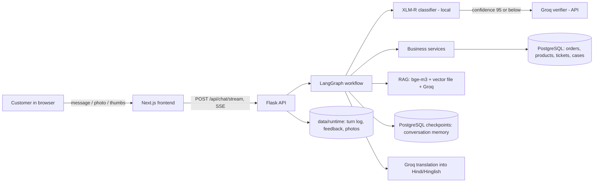
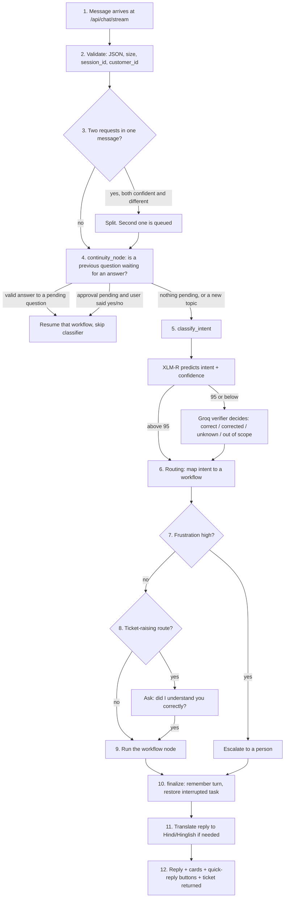
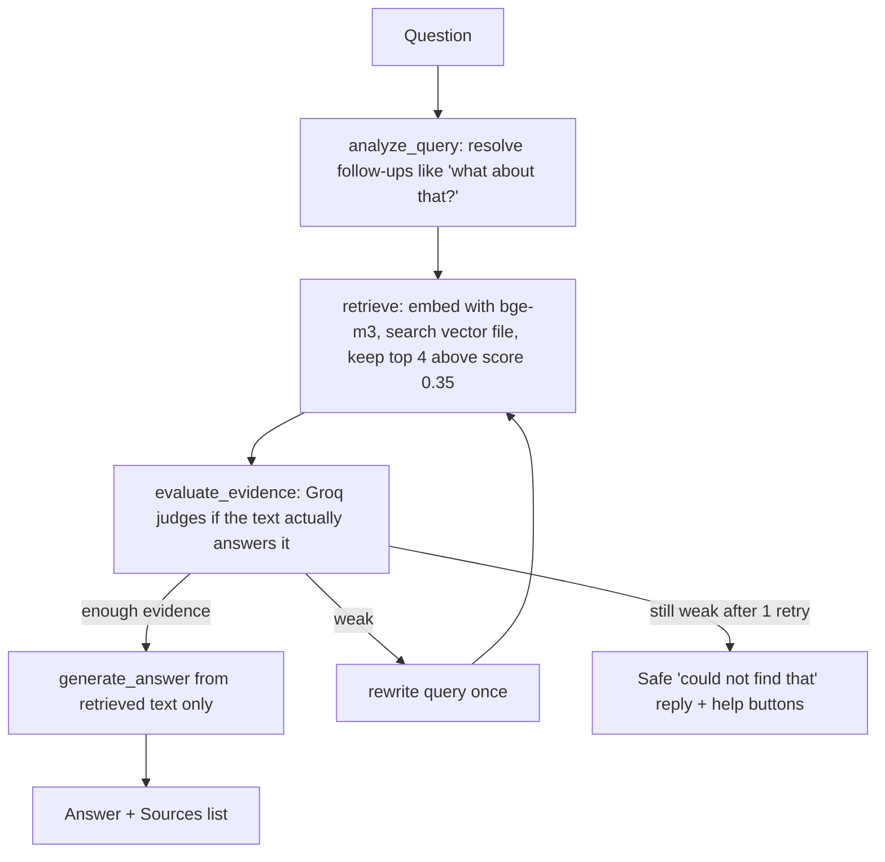

# E-commerce Customer Support Assistant: Team Guide

**Who this is for:** teammates who have not worked on the project. No code reading needed.
**Living document:** update it whenever a feature ships or the plan changes (see the Changelog at the end).
**Last updated:** 2026-11-22

---

## 1. What is this project? (30-second version)

A **chat assistant for an online store** that talks to customers in **English, Hindi and Hinglish** (Hindi typed in English letters, e.g. "mera order kab aayega"). The customer types a message. The assistant works out **what they want** (track an order, return an item, cancel, ask about a policy, complain, talk to a human). It then does that task or answers from the store's help documents, and replies in the customer's own language.

Three ideas make it different from a plain chatbot:

1. **A trained intent classifier decides what the customer wants.** It is a model we fine-tuned, not an LLM guessing. An LLM only double-checks when the classifier is unsure.
2. **Every workflow is a fixed, tested path** (a LangGraph state machine). The LLM does not improvise actions. Anything risky (cancel, exchange) needs the customer's explicit "yes".
3. **Answers about policies come from our own documents (RAG)** and cite the source. If the documents don't contain the answer, the assistant says so instead of inventing one.

> **Important honesty point (Viva):** all store data (orders, products, customers, policies) is **fictional demo data**. Cancellations, returns and hand-offs are **simulated**. Nothing is sent to a real courier, retailer or human agent. The code is built so real systems could be plugged in later.

---

## 2. Tech stack

| Layer | Technology | Runs where | Cost / keys |
|---|---|---|---|
| **Frontend** (chat UI) | Next.js + React + TypeScript + Tailwind | Browser, `localhost:3000` | Free |
| **Backend API** | Python 3.11, Flask | `localhost:5000` | Free |
| **Workflow engine** | LangGraph (state machine, checkpoints, `interrupt()` for approvals) | In the Flask process | Free |
| **Intent classifier** | XLM-RoBERTa (multilingual transformer) fine-tuned for 20 intents, PyTorch + Hugging Face | **Local**, weights in `models/` | Free, no key |
| **Intent verifier** | Groq LLM (`openai/gpt-oss-120b`) | **API** | Groq key (free tier) |
| **Reply translation, detail extraction, photo description** | Groq (text model, and a vision model for photos) | **API** | Same Groq key |
| **Frustration detection** | `cardiffnlp/twitter-xlm-roberta-base-sentiment` plus rule lexicon | **Local** | Free, no key |
| **RAG: embeddings** | `BAAI/bge-m3` (multilingual) | **Local** | Free |
| **RAG: vector store** | JSON file `data/runtime/vector_store.json`, searched with numpy | **Local** | Free |
| **RAG: answer writing** | Groq | **API** | Same Groq key |
| **Database** | PostgreSQL 16 (Homebrew, local) via SQLAlchemy + Alembic migrations | **Local** | Free |
| **Conversation memory** | LangGraph checkpoints stored in PostgreSQL | **Local** | Free |
| **Optional product catalog** | FakeStore public API (read-only) | API, **off** by default | No key |

### Which API keys exist, and what each is used for

| Key in `.env` | Used for | Status |
|---|---|---|
| `GROQ_API_KEY` | Intent verification, reply translation, detail extraction, damage-photo description, and RAG answer writing | **In use. The only key the running system needs.** |
| `OPENAI_API_KEY`, `PINECONE_API_KEY`, `DEEPSEEK_API_KEY` | The *paid* RAG path (OpenAI embeddings, Pinecone vector DB, DeepSeek answers) | **Present but not used.** Local RAG is the default. Switch back by setting `RAG_EMBEDDING_PROVIDER=openai`, `RAG_VECTOR_STORE=pinecone`, `RAG_GENERATION_PROVIDER=deepseek`. |
| `GEMINI_API_KEY` | Nothing in the current code | Unused |
| `DATABASE_URL` | Local PostgreSQL connection | In use (local) |

Keys live only in the git-ignored `.env`. Never paste them into chat, docs or commits.

### Local vs API at a glance

- **Runs on the laptop (no internet needed):** classifier, frustration model, RAG embeddings, vector store, database, offline keyword fallback for documents.
- **Calls an API (Groq):** verification of unsure intents, translating replies, extracting details from messy text, describing damage photos, writing RAG answers. If Groq is down, the system degrades gracefully (see section 9).

---

## 3. Architecture in one picture

**Plain-English summary:** the browser sends the message to Flask. Flask hands it to the LangGraph workflow, which classifies it, runs the matching workflow against the database (or the documents), and builds a reply. The reply is translated if needed and goes back to the browser together with cards, buttons and tickets.

---

## 4. The life of one message (the master workflow)

This is the single most important flow. Every chat message goes through it.

### Step by step

1. **Message arrives.** The frontend sends `session_id` (a conversation ID held in the browser), the `message`, and optionally `customer_id` (the demo "signed in as" user). It uses Server-Sent Events, so the UI can show live status like "Checking your order".
2. **Validation.** Checks JSON shape, message length (max 10,000 chars) and ID lengths. A customer ID must match a known demo customer. Errors never leak internal details.
3. **Two-in-one split.** A message like "track ORD-1001 and cancel ORD-1002" is split into two requests. This only happens if **both halves classify confidently as different, actionable intents**, so "black and white shirt" is not split. The second request is queued and answered right after the first finishes.
4. **Continuity check.** If the assistant previously asked something ("Which order ID?"), a valid-looking answer goes straight back into that workflow **without calling the classifier**. If the answer is invalid (or a new question), it is classified once. A genuinely new request **suspends** the old one, which is restored afterwards with "To continue your earlier request: ...".
5. **Classification.** The local XLM-R model outputs one of 20 intents with a confidence percentage. Above the **95%** threshold we trust it. At 95% or below, **Groq double-checks** with the intent descriptions, the model's top 5 candidates and the last few turns. If Groq is unavailable and confidence is at least 80%, we accept the classifier anyway. Below that, we ask the customer to rephrase.
6. **Routing.** The intent maps to a workflow. A few refinements apply (e.g. "what is your return policy?" goes to documents, not the return workflow; "how do I place an order?" goes to documents because the chat can't place orders).
7. **Frustration check.** A score from the last 3 customer messages decides whether to hand over to a person (section 6.9).
8. **Intent confirmation.** Before raising a ticket for issues, human-help requests or exchanges, the assistant restates its understanding ("You'd like to return order ORD-1001. Is that right?") with Yes/No buttons. "No" opens a correction menu.
9. **Workflow runs** (section 6).
10. **Finalize.** Stores a short history of the customer's last 5 turns (for frustration and hand-off summaries) and restores any interrupted workflow.
11. **Localization.** If the customer wrote in Hindi or Hinglish, the English reply is translated by Groq. IDs, amounts and dates are kept exactly. Personal data is masked before the call. If translation fails, the English reply is sent.
12. **Response.** The API returns the text answer, intent, status, language, quick-reply buttons, a ticket (if raised) and **UI blocks** (order card, product cards, sources).

---

## 5. Where data comes from and where it goes

| Data | Source | Stored where | Who reads it |
|---|---|---|---|
| Orders, products, refunds, customers | Fictional demo JSON in `data/mock/`, imported into PostgreSQL | PostgreSQL tables (`orders`, `products`, `refund_records`, ...) | Order, product and refund workflows |
| Shipping, payment, warranty, store info | Demo JSON in `data/mock/` | Read from JSON | Shipping, payment and warranty workflows |
| Help documents (policies, how-to guides, FAQ) | Markdown files in `knowledge_base/demo/` (the `approved/` folder is empty) | Chunked and embedded into `data/runtime/vector_store.json` | The RAG workflow |
| Conversation memory (history, pending questions, approvals) | Built live from chat | PostgreSQL via LangGraph checkpoints, keyed by `session_id` | Continuity logic |
| Support cases and return drafts | Created by workflows | PostgreSQL (`support_cases`, `return_request_drafts`) | Issue workflows |
| **Tickets** | Created at the end of confirmed issue, human-help, exchange and escalation flows | PostgreSQL `support_tickets` | "My Tickets" tab |
| Turn log (monitoring) | Every chat turn, **PII-masked** | `data/runtime/turns.jsonl` | Us, for accuracy review and retraining |
| Thumbs up/down | The customer in the UI | `data/runtime/feedback.jsonl`, **PII-masked** | Us; thumbs-down turns become training candidates |
| Written feedback ("your checkout is confusing") | Chat message | `data/runtime/customer_feedback.jsonl`, PII-masked | The store team |
| Damage photos | Customer upload | `data/runtime/evidence/` plus a description record | Damage workflow (as evidence only) |
| Classifier training data | Template generator and original data, in 3 languages | `data/training/` (train, val, test) | Retraining only, not at runtime |

**What leaves the machine:** to Groq only. It receives the customer's message (with PII masked where translation or extraction is involved), the intent labels, and photos for the damage workflow. Everything else stays local.

**PII masking:** phone numbers, emails, card numbers (Luhn-checked), UPI IDs, Aadhaar and PAN are replaced with tags like `[PHONE]` before anything is logged, stored as feedback, or sent for translation. Order IDs, amounts and product names are deliberately left alone.

---

## 6. Every workflow, one by one

The assistant understands **20 intents**. The routing table decides what each one does.

| Intent(s) | What happens | Section |
|---|---|---|
| `order_tracking` | Order status and ETA | 6.1 |
| `order_management` (cancel wording) | Cancel an order, with approval | 6.2 |
| `issue_support` | Refund status, return, damaged item, missing order | 6.3 |
| `exchange_request` | Exchange a delivered order, with approval | 6.4 |
| `store_information`, `submit_feedback`/`place_order`/`account_management`/`add_to_cart`/`remove_from_cart`/`order_management` **when phrased as how-to**, and general return/refund policy questions | RAG over help documents | 6.5 |
| `product_inquiry`, `product_recommendation`, `warranty_inquiry` | Product and warranty lookups | 6.6 |
| `billing_and_payment`, `delivery_options`, `shipping_cost` | Payment and shipping answers | 6.7 |
| `customer_care_support` | Hand-off to a person | 6.8 |
| any, when frustrated | Escalation | 6.9 |
| `submit_feedback` | Record an opinion | 6.10 |
| `greeting`, `goodbye_thanks` | Small talk | 6.11 |
| `place_order`, `add_to_cart`, `remove_from_cart`, `account_management`, `order_management` (non-cancel) | Politely unsupported, with help buttons | 6.11 |
| `out_of_scope`, unknown, verification failure | Safe fallbacks with a help menu | 6.11 |

Each workflow below lists **input → what it checks → output → where data goes**.

### 6.1 Order tracking
- **Input:** "where is my order ORD-1001?" or just "where is my order" (the assistant then asks for the ID).
- **Steps:** extract the ID (format `ORD-####`) → look it up in PostgreSQL → build an explanation from the stored status and ETA.
- **Output:** status, ETA, a plain explanation, plus a **timeline card** in the UI (Placed → Processing → Shipped → Out for delivery → Delivered).
- **Missing ID:** the workflow goes into "waiting" and stores a pending question. The next message is treated as the answer.
- **Not real:** it is clearly labelled "not a live carrier lookup".

### 6.2 Order cancellation (high risk, needs approval)
- **Input:** "cancel ORD-1002". A fee or policy question ("cancellation charges?") goes to documents instead.
- **Steps:** look up the order → only orders in **processing** can be cancelled (shipped or delivered ones get a helpful alternative) → **graph pauses with `interrupt()`** and asks "Do you want me to cancel it? yes / no" → the customer's next message resumes the graph.
- **Safety rules:**
  - Only an explicit yes (English, Hindi or Hinglish: "yes", "haan", "हाँ") cancels.
  - If the customer says something else, the approval is closed **without acting** and the new message is handled.
  - The order is **re-checked after approval**, because the status could have changed.
  - **Idempotency:** cancelling the same order twice in a conversation does nothing the second time.
- **Output:** a `DEMO-CANCEL-xxxx` reference. Nothing real is changed.

### 6.3 Issue support (refund status, return, damaged, missing)
- **Input:** "I want to return my order", "my screen arrived cracked", "refund not received", "package never arrived".
- **Steps:**
  1. Decide the issue type using phrase rules first (fast, free). If the rules can't tell, a Groq extraction fallback tries, with its output restricted to the 4 allowed issue types. If still unclear, the assistant shows buttons so the customer can choose.
  2. Collect the missing details, one question at a time: order ID → reason or description.
  3. **Confirm understanding** ("You want to return ORD-1001, is that right?").
  4. Run the matching service: refund lookup, return draft creation, damage report, or missing-delivery investigation.
  5. **Raise a ticket** (damaged and missing = high priority).
- **Damage photos:** the customer can attach a photo (section 6.12).
- **Output:** a case reference (`DEMO-...`), a ticket, and a card. Records are stored in PostgreSQL. Nothing is submitted to a retailer.

### 6.4 Exchange (high risk, needs approval)
- Needs an order ID. The order must be **delivered**. Otherwise the assistant says what is possible (cancel it if processing, wait if shipped).
- Asks for approval via `interrupt()`, then creates a `DEMO-EXCH-xxxx` reference and a ticket. Same idempotency protection as cancellation.

### 6.5 Help-document questions (RAG)
This handles "what is your return policy?", "do you ship to Pune?", "how do I place an order?", "how do I add something to my cart?", "is the sale still on?".

- **Documents:** Markdown files with a metadata header (`document_id`, `category`, `language`, `last_updated`, `status`). They are cut into chunks of about 1,200 characters with 150 overlap, so each chunk keeps source and topic metadata.
- **Boundaries:** retrieval happens **at most twice** (one rewrite). RAG **never** decides order status or runs actions. Follow-up context uses only the same conversation's earlier non-transactional questions. Prompt-injection text inside documents is treated as data.
- **Output:** the answer plus a **Sources** line, and source chips in the UI.
- **Fallback chain when something fails:**
  1. Local embedding + Groq answer, the normal path.
  2. If the providers are unavailable, an **offline keyword search (BM25)** over the same documents quotes the best section word for word, with its source.
  3. If nothing matches well, it declines and shows quick-reply buttons.
- **Honest limits:** the document set is **demo content we wrote** (clearly labelled fictional). The `approved/` folder for real store documents is empty. Demo documents are only usable in development mode.

### 6.6 Products and warranty
- **Product inquiry:** looks up a product by ID or name in the database (or FakeStore when enabled), then reports availability. Ambiguous names get a "which one did you mean?" question. Output includes **product cards**.
- **Recommendation and warranty:** answered from demo product and warranty JSON.

### 6.7 Shipping and payment
- Answers from demo JSON: delivery options, shipping cost by city (understands names like "Bangalore", "बैंगलोर", "dilli"), payment methods. International shipping is handled as a special case. Every answer says these are demonstration terms.

### 6.8 Talk to a person (customer care)
- Saves a **simulated hand-off** with a summary of the last 6 messages, gives a `DEMO-` reference, and raises a ticket. No real agent is contacted. This is stated clearly in the reply.

### 6.9 Frustration escalation
- **Scoring:** a multilingual sentiment model (60% weight) plus rules (40%) over English, Hindi and Hinglish: legal threats ("consumer court"), explicit demands for a human, ALL CAPS, repeated `?!`, mild swearing, and "still / again / third time". The last 3 customer turns are weighted 0.2 / 0.3 / 0.5 (newest counts most). There are bonuses for asking the same intent or order repeatedly.
- **Trigger:** score above **0.65**, or an explicit escalation phrase.
- **Action:** skip the bot answer, apologise, hand the conversation to a person with an **auto-written summary** (intents, order IDs, score and reasons), raise a **high-priority ticket**, and state the support hours (Mon-Fri 09:00-17:00).
- If the sentiment model is unavailable, the rules alone still work.

### 6.10 Feedback
- Two different things, which is a common Viva question:
  - **Written feedback in chat** ("your website is confusing"): saved with PII masked. If the message only says "I want to give feedback", the assistant asks for the actual text first.
  - **Thumbs up/down on an answer** (UI buttons): saved in the feedback log. **Thumbs-down turns are candidates for new training data.** This is our improvement loop.

### 6.11 Small talk, unsupported, fallbacks
- **Greeting and goodbye:** short replies.
- **Unsupported** (place order, cart edits, account changes): a polite "I can't do that here yet", plus a help menu. If the customer asked *how*, they get the how-to document instead.
- **Out of scope** (e.g. medical advice) and **unknown e-commerce intent:** safe refusal plus a **help menu** (Track my order / Return or refund / Damaged item / Talk to a person / Give feedback), so the customer is never stuck.
- **Verification failure** (classifier is unsure and Groq is down): asks the customer to rephrase. It never guesses.

### 6.12 Damage photo evidence
- The customer attaches a JPEG, PNG or WebP (max 4 MB). The server checks the file type **and the file's actual byte signature**, stores it, and a **Groq vision model** returns strict JSON (is it a product photo, damage type, severity, a one or two sentence description, confidence).
- The description is sent into the conversation as the customer's next message. **It is evidence only. It never approves a refund by itself.**

### 6.13 Cross-cutting behaviours
- **Memory:** per-conversation history, pending questions and approvals persist in PostgreSQL checkpoints, so a server restart doesn't lose a half-finished return.
- **Interruptions:** asking something else mid-workflow is fine. The old task is suspended, the new one is answered, then the old one is resumed.
- **Risk tiers:** every route is labelled **READ** (look up only), **CHANGE** (creates a record, e.g. ticket or feedback) or **HIGH_RISK** (alters an order, needs explicit approval).
- **Live status:** the UI shows what the assistant is doing ("Searching our help documents") through Server-Sent Events.

---

## 7. The intent classifier (the "brain")

- **Model:** XLM-RoBERTa base (multilingual, understands Hindi and English), fine-tuned for sequence classification into **20 intents**.
- **Currently deployed:** `xlmr_intent_classifier_v4` (selected by `XLMR_MODEL_PATH` in `.env`). v1, v2 and v3 are kept for comparison.
- **Training data:** generated from templates, plus original data, in three languages. **27,600** training rows, **5,450** validation rows, **4,866** unseen-template test rows and **900** original test rows.
- **Training setup:** 4 epochs, batch size 32, learning rate 2e-5. It has per-epoch checkpoints, **early stopping** (`patience`, `min_delta`) so the model **does not over-train**, and `--resume`.
- **Calibration:** temperature scaling makes the confidence number honest. Expected calibration error on the validation set went from **0.035 to 0.010**, so "95%" really means about 95%.
- **Why a classifier plus an LLM verifier?** The classifier is fast, free and runs locally. The LLM is only consulted on the roughly 8-10% of messages where the classifier is unsure, which saves cost and latency while still catching hard cases.

**Results (v4 vs v3, from `evals/reports/classifier_v3_v4.json`)**

| Test set | v3 accuracy | v4 accuracy | v4 notes |
|---|---|---|---|
| Unseen-template test (4,866) | 93.9% | **94.8%** | EN 96.0, HI 95.6, Hinglish 92.8. Confidently wrong 2.0%. 9.7% sent to Groq. |
| Original test (900) | 95.8% | **95.6%** | Confidently wrong 1.0% |
| Hand-written cases (371) | 96.0% | **95.4%** | Confidently wrong 0.5% |

"Confidently wrong" means the model was above 95% confident and still wrong. It is the dangerous kind of error, so we track it separately.

**Weakest area:** Hinglish (92.8% on the largest set). Misses are usually informal slang, or a complaint phrased like feedback.

---

## 8. RAG: how it works and our choices

**RAG** = Retrieval-Augmented Generation. Instead of letting an LLM answer from memory, we first **retrieve** the relevant paragraphs from our own documents, then ask the LLM to answer **using only those paragraphs**.

| Piece | What we use now (free) | The paid alternative (built in, switch with `.env`) |
|---|---|---|
| Embeddings | `BAAI/bge-m3` local, multilingual | OpenAI `text-embedding-3-large` |
| Vector store | Local JSON file plus numpy cosine search | Pinecone (separate namespaces for approved vs demo content) |
| Answer LLM | Groq `openai/gpt-oss-120b` (`RAG_GENERATION_MODEL`) | DeepSeek |
| Offline fallback | BM25 keyword search that quotes the document | same |

**Why we moved to the free local setup:** zero cost, no paid keys for teammates to manage, works offline for demos, and bge-m3 handles Hindi.

**Re-indexing:** `python -m app.rag.ingest` embeds the documents. It skips unchanged chunks, upserts new versions before deleting stale ones (so a failure never leaves the index empty), and only touches IDs it owns.

**Latest RAG evaluation** (`evals/reports/rag_eval.json`, 30 questions, run through the live pipeline):

| Metric | Result | Meaning |
|---|---|---|
| Hit@4 | **100%** | The right document was in the top 4 retrieved. |
| Answer rate | 66.7% | Answerable questions that got an answer. |
| Correct refusals | 83.3% | Unanswerable questions correctly declined. |
| Groundedness | **35.3%** | Share of answers whose sentences are mostly made of words from the retrieved text. **This is low and is our weakest number.** |

> Retrieval is strong and answer *faithfulness* is the thing to improve. Be upfront about this in the Viva. The groundedness check is a simple word-overlap test, so it can under-score good paraphrases. It still needs a proper review.

---

## 9. Safety, reliability and limits

**Safety design**
- Risky actions need an explicit yes, and they are re-validated afterwards.
- The classifier and routing **fail closed**: unverified or unknown requests never trigger a workflow.
- LLM output is validated against closed sets (e.g. the 4 issue types), and anything outside the set is discarded.
- Customer text is treated as data, never as instructions to the LLM.
- The API accepts only known fields and has size limits, and errors don't leak provider details.
- PII is masked before logging, feedback storage and translation.

**What happens when things fail**

| Failure | Behaviour |
|---|---|
| Groq down, classifier at 80% or above | Accept the classifier's answer |
| Groq down, classifier below 80% | Ask the customer to rephrase |
| Translation fails | Reply in English |
| Extraction fails | Show choice buttons |
| RAG providers unavailable | Offline keyword answer, then a safe decline |
| Sentiment model missing | Rule-only frustration scoring |
| Ticket creation fails | The conversation continues without a ticket |
| Server restart mid-conversation | Checkpoints in PostgreSQL resume it |

**Known limitations (say these in the Viva)**
- All business data is demo data, and actions are simulated.
- `session_id` is a conversation key, **not authentication**. The "signed in as" picker is a demo.
- No retention or deletion policy for checkpoints and logs.
- The knowledge base is demo content. The `approved/` folder is empty.
- No real human hand-off and no live courier or retailer integration.
- Frontend chat history is lost on browser refresh (the server keeps the memory, and the UI starts fresh).
- Hinglish accuracy is the lowest of the three languages.
- RAG groundedness needs improvement (section 8).

---

## 10. Features: built

| # | Feature | Notes |
|---|---|---|
| 1 | Multilingual intent classifier (20 intents, XLM-R v4) with Groq verification | Calibrated confidence, early stopping |
| 2 | LangGraph workflow with Postgres checkpoints | Conversation memory survives restarts |
| 3 | Conversation continuity: pending questions, interruptions, restore | |
| 4 | Order tracking with timeline card | |
| 5 | Order cancellation with `interrupt()` approval and idempotency | |
| 6 | Issue support: refund status, return, damaged, missing | Rules first, LLM extraction fallback |
| 7 | Exchange with approval | |
| 8 | Product, recommendation, warranty, shipping and payment answers | |
| 9 | RAG over help documents with citations | Local, free, with BM25 offline fallback |
| 10 | How-to answers for things the chat can't do | Placing an order, cart, account, feedback |
| 11 | Intent confirmation ("did I understand you?") | With a correction menu |
| 12 | Support tickets plus "My Tickets" tab | Priorities by category |
| 13 | Reply in the customer's language (Hindi, Hinglish, English) | |
| 14 | PII masking | Phone, email, card, UPI, Aadhaar, PAN |
| 15 | Frustration detection and escalation with hand-off summary | |
| 16 | Risk tiers (READ / CHANGE / HIGH_RISK) | |
| 17 | UI cards (order, products, ticket, sources) and live SSE status | |
| 18 | Damage-photo evidence via vision model | |
| 19 | Two requests in one message | |
| 20 | Feedback: written feedback, plus thumbs up/down feeding the retraining loop | |
| 21 | Quick-reply help menu fallback | The customer is never stuck |
| 22 | Evaluation tooling | Classifier test sets (v1 to v4), 371 hand-written cases, 30-question RAG eval |
| 23 | Automated tests | 334 passing, 2 optional skipped |

## 11. Features: in progress and planned

| Item | Status | Notes |
|---|---|---|
| Free local RAG (bge-m3, local vector file, Groq) | **Built, uncommitted.** Needs a final eval and a commit. | Owner: TBD |
| Improve RAG groundedness (currently 35.3%) | Planned | Review the metric, tighten the generation prompt, add more document coverage |
| Final project report (`FINAL_PROJECT_REPORT`) | In progress | Owned by session pr-6f. Needs the final numbers from this guide. |
| Refresh README (some "not implemented" lines are stale) | Planned | About 1 hour |
| Cleanup: redundant tickets worktree, merge to `main` | Planned | |
| Improve Hinglish accuracy (currently 92.8%) | Idea | Collect more thumbs-down examples, retrain as v5 |
| Real authentication and ownership of sessions | Out of scope for now | Documented limitation |
| Approved real knowledge-base content | Out of scope for now | Needs real store documents |
| Retention and deletion policy | Out of scope for now | |
| Real human hand-off and retailer/courier integrations | Out of scope for now | Simulated today |

---

## 12. Likely Viva questions and answers

**Q: What does the project do?** A multilingual (English, Hindi, Hinglish) e-commerce support assistant. It understands intent, runs safe workflows for tracking, cancelling, returning, exchanging and complaints, answers policy questions from documents with citations, and hands over to humans when needed.

**Q: Why XLM-RoBERTa and not just an LLM?** A fine-tuned classifier is faster, free to run, deterministic, works offline and is measurable. An LLM is used only as a second opinion when confidence is low, so we get most of the accuracy for a fraction of the cost.

**Q: Why a 95% threshold?** Above it the model is almost always right. Calibration makes the confidence trustworthy. Below it, a verifier decides. The threshold trades LLM cost against the risk of confident mistakes, and "confidently wrong" is only 2.0% on our hardest test.

**Q: What is confidence calibration?** Raw neural networks are over-confident. We fit a temperature value on validation data so that predicted confidence matches real accuracy. The error dropped from 0.035 to 0.010.

**Q: How do you stop the model from over-training?** Early stopping with `patience` and `min_delta`, per-epoch checkpoints, and a separate validation set. We also test on unseen-template data and an original test set to catch memorization.

**Q: How did you get training data, and could the test set leak?** Templates in 3 languages plus original data. The main test set uses **unseen templates**, so the model can't pass by memorising phrasing. We also keep an original-data test set and 371 hand-written cases.

**Q: What is LangGraph and why use it?** A library for building stateful workflows as graphs of nodes. We use it for deterministic routing, checkpointed memory (resume after restart), and `interrupt()` to pause for approval. A plain chain of LLM calls can't pause for approval and resume safely.

**Q: How do you make sure the bot doesn't cancel orders by mistake?** Cancellation is HIGH_RISK. The graph pauses and asks for an explicit yes. Anything else abandons the action. The order status is re-checked after approval, and it is idempotent.

**Q: What is RAG? Why not fine-tune the LLM on the documents?** RAG retrieves relevant text at question time, so updating a policy means editing a document, with no retraining. Answers can cite their source, and the model is restricted to the retrieved text, which reduces hallucination.

**Q: How do you prevent hallucination in RAG?** Answers are generated only from retrieved text, an evidence check runs first, there is one bounded retry, and the assistant refuses when evidence is weak. Honest caveat: our groundedness metric is 35.3% and needs work.

**Q: What are embeddings and a vector store?** Embeddings turn text into numbers so that similar meaning gives nearby vectors. The vector store holds the document vectors, and we find the closest ones to the question's vector. We use bge-m3 (multilingual) and a local file with numpy cosine search.

**Q: Why local RAG instead of OpenAI and Pinecone?** Free, private, offline-capable and good at Hindi. The paid path is still built in and switchable by config.

**Q: How do you handle Hindi and Hinglish?** The classifier is multilingual and trained on all three. Language detection uses Devanagari share plus a curated Hinglish word list. Replies are translated by Groq into the customer's script. The frustration lexicon covers all three.

**Q: How does the system handle a customer who is angry?** A frustration score is built from a sentiment model and rules over the last 3 turns. Above 0.65, or on a legal threat, the bot stops and escalates with a summary and a high-priority ticket.

**Q: How do you protect privacy?** PII is masked before logging, feedback storage and translation. Only Groq receives customer text externally. Keys are in a git-ignored `.env`. Limitation: there's no retention policy yet.

**Q: How is conversation memory kept?** LangGraph checkpoints in PostgreSQL, keyed by `session_id`. A restart mid-return resumes where it left off.

**Q: What happens if the LLM API is down?** The system degrades. It accepts the classifier at 80% or above, replies in English if translation fails, and uses an offline keyword answer for documents. It never makes up an answer.

**Q: Is any of it real?** No. Orders, products and policies are fictional demos and actions are simulated. The architecture is real and tested, with 334 passing tests. Real systems would be connected through the existing service layer.

**Q: What are the system's weaknesses?** Hinglish accuracy (92.8%), RAG groundedness, demo-only data and knowledge base, session IDs that are not authentication, and no retention policy.

**Q: How do you improve it over time?** Every turn is logged with its masked text, predicted intent and confidence. Thumbs-down turns become new training examples. We retrain, compare versions on fixed test sets (v1 to v4), and deploy only if the numbers improve.

**Q: How is it tested?** 334 automated tests run offline with fake providers, so no paid calls happen. There are also classifier test sets, 371 hand-written scenarios and a 30-question RAG eval.

---

## 13. Glossary

- **Intent:** the goal behind a message (track order, cancel, ...). We have 20.
- **Classifier:** model that picks the intent. **Verifier:** the LLM second opinion.
- **Confidence:** how sure the model is, as a percentage.
- **Node / graph / state (LangGraph):** a step / the whole flow / the data carried between steps.
- **Checkpoint:** a saved snapshot of the conversation state.
- **`interrupt()`:** pauses the graph until the customer answers.
- **Slot:** a missing piece of information the assistant must collect (e.g. the order ID).
- **RAG:** retrieve relevant document text, then generate an answer from it.
- **Embedding:** a list of numbers representing the meaning of text.
- **SSE:** Server-Sent Events, the stream that sends live status to the browser.
- **PII:** personal identifiable information (phone, email, card, ...).
- **Hinglish:** Hindi written in English letters.
- **Idempotent:** doing it twice has the same effect as doing it once.
- **Ticket:** a customer-visible tracking record of a request. It does not contact anyone real.

---

## 14. How to run it (for teammates who want to try it)

1. Backend: `cd ecommerce-customer-support-assistant`, then use the project's Python 3.11 venv (`.venv/bin/python run.py`). PostgreSQL must be running (Homebrew `postgresql@16`).
2. Frontend: `cd frontend && npm run dev`, then open `http://localhost:3000`.
3. Pick a demo customer in the "Signed in as" dropdown (e.g. Aarav Sharma, orders ORD-1001 and ORD-1002).
4. Try:
   - "where is ORD-1001"
   - "cancel ORD-1002" (then answer yes)
   - "my item arrived damaged"
   - "what is your return policy?"
   - "mera order kab aayega ORD-1001"
   - "I want to talk to a human"
5. Tests: `.venv/bin/python -m unittest discover -s tests` (no pytest).

You need your own `.env`, which holds the Groq key. Ask the project owner. Model weights are not in git and must be shared separately.

---

## Changelog

| Date | Change |
|---|---|
| 2026-11-22 | First version of the guide: stack, workflows, data flow, built and planned features, Viva Q&A |
| 2026-11-22 | Deployed classifier v4 (94.8% unseen-template test, 95.4% hand cases, 95.6% retention; complaints now go to issue support). RAG runs on the free local stack (bge-m3, local vector file, Groq); retrieval hit@4 is 100% on 30 questions and `RAG_MIN_SCORE` is 0.45. Groq's free tier caps tokens per day for each model (200,000 on `gpt-oss-20b`, used up by evaluation runs), so the app now uses `gpt-oss-120b`. |
| 2026-11-23 | Demo data grown so the chat has context to answer from: 120 products, 120 orders, 109 refund records and 110 demo customers (all fictional, deterministic, generated by `scripts/generate_demo_data.py`, loaded with `python -m app.db.import_demo_data`). Original rows are unchanged. Product search now prefers an exact name or ID and the products sharing the most words, and shows at most 8 candidates. Also this day: delivery speed-up requests get their own reply and ticket, loosely typed order IDs (1002, ORD 1002) are accepted, offer/sale questions point to the cart page, and unanswered questions end with "ask another question or end the conversation". |
