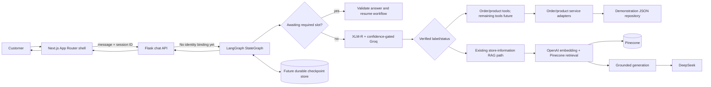
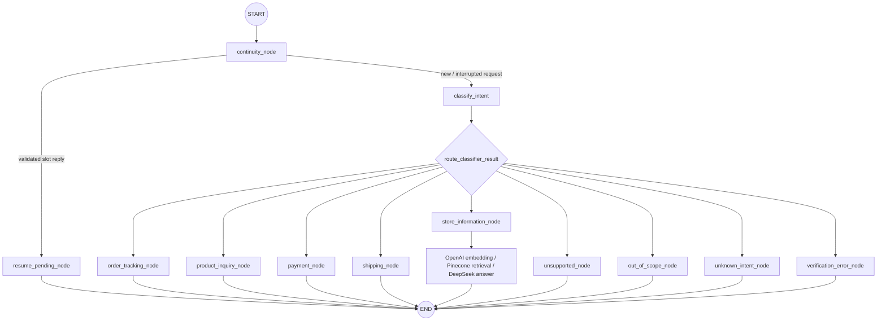
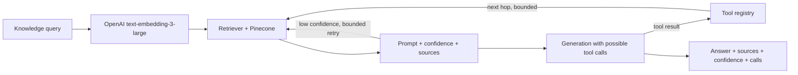
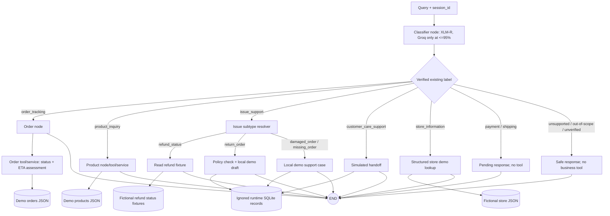
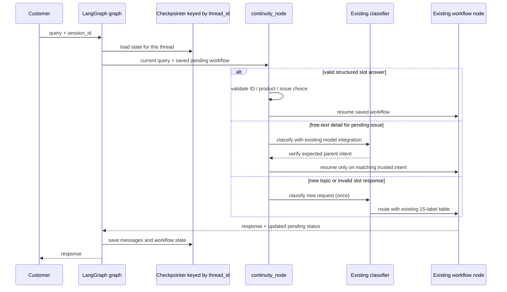
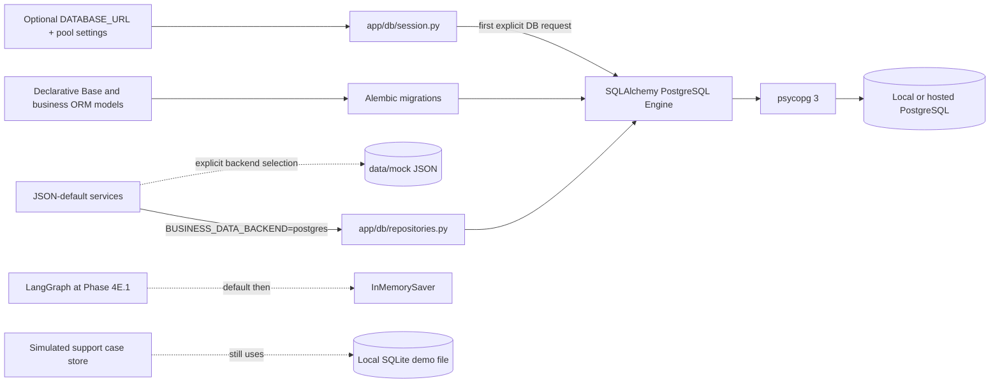
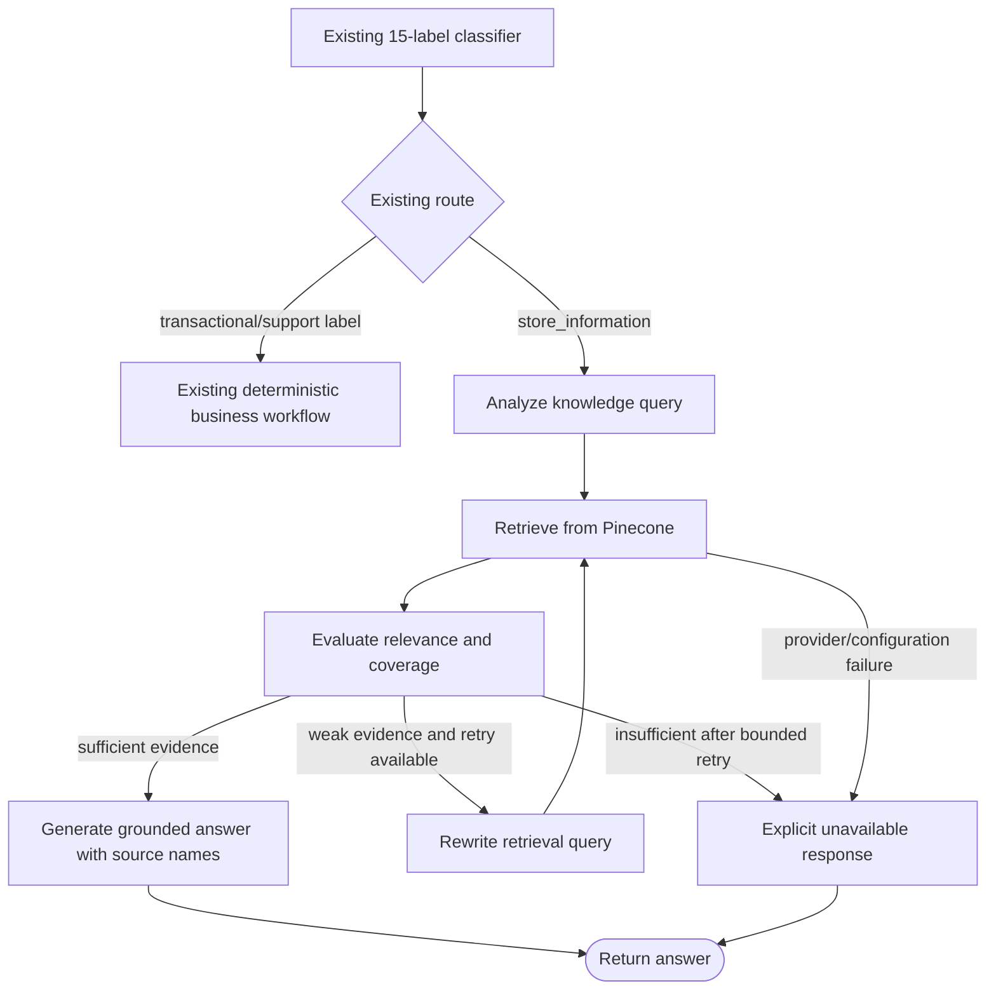
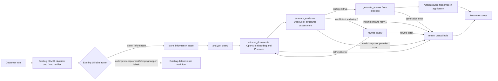

# System Design — Multilingual Ecommerce Support Agent

This document separates **implemented behavior** from **proposed architecture**. The new project source is authoritative for current behavior. `Ecommerce-Support-Agentic-RAG/` is a source reference only. Do not treat an integration as operational until implemented and tested.

## 1. Detailed architecture

### Current implementation

```mermaid
flowchart TB
    HTTP[POST /api/chat] --> Invoke[invoke_graph(message, session_id)]
    Invoke --> Graph[Compiled LangGraph StateGraph]
    Graph --> Continuity[continuity_node: pending slot gate]
    Continuity -->|new request / interruption| Classify[classify_intent node]
    Continuity -->|validated slot answer| Resume[resume_pending_node]
    Classify --> Adapter[classify_and_verify]
    Adapter --> Loader[Lazy local XLM-R loader]
    Loader --> Bundle[(models/xlmr_intent_classifier)]
    Adapter --> Gate{Confidence > 95?}
    Gate -->|yes| Route[Conditional route by status and actual label]
    Gate -->|no| Groq[Groq verifier]
    Groq --> Route
    Resume --> Order[Order tracking + ETA assessment]
    Route --> Order
    Resume --> Product[Product inquiry]
    Route --> Product
    Resume --> Issue[Issue subtype resolver]
    Route --> Issue
    Route --> Care[Simulated customer-care handoff]
    Route --> Store[store_information_node]
    Store --> RAG[Lazy document RAG service]
    RAG --> Embed[OpenAI embeddings]
    RAG --> Search[Pinecone vector retrieval]
    Search --> Context[Source-tagged excerpts]
    Context --> Generate[DeepSeek grounded answer]
    Store -. development configuration fallback .-> StoreJSON[(Explicitly fictional store JSON)]
    Issue --> SupportServices[Refund / return / damage / missing services]
    Care --> Cases[(Local SQLite demo records)]
    SupportServices --> Cases
    Store --> StoreJSON[(Demo store JSON)]
    Route --> Pending[Payment / shipping pending nodes]
    Route --> Safe[Unsupported / unknown / out-of-scope / verification error]
    Order --> End((END))
    Product --> End((END))
    Pending --> End((END))
    Safe --> End
    Graph --> Checkpointer{CHECKPOINT_BACKEND}
    Checkpointer -->|memory| Memory[InMemorySaver]
    Checkpointer -->|postgres| Saver[PostgresSaver + psycopg pool]
    Saver --> CheckpointDB[(Checkpoint-owned PostgreSQL tables)]
    Memory --> Graph
    Flask[Existing Flask application] --> Health[GET /api/health]
    Flask --> HTTP
```

Flask's chat route invokes the existing graph interface. Order/product/issue nodes use local demonstration JSON and customer-care/issue records use a local SQLite demo repository. The existing store-information route invokes RAG when configured; no approved knowledge documents or Pinecone index are included. Payment and shipping operations remain pending. No live retailer, courier, refund processor, or human agent is contacted.

### Target architecture (incremental)



Authentication and UI are future components; RAG routing for shipping/operational issue requests also remains future work. Store-information RAG requires approved documents, provider credentials, and a provisioned index. Order/product, issue-support, and customer-care paths remain demonstration workflows.

## 2. Component responsibilities

| Component | Source | Current role/boundary |
| --- | --- | --- |
| Flask factory | `app/__init__.py:create_app` | Builds Flask and registers blueprint. |
| API blueprint | `app/api/routes.py` | `GET /api/health` and validated `POST /api/chat`; exposes a limited response projection. |
| Config | `app/config.py:Config` | Flask, model paths, threshold/Groq, database/checkpoint, and lazy RAG settings. |
| Classifier | `app/classifier/classifier_service.py:classify_and_verify` | XLM-R result plus conditional Groq validation. |
| Model loader | `app/classifier/model_loader.py:load_model` | Loads the bundled model/tokenizer locally, validates required files and labels, and caches per process. |
| Labels | `app/classifier/intent_mapping.json` | Copy of model's 15 labels; graph validates route coverage. |
| Typed state | `app/graph/state.py:AgentState` | Query/thread/messages, classifier result, explicit pending workflow/slots, confirmation status, route, output/errors and context. |
| Nodes/router | `app/graph/nodes.py`, `routing.py` | Validate/resume pending slots before classifier routing; route to existing order/product, issue resolver, simulated handoff, store information, pending, or safe fallback nodes. |
| Workflow/checkpointing | `app/graph/workflow.py`, `app/graph/checkpointer.py` | Maps session ID to thread ID; selectable memory or pooled PostgreSQL saver. |
| RAG | `app/rag/documents.py`, `service.py`, `ingest.py` | Loads/chunks approved Markdown/text, upserts OpenAI vectors to Pinecone, retrieves evidence, and generates grounded answers through DeepSeek. Provider clients initialize on demand. |
| Services/tools/repository | `app/services/`, `app/tools/`, `data/mock/`, `data/runtime/` | Demo JSON readers, support services/tools, and local SQLite simulated case records. |
| Frontend | `frontend/app/` | Next.js App Router, React, TypeScript and Tailwind chat UI; local component state and mock replies only, no Flask requests or chat persistence. |

## 3. XLM-R and Groq verifier

`load_model()` resolves the default model directory to `models/xlmr_intent_classifier/`, checks for `config.json`, `model.safetensors`, `tokenizer.json`, and `tokenizer_config.json`, validates 15 consecutive IDs and unique labels, loads via Transformers `local_files_only=True`, chooses CUDA when available (otherwise CPU), calls `eval()`, and caches a `ModelBundle` behind a lock. Missing bundle files produce an actionable error; no model download is attempted. The label map is bundled with the model and a packaged copy remains available as a fallback. `intent_descriptions.json` is bundled under `app/classifier/` and is required by the low-confidence Groq verification path.

The backend imports the app-owned adapter modules `app/classifier/classifier_service.py` and `app/classifier/model_loader.py`; it does not import the original classifier project's `main.py` or `routing.py`. Only the inference artifacts and verifier descriptions are included. Training arguments, notebooks, datasets, archives, the original environment file, and virtual environments are not runtime dependencies.

The local weight file is about 1.04 GiB and `.gitattributes` retains a Git LFS rule for `model.safetensors`, but the model and other inference artifacts are excluded from the current publication set while redistribution rights remain unverified. A fresh clone will not contain the model bundle and must obtain it through an authorized distribution method before classification can run. The fine-tuned classifier's dataset provenance is `monish-sd-7/E-Commerce-Customer-Intent-Detection-Dataset` ([dataset page](https://huggingface.co/datasets/monish-sd-7/E-Commerce-Customer-Intent-Detection-Dataset)), owner namespace `monish-sd-7`, as supplied by the project owner. The page currently has no dataset card and displays no license; inspected classifier source files do not independently identify the training dataset. No license or redistribution right is inferred. The original dataset, fine-tuned weights, and derived artifacts with uncertain rights are withheld. The upstream [XLM-R base model is listed as MIT licensed](https://huggingface.co/FacebookAI/xlm-roberta-base), but that alone does not establish rights for this fine-tuned artifact.

### Classifier dependency map

```text
run.py -> app.create_app -> Flask /api/chat -> app.graph.workflow.invoke_graph
  -> app.graph.nodes.classify_intent_node
    -> app.classifier.classifier_service.classify_and_verify
      -> app.classifier.model_loader.load_model
        -> Transformers AutoTokenizer + AutoModelForSequenceClassification
        -> local models/xlmr_intent_classifier/{config,weights,tokenizer,label map}
        -> PyTorch inference (CUDA when available; CPU otherwise)
      -> Groq SDK only when confidence <= 95.0
        -> app/classifier/intent_descriptions.json
```

Direct classifier dependencies are already present in `requirements.txt`: PyTorch, Transformers, SentencePiece, Safetensors, Groq, and python-dotenv. The installed Python 3.11 environment resolves their transitive packages through the existing dependency resolver: Transformers uses Hugging Face Hub, Tokenizers, NumPy, Requests, regex and YAML; PyTorch brings its runtime support packages; Groq uses HTTPX, Pydantic, AnyIO and related packages. No separate classifier requirements file or runtime import of the original project is needed.

For reproducibility of the Phase 7.4 inspection, the installed dependency metadata resolved this classifier subset to the following package closure (versions below are the current `ecom_langraph/.venv` resolution, not new pins):

| Root dependency | Resolved transitive package names in this Python 3.11 environment |
|---|---|
| `torch` | `filelock`, `typing_extensions`, `setuptools`, `sympy`, `mpmath`, `networkx`, `Jinja2`, `MarkupSafe`, `fsspec` |
| `transformers` | `huggingface_hub`, `packaging`, `PyYAML`, `requests`, `charset-normalizer`, `idna`, `urllib3`, `certifi`, `tqdm`, `colorama`, `numpy`, `regex`, `tokenizers`, `safetensors` |
| `groq` | `anyio`, `distro`, `httpx`, `httpcore`, `h11`, `pydantic`, `annotated-types`, `pydantic_core`, `typing-inspection`, `sniffio`, `typing_extensions` |
| `sentencepiece`, `safetensors`, `python-dotenv` | No additional runtime package dependencies reported by the installed package metadata. |

The copied inference bundle totals about 1.05 GiB: weights 1,112,244,996 bytes, tokenizer JSON 17,098,184 bytes, intent descriptions 5,011 bytes, with small config/mapping files. `training_args.bin` (5,201 bytes) was deliberately excluded because loading and inference do not use it. Hash comparison confirmed byte-identical copies of the selected model/tokenizer/metadata files.

`classify_and_verify(query)` tokenizes up to 128 tokens and calculates softmax confidence. Confidence strictly greater than `INTENT_CONFIDENCE_THRESHOLD` (default 95) bypasses Groq. Confidence at/below threshold calls Groq with query, predicted label, score, the exact labels, and intent descriptions. The response must follow one of `CORRECT_INTENT`, `CORRECTED_INTENT`, `UNKNOWN_ECOMMERCE_INTENT`, `OUT_OF_SCOPE`; it is checked for schema and consistency. The verifier cannot invent labels or alter the prediction field.

Groq import/client use is lazy. Missing key, API/schema failure, or invalid corrected label returns `UNVERIFIED` with no final intent. Model/path failure returns `CLASSIFICATION_ERROR`. Both reach the graph's verification-error no-tool node. See `app/classifier/classifier_service.py` and `app/graph/routing.py`.

## 4. StateGraph nodes and conditional edges

`app/graph/workflow.py:build_graph()` begins with `continuity_node`, then routes either to `resume_pending_node` or `classify_intent`; the existing `store_information` trained label reaches `store_information_node`, which invokes document RAG. The separately registered `rag_node` remains an unrouted placeholder; no classifier label was added.



`UNVERIFIED` and `CLASSIFICATION_ERROR` go to verification error; `UNKNOWN_ECOMMERCE_INTENT` goes to unknown; `OUT_OF_SCOPE` status or label goes to out-of-scope. Only `ACCEPTED_BY_CLASSIFIER`, `CORRECT_INTENT`, and `CORRECTED_INTENT` with a known final label route to a mapped branch. Invalid/missing outcomes fail to unknown. Six trained but unavailable labels use `unsupported_node`.

| Exact model label | Current route | Intended first capability / boundary |
| --- | --- | --- |
| `account_management` | unsupported | No account service inspected. |
| `add_to_cart` | unsupported | Mutation excluded. |
| `billing_and_payment` | payment | Payment method/policy reads; currently pending. |
| `customer_care_support` | customer_care | Local simulated handoff record; no live agent contact. |
| `delivery_options` | shipping | Shipping policy read; currently pending. |
| `issue_support` | issue_support | Subtype resolver for refund status, return draft, damage report, or missing delivery. |
| `order_management` | unsupported | No order update/cancel service. |
| `order_tracking` | order_tracking | Status lookup after collecting order ID. |
| `out_of_scope` | out_of_scope | Safe response; no tool. |
| `place_order` | unsupported | No purchase creation service. |
| `product_inquiry` | product_inquiry | Stock read only; broader catalog needs source. |
| `remove_from_cart` | unsupported | Mutation absent. |
| `shipping_cost` | shipping | Read shipping cost fields. |
| `store_information` | store_information | Lazy document RAG with source names; empty/weak evidence is unavailable. Development-only fixture fallback is explicitly labeled. |
| `submit_feedback` | unsupported | No feedback store. |

Route keys are workflow branches, not extra classifier labels. This exact label set is from `app/classifier/intent_mapping.json`; graph route table is `app/graph/routing.py`.

## 5. Conversation state and memory

`AgentState` includes `query`, `session_id`, `messages`, classifier result, response and route; `pending_workflow` stores workflow/status/awaiting slot/required slots/collected values/prompt; `workflow_status`, `pending_clarification`, and `resuming_pending` control turn continuity. Other fields include order/product identifiers, issue type/details, support case reference, handoff state, confirmation requirement/status, and future retrieval context.

`invoke_graph(query, session_id)` uses `session_id` as `configurable.thread_id` on a cached compiled graph. `InMemorySaver` preserves state/messages per thread for the current process. When explicitly configured, `PostgresSaver` preserves it across process restarts. Thread IDs keep checkpoint namespaces separate, but are not authentication or authorization.

Additional fields reserved for later capabilities:

| Field | Purpose |
| --- | --- |
| `last_intent`, `last_tool_result` | Context for follow-up questions. |
| `entities` | Validated values gathered over turns. |
| `clarification_count` | Bound repeated clarification loops. |
| `confirmation_required`, `confirmation_status` | Pause before any later side effect. |
| `messages` | Ordered turns, with retention/size controls in production. |

Implemented: `continuity_node` checks the pending slot and validates the next answer before classifier routing. Valid structured answers resume the selected workflow. Free-text support details pass through the existing classifier and are accepted only for the saved parent intent. A different request can run while the pending workflow remains suspended in that thread. There is one active pending workflow per session; starting a second incomplete workflow can replace the first.

## 6. Multi-turn lifecycle (client path proposed; graph continuity implemented)

```mermaid
sequenceDiagram
    participant U as Customer
    participant UI as Next.js frontend shell
    participant API as Future Flask API
    participant G as LangGraph
    participant DB as Future read-only order adapter
    U->>UI: Where is my order?
    UI->>API: message + conversation ID
    API->>G: invoke with thread ID
    G->>G: classify order_tracking; set pending workflow
    G-->>UI: Please provide your order ID
    U->>UI: ORD-1001
    UI->>API: follow-up with same conversation ID
    API->>G: invoke same thread
    G->>G: validate/store ID in awaiting_slot
    G->>DB: get_order_status(order_id)
    DB-->>G: status result
    G->>G: explain and clear pending workflow
    G-->>UI: order status response
```

The graph persists pending slots in the same thread checkpoint. Order IDs/product names are validated against strict formats and demo fixtures; support free text must pass the saved parent intent. Invalid IDs and ambiguous candidates ask for clarification. A different task can run and leave the earlier workflow suspended. Repeated clarification attempts are not yet bounded by a configurable maximum.

## 7. Business functions and migration plan

Reference functions are in `Ecommerce-Support-Agentic-RAG/api/app/services/`; their data comes from `api/utils/mock_data.py`. These are fixtures, not a live ecommerce backend. Policy retrieval exists; return initiation/validation does not exist in the inspected services.

| Capability | Actual function/signature | Data and behavior | Reuse/adaptation |
| --- | --- | --- | --- |
| Order status | `get_order_status(order_id: str) -> dict` (`order_service.py`) | `ORDERS`, keyed by order ID; returns status, ETA, product ID; unknown gives status `Not found`. | Simple logic; migrate fixture behind new adapter. Explicitly distinguish not-found and add future ownership checks. |
| Product stock | `get_product_stock(product_id: str) -> dict` (`product_service.py`) | `PRODUCTS` actually keyed by display name; returns stock/restock date. | Parameter is misleading. Normalize product name vs canonical ID and distinguish unknown from zero stock. |
| Payment methods | `get_payment_methods() -> dict` (`payment_shipping_service.py`) | `POLICIES["payment"]` | Read-only lookup; fixture text. Copy return values in adapter. |
| Payment policy | `get_payment_policy() -> dict` | `POLICIES["payment"]`, including defaults | Read-only lookup; defaults can hide absent fields; do not imply payment processing. |
| Refund policy | `get_refund_policy(product_id: str = None) -> dict` (`return_refund_service.py`) | Base policy plus optional product-ID override | Lookup only; form URL does not mean refund submission works. Copy/validate inputs. |
| Return policy | `get_return_policy(product_id: str = None) -> dict` | Base policy plus optional product-ID override | Lookup only; beware merging/returning shared dictionary. No eligibility or return creation. |
| Shipping info | `get_shipping_info() -> dict` (`payment_shipping_service.py`) | `POLICIES["shipping"]` | Direct read-only result currently returns global dict; adapter should copy. |
| Shipping cost | No dedicated function | `free_threshold`, `cost_domestic`, `cost_international` under shipping policy | Project selected fields via a small read-only adapter; ask about destination/conditions; don't infer absent rates. |
| Warranty (extra) | `get_warranty_info(product_id: str) -> dict` | `POLICIES["products"]` | Exists but outside requested eight and no clearly dedicated label; defer. |

The reference `rag/agents/tools/tool_registry.py` executes `func(**args)`. Its stock schema requires keyword `product_name`, but the function requires `product_id`; that call raises `TypeError`. The order schema/function both use `order_id`.

### Imports and packaging

- Services import `api.utils.mock_data`; copying only functions breaks imports. Migrate needed fixture/data under the new project with clean packages; don't import the old repo at runtime.
- Reference Flask routes import `app.services.*` although source files sit under `api/app/services`; this relies on a particular `sys.path` and conflicts with the new project's top-level `app`.
- Tool registry instead imports `api.app.services.*`, another package root.
- `api/app/routes.py` imports and constructs Pinecone, OpenAI embeddings, Retriever and RAG controller at module import, coupling simple routes to optional dependencies and credentials. Do not reuse this route module; reuse only tested pure logic.
- Some defaults can mask missing policy fields and several functions return shared dictionaries. Normalize result/status and shallow/deep-copy appropriately at adapter boundary.
- Fixture orders/products are fixed examples, some dates historical; never present them as real customer records.

### Recommended separation

Graph nodes handle workflow/slot collection. Tools validate inputs and call service adapters. Adapters own data-source boundaries and normalize outcomes/errors. Graph nodes must not directly import reference modules or embed business data. Start read-only. Return creation, email, restock subscription, payment mutation, cancellation and cart changes need real contracts, authorization/idempotency and confirmation; out of migration scope.

## 8. Agentic RAG architecture

New project has no RAG code yet. Reference source structure indicates:

1. `rag/ingestion/loader.py` and `chunker.py`: ingestion components; inspect their internals before reuse.
2. `rag/retrieval/vector_store.py`: vector-store interface plus Pinecone/in-memory variants; reads `OPENAI_API_KEY` and `PINECONE_API_KEY` at import. Uses OpenAI `text-embedding-3-large`.
3. `rag/retrieval/retriever.py`: embeds query and retrieves; optional HyDE uses default `ChatOpenAI(model="gpt-4o-mini")`; controller requests HyDE and MMR. MMR constructs `BM25Retriever` from text and sets `search_type="mmr"`; verify library compatibility before reuse. Optional rerank uses Cohere but controller does not request it.
4. `rag/augmentation/augmenter.py`: builds augmented prompt and metadata (confidence/sources).
5. `rag/generation/generator.py`: generates response and may request registered tools.
6. `rag/agents/agentic_controller.py`: max 3 hops, top-k 5, <=2 low-confidence retries, confidence cutoff .6, and tool result incorporated into next query. Final low-confidence output may still be returned; exhausted hops return fallback.
7. `api/app/routes.py`: initializes Pinecone/OpenAI/retriever/controller at module import and exposes POST RAG handler. Rasa action calls a different localhost URL/port/path.



This is reference design only. DeepSeek is the objective, but the inspected Retriever defaults to OpenAI chat for HyDE. Inspect `rag/generation/generator.py` before claiming the generator uses DeepSeek; a separate Rasa action calls DeepSeek and does not prove RAG generator configuration. Phase 5 should inspect ingestion, augmenter, generator, tool schemas, dependencies, prompt safety, citations, timeouts, retry limits and provider setup before migration.

## 9. Flask API design

**Implemented:** `GET /api/health` and `POST /api/chat` in `app/api/routes.py`, registered by the existing `create_app()` factory. Chat accepts JSON `{ "session_id": "...", "message": "..." }`; rejects invalid JSON, missing/empty/wrong-typed values, overlong inputs, and extra fields such as client-supplied `thread_id`; then calls `invoke_graph(message, session_id)`. It returns only `{ "session_id", "answer", "intent", "workflow_status" }`, mapped from actual graph fields `response`, `final_intent`, and `workflow_status`. Absent optional intent/status values are JSON `null`. Example:

```json
{
  "session_id": "conversation-123",
  "answer": "Please provide your order ID (for example, ORD-1001).",
  "intent": "order_tracking",
  "workflow_status": "awaiting_input"
}
```

Reuse the same session ID for later turns. `invoke_graph` maps it to LangGraph `configurable.thread_id`; the configured memory/PostgreSQL saver remains authoritative and PostgreSQL initialization failures do not fall back to memory. Distinct IDs isolate graph threads, but IDs are not authentication: there is no owner binding or authorization, so public deployment must not let a caller select another person's ID.

`CORS_ALLOWED_ORIGINS` is a comma-separated exact-origin allowlist for browser clients. Wildcard `*` is rejected, JSON preflight headers are allowed, and credentials are not enabled. Defaults allow no browser origins. Limits are configured by `MAX_CHAT_MESSAGE_LENGTH` (10,000 chars), `MAX_SESSION_ID_LENGTH` (128 chars), and `MAX_CONTENT_LENGTH` (64 KiB). Graph exceptions return a generic 503 and are not included in the response; health remains a liveness check and does not initialize model/database/provider services. CORS is not an authentication control.

Full offline validation for Phase 6.1: `python -m unittest discover -s tests -q` ran **168 tests successfully; 2 skipped**. The chat endpoint tests mock graph calls except the continuity/isolation case, which uses a real in-memory LangGraph saver with the classifier mocked. No real provider or production PostgreSQL call was made by the API tests.

Reference endpoints are not contracts for the new app. Inspected `api/app/routes.py` declares order, stock, RAG, return/refund policy, shipping, payment methods/policy and warranty routes. No return-validate/create or email endpoint appeared in inspected routes. RAG components initialize at import.

## 9.1 Optional FakeStore catalog and conversational API testing

FakeStore is a disabled-by-default read-only demonstration catalog. `FAKESTORE_ENABLED`, `FAKESTORE_API_BASE_URL` and `FAKESTORE_TIMEOUT_SECONDS` configure it. `app/integrations/fakestore_client.py` lazily creates a stdlib HTTP client, validates JSON/status/schema, and uses a bounded timeout. It calls only `GET /products?limit=N` and `GET /products/{id}`. The returned product fields are `id`, `title`, `price`, `description`, `category`, and `image`; no stock count is present. Product list/search/detail/stock wrappers live in `app/tools/fakestore_tools.py`. The stock result therefore sets `stock_quantity` to `null` and the graph explicitly says that live availability cannot be confirmed. See the [FakeStore product API collection](https://documenter.getpostman.com/view/4790112/2sBY4WnGCZ) for the documented read endpoints.

Only the existing classifier `product_inquiry` route can select these tools, and only when enabled. When FakeStore is enabled, its miss or provider/validation failure is terminal for the product lookup and never falls through to PostgreSQL or JSON records. Pending product-name validation also uses FakeStore in this mode. When disabled, the configured local demonstration product source is selected directly, and stock figures are labeled as fictional sample data. No new classifier labels were introduced. Search terms are directly derived from the customer's message; the system does not generate or infer product IDs. Product detail lookup accepts a numeric ID only when the customer explicitly writes it as a product/item ID.

Order status, refunds, returns, support cases and handoff remain on existing application services and repositories. `BUSINESS_DATA_BACKEND=postgres` selects the PostgreSQL repository; JSON is still the local default. There is no FakeStore order endpoint in this application. The reference project's actual `api/integrations/fakestore_client.py` has a bare `requests.get(.../products/{product_id})` and parses `.json()` without timeout/status/schema handling. Its `get_order_status` and product stock service use local fixture data, and its tool registry registers `check_product_stock`, not a FakeStore-backed `check_stock`. Its README statements about real-time FakeStore order tracking and stock integration do not match those implementations. See the [reference repository](https://github.com/Tekraj15/Ecommerce-Support-Agentic-RAG).

FakeStore documents demo cart routes, but no cart operations are implemented here. This graph has no customer/cart ownership model, and the existing add/remove-cart classifier intents stay unchanged. Mutating FakeStore's shared demo records would not represent a real customer's cart.

For repeatable, user-style API testing, run `scripts/run_chat_scenarios.ps1` against a started Flask server. It covers order follow-up, product availability, product search, return policy, damage, refund status, simulated agent handoff, unrelated input and Hindi order follow-up. Each scenario uses a separate conversation key, reusing it for sequential turns. Tests in `tests/test_fakestore.py` mock HTTP replies; one uses Flask's test client, the actual LangGraph, and a fake FakeStore response. Ordinary tests make no paid provider calls. No live FakeStore/Pinecone/LLM quality test is claimed. Phase 6.2 validation ran **174 tests successfully; 2 skipped** using `.venv` Python.

## 9.2 Classifier and pending-workflow routing (Phase 6.3)

`continuity_node` is the first graph node. With no pending workflow, it selects `classify_intent`; `classify_intent_node` calls the unchanged `classify_and_verify()` interface, preserving local XLM-R as primary and Groq verification at the existing <=95% threshold. No label mapping or classifier model was changed.

When a workflow is pending, the continuity node checks the expected slot first. Valid order identifiers, unambiguous product names/IDs, supported issue choices, explicit yes/no confirmation (English/Hindi), and valid natural-language slot details resume through `resume_pending_node` without a classifier call. Slot-specific shape validation is limited to deciding whether text answers the current field; it does not select a business intent. If a value does not validate, the node calls XLM-R/Groq once. A verified new intent is passed to the existing route using that preclassified result, so the classifier is not called a second time. Unknown/unverified or same-workflow ambiguous messages return a clarification and keep the current pending state.

For verified interruptions, the original pending object is pushed onto `suspended_workflows` in the same LangGraph checkpoint thread and the new request becomes active. After the interruption completes, `finalize_turn_node` restores the most recently suspended workflow and re-prompts for its outstanding slot. If the interruption itself is pending, it remains active; completing it then restores the older request. Session/thread isolation continues to come from the existing checkpointer. Confirmation state remains explicit, and invalid confirmation input is classified as a possible interruption rather than executing an action.

The damaged-order conversation validates its order through the existing order service, then consumes a free-text damage description without unnecessary reclassification, and records only the existing local demonstration support case. No real retailer/courier claim is submitted.

The JSON refund fixture and SQLAlchemy `RefundRecord` model already support the required status strings; no schema migration was needed. Demo data records `ORD-1001=not_initiated`, `ORD-1002=processing`, and `ORD-1003=completed`; `ORD-1004` has no refund row. `get_refund_status()` remains read-only and reports only a stored record. Fixture import remains insert-if-absent and now skips a refund if its parent order is missing or not marked `is_demo`, so these sample records cannot attach to a non-demo order. Current dry-run counts are 3 products, 4 orders, and 3 refunds.

To validate the import without connecting to PostgreSQL, run `python -m app.db.import_demo_data --dry-run`. For a deliberate import, first configure `DATABASE_URL`, migrate with `python -m alembic upgrade head`, then in PowerShell set `$env:BUSINESS_DATA_BACKEND="postgres"`, run `python -m app.db.import_demo_data`, and remove that process variable. The database insert is idempotent and never updates existing identifiers. These commands were documented but no live PostgreSQL import was performed in this phase.

`tests/test_chat_api.py` exercises the full damaged-order turn sequence through Flask's test client, existing LangGraph, and a mocked classifier; valid slot answers skip subsequent classifier calls. `scripts/run_chat_scenarios.ps1` provides manual Flask-server scenarios for order tracking, damage, each refund status, absent refund, product flows, policy, Hindi, interruption/resumption, and unrelated input. The script syntax was checked, but it was not executed against a running server; the automated tests are not live API/provider tests.

Phase 6.3 validation: `.\.venv\Scripts\python.exe -m unittest discover -s tests -v` ran **182 tests successfully; 2 skipped**. The database fixture importer dry run reported 3 products, 4 orders, and 3 refunds. Import idempotency and repository behavior were tested with session doubles; no live PostgreSQL import was performed.

## 10. Next.js frontend and Flask chat integration (Phases 7.1–7.3)

`frontend/` is an independent Next.js App Router project using React, TypeScript and Tailwind CSS. It provides the responsive sidebar, page heading, assistant greeting, right-aligned customer bubbles, left-aligned assistant bubbles, a typing indicator, a multiline composer, and a light/dark theme toggle. Enter submits, Shift+Enter inserts a line break, and the view scrolls to the latest message. The initial message is “Hi! How can we help you today?”.

Phase 7.3 sends `{session_id, message}` as JSON to the existing Flask `POST /api/chat` and displays its `answer`. The frontend validates the echoed session ID and uses the backend's safe `message` field for HTTP errors. Network and malformed-response failures render as explicit error messages; they do not produce a fabricated assistant response. The browser creates a UUID for the first turn, reuses it until **New chat** resets the conversation, then creates a new UUID on the next send. `NEXT_PUBLIC_CHAT_API_BASE_URL` configures the Flask base URL in `frontend/.env.local`.

The frontend requires the Flask server's exact browser origin in `CORS_ALLOWED_ORIGINS`; wildcard origins are rejected. Chat messages and the current session ID remain only in React memory and are lost on refresh. The UUID is only a LangGraph conversation key, not authentication or customer identity. The frontend does not import Python modules or receive model/provider/database credentials. Live Flask integration was not tested in the current environment because no server was listening on `127.0.0.1:5000`.

## 11. Errors and fallbacks

Current service and graph behavior:

- Empty input returns classification error.
- Model/path/mapping failures become `CLASSIFICATION_ERROR`.
- Missing Groq key/API failure/invalid response becomes `UNVERIFIED`, with no final intent.
- Invalid verifier status or missing/unknown `final_intent` routes to unknown.
- Unknown ecommerce, out-of-scope, and unsupported labels have distinct no-tool responses.

Future adapters should return explicit outcomes (`ok`, `not_found`, `invalid_input`, `unavailable`); keep diagnostic detail server-side with redaction and user message concise. Avoid success-shaped defaults. Bound timeouts/retries. Ground RAG answers in evidence, cite sources, and say when evidence is insufficient.

## 12. Human confirmation for sensitive operations

Phase 4A is read-only. Order status is still customer data and production needs authentication/ownership checks. Any state change (return creation, cancellation/change, refund/payment, notifications, feedback) needs a real service contract, authorization, idempotency, and a confirmation pause that states the exact action. A verifier or generated answer is not authorization. The application has no confirmation node or mutation service today.

## 13. Deployment architecture

Current local mode: one Python Flask development process; model from local files; Groq outbound only when confidence <= cutoff; graph state in process memory. No new-project Docker deployment, database, Redis, reverse proxy, authentication, or multi-worker-safe store exists.

Future: place the Next.js frontend and Flask API behind an intentional network boundary; use a secret manager; version/mount model assets; use a durable shared checkpointer; bind conversations to authenticated owners; add TLS/rate limits and separate health/readiness. Pinecone/OpenAI/DeepSeek are outbound services. Reference deployment is not a proxy for this project.

## 14. Decisions and rationale

- **Keep XLM-R primary:** preserves the existing English/Hindi trained behavior and labels.
- **Gate Groq by confidence:** limits verifier calls; schema checks and fail-closed routing keep uncertain outcomes from tools.
- **Use StateGraph:** explicit routing and state make workflow decisions inspectable and support future pauses for required fields.
- **Use new adapters:** reference import roots conflict, reference data are fixtures, and route import eagerly initializes RAG; selective migration reduces coupling.
- **Read-only first:** avoids customer-visible mutations while only mock data and unverified API contracts are available.
- **InMemorySaver for foundation:** simple local state without another service, knowingly not restart/multi-worker safe.
- **Flask boundary, Next.js frontend:** keeps UI presentation independent from model/business logic. The Phase 7.3 client calls the existing Flask chat endpoint; it does not embed graph or business behavior.
- **RAG later:** optional providers should not block health or deterministic reads.

## 15. Known integration risks

1. Fixed sample data and dates are not live commerce records.
2. Product stock keys are display names despite parameter named `product_id`; policy overrides use actual product IDs.
3. Tool schema uses `product_name`, function requires `product_id` keyword.
4. Package roots vary (`app.services`, `api.utils`, `api.app.services`) and collide with the new project's `app`.
5. Reference Flask import eagerly creates Pinecone/OpenAI/RAG clients.
6. Phase 4D now checkpoints pending slots and resumes validated answers; free-text answers are checked against the existing parent classifier intent.
7. Caller-controlled session ID does not authorize access.
8. Service fallback values can blur not-found vs real result; shared dicts can be mutated.
9. Rasa references localhost endpoints; return validation/creation/email APIs were not found; RAG URL/port differs from route arrangement.
10. RAG provider is ambiguous; retriever defaults to OpenAI HyDE even though project goal names DeepSeek.
11. MMR/rerank calls may not match installed LangChain APIs; untested.
12. No real database/API credentials or service contract for order/inventory/payment/logistics was identified.
13. Conversation data retention/deletion and PII-safe logging are not designed.
14. Verifier/provider timeouts, quotas, bounded retries and monitoring need design.

## 16. Proposed conversation and Phase 4 sequence

1. Add new-project fixtures/service boundary and tests; keep reference packages out of runtime imports.
2. Migrate/test `get_order_status`; distinguish missing order ID, unknown order and backend error.
3. Add `pending_workflow`/`awaiting_slot`, same-thread continuation; test “Where is my order?” → ask ID → `ORD-1001` → status, thread isolation, and topic changes.
4. Migrate stock, with product-name/ID normalization and unknown-vs-zero stock tests.
5. Migrate payment methods and payment policy; then return and refund policy; then shipping info and cost projection.
6. For broad `issue_support` and `store_information`, clarify topic or answer from validated policy data; do not create additional classifier labels. Keep return eligibility/refund execution/mutations unsupported.
7. Add network timeouts only when a live backend is identified; present reference functions have no network call.
8. Record evidence in README, this design, and progress tracker. Do not start Phase 5 until Phase 4 review.

Test each tool for schema/signature, known fixture, unknown key, malformed input, service error, dialogue slot collection, correct language response, thread isolation, and no write side effect.


## 17. Phase 4B: order tracking and product inquiry implementation (historical phase notes)

Phase 4B adds working read-only workflows backed only by local demonstration JSON. The original XLM-R classifier, its labels, and `app/graph/routing.py` are unchanged. The existing `order_tracking` and `product_inquiry` routes now execute tools; no Rasa, Pinecone, DeepSeek, or reference-project package is imported.

### Implemented service architecture

```mermaid
flowchart LR
    Query[New user query] --> Classifier[classify_intent node]
    Classifier --> Router{Verified intent}
    Router -->|order_tracking| ON[order_tracking_node]
    ON --> OT[lookup_order_status(order_id)]
    OT --> OS[get_order_status]
    OS --> Repo[load_orders]
    Repo --> Orders[(data/mock/orders.json)]
    Router -->|product_inquiry| PN[product_inquiry_node]
    PN --> PT[check_product_stock(product_query)]
    PT --> Search[search_products]
    Search -->|one candidate| Stock[get_product_stock(product_id)]
    Search -->|none/multiple| Ask[Not found or ask to clarify]
    Stock --> PRepo[load_products]
    PRepo --> Products[(data/mock/products.json)]
```

JSON reading is isolated in `app/services/data_repository.py`; graph nodes do not open files. Tool wrappers under `app/tools/` call the service layer and return dictionaries; they do not read or write LangGraph state. Graph nodes interpret those outcomes and produce messages.

### Data structures and source

Both JSON files have top-level `data_type: "demonstration_only"`, a notice, and a record list. Orders are records `{order_id, status, eta, product_id}` keyed by `order_id` in the repository index. Products are `{product_id, name, stock, restock_date}` keyed by canonical `product_id`. Records reuse the reference sample values but omit customer email. Stock zero is meaningful; missing or invalid stock is reported unavailable. The fixed 2025 dates are historical examples. These data are not live or real customer records.

### Service and tool interfaces

| Function | Signature | Result behavior |
| --- | --- | --- |
| `load_orders` | `load_orders(data_dir: str \| Path \| None = None) -> dict[str, dict[str, Any]]` | Fresh order index; wraps unreadable/malformed JSON in `DataRepositoryError`. |
| `load_products` | `load_products(data_dir: str \| Path \| None = None) -> dict[str, dict[str, Any]]` | Fresh canonical product-ID index. |
| `get_order_by_id` | `get_order_by_id(order_id: str \| None) -> dict[str, Any]` | `outcome`: found, missing_order_id, invalid_order_id, not_found, or data_unavailable; found result exposes only order ID/status/ETA/product ID. |
| `get_order_status` | `get_order_status(order_id: str \| None) -> dict[str, Any]` | Same outcome with `order_status`, ETA and product ID; no fabricated status. |
| `get_product_by_id` | `get_product_by_id(product_id: str \| None) -> dict[str, Any]` | found/missing/invalid/not_found and safe product data. |
| `search_products` | `search_products(query: str \| None) -> dict[str, Any]` | found with one match, ambiguous with candidate names/IDs only, not_found, missing_query or invalid_query. Multiple candidates are never guessed. |
| `get_product_stock` | `get_product_stock(product_id: str \| None) -> dict[str, Any]` | Stock returned only for known product with nonnegative integer value; zero remains valid. |
| `lookup_order_status` | `lookup_order_status(order_id: str \| None) -> dict[str, Any]` | Tool wrapper around order service; adds `lookup_performed`. |
| `check_product_stock` | `check_product_stock(product_query: str \| None) -> dict[str, Any]` | Resolves candidate first and calls stock service only for exactly one product. |

Both IDs are normalized to uppercase and validated against the demonstrated formats (`ORD-1234`, `PROD-001`). Order service filters out `user_email`. Product query matching supports product ID/name mentions and returns clarification when more than one candidate matches. The earlier reference mismatch is fixed: new stock service accepts canonical product ID, and the new product tool takes a user query and resolves the ID before calling it.

### Request flows and error behavior

- **Order, ID supplied:** “Where is order ORD-1001?” → classifier selects `order_tracking` → node extracts the formatted ID → tool/service reads JSON → response labels its result as demonstration data and returns only sample status/ETA.
- **Order, ID missing:** “Where is my order?” → node returns `missing_order_id` and asks for an ID. It does not look up an order. The graph does not yet resume this pending request on a subsequent bare-ID turn.
- **Product, one clear match:** “Do you have Laptop Pro in stock?” → product search resolves `PROD-001` → service returns the sample count and the response says it is not live inventory.
- **Product, ambiguous:** “Laptop Pro or Galaxy S21” → tool returns names/IDs with no stock → node asks which one.
- **Product, unknown:** tool returns not-found; response asks for exact name or product ID and does not invent availability.
- **Repository failure:** tools return a safe `data_unavailable` result; nodes avoid success wording. Unrelated graph branches never invoke either tool.

### Tests and coverage

`tests/test_order_service.py` covers known/unknown/missing/invalid IDs, status result, and customer-email omission. `tests/test_product_service.py` covers canonical ID, stock, zero stock, unknown product, natural query, ambiguity without stock leakage, missing query, and absent stock. `tests/test_business_graph.py` covers order and product routes, missing ID, unknown ID, identified/unidentified/ambiguous products, and proves unrelated intents do not call these tools. Existing Phase 1/2/3 tests still run with classifier/Groq mocked; optional real-model smoke remains skipped by default.

Run the complete suite from the project root:

```powershell
.\.venv\Scripts\python.exe -m unittest discover -s tests -v
```

Phase 4B historical test run: **53 tests passed, 1 optional local-classifier smoke test skipped**. See the Phase 4C section below for the current suite result.

### Incomplete behavior after Phase 4B (historical; see Phase 4C status below)

- Data is sample JSON and not connected to a store, inventory service, or customer identity system.
- `invoke_graph` processes a new query through classification each time. Although checkpoint messages persist per thread, there is no saved `pending_workflow`/`awaiting_slot`; follow-up resumption is deferred to Phase 4D.
- Flask has no chat endpoint; Streamlit is not implemented.
- Payment/policy/shipping tools, RAG, durable memory, and state-changing operations are not implemented. Cancellation, returns/refunds, cart, payment APIs remain excluded.
- No live freshness, authorization/ownership validation, or deployment-grade persistence is available.


## 18. Phase 4C: core support workflow implementation (historical phase notes)

Phase 4C connects existing classifier labels to bounded support workflows. `issue_support` is resolved by `app/services/issue_resolver.py` into `refund_status`, `return_order`, `damaged_order`, or `missing_order`. Multiple detected categories produce a clarification response and no issue tool call. Required order IDs and return reasons are requested when absent; cross-turn slot resumption was not implemented at the end of Phase 4C; it is implemented in Section 19.

### Implemented request graph



### Data and behavioral boundaries

- `data/mock/refunds.json` contains fictional `not_initiated` (`ORD-1001`), `processing` (`ORD-1002`), and `completed` (`ORD-1003`) records. `ORD-1004` has no record, which returns `no_refund_record`; the service does not guess a status or initiate a refund.
- `data/mock/policies.json` contains reference-derived example policy values, visibly marked demonstration-only. Because sample orders lack purchase date and item condition, `check_return_eligibility()` returns `manual_review_required` and `eligibility=not_determined`.
- `prepare_demo_return_request()` records a local draft only, status `demo_prepared_pending_manual_review`; no real return/pickup/refund is submitted.
- Damage and missing-delivery reports create local demo case records only. The app does not state that an actual retailer/courier claim was submitted or that a parcel is lost. Missing-delivery progress is based only on fixture status/ETA; no carrier scan timeline exists.
- `request_customer_handoff()` records session ID, reason, summary and simulated status. `live_agent_contacted` is false, and the response says no live agent was contacted.
- Store facts and promotions come from `data/mock/store_information.json` and are explicitly fictional/not redeemable.
- `app/services/case_repository.py` stores local demo records in `data/runtime/support_cases.sqlite3`; `data/runtime/` is ignored by Git. This is demonstration storage with no authentication, deployment durability, retention controls, or ticketing integration.
- `assess_delivery_progress()` derives a delayed stage only when a recognized shipped/in-transit status has a past ETA. Unknown statuses remain unknown and no carrier events are fabricated.
- The classifier's 15 labels and model are unchanged. Existing routes now map `issue_support`, `customer_care_support`, and `store_information` to implemented nodes; no labels are added.

Principal source files: `app/graph/routing.py`, `app/graph/nodes.py`, `app/graph/workflow.py`, `app/services/issue_resolver.py`, the support services under `app/services/`, and tool wrappers under `app/tools/`. Tests are in `tests/test_support_workflows.py` and `tests/test_order_service.py`, alongside prior phase tests. Run the full suite with ` .\.venv\Scripts\python.exe -m unittest discover -s tests -v `. The optional local-classifier smoke test remains skipped by default. Cross-turn pending issue resumption, chat API, Streamlit, live integrations, and RAG are not included in Phase 4C.


## 19. Phase 4D: conversational continuity and checkpointer contract

### Turn processing

`app/graph/workflow.py:build_graph(checkpointer=None)` places `continuity_node` before `classify_intent`. The default compiled graph uses `InMemorySaver`; `invoke_graph(query, session_id)` sends `session_id` as LangGraph `configurable.thread_id`. This makes the checkpoint key explicit while allowing a future LangGraph-compatible saver to be injected without changing node/service contracts.



### Pending workflows and safe validation

The pending dictionary includes `workflow`, `status`, `awaiting_slot`, `required_slots`, `collected`, and `prompt`, with an optional issue subtype/candidate list/parent intent. Workflows currently collect:

- `order_tracking`: strict `ORD-1234` identifier.
- `product_inquiry`: one unambiguous product name or `PROD-123` identifier; ambiguous matches return a clarification and no stock result.
- `issue_support`: explicit subtype (`refund_status`, `return_order`, `damaged_order`, `missing_order`), then required order ID/reason/damage/missing-delivery details as applicable.
- Free-text return/damage/missing details: accepted only when the existing classifier returns a trusted `issue_support` final intent. No new label or second classifier is introduced.

The graph preserves user/assistant history through the checkpoint. On a non-slot query it preclassifies once and passes that result to the ordinary classifier node, avoiding a duplicate model call. The existing supported node handles the new topic; the older pending flow remains marked suspended. Different `thread_id` values use distinct checkpoint state.

### Confirmation and external effects

The state carries `confirmation_required`/`confirmation_status`, and the continuity gate requires explicit `confirm` or `cancel` for a pending confirmation state. The generic resume node fails closed when confirmation is absent. No live irreversible operation is wired in Phase 4D: order/product are reads; return/damage/missing/handoff only create local demo records. Any future real mutation must establish its exact action and arguments in pending state and invoke its service only after confirmed state; adding the confirmation fields alone does not make an external operation available.

### Persistence and Phase 4E.3

At the end of Phase 4D, the default was volatile `InMemorySaver` and the graph already accepted an injected saver. Phase 4E.3 now adds the optional PostgreSQL implementation documented in section 22. Thread ownership/authentication and retention controls remain necessary before production rollout.

No session authentication is implemented: a session ID isolates graph state only when different sessions use different IDs; a caller that can reuse another ID can access that checkpoint. The chat API is not implemented.

Verified tests: `tests/test_conversation_continuity.py` covers valid order/product slots, multi-step return/damage/missing workflows, ambiguous product and issue clarification, malformed IDs, interruption/resumption, session isolation, history reuse, and confirmation gating. Full-suite result is recorded in `docs/PROJECT_PROGRESS.md`.


## 20. Phase 4E.1: PostgreSQL foundation

### Database boundary

`app/config.py` reads optional `DATABASE_URL` and bounded pool/timeout settings. An absent URL does not block imports, Flask health, classifier startup, LangGraph use, or current JSON workflows. `app/db/session.py` validates PostgreSQL URLs, normalizes common `postgresql://` forms to the installed psycopg 3 driver, and rejects SQLite/other dialects. `get_engine()` lazily creates and caches a SQLAlchemy engine with `pool_pre_ping`, bounded pool settings, `echo=False`, and a driver connection timeout. Creating the engine does not establish a TCP connection.

`app/db/base.py` defines the SQLAlchemy declarative `Base`; Phase 4E.2 registers business models in `app/db/models.py`. `get_session_factory()` returns a cached factory. `session_scope()` provides deterministic cleanup, rolls back exceptions, and leaves successful commits explicit to the caller. `dispose_engines()` allows application shutdown or tests to return pooled connections and clear cached factories. Database URLs/passwords are not written to source or logged by this layer.



### Local and production configuration

Local development uses a PostgreSQL instance and a URL in the ignored `.env`, typically `postgresql+psycopg://...@localhost:5432/ecom_support_dev`. `.env.example` keeps `DATABASE_URL` blank and includes only a commented placeholder format. Hosted production should inject a separately provisioned managed PostgreSQL URL from its secret manager/environment, apply provider-required TLS options, and size the pool for its connection cap and application worker count. No production URL or credentials are part of this repository.

### Migration state

`alembic.ini` has no URL/credentials. `migrations/env.py` obtains its dialect/engine through the same lazy database layer and uses a managed connection for online migrations. Revision `0001_postgresql_foundation` is the preserved no-op baseline; `0002_business_data` adds the application tables. Checkpoint tables are separately managed by the saver package, as described in section 22.

Commands from the project root:

```powershell
python -m alembic current
python -m alembic upgrade head
python -m alembic current
```

Offline `--sql` generation requires a configured PostgreSQL URL for dialect selection but does not connect.

### Validation and limits

`tests/test_database.py` verifies optional/missing URL behavior, URL normalization and SQLite rejection, engine/session creation without connecting, session rollback/close, and application import/health setup without DB credentials. `tests/test_database_connectivity.py` performs `SELECT 1` against an actual configured PostgreSQL server and is skipped when `DATABASE_URL` is blank. Phase validation did not have a live PostgreSQL server, so server authentication, TLS negotiation, pool behavior under load, and online migration execution remain unverified.

No business service was moved from JSON and no checkpointer was changed. Existing simulated support cases remain in their separate SQLite demo store. SQLAlchemy/Alembic/psycopg are the only new dependencies; no PostgreSQL server or RAG service is provisioned by this change.


## 21. Phase 4E.2: Business data models and explicit migration

### Schema derived from fixtures

The ORM schema mirrors the available data rather than predicting a production retailer contract:

| Table | Source / role | Key relations and constraints |
| --- | --- | --- |
| `products` | Product ID, name, demo stock, optional restock date | Product ID primary key, stock nonnegative check, name index, `is_demo=true` |
| `orders` | Order ID, status, optional ETA, product ID | Order ID primary key; nullable product FK with `RESTRICT`; status index; `is_demo=true` |
| `support_cases` | Simulated damage, missing delivery, handoff records | Reference primary key; optional order FK; session/created and order indexes; JSONB details |
| `return_request_drafts` | Simulated return drafts from existing return workflow | Reference primary key; required order FK; JSONB policy/evidence details; session/created index |
| `refund_records` | Recorded refund status only; source fixture is empty | One optional status per order; order PK/FK; unique optional refund ID; JSONB details |

There are no `customers` or `order_items` tables: the project fixtures contain no customer attributes or line-item quantities. Products, orders, and refund rows are imported from `data/mock`. The demo refunds have valid order foreign keys; `ORD-1004` intentionally has no refund row. Policy and store documents remain JSON because they are configuration documents, not transactional entities. Every imported/created row is marked as demonstration data. No real refund, return, carrier request, or agent contact occurs.

### Dependencies and explicit backend selection

`app/db/repositories.py` uses the existing lazy SQLAlchemy sessions. Read helpers retrieve orders/products, perform a safely bound product-name substring search, read support cases/refunds, and write explicitly simulated support cases/return drafts. Transactions are committed explicitly and sessions close through `session_scope()`.

`BUSINESS_DATA_BACKEND` accepts `json` or `postgres`; the default is `json`. Only an explicit `postgres` setting routes order/product/refund reads and simulated support/return persistence to PostgreSQL. `DATABASE_URL` is still lazy and required only when an operation asks for the database. PostgreSQL errors are surfaced; there is no automatic fallback to fixtures. Existing SQLite tests and local demo storage continue under the default JSON backend. Checkpoint persistence is controlled independently by `CHECKPOINT_BACKEND` (section 22).

### Migration and fixture import

Revision `0002_business_data` follows the existing no-op `0001_postgresql_foundation` and creates the five tables, constraints, indexes, and foreign keys. It is intended to apply in order to a fresh PostgreSQL database. Offline PostgreSQL SQL generation was validated; a live server was not available to apply it.

The importer is an explicit operator command, not startup behavior:

```powershell
python -m app.db.import_demo_data --dry-run
python -m alembic upgrade head
python -m app.db.import_demo_data
```

Afterwards set `BUSINESS_DATA_BACKEND=postgres` to opt the application into the imported records. The importer reads only demonstration-marked `products.json`, `orders.json`, and `refunds.json`; it never writes source files, imports products before dependent orders, skips existing IDs on rerun, and reports imported/skipped/failed counts. Current source counts are 3 products, 4 orders, and 3 refunds. The dry run was verified locally; the actual importer was not run against a database. Demo refund rows are skipped if their order is absent or not marked as demo.

### Verification boundary and pending work

Schema metadata, constraints, fixture parsing, importer skip behavior with a session double, backend configuration, and the full unittest suite are covered without requiring PostgreSQL. The connectivity check is skipped unless `DATABASE_URL` is configured. No live migration or PostgreSQL repository transaction was verified in this run.


## 22. Phase 4E.3: PostgreSQL LangGraph checkpointing

### Backend selection and graph integration

`app/config.py` reads `CHECKPOINT_BACKEND`, defaulting to `memory`. `app/graph/workflow.py:build_graph(checkpointer=...)` preserves checkpointer injection; if none is passed, it asks `app/graph/checkpointer.py` for the configured backend. `invoke_graph(query, session_id)` keeps the existing interface and uses the session ID as LangGraph's `configurable.thread_id`.

In `memory` mode, graph behavior remains `InMemorySaver`. In `postgres` mode, a managed `psycopg_pool.ConnectionPool` backs `PostgresSaver`. One pool and saver are retained for the process and shared by the cached graph; per-message checkpoint operations borrow pooled connections rather than creating new connections. Pool size/timeouts use the existing `DB_POOL_*` configuration. The pool uses psycopg 3, autocommit, `dict_row`, and `prepare_threshold=0`, matching the installed saver implementation. A restricted `JsonPlusSerializer` is supplied to limit MessagePack deserialization to safe built-in types.

Selecting PostgreSQL without a URL or with a malformed/non-PostgreSQL URL raises `CheckpointerConfigurationError`. Connection or setup failures raise `CheckpointerInitializationError`; neither case falls back to memory. `close_graph_resources()` clears the graph cache and closes the saver pool and SQLAlchemy pools. Flask registers this cleanup at process exit; deployments that host the graph outside Flask can call the function from their own shutdown hook.

`build_graph(checkpointer=custom_saver)` uses the supplied saver and leaves its lifecycle to the caller. This keeps tests and future alternate saver integrations independent of process-global configuration.

### Checkpoint schema ownership

The installed `langgraph-checkpoint-postgres` package owns its checkpoint tables (`checkpoints`, `checkpoint_blobs`, `checkpoint_writes`) and its `checkpoint_migrations` tracking table. The app calls the package-supported `PostgresSaver.setup()` when creating a PostgreSQL saver. Setup is repeatable and the package advances its internal migration version. Alembic continues to own only the five business-data tables; checkpoint tables are not duplicated in Alembic. The database role must be allowed to create and migrate these package-managed tables.

Initialize explicitly with:

```powershell
$env:CHECKPOINT_BACKEND = "postgres"
python -m app.graph.checkpointer_cli setup
```

Runtime graph creation also calls `setup()` so a new process can resume after deployment/restart. It does not delete checkpoint data. `DATABASE_URL` points to the PostgreSQL database for both business repositories and checkpoints, but `BUSINESS_DATA_BACKEND` and `CHECKPOINT_BACKEND` are independent controls.

### Verification and safety boundaries

Unit tests cover memory-mode compatibility, invalid/missing settings, saver/pool construction, pool reuse and cleanup, setup failure handling, graph injection, and existing continuity flows. `tests/test_postgres_checkpointer_integration.py` is opt-in via `RUN_POSTGRES_CHECKPOINT_TESTS=1`; it launches separate Python processes, starts a pending order workflow, closes the first process's graph and pool, resumes the same thread in a second process, and checks that another thread does not inherit it. It cleans only the unique test thread IDs. Mocked tests do not prove process-restart persistence.

The integration test requires `DATABASE_URL`, network access to PostgreSQL, and a role allowed to create the checkpointer's tables. The opt-in test passed against the configured development PostgreSQL database during Phase 4E.3; the regular suite skips it unless its explicit flag is set.

The current session ID is a storage namespace, not an identity credential. The project has no chat endpoint, authenticated owner binding, thread authorization, retention/deletion policy, or application-level checkpoint encryption. Anyone who can invoke the graph with another session's ID could address that thread. Do not expose persistent conversations to untrusted clients until identity and authorization checks are added.


## 23. Phase 5.2: Basic document RAG

### Workflow and data boundaries

The unchanged `store_information` label maps through `app/graph/routing.py` to `store_information_node` in `app/graph/nodes.py`. Phase 5.2 introduced the cached lazy `RAGService` in `app/rag/service.py` for embedding, Pinecone search, filtering and grounded DeepSeek generation. Phase 5.4 now orchestrates those shared operations in the subgraph documented in section 25. Checkpointing and conversation continuity are unchanged. The separately registered `rag_node` remains unrouted.

RAG is used for store-information requests. Additionally, a narrow post-classifier refinement routes explicit general return/refund policy questions from a verified `issue_support` result to the existing `store_information_node`; it preserves the original predicted/final intent in state. Requests to initiate a return, or to check an existing refund, remain on their transactional support workflows. Order tracking, product stock, return drafts, and damage/missing support are unchanged. No new or changed classifier label was introduced. The approved knowledge directory currently has no policy documents, and fictional demo policy content is not treated as approved evidence; the safe RAG response remains unavailable until approved documents are indexed in the approved namespace.

At Phase 5.2, the knowledge directory contained instructions only. Phase 5.5 separates approved documents from fictional demo documents; see section 26. `app/rag/documents.py` recursively reads UTF-8 `.md` and `.txt`, parses the supported metadata header, ignores other extensions and blank files, chunks text, and attaches document/source/category/language/date/content/version metadata. `app/rag/ingest.py` is an explicit CLI and upserts in batches of 100. It never indexes `data/mock` files and never runs at application startup.

### Runtime and failure behavior

The provider SDK imports and clients are lazy. Ordinary imports, Flask health checks, and unrelated business workflows do not require RAG credentials. OpenAI `embeddings.create`, Pinecone `index(...).upsert/query`, and DeepSeek's OpenAI-compatible `chat.completions.create` are used. Calls have bounded timeouts/retries. Retrieved content is JSON-encoded as untrusted context, and the system prompt tells DeepSeek to ignore instructions in excerpts and answer only from evidence. The graph attaches the returned source names; it does not rely on model-generated citations.

At the Phase 5.2 baseline, no matches returned a fixed unavailable response. The Phase 5.4 subgraph now routes insufficient evidence through its single bounded rewrite/retrieval attempt before returning that response; evaluator or provider errors fail closed. In `APP_ENV=development` only, missing configuration may append the existing structured fictional store fixture for explicit sales/promotions/store-details queries, prominently labeled as sample data. This fallback is not used after a retrieval miss or provider failure and is disabled in production. No retrieved answer is mixed with mock facts.

### Configuration and setup

| Variable | Use |
| --- | --- |
| `OPENAI_API_KEY` | OpenAI embedding requests |
| `PINECONE_API_KEY`, `PINECONE_INDEX_NAME` | Open existing Pinecone index and upsert/query vectors |
| `DEEPSEEK_API_KEY`, `DEEPSEEK_BASE_URL` | DeepSeek generation; default base URL is `https://api.deepseek.com` |
| `OPENAI_EMBEDDING_MODEL`, `DEEPSEEK_MODEL` | Model selection; defaults are `text-embedding-3-large` and `deepseek-flash` |
| `RAG_TOP_K`, `RAG_MIN_SCORE` | Result count and evidence floor; defaults are 4 and 0.35, not yet calibrated on a real corpus |
| `RAG_CHUNK_SIZE`, `RAG_CHUNK_OVERLAP`, `RAG_KNOWLEDGE_DIR` | Document splitting and source directory |
| `RAG_DEMO_KNOWLEDGE_DIR`, `RAG_USE_DEMO_KNOWLEDGE` | Separate demo source and explicit development-only demo retrieval switch |
| `PINECONE_NAMESPACE`, `PINECONE_DEMO_NAMESPACE` | Isolated vector namespaces for approved and fictional data |

`.env.example` contains blank key placeholders. Secrets belong in ignored `.env` or a hosted secret manager. The new runtime dependencies are `openai>=3.49,<4` and `pinecone>=10,<11`; the validated environment installed OpenAI 3.51.0 and Pinecone 10.3.0. Direct SDK signatures were checked in that environment. DeepSeek uses the OpenAI SDK's documented compatible base URL and chat-completion method. See [OpenAI Python SDK](https://github.com/openai/openai-python), [Pinecone Python SDK](https://docs.pinecone.io/reference/sdks/python/overview), and [DeepSeek API integration](https://api-docs.deepseek.com/quick_start/agent_integrations/).

Create a Pinecone dense index before indexing. OpenAI documents 3072 output dimensions by default for `text-embedding-3-large`; configure the index with matching dimension and cosine metric. A changed embedding model requires a compatible index configuration. After adding approved Markdown/text documents, run `python -m app.rag.ingest` from the project root. If the source directory is empty, the command exits successfully without requiring credentials or contacting a provider. See the [OpenAI embeddings guide](https://developers.openai.com/api/docs/guides/embeddings) for vector dimensions.

### Verification and remaining limits

`tests/test_rag.py` uses fake embeddings, index, and generation clients. It covers chunking/metadata, upsert, result formatting and score filtering, grounded prompt content, empty retrieval, missing configuration, provider errors, store-route sources, explicit development fallback, and no fallback on retrieval misses. Existing graph, continuity, and support tests isolate RAG providers and cover unrelated workflow regression. No real OpenAI, Pinecone, or DeepSeek call was made; no approved knowledge content or live index was available. Retrieval threshold quality, cross-language retrieval, prompt robustness, content approval/freshness, index cleanup on document deletion, and provider integration remain to be validated with approved material.


## 24. Phase 5.3: Agentic RAG architecture analysis

This section records the Phase 5.3 analysis that preceded implementation. The implementation is described in section 25.

### Actual behavior in the reference project

The reference implementation is centered on `Ecommerce-Support-Agentic-RAG/rag/agents/agentic_controller.py:AgenticRAGController.query()`. For each of up to three hops it always calls `retriever.retrieve(current_query, top_k=5, use_hyde=True, use_mmr=True)`, builds an augmented prompt, and calls the generator. If the generator returns a registered tool call, the controller incorporates its result into a follow-up query and starts another retrieval hop. Otherwise it compares an “confidence” value with 0.6 and may rewrite the original query up to twice using the first retrieved text. The loops are bounded, but the logic does not decide whether retrieval is needed before calling retrieval.

| Question | What the source actually does | Limitation |
| --- | --- | --- |
| Action decision | The controller always retrieves, then asks the generator for an answer or optional function call. | Retrieval is not itself a selectable tool; no explicit query-analysis node exists. |
| Tool selection | `rag/generation/generator.py` advertises `TOOL_REGISTRY`; `rag/agents/tools/tool_registry.py` defines `get_order_status` and `check_product_stock`. | These import reference Flask services and do not match this project's service boundary. They must not be used to answer transactional questions through RAG. |
| Retry/refinement | Controller bounds execution to three hops and two rewrite retries. Tool output can also trigger a further retrieve/generate hop. | Retry conditions depend on an uncalibrated score. Empty docs can fail at `docs[0]`. |
| Evidence evaluation | `rag/augmentation/augmenter.py` averages vector similarity scores and calls that confidence. | This is not semantic relevance, query coverage, answer faithfulness, or evidence sufficiency evaluation. |
| Grounding | Augmenter prompt instructs the model to use context and admit missing information; generator uses DeepSeek. | Pinecone stores text under `metadata.text` (`rag/retrieval/vector_store.py`), but augmenter reads top-level `doc.text`, so context can be empty. Generated citations are not independently verified. |
| Failure/unanswered | Controller has a generic exhausted-hop answer; generator returns a generic apology on caught errors; Flask `/rag/query` catches errors and may return exception text. | Failure meanings are inconsistent, and some paths hide errors or expose implementation details. |
| Conversation context | `rasa/actions/actions.py:ActionRagQuery.run()` sends only the latest message text. Controller initializes one user message for that query; its own retry/tool results are local to the call. | No prior-turn context or persistent conversation state informs retrieval. |

Related incompatibilities confirmed in source: `rag/retrieval/retriever.py` eagerly creates a `ChatOpenAI` HyDE model and enables it from the controller; its “MMR” path invokes BM25 instead, while the optional Cohere reranker is not enabled by the controller. `api/app/routes.py` eagerly constructs Pinecone/OpenAI/RAG objects and hard-codes an index name that differs from `rag/retrieval/index_sample_docs.py`. The generator references `json` without importing it. `rag/evaluation/evaluate_rag.py` has a controller-output shape mismatch (`dict` versus attribute access) and the configured dataset path differs from the checked-in filename. Reference tests also include mismatched Flask/FastAPI expectations and signatures. These are source-level observations, not claims that the reference application runs.

### Phase 5.2 behavior and Phase 5.3 target

Our actual flow is `existing classifier label -> store_information_node -> RAGService.answer() -> one embedding/Pinecone search -> score-floor filter -> DeepSeek generation or unavailable response`. The service is lazy and fakes are used in offline tests. It does not analyze query intent, choose whether to retrieve, rewrite, iterate, or grade evidence beyond the vector-score floor. Existing business labels continue through their own deterministic services.

The proposed minimal LangGraph subgraph is:



At the end of Phase 5.3, the nodes and edges were proposed. Phase 5.4 implements the bounded flow (see section 25): at most two retrieval attempts, evidence evaluation beyond a vector score, accepted excerpts only for generation, application-attached sources, and safe termination on empty results or provider failures.

### Boundaries, context, and dependencies

The outer classifier remains authoritative and all 15 labels remain unchanged. Order tracking, inventory/product lookup, refund status, returns, support cases, and simulated handoff stay on their existing business routes. The RAG generator must not call transactional tools or manufacture statuses and outcomes. If business-service selection is needed, it remains the existing classifier-to-business-route decision; it is not delegated to LLM function calling.

For follow-up knowledge questions, the subgraph may use a relevant prior user turn from the same LangGraph state; it excludes transaction-looking prior turns and never accesses another thread's state. OpenAI embeddings, Pinecone, and DeepSeek remain lazy; routine tests use fakes and make no paid calls. No additional agent framework was introduced.

### Minimal implementation plan and validation

The Phase 5.3 plan for state, nodes and routing was implemented in Phase 5.4. See section 25 for the actual graph and current limitations.

Phase 5.4 offline tests cover classifier/business route isolation, first-pass evidence, one retry and termination, empty evidence, invalid evaluator output, provider failures, source attribution, pending workflow preservation and context filtering. All routine external clients are fakes. Real provider quality and multilingual retrieval still require a separately approved evaluation run against approved documents.


## 25. Phase 5.4: Agentic RAG implementation

### Where the subgraph runs

The existing classifier and `app/graph/routing.py` remain the outer routing authority. Only the unchanged `store_information` route reaches `store_information_node`; that node calls `run_agentic_rag()` in `app/rag/workflow.py`. The subgraph reuses `RAGService.retrieve()`, `evaluate_evidence()`, `rewrite_query()`, and `generate_answer()`. The service factory and provider clients stay lazy, and the compiled subgraph is cached against the process-level service.



### Node behavior and evidence contract

`analyze_query` keeps the original question and initializes retry/evidence state. If the current query is an anaphoric follow-up, it may prepend the most recent relevant prior user turn available in the current thread state; transaction-like previous turns are excluded. It does not change pending workflow state. LangGraph's existing `thread_id` checkpoint boundary provides thread isolation; the subgraph does not query any other session.

`retrieve_documents` calls the existing service, which embeds the current search query, queries Pinecone, normalizes source metadata and applies `RAG_MIN_SCORE`. `evaluate_evidence` asks the existing lazy DeepSeek client for JSON with exactly `sufficient` (boolean), `reason` (nonempty string), and `missing_information` (string or null). JSON and field types are validated. Empty evidence is insufficient. Invalid output or a provider/configuration error terminates safely rather than being treated as approval to answer.

On the first insufficient assessment only, `rewrite_query` asks DeepSeek to produce a concise search query preserving the customer's intent and adding no answer/facts. The graph retrieves and evaluates once more. The maximum is two retrievals total. If the second assessment is insufficient, `return_unavailable` returns the fixed approved-documents-unavailable response.

`generate_answer` runs only after a sufficient assessment. It passes the original question, any safe contextual expansion, and retrieved excerpts to the existing DeepSeek generator, whose system instruction limits the answer to those untrusted excerpts. Source names are derived from retrieved metadata and attached in application code. No model-generated citation or transactional claim is trusted as metadata. Runtime generation is still probabilistic; offline tests verify prompt boundaries and route gating, not semantic truth across arbitrary documents.

### Business boundary, tests, and limitations

The subgraph exposes no order, refund, return, product-stock, support-case, or handoff tools. Those requests remain on their existing classifier-selected workflows. The classifier labels and `ROUTE_TO_NODE` table are unchanged. Failed RAG operations return a customer-safe unavailable message and an internal state error; the existing development-only fictional fixture fallback still applies only to recognized explicit demo-sales/details queries when configuration is missing, never after retrieval misses/provider failures.

`tests/test_rag.py` uses fake services and fake DeepSeek/Pinecone/OpenAI-shaped clients. It covers successful and first-pass answers, one retry success, retry exhaustion, empty retrieval, malformed evaluator output, evaluator/rewrite/provider failures, source attachment, context filtering, existing store route and pending workflow preservation. The full suite ran 138 tests successfully with 2 opt-in tests skipped. No paid provider call or live corpus evaluation was performed.

Remaining work includes approved knowledge documents and an indexed Pinecone corpus, calibration of retrieval/evidence decisions against that corpus (including Hindi/English), adversarial prompt-injection evaluation, and independent answer-faithfulness evaluation. No frontend, chat API, or deployment work is included in Phase 5.4.


## 26. Phase 5.5: Knowledge base and RAG quality validation

### Knowledge organization and metadata

Knowledge files are separated by trust and use:

| Directory / namespace | Content | Default behavior |
| --- | --- | --- |
| knowledge_base/approved/ / ecom-support-kb-approved-v1 | Owner-approved current content | Default indexing and runtime retrieval |
| knowledge_base/demo/ / ecom-support-kb-demo-v1 | Conspicuously fictional local test examples | Excluded unless indexing uses --demo; runtime additionally needs RAG_USE_DEMO_KNOWLEDGE=true in development |

The approved directory is empty other than instructions. The demo directory contains seven fictional content Markdown documents plus its README for FAQ, promotion, shipping, return, refund and store information topics, including English and Hindi FAQ text. Nothing in this corpus is a real policy or offer and no document was uploaded during this phase.

Documents may begin with a simple frontmatter header containing document_id, category, language, last_updated (ISO YYYY-MM-DD), and status (approved or demo). Source path and filename are derived from the file; each chunk also records text, topic, chunk index, content hash, version hash and demo flag. Missing IDs are derived deterministically from the relative source path; missing category/language/date default to parent folder/und/unknown. Duplicate document IDs, unsupported metadata, malformed headers and invalid dates are rejected. Categories cover store_faq, promotion, shipping_policy, return_policy, refund_policy, and store_information. Format details and a template are in knowledge_base/README.md.

### Re-index and deletion safety

app/config.py defaults RAG_KNOWLEDGE_DIR to knowledge_base/approved/; demo root and namespaces are separate settings. get_rag_service() normally uses the approved namespace. A demo service cannot query in production. The ingestion CLI supports:

- python -m app.rag.ingest — synchronize approved content.
- python -m app.rag.ingest --demo — synchronize only demo content, only with APP_ENV=development.
- python -m app.rag.ingest --prune-empty — explicitly remove this indexer's vectors if the selected source directory is empty.

IDs use the eskb- project prefix, stable document ID, version digest and chunk number. The version digest includes content and relevant metadata, so content, source, category, language or update-date changes produce new IDs. The indexer lists IDs with only its prefix in only its selected namespace; it skips existing version IDs, embeds/upserts new versions, then deletes exact old IDs with that prefix. Thus it never invokes Pinecone delete_all or a broad metadata-filter delete. Deleted files are reconciled on a regular sync while the source directory has at least one document. An empty source is a no-op unless the explicit prune flag is supplied, preventing an accidental empty/misconfigured directory from clearing even the app's namespace.

Upsert occurs before stale deletion, so an embedding/upsert failure retains the last indexed version. Pinecone does not provide a transaction for the multi-step sync: if deletion fails after a successful upsert, old and new versions can temporarily coexist. A later sync reconciles them. Legacy Phase 5.2 vectors in the prior default namespace are not touched; runtime now reads the new approved namespace. Deleting legacy vectors would be a separate reviewed migration.

### Offline validation and what it establishes

tests/test_rag.py uses fake embedding, Pinecone-shaped and DeepSeek clients/services. Tests cover metadata parsing and validation, English/Hindi orchestration paths, relevant/irrelevant and unsupported questions, no results, conflicting/superseded excerpts, prompt-injection text, bounded retries, unavailable responses, metadata updates, changed/deleted documents, unrelated vector preservation, empty-directory pruning, upsert failure safety and demo namespace isolation. The complete unittest suite result is 153 tests passing with 2 skipped.

docs/rag_quality_report.md records the scenario outcomes and qualification: fake retrieval/evaluation exercise handling behavior but do not measure actual embedding recall, ranking, answer faithfulness or multilingual model quality. No OpenAI, Pinecone or DeepSeek requests were made. Installed Pinecone SDK list/upsert/delete/query signatures were inspected locally. Approved corpus and live index validation remain pending.
